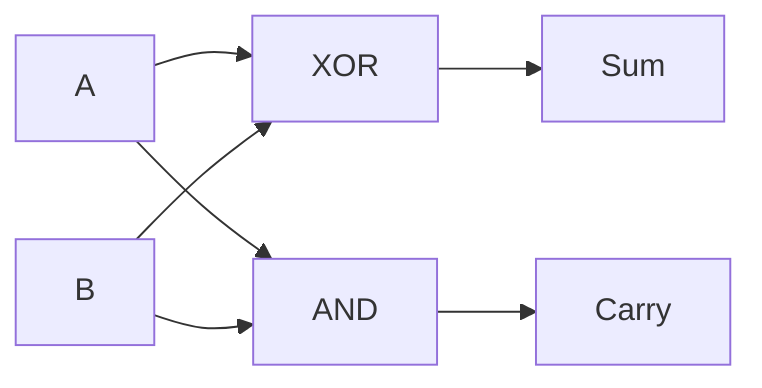
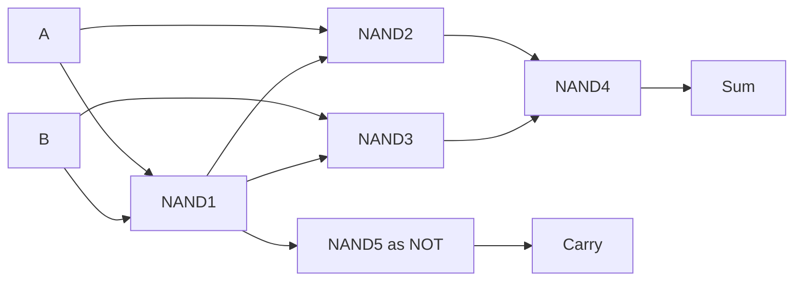

---
tags:
  - GATE/CS
  - GATE/DigitalLogic
  - CombinationalCircuits
  - Arithmetic
aliases:
  - HA
  - Half-Adder
date_created: 2026-10-15
difficulty: ⭐⭐
last_revised: 2026-10-15
pyq_frequency: Medium
---

## Syllabus Position

Subject: [[Digital Logic]]
Parent Topic: [[Combinational Circuit]]
Sibling Topics: [[Full Adder]], [[Half Subtractor]], [[Magnitude Comparator]], [[Multiplexer]]
Leads To: [[Full Adder]], [[Ripple Carry Adder]], [[Carry Lookahead Adder]]

GATE Syllabus Line: "Combinational and sequential circuits" (Digital Logic).

Exam Weight Note: Appears as 1-mark MCQ on gate counts, NAND/NOR-only implementation, or building a full adder from half adders.

![[Screenshot 2026-10-15 at 2.55.38 PM.png]]

## The Problem This Solves

Computers must add numbers. Adding two single bits gives four cases: $0+0=0$, $0+1=1$, $1+0=1$, and $1+1=10_2$. The last case produces a result that does not fit in one bit, so we need two outputs: a digit (sum) and an overflow into the next column (carry).

Analogy: adding two single decimal digits like 7 + 5. You write 2 in the column and carry 1 to the next. A half adder does this for one binary column, but it has no input slot for a carry arriving from the previous column. That is why it is "half".

Core Idea (one sentence): A half adder adds two bits, producing $S = A \oplus B$ and $C = A \cdot B$.

## Formal Theory

A **half adder** is a [[Combinational Circuit]] with two inputs $A, B$ and two outputs, **Sum** $S$ and **Carry** $C$.

### Truth Table

| A | B | C (carry) | S (sum) |
|---|---|-----------|---------|
| 0 | 0 | 0 | 0 |
| 0 | 1 | 0 | 1 |
| 1 | 0 | 0 | 1 |
| 1 | 1 | 1 | 0 |

### Boolean Expressions

$$S = A\bar{B} + \bar{A}B = A \oplus B$$
$$C = A \cdot B$$

Justification: sum is 1 exactly when the inputs differ, which is the definition of [[XOR Gate]]. Carry is 1 only when both are 1, which is [[AND Gate]].

### Implementations

- **XOR + AND:** 1 XOR gate + 1 AND gate (minimum).
- **NAND only:** 5 NAND gates. Let $N_1 = \overline{AB}$, $N_2 = \overline{A N_1}$, $N_3 = \overline{B N_1}$, $S = \overline{N_2 N_3}$ (4 gates), and $C = \overline{N_1}$ needs a fifth NAND with both inputs tied (inverter). Note $N_1$ is shared.
- **NOR only:** 5 NOR gates.
- **Sum-of-products:** 2 AND + 1 OR + 2 NOT for S, plus 1 AND for C.

See [[Universal Gates]] and [[Functional Completeness]] for why NAND/NOR alone suffice.

### Half Adder as a Half Subtractor Cousin

The [[Half Subtractor]] has the same sum/difference $D = A \oplus B$ but borrow $Bo = \bar{A}B$. Only the carry/borrow differs.

### What GATE actually tests here

Gate counts for universal-gate implementations, expression for carry/sum, building a [[Full Adder]] from two half adders plus an OR, and the fact that a half adder cannot chain (no carry-in).

## Diagrams and Visuals

Draw: inputs A and B fan out to an XOR gate (top, output S) and an AND gate (bottom, output C).

```
A ──┬──────┐
    │     ┌┴────┐
    │     │ XOR ├──── S
B ──┼──┬──┤     │
    │  │  └─────┘
    │  │  ┌─────┐
    └──┼──┤ AND ├──── C
       └──┤     │
          └─────┘
```



NAND-only form:



## Complexity Analysis

Circuit analysis replaces time complexity.

- **Gate count:** 2 (XOR + AND).
- **Propagation delay:** one gate delay, $t_{XOR}$ for S and $t_{AND}$ for C; critical path is the slower of the two.
- **NAND-only:** 5 gates, with depth 3 for S and 2 for C.
- **Input count:** fan-in 2; each input has fan-out 2.

| Metric | XOR+AND | NAND only | NOR only |
|---|---|---|---|
| Gates | 2 | 5 | 5 |
| Depth (S) | 1 | 3 | 3 |
| Depth (C) | 1 | 2 | 3 |

## Worked Example

Add $A=1$, $B=1$.
1. $S = 1 \oplus 1 = 0$.
2. $C = 1 \cdot 1 = 1$.
3. Output $(C S) = 10_2 = 2$. Correct.

NAND trace with $A=B=1$: $N_1 = \overline{1}=0$; $N_2=\overline{1\cdot0}=1$; $N_3=1$; $S=\overline{1\cdot1}=0$; $C=\overline{N_1}=1$. Total 5 gate evaluations, matches.

Edge case: What changes if $A=0,B=0$? $N_1=1$, $N_2=\overline{0}=1$, $N_3=1$, $S=0$, $C=\overline{1}=0$. Output is 00, as expected.

## Intuition Anchors

**The Analogy:** the single-column addition. The sum digit is the "written" digit and the carry is the "borrowed forward" digit. The half adder lacks a slot for an incoming carry, so it only works for the rightmost column (LSB).

**The Mental Model:** "XOR is the odd detector, AND is the both detector." Sum says exactly one is on; carry says both are on.

**The One-Line Recall:** $S = A\oplus B$, $C = AB$; 1 XOR + 1 AND; 5 NAND gates.

**The #1 Trap:** Students assume a half adder can be used at every bit position of a multi-bit adder. It cannot, because bits beyond the LSB receive a carry-in, which needs three inputs. Use a [[Full Adder]] there. Only the LSB can use a half adder.

## GATE Questions

**Question 1 — GATE-style — 1-mark**

> The minimum number of 2-input NAND gates required to implement a half adder is
- (A) 3
- (B) 4
- (C) 5
- (D) 6

<details>
<summary>Solution</summary>

**Answer: (C)**

**Reasoning:** $N_1=\overline{AB}$, $N_2=\overline{AN_1}$, $N_3=\overline{BN_1}$, $S=\overline{N_2N_3}$ is the 4-NAND XOR. Carry $=\overline{N_1}$ needs one more NAND as an inverter. Total 5. (A), (B) omit the carry; (D) is not minimal.

**What this tests:** knowing the shared-term XOR from NAND gates.

**Trap to avoid:** counting only 4 for the XOR and forgetting carry.

</details>

---

**Question 2 — Conceptual — 1-mark**

> A half adder's carry output equals the output of which gate, and when is its sum output 1?

<details>
<summary>Solution</summary>

Carry is an AND of A and B. Sum is 1 when exactly one input is 1 (XOR).

</details>

---

**Question 3 — Multi-concept — 2-mark**

> A full adder is built from two half adders and one gate. Which gate, and why? If each half adder has gate delay $t$ per gate, what is the worst-case delay to the carry-out?

<details>
<summary>Solution</summary>

Half adder 1 adds $A,B$: $S_1=A\oplus B$, $C_1=AB$. Half adder 2 adds $S_1$ and $C_{in}$: $S=S_1\oplus C_{in}$, $C_2=S_1C_{in}$. Then $C_{out}=C_1+C_2$, using an **OR** gate, because at most one of $C_1$, $C_2$ can be 1 (if $A=B=1$ then $S_1=0$, so $C_2=0$).

Delay: $S_1$ is 1 gate (XOR), $C_2$ is the 2nd (AND), OR is the 3rd, so $3t$ for carry-out.

**Trap:** using XOR for the carry-merge also works logically, but OR is the standard answer.

</details>

**Pattern Recognition:**
- Gate-count questions: remember the 5-NAND/5-NOR figure.
- Full adder from half adders: 2 HA + 1 OR.
- Half adder vs half subtractor: only the carry/borrow differs ($AB$ vs $\bar{A}B$).

## Edge Cases and Failure Modes

- [ ] Both inputs 0: S=0, C=0; no carry.
- [ ] Both inputs 1: S=0, C=1, the only case with carry; students misread S as 1.
- [ ] No carry-in: cascading halves at higher bits gives wrong results; use [[Full Adder]].
- [ ] NAND implementation: forgetting the carry inverter yields 4 gates.
- [ ] Glitches: XOR and AND paths have unequal delays, so outputs may briefly show spurious values.

## Comparisons

| Feature | [[Half Adder]] | [[Full Adder]] | [[Half Subtractor]] |
|---|---|---|---|
| Inputs | 2 | 3 | 2 |
| Outputs | S, C | S, Cout | D, Borrow |
| Sum | $A\oplus B$ | $A\oplus B\oplus C_{in}$ | $A\oplus B$ |
| Carry/Borrow | $AB$ | $AB + C_{in}(A\oplus B)$ | $\bar{A}B$ |
| Gates (XOR/AND form) | 2 | 5 | 3 |
| GATE Trap | no carry-in | 2 HA + OR | borrow uses $\bar{A}$ |

The most common GATE question compares these via gate counts or asks how to build a full adder from half adders, and the answer hinges on the presence of the carry-in.

## Connections Web

**Must know before this topic:**
- [[Boolean Algebra]] — to derive expressions
- [[XOR Gate]] — sum function
- [[Universal Gates]] — NAND/NOR realizations
- [[Binary Number System]] — binary addition

**Topics that build on this:**
- [[Full Adder]]
- [[Ripple Carry Adder]]
- [[Carry Lookahead Adder]]
- [[ALU Design]]

**GATE subject cross-links:**
- [[Digital Logic]] > [[Combinational Circuit]]

**Cross-subject connections:**
- [[Computer Architecture and Organisation]] — ALU adders are built from these cells.

**Standard references:**
- [[Morris Mano Chapter 4]]

## Quick Revision Sheet

**Definition:** A 2-input, 2-output circuit adding two bits.

**Core Idea:** Column addition without carry-in.

**Steps:**
1. $S=A\oplus B$.
2. $C=A\cdot B$.

**Complexity:** 2 gates (XOR + AND); 5 NAND; 5 NOR; 1 gate delay.

**Key Properties:**
- Only 1 of 4 input combos gives a carry (11).
- No carry-in, so used only for LSB.
- 2 HA + OR = Full Adder.
- Same sum as half subtractor.

**The #1 Trap:** using a half adder at non-LSB positions.

**When to use:** the LSB of an adder or inside a full adder.

**Mnemonic:** "XOR sums, AND carries."

## Revision Checklist

- [ ] I can state the formal definition without looking.
- [ ] I can explain the column-addition analogy.
- [ ] I can draw the NAND-only version.
- [ ] I can derive $S$ and $C$ from the truth table.
- [ ] I know the Quick Revision Sheet by heart.
- [ ] I can solve all 3 GATE questions without peeking.
- [ ] I know the #1 trap.
- [ ] I have linked this note in my Obsidian vault.
- [ ] I have scheduled a spaced-repetition review in 3 days.
