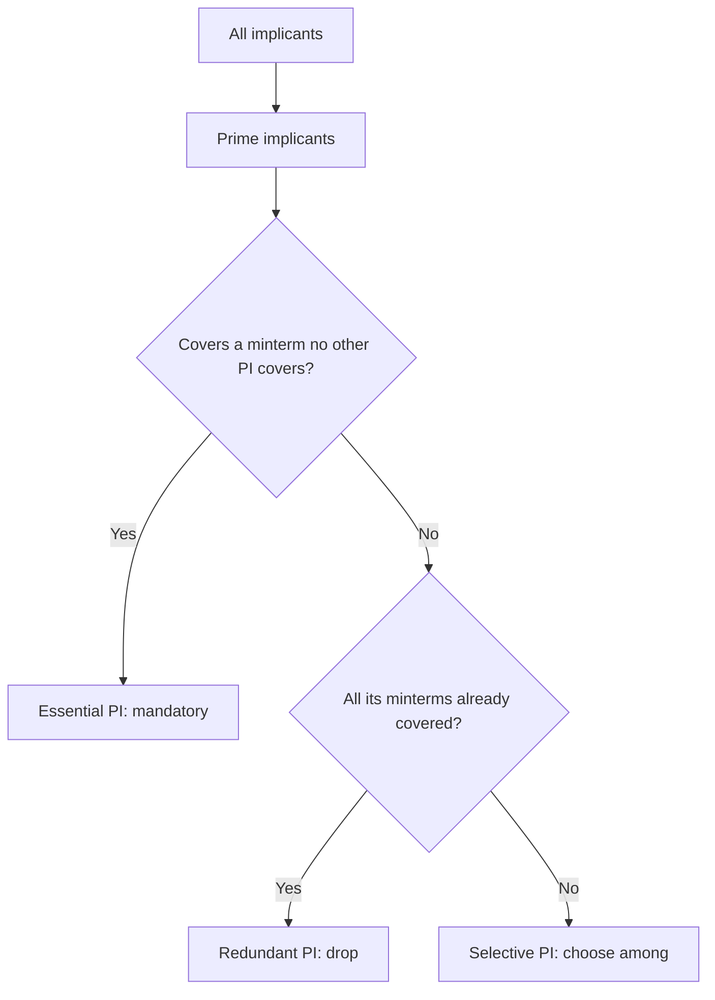

---
tags:
  - GATE/CS
  - GATE/DigitalLogic
  - Minimization
aliases:
  - Implicant
  - Prime Implicant
  - Essential Prime Implicant
  - Redundant Prime Implicant
  - Selective Prime Implicant
  - PI and EPI
date_created: 2026-10-12
difficulty: 3
last_revised: 2026-10-12
pyq_frequency: High
---

## Syllabus Position

Subject: [[Digital Logic]]
Parent Topic: [[K-Map Minimization]]
Sibling Topics: [[Canonical and Standard Forms]], [[Boolean Algebra]], [[Quine-McCluskey Method]]
Leads To: [[Hazards in Combinational Circuits]], [[Minimal SOP and POS]], [[Logic Gate Implementation]]

GATE Syllabus Line: "Digital Logic: Boolean algebra. Combinational and sequential circuits. Minimization."

Exam Weight Note: Appears as 1-mark or 2-mark NAT/MCQ: "How many prime implicants / essential prime implicants does $f(A,B,C,D)=\sum m(\dots)$ have?" Also used in hazard-cover questions.

---

## The Problem This Solves

A Boolean function written as a sum of minterms is wasteful: every minterm is a full AND gate with all variables. We want fewer gates and fewer inputs. Adjacent minterms differ in one variable, so they can merge and drop that variable. The question is: which merged groups exist, which are the biggest, and which are mandatory to include in the final circuit? Implicants, prime implicants and essential prime implicants give precise names to those groups.

Analogy: You must cover all the "1" squares on a floor with rectangular rugs. Any rug that lies fully on 1-squares is an **implicant**. A rug that cannot be enlarged without covering a 0 is a **prime implicant**. A rug that is the only one covering some square is **essential** (you must buy it). Rugs that are never needed are **redundant**. Rugs that are interchangeable choices are **selective**.

Core Idea (one sentence): Group 1s into maximal power-of-2 blocks (PIs), take the mandatory ones (EPIs), then pick the fewest remaining PIs to cover what is left.

---

## Formal Theory

### Implicant
A product term $P$ is an **implicant** of $f$ if $P=1 \Rightarrow f=1$ (i.e. $P \le f$). On a K-map: any group of $2^k$ adjacent 1s (or 1s plus don't-cares) forming a rectangle. Every minterm is an implicant; a group of size $2^k$ in $n$ variables gives a term with $n-k$ literals.

### Prime Implicant (PI)
An implicant $P$ is a **prime implicant** if removing any literal from $P$ gives a term that is no longer an implicant. On a K-map: a group that is **not contained in any larger valid group**.

$$\text{Literals in a PI} = n - \log_2(\text{group size})$$

### Essential Prime Implicant (EPI)
A PI is **essential** if it covers at least one minterm (1, not don't-care) that **no other PI** covers. Every EPI must appear in every minimal SOP.

### Selective Prime Implicant
A PI that is **neither essential nor redundant**; it is one of several alternatives that can cover the minterms left after EPIs are chosen. Also called **non-essential** or **optional**. Choosing among selective PIs may give multiple minimal solutions.

### Redundant (Reduce) Prime Implicant
A PI whose every 1-minterm is already covered by EPIs (or by other chosen PIs). It is **never needed** in any minimal cover. Also called "redundant PI".

Terminology note: "reduce prime implicant" in some notes means *redundant* PI. Do not confuse with "reduced" expressions.

### Hierarchy
$$\text{Implicants} \supset \text{PIs} \supset \{\text{EPIs}, \text{Selective PIs}, \text{Redundant PIs}\}$$

### Procedure to get minimal SOP
```
Algorithm MinimalSOP(f):
    1. List all PIs (maximal groups, don't-cares allowed in groups)
    2. Mark EPIs: PIs covering a minterm covered by only one PI
    3. Cover all minterms covered by EPIs; remove them from consideration
    4. Among remaining uncovered 1s, pick the fewest selective PIs
       (prefer larger groups / fewer literals) to cover them
    5. Ignore redundant PIs
    6. return OR of EPIs and chosen selective PIs
```

What GATE actually tests here: counting PIs, EPIs, selective/redundant PIs from a minterm list; remember that don't-cares help form PIs but a PI is essential only through a real 1; a PI made only of don't-cares is not required.

---

## Diagrams and Visuals

Draw a 4x4 K-map with Gray-code axes $AB$ (rows) and $CD$ (columns). Example: $f=\sum m(0,1,2,5,6,7)$ over 3 variables $A,B,C$:

```
        BC
      00  01  11  10
A=0 |  1   1   0   1 |   m0 m1 m3 m2
A=1 |  0   1   1   1 |   m4 m5 m7 m6
```
Row A=0: m0=1, m1=1, m3=0, m2=1. Row A=1: m4=0, m5=1, m7=1, m6=1.

PIs (size-2 groups): 
- $P_1=\{m0,m1\}=A'B'$
- $P_2=\{m0,m2\}=A'C'$
- $P_3=\{m1,m5\}=B'C$
- $P_4=\{m2,m6\}=BC'$
- $P_5=\{m5,m7\}=AC$
- $P_6=\{m6,m7\}=AB$

No EPI exists (every minterm is covered by two PIs): a **cyclic** structure, so all six PIs are selective. Two minimal covers: $\{P_1,P_4,P_5\}$ and $\{P_2,P_3,P_6\}$.



---

## Complexity Analysis

Adapted for minimization:
- Number of minterms $\le 2^n$. Maximum possible PIs for $n$ variables is $O(3^n/n)$ (each variable is $0$, $1$ or $-$, so at most $3^n$ cubes; the true bound is $3^n/n$).
- Finding all PIs via [[Quine-McCluskey Method]]: comparing pairs of terms is $O(4^n)$ in the worst case, exponential in $n$.
- Choosing a minimal cover from selective PIs is the **set cover** problem, which is NP-hard in general. EPIs remove the easy part first.

| Case | Cost | Notes |
|------|------|-------|
| Only EPIs needed | Polynomial after PI listing | Every minterm covered by EPIs |
| Cyclic cover | NP-hard set cover | No EPI, all PIs selective |
| Max PIs | $\approx 3^n/n$ | Checkerboard-free worst cases |

---

## Worked Example

$f(A,B,C,D)=\sum m(0,1,2,5,6,7,8,9,10,14)$.

K-map (rows $AB$, columns $CD$ in order 00,01,11,10):

```
        CD
       00  01  11  10
AB=00 | 1   1   0   1 |   m0  m1  m3  m2
AB=01 | 0   1   1   1 |   m4  m5  m7  m6
AB=11 | 0   0   0   1 |   m12 m13 m15 m14
AB=10 | 1   1   0   1 |   m8  m9  m11 m10
```

Step 1: List all PIs (maximal groups):
- $\{0,1,8,9\}=B'C'$ (quad)
- $\{0,2,8,10\}=B'D'$ (quad)
- $\{2,6,10,14\}=CD'$ (quad)
- $\{1,5\}=A'C'D$ (pair; the larger group of 1 and 9 is already in the quad, 1-5 is maximal)
- $\{5,7\}=A'BD$
- $\{6,7\}=A'BC$

Step 2: Find EPIs by checking each minterm's coverage:
- m0: $B'C'$, $B'D'$ (2 PIs) 
- m1: $B'C'$, $A'C'D$ 
- m2: $B'D'$, $CD'$
- m5: $A'C'D$, $A'BD$
- m6: $CD'$, $A'BC$
- m7: $A'BD$, $A'BC$
- m8, m9: only $B'C'$ for m9 (m9 in $\{0,1,8,9\}$ only). So $B'C'$ is **essential** (m9).
- m10: $B'D'$, $CD'$ 
- m14: only $CD'$. So $CD'$ is **essential** (m14).

EPIs: $B'C'$, $CD'$.

Step 3: Covered by EPIs: 0,1,8,9 and 2,6,10,14. Remaining: 5, 7.

Step 4: Remaining PIs: $A'C'D$ covers 5 (1 already covered), $A'BD$ covers 5,7, $A'BC$ covers 7 (6 already covered). Best single choice: $A'BD$ covers both 5 and 7.

Step 5: $B'D'$ covers {0,2,8,10}, all already covered by EPIs, so it is **redundant**. $A'C'D$ and $A'BC$ are selective (each covers only one leftover), but they are not needed since $A'BD$ covers both. Strictly, with the leftover set {5,7}: $A'BD$ covers both; the pair $A'C'D + A'BC$ would also cover both but uses more terms, so minimal is $A'BD$.

Minimal SOP: $f = B'C' + CD' + A'BD$.

Total: 6 PIs, 2 EPIs, 1 redundant ($B'D'$), selective: $A'BD$, $A'C'D$, $A'BC$.

What changes if m3 were a don't-care? Then $\{1,3\}$, $\{2,3\}$, etc. become possible groups, creating new PIs; EPIs must be re-derived, and a PI covering only don't-cares is never essential.

---

## Intuition Anchors

**The Analogy (deepened):** Rugs: bigger rugs mean fewer rugs and fewer stitches (literals). EPI = a floor tile only one rug can cover, so you must buy that rug. Redundant = a rug whose tiles are all covered by must-buy rugs. Selective = a pile of leftover rugs where you only need enough to finish the job. Cyclic = every tile has two candidate rugs, so you must choose a consistent set.

**The Mental Model:** Scan each 1 and ask: "How many maximal groups include me?" If exactly one, that group is essential. Mark and cross off everything it covers. Look at what remains.

**The One-Line Recall:** Minimal SOP = all EPIs + fewest selective PIs covering the rest; PI literal count $=n-\log_2(\text{size})$.

**The #1 Trap:** Students call any large group essential or count a group of size 4 as prime even if it sits inside a size-8 group. Wrong: a PI must be maximal. Another trap: marking a PI essential because it covers a don't-care alone. Essential requires a **1** covered only by it.

---

## GATE Questions

**Question 1 — GATE-style — 2-mark**

> $f(A,B,C)=\sum m(0,1,2,5,6,7)$. How many prime implicants and how many essential prime implicants does it have?

- (A) 6 PIs, 0 EPIs
- (B) 6 PIs, 2 EPIs
- (C) 3 PIs, 3 EPIs
- (D) 4 PIs, 0 EPIs

<details>
<summary>Solution</summary>

**Answer: (A)**

**Reasoning:** The K-map (see Diagrams) has six pairs as maximal groups and no quad (no 4-group of 1s is available). Every minterm lies in exactly two PIs, so none is essential. (B) is wrong as no minterm is uniquely covered. (C), (D) miscount the pairs.

**What this question is really testing:** Cyclic K-maps with no EPIs.

**Trap to avoid:** Assuming every function has at least one EPI.

</details>

---

**Question 2 — Numerical — 1-mark**

> A 4-variable K-map has a PI that covers 4 cells. How many literals does its product term have?

<details>
<summary>Solution</summary>

$n-\log_2 4 = 4-2 = 2$ literals. Each doubling of group size removes one variable.

</details>

---

**Question 3 — Hard / Multi-concept — 2-mark**

> For $f=\sum m(1,3,5,7,9) + d(11,13)$ over $A,B,C,D$, find the number of EPIs of the minimal SOP.

<details>
<summary>Solution</summary>

Map (rows AB, cols CD in 00,01,11,10): the 1s and don't-cares sit in column $D=1$: m1, m3, m5, m7 (rows 00,01), m9 (1), m11 (d), m13 (d), m15 = 0.

Use don't-cares: 1,3,9,11 → $B'D$; 1,5,9,13 → $C'D$; 1,3,5,7 → $A'D$. PIs (maximal): $B'D$, $C'D$, $A'D$.
- m7 only in $A'D$ ($B'D$ doesn't include 7; $C'D$ doesn't). So $A'D$ is essential.
- m9 is in $B'D$ and $C'D$ (both), m9's only coverage: $B'D$ and $C'D$: not unique.
- Remaining after $A'D$: m9. Selective: $B'D$ or $C'D$.

EPIs: **1** ($A'D$). Minimal SOP: $A'D + B'D$ (or $+C'D$), with two minimal answers.

**Trap:** Treating don't-cares as needing cover.

</details>

**Pattern Recognition:**
- Count PIs by finding maximal groups; EPIs by unique minterm coverage.
- "Number of minimal SOPs" often = number of choices among selective PIs.
- Don't-cares enlarge PIs but never create essentiality.

---

## Edge Cases and Failure Modes

- [ ] $f=0$ has no implicants (and no PIs); $f=1$ has a single PI "1" (zero literals).
- [ ] All 1s: the whole map is one PI and one EPI.
- [ ] Single isolated 1: the minterm itself is a PI and an EPI (full literal count).
- [ ] Wrap-around groups (edges and corners) are adjacent. Missing them undercounts PIs.
- [ ] Overlapping groups are allowed; groups of size 3, 5, 6 are illegal (must be $2^k$).
- [ ] Don't-cares: use them to enlarge groups, but do not need to cover them.
- [ ] Cyclic maps: no EPI; several minimal solutions exist.
- [ ] Hazards: the minimal SOP may lack a redundant PI that is needed to remove a static-1 hazard (see [[Hazards in Combinational Circuits]]).

---

## Comparisons

| Feature | [[Implicants and Prime Implicants]] (PI) | Essential PI | Selective PI | Redundant PI |
|---------|------|------|------|------|
| Maximal group? | Yes | Yes | Yes | Yes |
| Unique minterm? | Not required | Yes | No | No |
| In every minimal SOP? | Not always | Always | Sometimes | Never |
| Covers leftover after EPIs? | - | - | Yes (partly) | Nothing new |
| GATE trap | Non-maximal group | Don't-care-only | Count of solutions | Needed for hazards |

The most common GATE question compares counts of PIs vs EPIs, and the answer hinges on whether a minterm is covered by exactly one PI.

---

## Connections Web

**Must know before this topic:**
- [[Boolean Algebra]] — adjacency rule $AB + AB' = A$
- [[Canonical and Standard Forms]] — minterms and SOP
- [[Gray Code]] — K-map axis ordering

**Topics that build on this:**
- [[Quine-McCluskey Method]] — tabular PI generation and Petrick's method
- [[Hazards in Combinational Circuits]] — redundant PIs removing glitches
- [[Minimal SOP and POS]]

**GATE subject cross-links:**
- [[Digital Logic]] > [[K-Map Minimization]]

**Cross-subject connections:**
- [[Computer Organization and Architecture]] — minimized logic in ALU and control units
- [[Set Cover Problem]] — covering step is set cover (Algorithms/NP-hardness)

**Standard references:**
- [[Morris Mano Digital Design Chapter 3]]

---

## Quick Revision Sheet

**Definition (1 sentence):** A prime implicant is a maximal product term (K-map group of $2^k$ ones) that implies $f$; an essential PI uniquely covers some 1.

**Core Idea / Analogy:** Maximal rugs on a floor of 1s; must-buy rugs are essential.

**Steps:**
1. Mark all maximal groups (PIs), using don't-cares and wrap-around.
2. Find minterms covered by one PI, mark that PI essential.
3. Cover everything the EPIs cover.
4. Pick fewest selective PIs for leftovers.
5. Discard redundant PIs.
6. OR them.

**Complexity:**
- Finding PIs: exponential ($\le 3^n/n$ PIs).
- Cover selection: NP-hard (set cover).

**Key Properties:**
- Literals $=n-\log_2(\text{size})$.
- EPIs are in every minimal SOP.
- Redundant PIs are in no minimal SOP (but may be needed for hazard-free).
- No EPI possible (cyclic map).
- Don't-cares never make a PI essential.

**The #1 Trap:** Non-maximal groups called prime, or don't-care-only essentiality.

**When to use over alternatives:** K-map for up to 4–5 variables; [[Quine-McCluskey Method]] beyond.

**Mnemonic:** "Prime = Maximal; Essential = Exclusive minterm; Selective = Select one; Redundant = Repeated coverage."

---

## Revision Checklist

- [ ] I can state the formal definition without looking.
- [ ] I can explain the rug analogy and map it to PI/EPI/selective/redundant.
- [ ] I can find all PIs of a 4-variable map in under 2 minutes.
- [ ] I can derive literals $=n-\log_2(\text{size})$.
- [ ] I know the Quick Revision Sheet without reading it.
- [ ] I can solve all 3 GATE questions without peeking.
- [ ] I know the #1 trap.
- [ ] I have linked this note in my Obsidian vault.
- [ ] I have scheduled a spaced-repetition review in 3 days.
