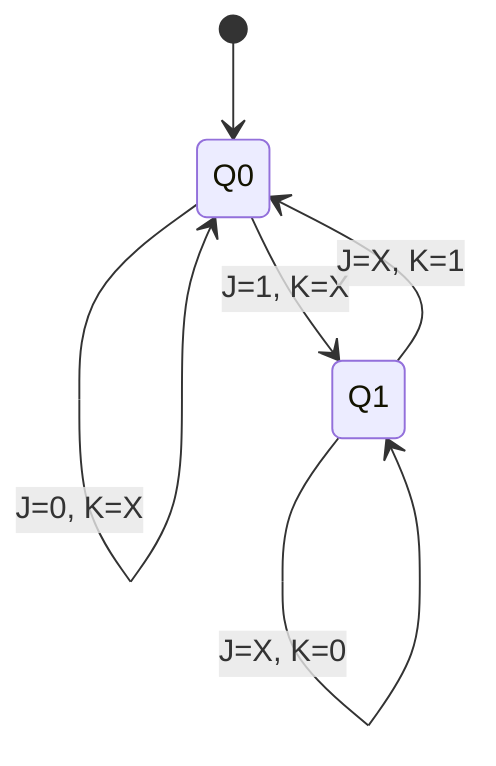
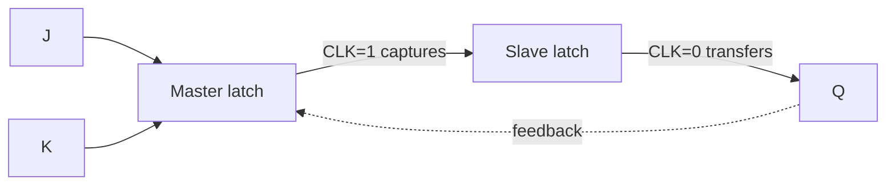

---
tags:
  - GATE/CS
  - GATE/DigitalLogic
  - SequentialCircuits
aliases:
  - JK FF
  - Jack Kilby Flip Flop
  - JK Latch
date_created: 2026-10-17
difficulty: ⭐⭐⭐
last_revised: 2026-10-17
pyq_frequency: High
---

## Syllabus Position

Subject: [[Digital Logic Index]]
Parent Topic: [[Flip Flops]]
Sibling Topics: [[SR Flip Flop]], [[D Flip Flop]], [[T Flip Flop]]
Leads To: [[Master Slave Flip Flop]], [[Counters]], [[Registers]], [[Sequential Circuit Design]]

GATE Syllabus Line: "Digital Logic: Boolean algebra. Combinational and sequential circuits. Minimization. Number representations and computer arithmetic (fixed and floating point)."

Exam Weight Note: Appears as 1-mark MCQ on characteristic equations and conversions (JK to T/D), and as 2-mark MCQ/NAT on counter design, excitation tables and race-around timing.

## The Problem This Solves

An [[SR Flip Flop]] stores one bit, but it has a fatal flaw: when both inputs S and R are 1, the output is undefined. A designer wants a memory cell that never lands in a forbidden state, so every input combination does something useful. Such a cell makes counters and state machines easy to build, because any desired state change can be requested with simple inputs.

Analogy: think of a light switch with two buttons, "turn on" (J) and "turn off" (K). Pressing neither leaves the light alone. Pressing both at once does not break the switch; it simply flips the light to the opposite state. The SR flip flop had no rule for pressing both; the JK adds exactly that rule: toggle.

Core Idea (one sentence): A JK flip flop is an SR flip flop whose outputs are fed back to the inputs so that J=K=1 toggles the state instead of being invalid.

## Formal Theory

A **JK flip flop** is a clocked, one-bit [[Sequential Circuit]] with inputs $J$, $K$, clock $CLK$ and outputs $Q$, $\bar{Q}$. J acts like Set, K like Reset; the next state $Q^+$ depends on $J$, $K$ and the present state $Q$.

### Construction from SR

Feed $\bar{Q}$ back to $S$ and $Q$ back to $R$ through AND gates with the clock:

$$S = J\bar{Q}, \qquad R = KQ$$

Substituting into the [[SR Flip Flop]] equation $Q^+ = S + \bar{R}Q$:

$$Q^+ = J\bar{Q} + \overline{KQ}\,Q = J\bar{Q} + (\bar{K}+\bar{Q})Q = J\bar{Q} + \bar{K}Q$$

This is the **characteristic equation**: $Q^+ = J\bar{Q} + \bar{K}Q$. Because $S\cdot R = J\bar{Q}KQ = 0$ always, the forbidden SR input never occurs.

### Truth Table

| J | K | $Q^+$ | Operation |
|---|---|-------|-----------|
| 0 | 0 | $Q$ | Hold (no change) |
| 0 | 1 | 0 | Reset |
| 1 | 0 | 1 | Set |
| 1 | 1 | $\bar{Q}$ | Toggle |

### Characteristic Table (Q, J, K to $Q^+$)

| Q | J | K | $Q^+$ |
|---|---|---|-------|
| 0 | 0 | 0 | 0 |
| 0 | 0 | 1 | 0 |
| 0 | 1 | 0 | 1 |
| 0 | 1 | 1 | 1 |
| 1 | 0 | 0 | 1 |
| 1 | 0 | 1 | 0 |
| 1 | 1 | 0 | 1 |
| 1 | 1 | 1 | 0 |

### Excitation Table (what J, K produce a required transition)

| $Q$ | $Q^+$ | J | K |
|-----|-------|---|---|
| 0 | 0 | 0 | X |
| 0 | 1 | 1 | X |
| 1 | 0 | X | 1 |
| 1 | 1 | X | 0 |

Justification: to go $0\to1$ you may Set (J=1,K=0) or Toggle (J=1,K=1), so K is don't-care; the other rows follow identically. The don't-cares make [[K-Map Minimization]] of counter logic cheaper.

### Race-Around Condition

With a **level-triggered** clock and J=K=1, the output toggles. If the clock pulse width $t_p$ exceeds the propagation delay $\Delta t$ of the gates, the new output feeds back and toggles again, and again, during the same pulse. The final state is uncertain. This is the **race-around condition**.

Condition for it to occur:

$$J=K=1 \quad\text{and}\quad t_p > \Delta t$$

Fixes:
1. Make $t_p < \Delta t < T_{clk}$ (impractical to control precisely).
2. Use **edge triggering** so the flip flop samples inputs only at one clock edge; see [[Edge Triggered Flip Flop]].
3. Use a [[Master Slave Flip Flop]]: master captures while CLK=1, slave updates while CLK=0, so the feedback never reaches inputs during the same level.

### What GATE actually tests here

Characteristic equation, conversions (JK to T, D, SR), excitation table use in counter design, the cause and cure of race-around, and the toggle behaviour used in ripple counters (J=K=1 gives divide-by-2).

## Diagrams and Visuals

Drawing instructions: draw a rectangle labelled JK FF with J and K on the left, a triangle clock input at the bottom, and Q, Q' on the right. Draw feedback wires from Q to the K-AND gate and from Q' to the J-AND gate.

```
        +-----------+
   J ---|           |--- Q
        |    JK     |
 CLK ---|>   FF     |
        |           |
   K ---|           |--- Q'
        +-----------+
```

Labels: J = set input, K = reset input, ">" = edge-trigger indicator, Q/Q' = complementary outputs.

State diagram (each arrow is labelled J K):



Race-around timing (level-triggered, J=K=1):

```
CLK : __|-----------------|__
Q   : __|--|__|--|__|--|__  (toggles every delay, repeatedly while CLK=1)
```

Master-slave fix:



## Complexity Analysis

For circuits the relevant "complexity" is timing and gate count, not asymptotics.

- Gate count: a gated-SR core uses 4 NAND gates plus 2 for the latch, and the JK adds feedback wiring (about 6 NAND gates with 3-input NANDs). A master-slave JK needs about 2x that, since it has two latches.
- Propagation delay: output settles after $t_{pd}$ of one latch stage.
- Race-around avoided when $t_p < t_{pd}$ for level triggering; for master-slave, the design needs $T_{clk} \ge t_{pd} + t_{setup}$.
- Maximum clock frequency:

$$f_{max} = \frac{1}{t_{pd} + t_{setup}}$$

- Number of toggles during a race: roughly $\lfloor t_p / t_{pd} \rfloor$, since one toggle occurs per propagation delay.

| Case | Time | Space | Trigger Condition |
|------|------|-------|-------------------|
| Best Case | one toggle per clock | 1 bit | Edge triggered or master-slave |
| Average Case | $\approx t_p/t_{pd}$ toggles | 1 bit | Level-triggered, J=K=1 |
| Worst Case | unpredictable final state | 1 bit | $t_p \gg t_{pd}$, J=K=1 |

## Worked Example

Problem: A JK flip flop (negative-edge triggered), initial $Q=0$. Inputs at successive falling edges: (J,K) = (1,0), (1,1), (0,0), (1,1), (0,1), (1,1), (1,0).

Using $Q^+ = J\bar{Q} + \bar{K}Q$:

| Edge | J | K | Q before | Calculation | Q after |
|------|---|---|----------|-------------|---------|
| 1 | 1 | 0 | 0 | $1\cdot1 + 1\cdot0 = 1$ | 1 |
| 2 | 1 | 1 | 1 | $1\cdot0 + 0\cdot1 = 0$ | 0 |
| 3 | 0 | 0 | 0 | $0 + 1\cdot0 = 0$ | 0 |
| 4 | 1 | 1 | 0 | $1\cdot1 + 0 = 1$ | 1 |
| 5 | 0 | 1 | 1 | $0 + 0\cdot1 = 0$ | 0 |
| 6 | 1 | 1 | 0 | $1\cdot1+0 = 1$ | 1 |
| 7 | 1 | 0 | 1 | $1\cdot0 + 1\cdot1 = 1$ | 1 |

Final Q = 1 after 7 edges. Total operations: 7 equation evaluations, one per clock edge. This confirms the $O(1)$-per-clock behaviour because each edge produces exactly one state update, independent of history.

Edge case follow-up: What changes if the clock were level-triggered with J=K=1 at edges 2, 4, 6? The output would oscillate within the pulse (race-around), so the final value would be unpredictable rather than a clean toggle.

## Intuition Anchors

**The Analogy (restated and deepened):** The two-button light switch. Hold: press nothing. Set/Reset: press one button. Toggle: press both. Race-around is like holding both buttons down for a long time: the light keeps flipping because each flip is noticed instantly and acted upon again. Master-slave is a two-door airlock: the first door (master) opens while the second (slave) is shut, so the signal can never run straight through.

**The Mental Model:** Picture $Q$ and $\bar{Q}$ as a see-saw. J pushes it to the Q side, K pushes it to the Q' side, both pushes flip it from wherever it is. Experts simply memorise four rows: 00 hold, 01 reset, 10 set, 11 toggle.

**The One-Line Recall:** $Q^+ = J\bar{Q} + \bar{K}Q$; 00 hold, 01 reset, 10 set, 11 toggle; excitation: 0to0 = 0X, 0to1 = 1X, 1to0 = X1, 1to1 = X0.

**The #1 Trap:** Students assume JK with J=K=1 always toggles once per clock. It seems right because the truth table says "toggle". But for a level-triggered JK with $t_p > t_{pd}$ it toggles repeatedly (race-around). Only edge-triggered or master-slave versions toggle exactly once per clock.

## GATE Questions

**Question 1 — [PYQ-style] — [1-mark]**

> A JK flip flop has J=K=1 and is clocked by a level-triggered clock whose pulse width is much greater than the propagation delay. The output will

- (A) Toggle once per clock pulse
- (B) Remain unchanged
- (C) Oscillate during the pulse, giving an uncertain final state
- (D) Be set to 1

<details>
<summary>Solution</summary>

**Answer: (C)**

**Reasoning:** With J=K=1, $Q^+ = \bar{Q}$. The new Q reaches the inputs after $t_{pd}$; because the pulse is still high, the flip flop toggles again. (A) is correct only for edge-triggered. (B) is hold, J=K=0. (D) is Set, J=1,K=0.

**What this question is really testing:** Race-around condition.

**Trap to avoid:** Choosing (A) because "toggle" is memorised.

</details>

---

**Question 2 — [Numerical] — [2-mark]**

> Convert a JK flip flop into a T flip flop and into a D flip flop. Give the J and K inputs.

<details>
<summary>Solution</summary>

**T:** $Q^+ = T\bar{Q} + \bar{T}Q$. Compare with $J\bar{Q} + \bar{K}Q$: $J = T$, $\bar{K} = \bar{T}$ so $K = T$. Tie $J=K=T$.

**D:** $Q^+ = D = D\bar{Q} + DQ$. So $J = D$, $\bar{K} = D$ giving $K=\bar{D}$. Connect $J=D$, $K=\bar{D}$.

Check D: D=1 gives J=1,K=0 (set); D=0 gives J=0,K=1 (reset). Correct. See [[T Flip Flop]] and [[D Flip Flop]].

</details>

---

**Question 3 — [Hard / Multi-concept] — [2-mark]**

> Three JK flip flops with J=K=1 are cascaded, each clocked by the Q output of the previous one (negative-edge triggered), the first by an input clock of 64 kHz. What is the output frequency of the last stage, and what is the modulus of this counter?

<details>
<summary>Solution</summary>

With J=K=1 each stage toggles on every falling edge of its clock, so it divides frequency by 2. After three stages: $64/2^3 = 8$ kHz. The counter counts $2^3 = 8$ states, so it is a MOD-8 ripple (asynchronous) [[Counters]]. Delay accumulates: total settle time $\approx 3\,t_{pd}$.

</details>

**Pattern Recognition:**
- If a question states J=K=1 plus "level triggered", think race-around.
- Conversion questions: equate to $J\bar{Q}+\bar{K}Q$.
- Counter-design questions: use the excitation table with don't-cares in a K-map.
- Cascaded toggling flip flops mean divide by $2^n$.

## Edge Cases and Failure Modes

- [ ] J=K=0: wrongly assumed to clear the output; actually holds. Fix: remember 00 is hold.
- [ ] J=K=1 with a wide level-triggered pulse: race-around. Fix: edge trigger or master-slave.
- [ ] Power-up state unknown: the flip flop starts at arbitrary Q. Fix: use asynchronous preset/clear.
- [ ] Setup/hold violation: J,K changing near the clock edge causes metastability. Fix: keep inputs stable for $t_{setup}$ and $t_{hold}$.
- [ ] Master-slave "1s catching": in the classic master-slave JK, a glitch on J or K while CLK=1 is latched by the master even if it disappears. Fix: use edge-triggered JK.
- [ ] Reading excitation X as 0: don't-care means either value works. Fix: exploit it in K-maps.

## Comparisons

| Feature | [[JK Flip Flop]] | [[SR Flip Flop]] | [[T Flip Flop]] |
|---------|------------------|------------------|-----------------|
| Inputs | J, K | S, R | T |
| Characteristic eq. | $J\bar{Q}+\bar{K}Q$ | $S+\bar{R}Q$ | $T\oplus Q$ |
| Invalid input | None | S=R=1 | None |
| Toggle | J=K=1 | Not possible | T=1 |
| Race-around | Yes (level-triggered) | No | Yes (if level-triggered) |
| GATE Trap | Race-around, excitation X | Forbidden state | T is JK with J=K |

The most common GATE question comparing these asks which flip flop has no invalid state or which one suffers race-around, and the answer hinges on the feedback that lets J=K=1 toggle. See also [[D Flip Flop]] and [[Latches]].

## Connections Web

**Must know before this topic:**
- [[Latches]] - the level-sensitive storage element underneath
- [[SR Flip Flop]] - JK fixes its invalid state
- [[Boolean Algebra]] - needed to derive the characteristic equation
- [[Flip Flops]] - general concept of edge-triggered storage

**Topics that build on this:**
- [[Master Slave Flip Flop]]
- [[Counters]]
- [[Registers]]
- [[Sequential Circuit Design]]

**GATE subject cross-links:**
- [[Digital Logic Index]] > [[Flip Flops]]
- [[K-Map Minimization]] - used for excitation logic

**Cross-subject connections:**
- [[Pipelining]] (COA) - pipeline registers are built from edge-triggered flip flops.
- [[Synchronization]] (OS) - hardware atomic ops depend on reliable state storage.

**Variants:**
- [[D Flip Flop]], [[T Flip Flop]]

**Standard references:**
- [[Morris Mano Digital Design Chapter 5]] / [[Kohavi Switching Theory]]

## Quick Revision Sheet

**Definition (1 sentence):** JK flip flop is a clocked bistable with $Q^+ = J\bar{Q}+\bar{K}Q$ and no invalid state.

**Core Idea / Analogy (1 sentence):** SR with feedback so both-pressed means toggle.

**Algorithm Steps:**
1. Read J, K at the active clock edge.
2. 00: Q stays.
3. 01: Q becomes 0.
4. 10: Q becomes 1.
5. 11: Q becomes $\bar{Q}$.

**Complexity:**
- Time: one state update per clock edge (best/average/worst); race-around if level triggered
- Space: 1 bit
- Recurrence: $Q_{n+1} = J\bar{Q_n} + \bar{K}Q_n$

**Key Properties:**
- Excitation: 0to0 = 0X, 0to1 = 1X, 1to0 = X1, 1to1 = X0.
- J=K gives T flip flop; $K=\bar{J}$ gives D flip flop.
- Race-around only for level triggering with J=K=1 and $t_p > t_{pd}$.
- Fixed by master-slave or edge triggering.
- Toggle mode divides frequency by 2.

**The #1 Trap:** J=K=1 does not guarantee a single toggle with level triggering.

**When to use this over alternatives:** Counters and general state machines where don't-cares reduce logic.

**Mnemonic:** "Hold, Reset, Set, Toggle" = 00, 01, 10, 11 (HRST).

## Revision Checklist

- [ ] I can state the formal definition without looking.
- [ ] I can explain the analogy and map it to the algorithm or concept.
- [ ] I can trace a 6-element example by hand in under 2 minutes.
- [ ] I can derive the worst-case complexity from scratch.
- [ ] I know what the Quick Revision Sheet says without reading it.
- [ ] I can solve all 3 GATE questions in this note without peeking.
- [ ] I know the #1 trap and can articulate why students fall for it.
- [ ] I have linked this note correctly in my Obsidian vault.
- [ ] I have scheduled a spaced-repetition review in 3 days.
