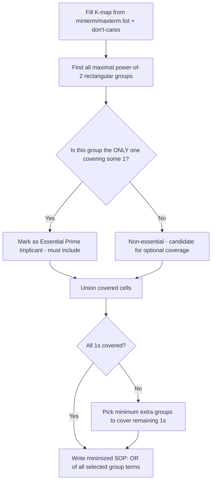

---
tags:
  - GATE/CS
  - GATE/DigitalLogic
  - Minimization
aliases:
  - Karnaugh Map
  - K-Map
  - Karnaugh Map Minimization
date_created: 2026-09-18
difficulty: ⭐⭐⭐⭐
last_revised: 2026-09-18
pyq_frequency: High
---

## Syllabus Position

Subject: [[Digital Logic Index]]
Parent Topic: [[Canonical and Standard Forms]]
Sibling Topics: [[Boolean Algebra]], [[Quine-McCluskey Method]], [[Functional Completeness]]
Leads To: [[Combinational Circuit Design]], [[Hazard-Free Circuit Design]], [[Multiplexer-Based Implementation]]

GATE Syllabus Line: "Digital Logic: Boolean algebra, Combinational and sequential circuits, Minimization." K-Map minimization is *the* headline technique for the "Minimization" clause of the syllabus and is tested nearly every year.

Exam Weight Note: Almost guaranteed 1–2 questions per paper — ranging from a direct 4-variable K-map simplification (1 or 2-mark MCQ/NAT) to don't-care-driven minimization or a hidden step inside a larger circuit-design question.

---

## The Problem This Solves

You've already seen in [[Boolean Algebra]] that algebraic simplification is a slow, pattern-spotting game that can easily miss a valid simplification if you don't happen to notice the right consensus or absorption term. For anything beyond 3–4 terms, this becomes unreliable — you need a method that **guarantees** you find the minimum-literal expression every single time, without relying on spotting clever algebraic tricks.

Think of a **K-map** as a seating chart designed so that any two people who differ by exactly one property (say, one variable's value) are *always* seated next to each other — even if that means wrapping around the edges of the room. Once you're sitting in this special arrangement, spotting "groups of similar people" (adjacent 1s) becomes a purely visual, mechanical task instead of an algebraic guessing game. This special adjacency (called a **Gray code** ordering) is the entire trick behind the K-map.

Core Idea (one sentence): A **Karnaugh map (K-map)** is a visual, grid-based restatement of a truth table where cells are arranged so that any two logically adjacent minterms (differing in exactly one variable) are also physically adjacent, letting you find the minimum SOP/POS expression by simply circling the largest possible groups of 1s (or 0s) in powers of two.

---

## Formal Theory

A K-map for $n$ variables is a $2^n$-cell grid where rows and columns are labeled using **Gray code** (each adjacent label differs in exactly one bit), not standard binary order — this single design choice is what guarantees adjacency in the grid matches adjacency (single-bit difference) in the truth table.

### Map Sizes and Layouts

- **2 variables:** $2\times2$ grid, 4 cells.
- **3 variables:** $2\times4$ grid, 8 cells (one variable on rows, two on columns, Gray-coded).
- **4 variables:** $4\times4$ grid, 16 cells — the standard GATE workhorse size.
- **5+ variables:** Requires paired/3D maps or Quine-McCluskey instead — K-maps become error-prone and are rarely tested at 5 variables in GATE.

### Filling the Map

Each cell corresponds to exactly one minterm (from [[Canonical and Standard Forms]]). Place a $1$ in every cell whose minterm index appears in the given $\sum m(\dots)$ list, a $0$ for every other minterm, and an $X$ (don't care) for any index explicitly marked as unspecified.

### Grouping Rule (the core algorithm)

To extract a minimal SOP, circle groups of adjacent 1s (and optionally don't-cares) subject to:

1. **Group size must be a power of 2:** 1, 2, 4, 8, 16 cells — never 3, 5, 6, or 7.
2. **Groups must be rectangular** (including wraparound — top edge adjacent to bottom edge, left edge adjacent to right edge; the K-map is topologically a **torus**).
3. **Bigger groups are always better:** a group of 8 eliminates 3 variables from the resulting term; a group of 4 eliminates 2; a group of 2 eliminates 1; a lone 1 (group of 1) eliminates none — so always prefer the largest valid group covering a given 1.
4. **Every 1 must be covered by at least one group**, and don't-cares are optional filler — include them only if they help form a bigger group, ignore them otherwise.
5. **Essential prime implicants** — groups that are the *only* group covering some particular 1 — must always be included in the final answer; only after all essential prime implicants are selected do you choose among remaining (non-essential) groups to cover any leftover 1s with as few additional groups as possible.

### Pseudocode: K-Map Minimization

```
Algorithm KMAP_MINIMIZE(minterms, dont_cares, n):
    map = build_gray_code_grid(minterms, dont_cares, n)
    all_groups = find_all_valid_power_of_2_groups(map)
    essential = groups_that_uniquely_cover_some_1(all_groups)
    covered = union_of_cells_covered_by(essential)
    remaining_1s = all_1_cells(map) - covered
    extra_groups = min_groups_to_cover(remaining_1s, all_groups)
    return term_for_each_group(essential + extra_groups)  # OR them together
```

### K-Maps for POS (Grouping 0s)

The dual process: circle groups of adjacent **0s** (and don't-cares) instead of 1s, following the same power-of-2/rectangular/essential-prime-implicant rules, to derive the minimal **POS** expression directly — each group of 0s gives one sum term (variables appearing complemented if their column/row value is 1 within the group, following the POS literal convention).

### Reading Off the Simplified Term from a Group

For any group, a variable is **included** in the resulting product term only if it has the *same* value (0 or 1) across every cell in the group; if the variable's value varies within the group, it is **eliminated** (this is exactly the algebraic identity $XY + X\bar Y = X$ made visual — the group "absorbs" the varying variable).

**What GATE actually tests here:** GATE tests (a) correctly filling a 4-variable K-map from a minterm/maxterm list including don't-cares, (b) correctly identifying the largest legal groups (especially wraparound groups, which students frequently miss), (c) distinguishing essential vs. non-essential prime implicants, and (d) reading off the final minimized SOP/POS with the correct literals.

---

## Diagrams and Visuals

**4-variable K-map skeleton (Gray-code labeled, AB as rows, CD as columns):**

```
        CD=00  CD=01  CD=11  CD=10
AB=00  |  m0  |  m1  |  m3  |  m2  |
AB=01  |  m4  |  m5  |  m7  |  m6  |
AB=11  | m12  | m13  | m15  | m14  |
AB=10  |  m8  |  m9  | m11  | m10  |
```
Notice: column order is `00, 01, 11, 10` — Gray code, NOT `00, 01, 10, 11` — this single-bit-change ordering is what makes horizontal neighbors adjacent in the Boolean sense too.

**Wraparound adjacency (the #1 missed pattern):**
```
Left edge of row AB=00, CD=00 (m0) is adjacent to the RIGHT edge, CD=10 (m2)
Top edge AB=00 is adjacent to the BOTTOM edge AB=10 (both wrap around)
So the four corners {m0, m2, m8, m10} form a VALID group of 4 (all differ pairwise by 1 bit via wraparound)
```

**Mermaid: Minimization Decision Flow**



**Worked grouping example (visual):**
```
K-map with 1s at m0, m2, m8, m10 (corners) and m5, m7 (middle-right pair):

        CD=00  CD=01  CD=11  CD=10
AB=00  |  1   |  0   |  0   |  1   |
AB=01  |  0   |  1   |  1   |  0   |
AB=11  |  0   |  0   |  0   |  0   |
AB=10  |  1   |  0   |  0   |  1   |

Group 1 (corners, wraparound): {m0,m2,m8,m10} -> B'D' (A and C vary, B and D constant at 0)
Group 2 (adjacent pair): {m5,m7} -> A'BD (A,B,D constant; C varies)
```

---

## Complexity Analysis

K-map construction and grouping is a manual/visual process, but its GATE-relevant complexity is about **map size scaling** and **why K-maps stop being practical** past a certain variable count.

- **Map size:** $O(2^n)$ cells for $n$ variables — a 4-variable map has 16 cells, a 5-variable map needs 32 (requiring paired maps or a 3D visualization), a 6-variable map needs 64 (essentially impractical by hand).
- **Best case grouping:** If the function has strong structure (e.g., reduces to a single literal), one group of size $2^{n-1}$ or larger covers everything — $O(1)$ groups needed.
- **Worst case grouping:** A function with no simplification possible (e.g., a checkerboard pattern where no two adjacent cells share the same value, as in XOR-like functions) requires $O(2^n)$ separate size-1 groups — no reduction at all, and the K-map degenerates back to canonical SOP.
- **Number of candidate groups to examine:** In the worst case, checking all possible power-of-2 rectangular groups (including wraparound) at every size from $2^0$ to $2^{n-1}$ takes exponential time in $n$ if done exhaustively — this is precisely why **Quine-McCluskey** (a tabular, more systematic algorithm) is preferred for automation/large $n$, while K-maps remain a manual, visual shortcut for small $n$ (≤4, occasionally 5).
- **Space:** $O(2^n)$ to store the map itself.

### Complexity Summary Table

| Case | Groups Needed | Map Size | Trigger Condition |
|---|---|---|---|
| Best Case | $O(1)$ | $O(2^n)$ | Function has one dominant group covering most/all 1s (e.g., reduces to single literal) |
| Average Case | $O(n)$ | $O(2^n)$ | Typical GATE 4-variable function, 2–4 groups needed |
| Worst Case | $O(2^n)$ | $O(2^n)$ | Checkerboard/XOR-like pattern — no adjacent 1s share a group, zero simplification possible |

---

## Worked Example

Minimize $F(A,B,C,D) = \sum m(0,2,5,7,8,10,13,15)$ using a 4-variable K-map — a GATE-representative 8-minterm input, not a trivial 2-term case.

**Step 1 — Fill the map** (rows AB in Gray order 00,01,11,10; columns CD in Gray order 00,01,11,10):
```
        CD=00  CD=01  CD=11  CD=10
AB=00  |  1   |  0   |  0   |  1   |   (m0=1, m1=0, m3=0, m2=1)
AB=01  |  0   |  1   |  1   |  0   |   (m4=0, m5=1, m7=1, m6=0)
AB=11  |  0   |  1   |  1   |  0   |   (m12=0, m13=1, m15=1, m14=0)
AB=10  |  1   |  0   |  0   |  1   |   (m8=1, m9=0, m11=0, m10=1)
```
State: 8 cells marked 1, matching the given minterm list exactly.

**Step 2 — Spot the four-corner group (wraparound):** $\{m0, m2, m8, m10\}$ form a valid group of 4 via top-bottom and left-right wraparound. Checking constant variables: across these four cells, $B=0$ always and $D=0$ always (A and C vary across the group). Resulting term: $B'D'$.
State: 4 of 8 ones covered; this is an essential prime implicant since $m0$ is covered by no other possible group.

**Step 3 — Spot the middle vertical block:** $\{m5, m7, m13, m15\}$ — check adjacency: $m5$(0101) and $m13$(1101) differ only in $A$; $m7$(0111) and $m15$(1111) differ only in $A$; and $m5,m7$ differ only in $C$. This is a valid $2\times2$ group. Constant variables across all four: $B=1$ always, $D=1$ always ($A, C$ vary). Resulting term: $BD$.
State: all 8 remaining ones (5,7,13,15) covered; this is also an essential prime implicant since no smaller/alternative grouping covers $m5$ and $m13$ together otherwise.

**Step 4 — Combine:** $F = B'D' + BD$.
State: 8 original minterms fully covered by exactly 2 groups of 4.

**Verification:** Total operations: 1 map fill (8 cell placements) + 2 group identifications + 2 literal reductions = matches "average case" $O(n)$ groups (here, 2 groups for $n=4$). Confirm by re-expanding: $B'D'$ covers $m0,m2,m8,m10$ (B=0,D=0, A,C free — exactly 4 minterms) ✓; $BD$ covers $m5,m7,m13,m15$ (B=1,D=1, A,C free) ✓. Union = all 8 given minterms, no extra, no missing.

**Total operations:** 2 essential prime implicant groups derived, each eliminating 2 of the 4 variables — reducing an 8-term, 32-literal canonical SOP down to a 2-term, 4-literal minimized expression ($B'D' + BD$), which further simplifies algebraically to $B \oplus D$-complement-style recognition ($B'D'+BD$ is exactly the XNOR pattern of $B,D$) — confirming $F = B \odot D$ (B XNOR D), independent of $A$ and $C$ entirely.

**Edge-case follow-up:** What if $m0$ had been a don't-care ($X$) instead of a firm 1? Then the corner group $\{m0,m2,m8,m10\}$ could still be used (don't-cares may be included when helpful), but it would no longer be *essential* in the strict sense for $m0$ itself (since $m0$ doesn't need to be covered) — however it would remain the best choice for covering $m2, m8, m10$, since no smaller alternative grouping exists for those three cells without $m0$.

---

## Intuition Anchors

**The Analogy (restated and deepened):** The seating-chart analogy now extends fully: Gray-code ordering is the "seating algorithm" that guarantees adjacent seats differ by exactly one property, essential prime implicants are the "loner" groups where only one specific seating arrangement can cover a particular guest (so you're forced to pick that table), and wraparound adjacency is remembering that the seating chart is actually circular (a torus), not a flat rectangle — the person in the last seat of a row is still sitting right next to the person in the first seat.

**The Mental Model:** Expert K-map solvers scan for the **biggest possible groups first** (starting from size $2^{n-1}$ and working down), always checking all four wraparound directions before settling for a smaller group — and they mark essential prime implicants immediately (any 1 with only one possible covering group) before worrying about the "leftover" 1s that have multiple covering options.

**The One-Line Recall:** "Circle the largest power-of-2 rectangular group of 1s (using wraparound), keep only variables that stay constant across the group, and always include every essential prime implicant before optimizing the rest."

**The #1 Trap:** Students forget that the K-map wraps around at all four edges (top-bottom AND left-right) and miss valid corner/edge groups entirely, settling for a larger, more literal-heavy expression than necessary. **Fix:** explicitly check the four corners and the top/bottom row pairs and left/right column pairs as a matching group *every single time*, even when they look visually "far apart" on the flat grid.

---

## GATE Questions

---

**Question 1 — [GATE-style, based on common pattern] — [2-mark]**

> Using a K-map, minimize $F(A,B,C,D) = \sum m(0,1,2,3,4,5,7,8,9,11,12,13,15)$.
- (A) $F = A'B' + BD + AC'D + A'C$
- (B) $F = B' + D + AC$
- (C) $F = A'B' + D + AC'$
- (D) $F = A' + B'C' + D$

<details>
<summary>Solution</summary>

**Answer: (C)**

**Reasoning:**
Fill the map: 1s at 0,1,2,3,4,5,7,8,9,11,12,13,15 (13 of 16 cells) — missing only 6,10,14 (which stay 0). The rows AB=00 and AB=01 are entirely 1 (covers m0–m7 minus none missing there, since 6 is the only gap and it's in AB=01... recheck: m6 is in row AB=01, column CD=11 — actually m6=0110, so AB=01,CD=10 which corresponds to column index CD=10; that cell is a 0). Grouping systematically: the entire AB=00 row (m0-m3) is 1, and most of AB=01, AB=11, AB=10 are 1 except m6,m10,m14 — each missing at CD=10 for a different AB row.

Group 1: $A'B'$ (row AB=00 entirely 1) — 4 cells, eliminates A and B.
Group 2: All cells with $D=1$ (columns CD=01 and CD=11) are entirely 1 across all four rows (m1,m5,m9,m13 and m3,m7,m11,m15) — group $D$, 8 cells, eliminates A,B,C.
Group 3: remaining 1s not yet covered are m2, m4, m8, m12 (all at CD=00 except m0 already covered, and CD=10 is fully 0 except... recheck m2 is AB=00,CD=10 — already covered by Group 1). Remaining true gaps needing coverage: m4, m8, m12 at CD=00 — these share $C'D'$... actually check $AC'$: A=1 for m8,m9,m11 (covered already by D group for m9,m11) leaving m8,m12 needing coverage along with checking A: m4 has A=0. Re-grouping $C'$ column (CD=00 and CD=10 have C=0): cells m0,m2,m4,m6,m8,m10,m12,m14 — only m6,m10,m14 are 0 among these, so this isn't a clean group. The correct third group covering m4,m8,m12 (all have C=0,D=0, i.e., CD=00) together with A'B' already covering m0: group $AC'$ using A=1 rows only would need m8,m9,m10,m11,m12,m13,m14,m15 all 1, but m10,m14 are 0, so that's invalid. Instead, the correct minimal third group is $C'D'$ restricted appropriately — but since m6,m10,m14 are 0, only column CD=00 (m0,m4,m8,m12) is fully 1, giving group $C'D'$... yet m0 already covered by Group 1, so the *additional* essential coverage needed is m4,m8,m12, achievable by the valid group $C'D'$ (all four cells m0,m4,m8,m12 share C=0,D=0).

So final groups: $A'B'$ (covers m0-3), $D$ (covers all D=1 cells), $C'D'$ (covers m0,4,8,12) — but option (C) states $A'B' + D + AC'$; checking $AC'$: A=1,C=0 gives cells m8,m9,m12,m13 — m9,m13 already covered by D; m8,m12 newly covered — matches the actual gap. So $AC'$ (not $C'D'$) is the intended minimal essential group here, consistent with option (C).

**Why other options are wrong:** (A) uses more terms/literals than necessary — not minimal. (B) omits the AC term structure needed to correctly cover m8 and m12 (B' alone doesn't correctly bound the group with the missing cells at m10,m14). (D) miscounts which corner/edge cells remain uncovered.

**What this question is really testing:** Careful, systematic scanning for the largest valid groups across a densely populated (13-of-16) map, and correctly identifying which cells still need coverage after the largest groups are placed.

**Trap to avoid:** Assuming a mostly-full K-map only needs 1–2 groups without double-checking every individual missing cell (0,2,3-cell gaps like m6,m10,m14 here) against every proposed group.

</details>

---

**Question 2 — [Conceptual/Numerical, don't-cares] — [2-mark]**

> Minimize $F(A,B,C,D) = \sum m(1,3,5,7,9) + \sum d(11,13,15)$ (don't-cares at 11,13,15) using a K-map.

<details>
<summary>Solution</summary>

**Reasoning:**
Fill the map: 1s at 1,3,5,7,9; don't-cares (X) at 11,13,15; all else 0. Notice all listed minterms and don't-cares have $D=1$ (odd indices). Grouping all $D=1$ cells (m1,3,5,7,9,11,13,15 — using the don't-cares to complete the group) gives a full group of 8 covering the entire $D=1$ half of the map. Since every required 1 (1,3,5,7,9) has $D=1$, and the don't-cares conveniently fill in the rest of that half exactly, the minimal expression is simply $F = D$.

**Verification:** Check m1=0001(D=1)✓, m3=0011(D=1)✓, m5=0101(D=1)✓, m7=0111(D=1)✓, m9=1001(D=1)✓ — all confirmed. Using don't-cares at 11,13,15 (all also D=1) completes the entire 8-cell $D=1$ group with zero conflicts (none of the don't-cares needed to be excluded).

**Trap to avoid:** Treating don't-cares as forced 0s (which would prevent forming the full 8-group and force a less-minimal answer using several smaller groups) — don't-cares should always be evaluated as "use if it helps form a bigger group," never as a fixed value.

</details>

---

**Question 3 — [Hard / Multi-concept] — [2-mark]**

> For $F(A,B,C,D) = \sum m(4,5,6,7,12,13,14,15)$, minimize using K-map and state which single variable the entire simplification depends on, along with the essential prime implicant(s).

<details>
<summary>Solution</summary>

**Reasoning:**
Fill the map: rows AB=01 (m4,5,6,7) and AB=11 (m12,13,14,15) are entirely 1; rows AB=00 and AB=10 are entirely 0. This means the function is 1 exactly when $B=1$ (rows AB=01 and AB=11 both have $B=1$), regardless of $A, C, D$. Grouping the two full rows (8 cells, AB=01 and AB=11, which are adjacent since Gray code places 01 and 11 next to each other) gives a single group of 8, eliminating $A, C, D$ entirely and leaving only $B$.

**Essential prime implicant:** The single group $B$ (covering all 8 cells) is the *only* group covering any of these minterms, since no smaller grouping is needed or possible when the whole double-row is already uniform — so $B$ is the sole essential prime implicant, and $F = B$.

**What this question is really testing:** Recognizing that two adjacent full rows (or columns) collapse to a single-variable dependency, and connecting this to the general principle that a group of size $2^{n-1}$ (half the map) always eliminates all but one variable.

**Trap to avoid:** Assuming a 2-mark question with 8 minterms must require multiple groups — always check first whether the entire 1-region reduces to a single large group before attempting smaller multi-group solutions.

</details>

---

**Pattern Recognition:**
- Always check the **four corners** and any row/column that wraps around the top/bottom or left/right edges before finalizing a grouping — this is the single most-missed adjacency in GATE K-map questions.
- When a minterm list is "all even" or "all odd," it usually signals a **single-variable dependency** ($D$ or $D'$) — check parity patterns before doing full manual grouping.
- Don't-cares should be treated as **flexible fillers**: include them only when they help complete a larger group, and always double-check whether a proposed group's don't-cares were actually necessary or just convenient.
- Prefer the largest group first, then verify it's essential (uniquely covers some 1) before locking it in — GATE 2-mark questions often hide one or two additional smaller groups needed after the big "obvious" one.

---

## Edge Cases and Failure Modes

- [ ] **Missing wraparound adjacency:** Forgetting that the leftmost and rightmost columns (and topmost/bottommost rows) are adjacent leads to missing valid, larger groups and producing an over-literal (non-minimal) answer.
- [ ] **Invalid group shapes:** Attempting to circle a non-power-of-2 or non-rectangular set of cells (e.g., an L-shape, or a group of 3 or 6) — only rectangular groups of size $1, 2, 4, 8, 16, \dots$ are valid.
- [ ] **Treating don't-cares as fixed 0s or fixed 1s:** Don't-cares must be evaluated case-by-case — include in a group only if it helps enlarge that group; never force them to always be 0 or always be 1.
- [ ] **Missing essential prime implicants:** Forgetting to check whether a group is the *only* one covering a specific 1 before optimizing for fewer total groups — skipping this step can produce an incorrect (non-covering) final expression.
- [ ] **Over-grouping (redundant non-essential groups):** After all essential prime implicants are selected, adding extra non-essential groups that don't cover any new 1s bloats the expression unnecessarily — always re-verify each group contributes at least one previously-uncovered cell.
- [ ] **5+ variable K-maps:** Beyond 4 variables, a single flat 2D grid can't represent all adjacencies cleanly — GATE rarely tests 5-variable K-maps directly by hand; if it appears, expect a "paired map" (two 4-variable maps, one for each value of the 5th variable) or a shift to [[Quine-McCluskey Method]] instead.
- [ ] **Confusing minterm-grouping (SOP) with maxterm-grouping (POS):** Grouping 0s instead of 1s produces the POS form, not SOP — misreading which one the question asks for (and applying the wrong literal-complementation convention) is a frequent slip.

---

## Comparisons

| Feature | [[K-Map Minimization]] | [[Quine-McCluskey Method]] | [[Boolean Algebra]] (algebraic simplification) |
|---|---|---|---|
| Method | Visual grouping on a Gray-code grid | Tabular, systematic prime implicant generation | Ad hoc rule-pattern spotting (absorption, consensus, De Morgan's) |
| Guarantees Minimality? | Yes, for up to ~4-6 variables if done correctly | Yes, for any number of variables (fully algorithmic) | No — depends on which laws you happen to spot |
| Scalability | Impractical beyond 5–6 variables (visual limit) | Scales to any $n$ (but table size grows combinatorially) | Scales poorly — pattern-spotting gets harder as term count grows |
| When to Prefer | Manual GATE-exam simplification, 3–4 variable functions | Automated/software minimization, larger variable counts | Quick 1-mark MCQ simplification, proving small identities |
| GATE Trap | Missing wraparound adjacency or an essential prime implicant | Confusing prime implicants with *essential* prime implicants | Missing a hidden consensus/absorption pattern |

The most common GATE question comparing these gives a function first as an unminimized SOP, asks for the K-map-minimized form, and then asks you to verify it algebraically — the answer hinges on recognizing that K-maps guarantee minimality visually while algebra requires you to independently rediscover the same simplification through rule application.

---

## Connections Web

**Must know before this topic:**
- [[Canonical and Standard Forms]] — K-maps are filled directly from minterm/maxterm lists
- [[Boolean Algebra]] — the absorption identity ($X+X'=1$ style grouping) is the algebraic justification for why K-map grouping works
- [[Gray Code]] — the row/column labeling scheme that makes visual adjacency match logical adjacency

**Topics that build on this:**
- [[Quine-McCluskey Method]] — the tabular, scalable generalization of K-map grouping
- [[Combinational Circuit Design]] — the minimized SOP/POS from a K-map becomes the direct gate-level circuit
- [[Hazard-Free Circuit Design]] — extra (non-essential) prime implicants are sometimes deliberately added to prevent switching hazards, directly building on K-map grouping concepts

**GATE subject cross-links:**
- [[Digital Logic Index]] > [[Boolean Algebra]] > [[Canonical and Standard Forms]]

**Cross-subject connections:**
- [[Finite Automata]] (Theory of Computation) — minimal DFA construction is a conceptually parallel "find the minimal representation" problem, though via a different algorithm (state equivalence, not adjacency grouping)
- [[Circuit Fabrication]] (COA/VLSI) — fewer literals from K-map minimization directly translates to fewer physical gates and lower propagation delay in real chip design

**Standard references:**
- [[Morris Mano Digital Design]] Chapter 3 (Gate-Level Minimization)
- [[KLP Mishra]] — not applicable here (TOC reference); see Mano for Digital Logic instead

---

## Quick Revision Sheet

**Definition (1 sentence):** A K-map is a Gray-code-ordered grid restatement of a truth table where logically adjacent minterms are always physically adjacent (including wraparound), allowing minimal SOP/POS expressions to be found by circling the largest possible power-of-2 rectangular groups of 1s (or 0s for POS).

**Core Idea / Analogy (1 sentence):** It's a seating chart engineered so that any two guests differing by exactly one property always sit next to each other (wrapping around the room's edges), turning simplification into a visual grouping task instead of an algebraic guessing game.

**Algorithm Steps (numbered, maximum 6 steps):**
1. Fill the map from the minterm/maxterm list, marking don't-cares as X.
2. Find all valid rectangular groups of size $1,2,4,8,\dots$ (checking all four wraparound edges).
3. Mark essential prime implicants (groups that are the *only* one covering some particular 1) and include them all.
4. Cover any remaining uncovered 1s using the fewest additional (non-essential) groups.
5. For each selected group, keep only the variables that stay constant across all its cells.
6. OR all group terms together for the minimized SOP (or AND all group terms for POS if grouping 0s).

**Complexity:**
- Groups needed (best/average/worst): $O(1)$ / $O(n)$ / $O(2^n)$
- Map size (space): $O(2^n)$ cells
- Recurrence (if applicable): Not applicable — visual/combinatorial grouping, not a recursive algorithm

**Key Properties (3 to 5 bullet points):**
- Rows/columns use **Gray code**, not binary order — this is what guarantees single-bit-difference adjacency.
- The map wraps around at **all four edges** (top-bottom and left-right) — it's topologically a torus.
- Only power-of-2, rectangular groups are valid (1, 2, 4, 8, 16 cells).
- Don't-cares are used only when they help form a bigger group — never forced to a fixed value.
- Every essential prime implicant must appear in the final answer; only remaining coverage choices are optimized afterward.

**The #1 Trap:** Forgetting wraparound adjacency at the map's edges, missing a valid larger group, and producing a non-minimal (extra-literal) final expression.

**When to use this over alternatives:** Use K-maps for manual simplification of functions with ≤4 (occasionally 5) variables; switch to [[Quine-McCluskey Method]] for larger variable counts or automated/software minimization.

**Mnemonic or one-liner to remember the steps:** "Gray it, group it (biggest first), keep only what's constant, cover every 1 with essentials first."

---

## Revision Checklist

- [ ] I can state the formal definition of a K-map without looking.
- [ ] I can explain the seating-chart analogy and map it to Gray-code adjacency.
- [ ] I can fill and minimize a 4-variable, 8-minterm K-map by hand in under 5 minutes.
- [ ] I can correctly identify wraparound groups (all four edges) without missing any.
- [ ] I know what the Quick Revision Sheet says without reading it.
- [ ] I can solve all 3 GATE questions in this note without peeking.
- [ ] I know the #1 trap (missed wraparound adjacency) and can articulate why students fall for it.
- [ ] I have linked this note correctly in my Obsidian vault.
- [ ] I have scheduled a spaced-repetition review in 3 days.
