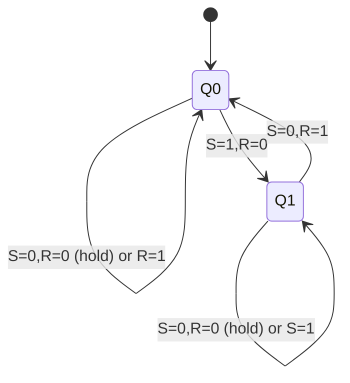
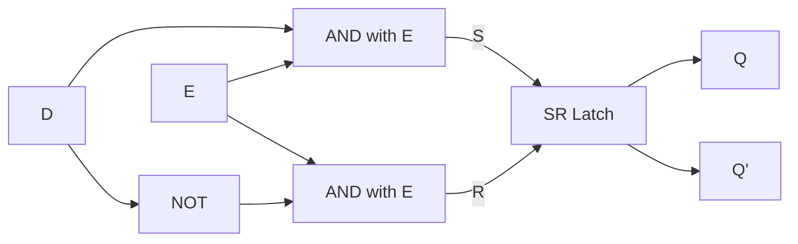

---
tags:
  - GATE/CS
  - GATE/DigitalLogic
  - SequentialCircuits
aliases:
  - SR Latch
  - Gated Latch
  - D Latch
  - Level-Triggered Latch
  - Transparent Latch
date_created: 2026-10-17
difficulty: 3
last_revised: 2026-10-17
pyq_frequency: Medium
---

## Syllabus Position

Subject: [[Digital Logic Index]]
Parent Topic: [[Sequential Circuits]]
Sibling Topics: [[Flip Flops]], [[SR Flip Flop]], [[JK Flip Flop]], [[D Flip Flop]], [[T Flip Flop]], [[Master Slave Flip Flop]]
Leads To: [[Master Slave Flip Flop]], [[Registers and Counters]], [[Sequential Circuit Analysis]]

GATE Syllabus Line: "Digital Logic: Boolean algebra. Combinational and sequential circuits. Minimization. Number representations and computer arithmetic (fixed and floating point)."

Exam Weight Note: Latches appear as 1-mark MCQ/NAT (output of a given SR/D latch circuit, forbidden input, race-around) and as building blocks inside 2-mark counter and sequential-circuit questions.

## The Problem This Solves

A [[Combinational Circuit]] forgets everything the moment its inputs change: output depends only on the present input. But a computer must remember: a bit of a register, a state of a controller. We need a circuit that holds a value after the input that set it has gone away. The trick is feedback: wire the output of a gate back into another gate, so the circuit sustains itself.

Analogy: a latch is a light switch with a spring-free toggle. You push it up (set) or down (reset) and it stays there when you let go. A *gated* latch is the same switch behind a door: it only responds while the door (enable) is open, and while the door is open every wiggle passes straight through.

Core Idea (one sentence): A latch is two cross-coupled gates whose feedback loop has two stable states, so it stores one bit and changes only when its level-sensitive enable lets new inputs in.

## Formal Theory

A **latch** is a level-sensitive bistable [[Sequential Circuit]] element: its output $Q$ depends on present inputs and on the previous state $Q_n$. Contrast with a [[Flip Flops|flip-flop]], which is edge-triggered.

### NOR-based SR Latch

Two cross-coupled NOR gates: $Q = \overline{R + \overline{Q}}$, $\overline{Q} = \overline{S + Q}$.

| S | R | $Q_{n+1}$ | Meaning |
|---|---|-----------|---------|
| 0 | 0 | $Q_n$ | Hold (memory) |
| 0 | 1 | 0 | Reset |
| 1 | 0 | 1 | Set |
| 1 | 1 | invalid | Both outputs 0, violates $\overline{Q}=\text{NOT }Q$ |

Characteristic equation: $Q_{n+1} = S + \overline{R}\,Q_n$, with constraint $S\cdot R = 0$.

Why $S=R=1$ is bad: both NORs output 0. If S and R then return to 0 *simultaneously*, both gates see inputs $(0,0)$ and try to go to 1; whichever is faster wins, or the latch oscillates/goes metastable. The next state is unpredictable.

### NAND-based $\overline{S}\,\overline{R}$ Latch

Two cross-coupled NAND gates are **active-low**: $\overline{S}=\overline{R}=1$ holds; $\overline{S}=0$ sets; $\overline{R}=0$ resets; $\overline{S}=\overline{R}=0$ is forbidden (both outputs 1). It is the dual of the NOR latch ([[Universal Gates]] give both).

### Gated (Clocked) SR Latch

Add two AND (or NAND) gates in front controlled by enable $E$ (or clock $CLK$):

$$Q_{n+1} = \begin{cases} Q_n & E = 0 \\ S + \overline{R}\,Q_n & E = 1,\ SR=0 \end{cases}$$

This is a **level-triggered** device: it is *transparent* for the whole time $E=1$ (the whole pulse width), not just at an instant. Forbidden input still exists.

### Gated D Latch

Remove the forbidden state by tying $S = D$, $R = \overline{D}$ (an inverter). Then:

$$Q_{n+1} = \begin{cases} Q_n & E=0 \\ D & E=1 \end{cases}$$

Characteristic equation (when enabled) is $Q_{n+1}=D$. No invalid input exists, since $S$ and $R$ are never both 1. It is the basic storage cell behind the [[D Flip Flop]].

### Level-Triggered vs Edge-Triggered

Level-triggered: output may change any time during $E=1$. Edge-triggered: output can change only at the clock edge (rising or falling). Latch = level; [[Flip Flops]] = edge (usually built from two latches, see [[Master Slave Flip Flop]]).

### Race-Around Condition

Consider a gated **JK latch** (an SR latch with feedback $S = J\overline{Q}$, $R = KQ$). For $J=K=1$ and $E=1$, the output toggles: $Q_{n+1}=\overline{Q_n}$. The toggled output feeds back to the inputs while $E$ is still high, so it toggles again, and again. The number of toggles in one pulse is roughly

$$N \approx \left\lfloor \frac{t_p}{\Delta t} \right\rfloor$$

where $t_p$ is the enable pulse width and $\Delta t$ the loop propagation delay. The final state is unpredictable. This is **race-around**. Remedies:
1. Make $t_p < \Delta t$ (impractical, depends on gate delay).
2. Use [[Master Slave Flip Flop]] (two latches, opposite phases).
3. Use edge triggering. See [[JK Flip Flop]] and [[T Flip Flop]], which have the same issue when $T=1$.

Note: D and SR latches do **not** race around (D latch has no feedback to inputs; SR has no toggle mode).

What GATE actually tests here: truth table of NOR/NAND SR latch, effect of $S=R=1$ then release, the difference between level and edge triggering, when race-around occurs ($J=K=1$ or $T=1$, long pulse), and tracing a D latch output against a waveform of D and E.

## Diagrams and Visuals

**NOR SR latch** (draw two NORs, outputs crossed to the other's input):

```
 R ----+--------\
       |  NOR1   )o----+------- Q
   +---|--------/      |
   |   |               |
   |   +---------------|---+
   |                   |   |
   +-------------------+   |
       +--------\          |
 S ----|  NOR2   )o--------+--- Q'
       +--------/
```
Draw: NOR1 takes R and Q' ; its output is Q. NOR2 takes S and Q; its output is Q'. Each output loops to the other gate: that crossing is the memory.



**D latch built from gated SR:**



**Timing: D latch (transparent while E=1):**

```
E : __|‾‾‾‾‾‾‾|______|‾‾‾‾|____
D : _|‾‾|__|‾‾‾‾‾|__|‾‾‾‾‾‾‾‾‾
Q : __|‾‾|__|‾‾‾‾|__ (hold) |‾‾‾|__
```
Q follows D during E high, freezes the last value when E falls.

## Complexity Analysis

Latches are circuits, so we analyse delay and gate cost instead of asymptotics.

- **Gate count:** SR latch = 2 gates; gated SR = 4 gates (2 NOR + 2 AND, or 4 NAND); D latch = 4 NAND + 1 inverter (the inverter can be shared).
- **Propagation delay:** from set input to $Q$ change = one gate delay $t_g$ (NOR1/NOR2 each respond once); to propagate to $\overline{Q}$ settles in $2t_g$. In a gated latch add one more gate: $3t_g$ typical.
- **Loop delay for race-around:** a toggle goes around two gates, so $\Delta t \approx 2t_g$ for the cross-coupled pair. Safe operation needs $t_p < \Delta t$. This is why a latch cannot be used directly for toggling.
- **Timing constraints:** setup time $t_{su}$ (D stable before E falls), hold time $t_h$ (D stable after E falls). Violating them leaves the latch **metastable**.

| Case | Time (delay) | Space (gates) | Trigger Condition |
|------|--------------|---------------|-------------------|
| Best | $t_g$ | 2 (SR), 5 (D) | Single input change, one gate responds |
| Average | $2t_g$ | 4 (gated SR) | Output and complement both settle |
| Worst | $\infty$ / metastable | same | $S=R=1\to 0,0$ together, or $J=K=1$ with long $E$ |

## Worked Example

NOR SR latch, initial $Q=0$. Apply the sequence $(S,R)$: $(0,0),(1,0),(0,0),(0,1),(0,0),(1,1)$.

| Step | S | R | Q | Q' | Reason |
|------|---|---|---|----|--------|
| 1 | 0 | 0 | 0 | 1 | Hold |
| 2 | 1 | 0 | 1 | 0 | NOR2 = $\overline{1+0}=0$, so Q' = 0; NOR1 = $\overline{0+0}=1$, so Q = 1 |
| 3 | 0 | 0 | 1 | 0 | Hold (memory) |
| 4 | 0 | 1 | 0 | 1 | NOR1 = $\overline{1+0}=0$; NOR2 = $\overline{0+0}=1$ |
| 5 | 0 | 0 | 0 | 1 | Hold |
| 6 | 1 | 1 | 0 | 0 | Forbidden: both NORs output 0 |

Total operations: 6 input changes, each settling within $2t_g$. This confirms the delay claim because each change makes at most two gates flip in sequence.

Gated D latch extension, $E$ high for steps with $D=1,0,1$ then $E=0$ while $D=0$: $Q = 1,0,1$ and then holds at $1$.

What changes if the input is $S=R=1$ followed by simultaneous release to $(0,0)$? Both gates see $(0,0)$ and want to output 1; this feeds back to 0 for both. Real gates break the symmetry randomly, so the final state is unpredictable (or oscillates for a while, metastability).

## Intuition Anchors

**The Analogy (restated and deepened):** The switch behind a door. Switch positions are the two stable states; "no spring" is the feedback loop; pushing both up and down at once (S=R=1) jams the switch, and releasing both at once gives a random side. The door is $E$: open door = transparent, every change passes; the door closing is the latch capturing. Race-around is someone toggling the switch repeatedly as long as the door stays open: the longer the door, the more flips, and the final position is a gamble.

**The Mental Model:** Picture the two gates as two people who each say the opposite of what the other says. Either state is self-consistent, so it sticks. Setting inputs force one speaker to flip, then the other follows. For a D latch I picture a window: while open, Q is just D; once closed, Q is a photograph of D.

**The One-Line Recall:** $Q_{n+1}=S+\overline{R}Q_n$ with $SR=0$ for the SR latch; $Q_{n+1}=D$ while $E=1$, else hold, for the D latch; race-around when $J=K=1$ and $t_p>\Delta t$.

**The #1 Trap:** Students assume a D latch behaves like a D flip-flop and captures D only at the clock edge. It does not: a latch is transparent for the whole high level, so any D change during $E=1$ reaches Q. The correct reading is "follow while enabled, hold when disabled."

## GATE Questions

**Question 1 — GATE-style — 1-mark**

> In a NOR-based SR latch, the inputs $S=R=1$ are applied and then both are changed to $0$ simultaneously. The resulting output is:

- (A) $Q=0$
- (B) $Q=1$
- (C) $Q=Q_{n}$ (previous value)
- (D) Indeterminate

<details>
<summary>Solution</summary>

**Answer: (D)**

**Reasoning:** At $S=R=1$ both NOR outputs are 0. After a simultaneous release, both gates see $(0,0)$ and both try to go to 1; the cross-coupling then forces them back. The final state depends on which gate is faster, so it is unpredictable (race/metastability). (A), (B) assume a deterministic winner; (C) is wrong because the forbidden state erased the old $Q_n$ (both outputs are 0).

**What this question is really testing:** The forbidden input state of the SR latch.

**Trap to avoid:** Believing release returns to "hold" with the old value.

</details>

---

**Question 2 — Numerical — 1-mark**

> A positive-level-enabled D latch has initial $Q=0$. $E$ is high from $t=0$ to $t=10$ ns and low afterward. $D=0$ for $0\le t<4$, $D=1$ for $4\le t<7$, $D=0$ for $7\le t<12$, and $D=1$ for $t\ge 12$. Ignoring delays, find $Q$ at $t=15$ ns.

<details>
<summary>Solution</summary>

While $E=1$ ($0$ to $10$), Q follows D: 0, then 1 (4 to 7), then 0 from 7. At $t=10$, $E$ falls and Q holds the value of D at that moment, which is 0. D then changes to 1 at $t=12$, but $E=0$, so Q is unaffected. **$Q=0$ at 15 ns.** A flip-flop capturing at the falling edge would also give 0, but one capturing at the rising edge ($t=0$) would too; the distinguishing check is the 4 to 7 ns glitch, which a latch passes to Q but an edge device ignores.

</details>

---

**Question 3 — Hard / Multi-concept — 2-mark**

> A level-triggered JK latch has $J=K=1$ and initial $Q=0$. The total loop delay for one toggle is 4 ns and the enable pulse is 10 ns wide. (a) How many toggles occur? (b) What is the final $Q$? (c) What circuit change fixes this?

- (A) 2 toggles, $Q=0$; use master-slave
- (B) 3 toggles, $Q=1$; use master-slave
- (C) 2 toggles, $Q=0$; increase pulse width
- (D) 10 toggles, $Q=1$; use a [[Combinational Circuit]]

<details>
<summary>Solution</summary>

**Answer: (A)**

**Reasoning:** Toggles occur at $4$ ns and $8$ ns; the third would occur at $12$ ns, after $E$ falls. $N=\lfloor 10/4\rfloor=2$. Two toggles return $Q$ to $0$. The fix is a [[Master Slave Flip Flop]] (or edge triggering), which breaks the feedback during the active level. (B) miscounts by rounding up. (C) lengthening the pulse worsens the race. (D) is nonsense; a combinational circuit has no memory.

**What this question is really testing:** Counting toggles using $\lfloor t_p/\Delta t\rfloor$ and knowing the remedy.

**Trap to avoid:** Rounding up, or thinking a short pulse *increases* toggling. Also note that the result depends on delays, which is why it is unpredictable in practice.

</details>

---

**Pattern Recognition:**
- "Both inputs 1 then both 0" on an SR latch: answer is indeterminate.
- "Output follows input while clock high": it is a latch, not a flip-flop.
- "$J=K=1$ or $T=1$ with a wide pulse": race-around; fix is master-slave or edge-triggering.
- NAND latch inputs are active-low: forbidden state is $(0,0)$, not $(1,1)$.

## Edge Cases and Failure Modes

- [ ] **Power-up:** unknown initial state of an SR latch. Fix: add reset/preset or initialise it explicitly.
- [ ] **$S=R=1$ (NOR) or $\overline{S}=\overline{R}=0$ (NAND):** forbidden; fix by using D latch or guaranteeing $SR=0$.
- [ ] **Simultaneous release from forbidden state:** unpredictable. Fix: avoid the state.
- [ ] **Glitches on D while $E=1$:** passed to Q. Fix: keep D stable or use an edge-triggered [[D Flip Flop]].
- [ ] **Setup/hold violation at the falling edge of $E$:** metastability. Fix: respect $t_{su}$ and $t_h$, add synchronisers.
- [ ] **Race-around ($J=K=1$, $t_p>\Delta t$):** repeated toggling. Fix: master-slave or edge triggering.
- [ ] **Active-low confusion:** NAND latch holds at $(1,1)$, not $(0,0)$.
- [ ] **Input size 0/1 and off-by-one in toggle counting:** the toggle that lands exactly at the pulse end is ambiguous; assume the problem states strict inequality.

## Comparisons

| Feature | [[Latches]] (D latch) | [[D Flip Flop]] | [[Master Slave Flip Flop]] |
|---------|-----------------------|-----------------|-----------------------------|
| Time Complexity (delay) | $\sim 3t_g$ | $\sim$ two latches in series | two latches in series |
| Space Complexity (gates) | 5 | about 10 (two D latches) | about 10 to 12 |
| Key Property | Level-sensitive, transparent | Edge-triggered | Output changes on clock edge (falling/rising by design) |
| When to Prefer | Cheap storage, timing-borrowing designs | Registers, counters | Fix race-around for JK/T |
| GATE Trap | Passes glitches while enabled | Captures D at the edge only | Appears level-based but outputs update at edge |

The most common GATE question comparing these asks for Q given waveforms of D and the clock, and the answer hinges on whether the device is level-sensitive (follows D for the whole active level) or edge-triggered (samples D once).

## Connections Web

**Must know before this topic:**
- [[Combinational Circuit]] — the no-memory baseline that latches extend
- [[Universal Gates]] — NOR/NAND build the latch
- [[Boolean Algebra]] — to derive characteristic equations

**Topics that build on this:**
- [[Flip Flops]] — edge-triggered storage
- [[SR Flip Flop]], [[JK Flip Flop]], [[D Flip Flop]], [[T Flip Flop]]
- [[Master Slave Flip Flop]] — cures race-around
- [[Registers and Counters]]

**GATE subject cross-links:**
- [[Digital Logic Index]] > [[Sequential Circuits]]

**Cross-subject connections:**
- [[Pipelining]] — pipeline registers are latches/flip-flops (COA)
- [[Cache Memory]] — SRAM cell is a cross-coupled latch

**Standard references:**
- [[Morris Mano Chapter 5]]

## Quick Revision Sheet

**Definition (1 sentence):** A latch is a level-sensitive bistable circuit of cross-coupled gates that stores one bit.

**Core Idea / Analogy (1 sentence):** A self-holding switch behind a door ($E$) that is transparent while open.

**Algorithm Steps:**
1. NOR SR latch: $(0,0)$ hold, $(1,0)$ set, $(0,1)$ reset, $(1,1)$ forbidden.
2. NAND latch: same with inverted inputs; forbidden is $(0,0)$.
3. Gated latch: behaves as above only when $E=1$; holds when $E=0$.
4. D latch: $S=D$, $R=\overline{D}$; $Q_{n+1}=D$ when $E=1$.
5. $J=K=1$ with $E$ long: race-around.
6. Fix with master-slave or edge triggering.

**Complexity:**
- Time (best / average / worst): $t_g$ / $2t_g$ / metastable
- Space: 2 gates (SR), 5 gates (D latch)
- Recurrence (if applicable): $Q_{n+1}=S+\overline{R}Q_n$, $SR=0$

**Key Properties:**
- Latch is level-triggered; flip-flop is edge-triggered.
- D latch has no forbidden state and no race-around.
- Race-around needs toggle mode ($J=K=1$ or $T=1$) and $t_p>\Delta t$.
- Toggles $\approx\lfloor t_p/\Delta t\rfloor$.

**The #1 Trap:** Treating a transparent latch as an edge-triggered flip-flop.

**When to use this over alternatives:** When a cheap, small storage cell is enough and inputs are stable while enabled.

**Mnemonic or one-liner to remember the steps:** "Latch = Level = Looks through; Flip-flop = Flank = Freezes at the edge."

## Revision Checklist

- [ ] I can state the formal definition without looking.
- [ ] I can explain the analogy and map it to the algorithm or concept.
- [ ] I can trace a 6-element example by hand in under 2 minutes.
- [ ] I can derive the worst-case complexity from scratch.
- [ ] I know what the Quick Revision Sheet says without reading it.
- [ ] I can solve all 3 GATE questions in this note without peeking.
- [ ] I know the #1 trap and can articulate why students fall for it.
- [ ] I have linked this note correctly in my Obsidian vault.
- [ ] I have scheduled a spaced-repetition review in 3 days.
