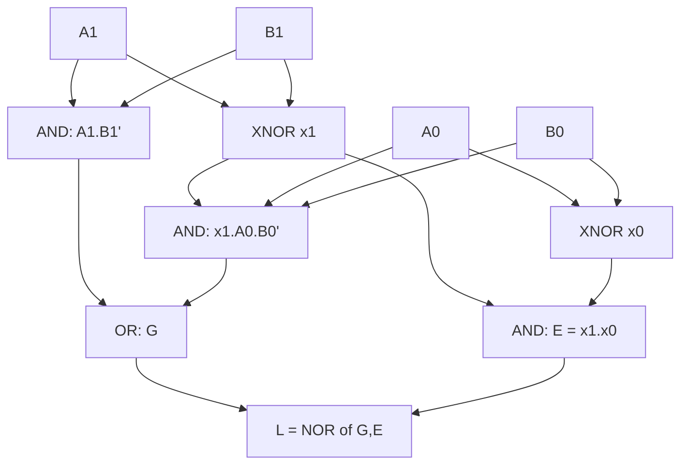

---
tags:
  - GATE/CS
  - GATE/DigitalLogic
  - CombinationalCircuits
aliases:
  - n-bit Comparator
  - Magnitude Comparator
  - Digital Comparator
date_created: 2026-10-13
difficulty: ⭐⭐⭐
last_revised: 2026-10-13
pyq_frequency: Medium
---

## Syllabus Position

Subject: [[Digital Logic]]
Parent Topic: [[Combinational Circuit]]
Sibling Topics: [[Adder and Subtractor]], [[Multiplexer]], [[Decoder]], [[Encoder]]
Leads To: [[ALU Design]], [[Sorting Networks]], [[Cache Tag Comparison]]

GATE Syllabus Line: "Combinational and sequential circuits" (Digital Logic).

Exam Weight Note: Appears as a 1 or 2-mark MCQ or NAT. Typical forms are "write the expression for $A>B$", "count gates", or "design a 4-bit comparator from 2-bit ones".

## The Problem This Solves

Computers constantly ask "is this number bigger than that one?". Examples are branch instructions, sorting hardware, cache tag matching, and priority arbitration. We need a circuit that takes two binary numbers and outputs exactly one of three signals: greater, equal, or less.

Analogy: compare two words in a dictionary, or two car odometer readings. Start at the leftmost (most significant) digit. If the digits differ, you are done. If they match, move one digit right.

Core Idea (one sentence): scan from the MSB; the first position where the bits differ decides the result, and equality needs every position to match.

## Formal Theory

A **magnitude comparator** takes $A = A_{n-1}\dots A_0$ and $B = B_{n-1}\dots B_0$. It produces three outputs: $G$ ($A>B$), $E$ ($A=B$), $L$ ($A<B$). Exactly one output is 1 at any time. So $G + E + L = 1$, and $L = \overline{G+E}$.

### Bit-level equality (the building block)

The **XNOR gate** gives a per-bit equality signal:

$$x_i = A_i \odot B_i = A_iB_i + \overline{A_i}\,\overline{B_i}$$

$x_i = 1$ exactly when the two bits at position $i$ match.

### 1-bit comparator

| A | B | G (A>B) | E (A=B) | L (A<B) |
|---|---|---|---|---|
| 0 | 0 | 0 | 1 | 0 |
| 0 | 1 | 0 | 0 | 1 |
| 1 | 0 | 1 | 0 | 0 |
| 1 | 1 | 0 | 1 | 0 |

$$G = A\overline{B},\qquad E = A\odot B,\qquad L = \overline{A}B$$

Each output is read directly off the truth table: $G$ is 1 only for $A=1,B=0$. $L$ is 1 only for $A=0,B=1$. $E$ is 1 for the two matching rows. Gates needed: 2 NOT, 2 AND, 1 XNOR.

### 2-bit comparator

Let $A = A_1A_0$ and $B = B_1B_0$, with $x_1 = A_1\odot B_1$ and $x_0 = A_0\odot B_0$.

- $A>B$ if the MSB wins, or the MSBs are equal and the LSB wins.
- $A=B$ if both bit pairs are equal.
- $A<B$ if the MSB loses, or the MSBs are equal and the LSB loses.

$$G = A_1\overline{B_1} + x_1\,A_0\overline{B_0}$$
$$E = x_1\,x_0$$
$$L = \overline{A_1}B_1 + x_1\,\overline{A_0}B_0$$

This is a 4-variable function with 16 minterms. Its K-map gives the same result: $G$ has 6 minterms, $E$ has 4, and $L$ has 6, totalling 16.

### SHORTCUT: n-bit comparator

Define $x_i = A_i \odot B_i$. Each $G$ term reads "all higher bits equal, and at this position $A_i=1, B_i=0$".

$$\boxed{E = x_{n-1}x_{n-2}\cdots x_1x_0}$$

$$\boxed{G = A_{n-1}\overline{B_{n-1}} + x_{n-1}A_{n-2}\overline{B_{n-2}} + x_{n-1}x_{n-2}A_{n-3}\overline{B_{n-3}} + \cdots + x_{n-1}\cdots x_1\,A_0\overline{B_0}}$$

$$\boxed{L = \overline{A_{n-1}}B_{n-1} + x_{n-1}\overline{A_{n-2}}B_{n-2} + \cdots + x_{n-1}\cdots x_1\,\overline{A_0}B_0}$$

Writing it for any $n$ takes three steps:
1. Write $x_i$ for every bit.
2. $E$ is the AND of all $x_i$.
3. For $G$, write $n$ product terms. Term $k$ is the AND of the top $k$ equalities, followed by $A\overline{B}$ at the next bit. $L$ is the same, with $\overline{A}B$ in place of $A\overline{B}$.

Shortcut for $L$: $L = \overline{G + E}$.

Check with $n=2$: the formula gives $A_1\overline{B_1} + x_1A_0\overline{B_0}$, which matches the 2-bit result above.

### Cascading (IC 7485 style)

A 4-bit comparator takes cascade inputs $(G_{in}, E_{in}, L_{in})$ from the lower stage. The cascade inputs are used only when all 4 bits are equal, so:

$$G_{out} = G_{4bit} + E_{4bit}\,G_{in},\quad E_{out} = E_{4bit}\,E_{in},\quad L_{out}=L_{4bit}+E_{4bit}L_{in}$$

The lowest stage is tied to $E_{in}=1$, $G_{in}=L_{in}=0$.

What GATE actually tests here: deriving $G$ for 2 bits, counting minterms, spotting that $E$ is the AND of XNORs, and cascading smaller comparators.

## Diagrams and Visuals

Drawing: draw $n$ XNOR gates, one per bit pair, with outputs $x_i$. Feed all $x_i$ into one AND gate to produce $E$. For $G$ and $L$, build an AND ladder where the higher $x$'s gate the lower bits.



```
MSB decides first:
 bit:    3   2   1   0
 A  :    1   0   1   1
 B  :    1   0   0   1
 x  :    1   1   0   1
         =   =   ^ first difference: A1=1,B1=0  -> A > B
```

## Complexity Analysis

Circuits are measured by gate count and delay, not time and space.

- Equality part: $n$ XNORs and one $n$-input AND, giving about $n$ gates. Delay is 1 XNOR plus an AND tree of depth $\lceil\log_2 n\rceil$.
- $G$ and $L$: term $k$ needs a $k$-wide AND, so the total is $O(n^2)$ literals in two-level form. With sharing of prefix ANDs it is $O(n)$ gates.
- Two-level (SOP) delay is constant in gate levels, but fan-in grows with $n$.
- Direct truth table: $2^{2n}$ rows, which is infeasible. The structured formula is what makes the design practical.

| Case | Delay | Gate count | Condition |
|---|---|---|---|
| Two-level | $O(1)$ levels | $O(n^2)$ | unbounded fan-in |
| Prefix-shared | $O(\log n)$ | $O(n)$ | bounded fan-in |
| Cascaded ripple | $O(n/4)$ stages | $O(n)$ | 4-bit ICs chained |

## Worked Example

$A = 1011$ (11), $B = 1001$ (9).

Step 1, per-bit equality:
- $x_3 = 1\odot1 = 1$
- $x_2 = 0\odot0 = 1$
- $x_1 = 1\odot0 = 0$
- $x_0 = 1\odot1 = 1$

Step 2, $E = x_3x_2x_1x_0 = 1\cdot1\cdot0\cdot1 = 0$, so the numbers are not equal.

Step 3, terms of $G$:
- $A_3\overline{B_3} = 1\cdot0 = 0$
- $x_3A_2\overline{B_2} = 1\cdot0\cdot1 = 0$
- $x_3x_2A_1\overline{B_1} = 1\cdot1\cdot1\cdot1 = 1$
- $x_3x_2x_1A_0\overline{B_0} = 0$

So $G = 1$.

Step 4, $L = \overline{G+E} = 0$.

Result: $A>B$, which is correct since $11>9$. Total: 4 XNORs, 1 four-input AND, and 4 product terms. This confirms the decision came from the first differing bit.

What changes if $A=B$? All $x_i=1$ gives $E=1$. Every $G$ term has an $A_i\overline{B_i}$ factor that is 0, so $G=L=0$. This is why the cascade inputs matter.

## Intuition Anchors

The Analogy (deepened): this is dictionary or odometer comparison. The prefix of equalities $x_{n-1}\cdots x_{i+1}$ is "all earlier letters matched". The $A_i\overline{B_i}$ factor is "this letter is bigger". Equality means every letter matched. Cascading is comparing the first 4 digits and, only on a tie, looking at the next 4.

The Mental Model: picture a flag moving from the MSB toward the LSB. It stops at the first mismatch and reports who is larger.

The One-Line Recall: $E=\prod x_i$, and $G=\sum_i\big(\prod_{j>i}x_j\big)A_i\overline{B_i}$ with $x_i = A_i\odot B_i$.

The #1 Trap: students write $G = \sum A_i\overline{B_i}$ without the equality prefix. That seems right per bit, but it fails when a lower bit has $A=1,B=0$ while a higher bit has $A=0,B=1$. For example, $A=01$ and $B=10$ would wrongly give $G=1$. The prefix $x$ terms are required.

## GATE Questions

**Question 1: GATE-style, 1-mark**

> For a 2-bit comparator with inputs $A_1A_0$ and $B_1B_0$, which expression gives $A>B$?

- (A) $A_1\overline{B_1} + A_0\overline{B_0}$
- (B) $A_1\overline{B_1} + (A_1\odot B_1)A_0\overline{B_0}$
- (C) $A_1\overline{B_1}A_0\overline{B_0}$
- (D) $(A_1\oplus B_1)A_0\overline{B_0}$

<details>
<summary>Solution</summary>

**Answer: (B)**

**Reasoning:** The MSB decides unless it ties, and a tie means $A_1\odot B_1$.
- (A) lacks the tie condition, so it is wrong for $01$ vs $10$.
- (C) requires both bits to win, which misses $A=10,B=01$.
- (D) uses XOR, which says the MSBs differ, so it would count the case where $B$ is ahead.

**What this question is really testing:** the tie-prefix structure.

**Trap to avoid:** forgetting the equality prefix.
</details>

---

**Question 2: Numerical, 1-mark**

> How many of the 16 input combinations of a 2-bit comparator give $A=B$, and how many give $A>B$?

<details>
<summary>Solution</summary>

$A=B$ has 4 combinations (one per value). By symmetry, $G$ and $L$ split the remaining 12 equally, so $A>B$ has $6$. In general, the numbers are $2^n$ equal cases and $(2^{2n}-2^n)/2$ greater cases.
</details>

---

**Question 3: Hard, 2-mark**

> A 4-bit comparator is built from two 2-bit comparators (high pair $H$, low pair $K$). Write the $G$ output for the 4-bit comparator in terms of their outputs.

<details>
<summary>Solution</summary>

The high pair decides unless it is equal, so
$$G_4 = G_H + E_H\,G_K,\qquad E_4 = E_HE_K,\qquad L_4 = L_H + E_HL_K.$$
This uses cascading, since the low pair only matters when the high pair ties.

**What this question is really testing:** the cascade (divide and conquer) structure.

**Trap to avoid:** using $G_H G_K$ or $G_H+G_K$.
</details>

**Pattern Recognition:**
- "Write the expression for $A>B$" means a prefix of XNORs followed by $A\overline{B}$.
- "Equality" means the AND of XNORs.
- "Cascade" means that stage's $G$ plus its $E$ times the lower stage's $G$.
- Counting gates or minterms: use the symmetry $G=L$ in count.

## Edge Cases and Failure Modes

- [ ] $n=1$: the formulas reduce to $A\overline{B}$, $A\odot B$, $\overline{A}B$ with no prefix.
- [ ] $A=B$: $G=L=0$ and $E=1$. Cascade inputs then decide, so tie the lowest stage to $E_{in}=1$.
- [ ] Signed numbers: this circuit is unsigned. For two's complement, the sign bit comparison is inverted, so $A_{n-1}B_{n-1}'$ gives $L$ rather than $G$.
- [ ] Using XOR instead of XNOR for $x_i$: the equality signal is inverted, so the circuit fails.
- [ ] Fan-in: an $n$-input AND is not available for large $n$, so use a tree.
- [ ] Mutual exclusivity: exactly one output is high, which is a useful correctness check.

## Comparisons

| Feature | [[Magnitude Comparator]] | [[Equality Comparator]] | [[Subtractor Based Comparison]] |
|---|---|---|---|
| Outputs | G, E, L | E only | sign / carry flags |
| Hardware | XNORs + AND ladder | XNORs + AND | adder with $A+\overline{B}+1$ |
| Delay | $O(\log n)$ | $O(\log n)$ | $O(n)$ ripple |
| When to prefer | dedicated compare | tag match | ALU already present |
| GATE Trap | prefix required | XOR vs XNOR | unsigned vs signed flags |

The most common GATE question comparing these asks for the output of a comparator or its gate count, and the answer hinges on the equality prefix.

## Connections Web

**Must know before this topic:**
- [[XNOR Gate]] — per-bit equality
- [[XOR Gate]]
- [[Boolean Algebra]]
- [[K-Map Minimization]] — derive the 2-bit expressions
- [[Canonical and Standard Forms]]

**Topics that build on this:**
- [[ALU Design]] — flag generation
- [[Sorting Networks]]

**GATE subject cross-links:**
- [[Digital Logic]] > [[Combinational Circuit]]

**Cross-subject connections:**
- [[Cache Memory]] — tag compare uses the equality comparator
- [[Branch Instructions]] — conditional jumps use comparator flags
- [[Two's Complement]] — signed comparison

**Standard references:**
- [[Morris Mano Digital Design Chapter 4]]

## Quick Revision Sheet

**Definition:** a circuit that compares two $n$-bit numbers and outputs $G$, $E$, $L$.

**Core Idea:** the first differing bit from the MSB decides.

**Steps:**
1. $x_i = A_i\odot B_i$.
2. $E=\prod x_i$.
3. $G=\sum_i (\prod_{j>i}x_j)A_i\overline{B_i}$.
4. $L=\overline{G+E}$.

**Complexity:**
- Gates: $O(n)$ with shared prefixes; delay $O(\log n)$.
- 1-bit: $G=A\overline{B},\ E=A\odot B,\ L=\overline{A}B$.
- 2-bit: $G=A_1\overline{B_1}+x_1A_0\overline{B_0}$, $E=x_1x_0$.

**Key Properties:**
- Exactly one output is 1.
- Cascade: $G=G_H+E_HG_K$.
- Truth table has $2^{2n}$ rows.
- $A=B$ in $2^n$ cases.

**The #1 Trap:** omitting the equality prefix.

**When to use:** dedicated compare; use a subtractor if an ALU is already present.

**Mnemonic:** "MSB first, tie? go lower."

## Revision Checklist

- [ ] I can state the formal definition without looking.
- [ ] I can explain the dictionary analogy and map it to the formulas.
- [ ] I can write $G$, $E$, $L$ for 1 and 2 bits from memory.
- [ ] I can write the $n$-bit shortcut.
- [ ] I know the #1 trap.
- [ ] I can solve all 3 GATE questions without peeking.
- [ ] I have linked this note in my Obsidian vault.
- [ ] I have scheduled a spaced-repetition review in 3 days.
