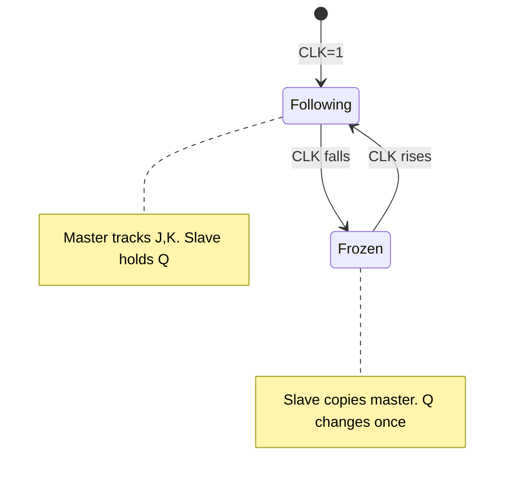

---
tags:
  - GATE/CS
  - GATE/DigitalLogic
  - SequentialCircuits
aliases:
  - Master-Slave JK Flip Flop
  - MS Flip Flop
  - Pulse-Triggered Flip Flop
date_created: 2026-10-17
difficulty: ⭐⭐⭐
last_revised: 2026-10-17
pyq_frequency: Medium
---

## Syllabus Position

Subject: [[Digital Logic Index]]
Parent Topic: [[Flip Flops]]
Sibling Topics: [[Latches]], [[SR Flip Flop]], [[JK Flip Flop]], [[D Flip Flop]], [[T Flip Flop]]
Leads To: [[Counters]], [[Shift Registers]], [[Sequential Circuit Design]]

GATE Syllabus Line: "Combinational and sequential circuits" (Digital Logic).

Exam Weight Note: Appears as 1-mark MCQ on race-around and toggling behaviour, and occasionally as 2-mark questions on timing and counters built from JK flip flops.

## The Problem This Solves

A level-triggered [[JK Flip Flop]] has a defect. When $J=K=1$ and the clock stays high for longer than the gate propagation delay, the output toggles over and over during one pulse. The final state is unpredictable. This is the **race-around condition**. We want exactly one change per clock pulse.

Think of an airlock. A ship passes through two doors, and the two doors are never open together. The master is the first door and the slave is the second. Inputs enter the master while the clock is high. Only when the clock falls does the slave open and copy the master. No signal can race straight through.

Core Idea (one sentence): Two latches on opposite clock phases make the output change only once per pulse, at the falling edge, so feedback cannot cause repeated toggling.

## Formal Theory

A **master-slave flip flop** is two gated [[Latches]] in cascade. The master is enabled by CLK and the slave by $\overline{CLK}$. The slave's output is fed back to the master's inputs.

### Race-Around Condition
For a level-triggered JK with $J=K=1$ the characteristic equation gives $Q^+ = \overline{Q}$. If the clock width is $t_p$ and the propagation delay is $\Delta t$, toggling repeats when:

$$\Delta t < t_p$$

Each loop around the feedback path flips $Q$ again, so the output at the end of the pulse is unpredictable. Two fixes exist:
1. Make $t_p < \Delta t < T$. This is impractical because the timing window is too narrow.
2. Use master-slave or edge triggering. This is the standard fix.

### Master-Slave JK Construction
Two [[SR Flip Flop]] latches are used. The inputs to the master are:

$$S_m = J\cdot\overline{Q},\qquad R_m = K\cdot Q$$

- CLK = 1: the master is enabled and follows $J,K$. The slave is disabled, so $Q$ is held.
- CLK = 0: the master is disabled and holds its value. The slave is enabled and copies the master, so $Q$ updates.

Because $Q$ changes only when the master is frozen, the new $Q$ cannot disturb the master. The race is removed.

```
Algorithm MS_JK(J, K, CLK):
    while CLK == 1:
        master follows (J, K) using current Q
    on CLK falling edge:
        master freezes
        slave copies master -> Q updates
    return Q
```

Characteristic equation (valid at the falling edge):

$$Q^+ = J\overline{Q} + \overline{K}Q$$

### Ones-Catching Problem
During CLK = 1 the master is a live latch. If a glitch sets $J$ (or $K$) high briefly, even if it returns low before the falling edge, the master may be set or reset. It stays that way, because for $Q=0$ only $J$ can change the master, and for $Q=1$ only $K$ can. The slave then copies this wrong value at the fall. The master has "caught" a 1.

Fix: use inputs that are stable throughout CLK = 1, or use a true edge-triggered flip flop (see [[D Flip Flop]]), which samples only at the edge.

### Variants
- Master-slave SR, D, and T are built the same way. The [[T Flip Flop]] is a JK with $J=K=T$. The D version is a master-slave built from two D latches.

What GATE actually tests here: why master-slave stops race-around, at which clock edge the output changes (the falling edge for the standard circuit), the toggle behaviour when $J=K=1$, and output frequency (divide-by-2 per flip flop).

## Diagrams and Visuals

Draw two boxes labelled MASTER and SLAVE in series. Master clock is CLK. Slave clock comes through an inverter. Feed $Q$ and $\overline{Q}$ back to the input AND gates.

```
 J ──[AND]─S─┌────────┐ Qm  ┌───────┐ Q
 K ──[AND]─R─│ MASTER │─────│ SLAVE │────┬──► Q
  ^  ^       └───┬────┘     └───┬───┘    │
  └──┴─feedback───┼──────────────┼────────┘
                 CLK          CLK'(NOT)
```



Timing diagram for $J=K=1$ (toggle):

```
CLK  : __|‾‾‾|___|‾‾‾|___|‾‾‾|___
Qm   : ___|‾‾‾‾‾‾|______|‾‾‾‾‾‾ (master changes at CLK rise)
Q    : ______|‾‾‾‾‾‾‾‾‾‾‾‾‾|____ (Q changes at CLK fall)
```

Q changes only on falling edges, so its frequency is $f_{CLK}/2$.

## Complexity Analysis

Not an algorithm, so we analyse timing and hardware cost.
- Hardware: two latches plus an inverter. A master-slave JK takes about 4 NAND for the master, 4 for the slave, and 1 inverter (plus 2 for the input gating).
- Race avoidance needs no pulse-width constraint relative to $\Delta t$. A pulse that is longer is safe.
- Minimum clock period is limited by:

$$T_{clk} \ge t_{pd,master} + t_{pd,slave} + t_{setup}$$

This follows because the master must settle while CLK = 1 and the slave must settle while CLK = 0.

| Case | Time | Space | Trigger Condition |
|---|---|---|---|
| Best | one transition/pulse | 2 latches | Inputs stable during CLK = 1 |
| Average | one transition/pulse | 2 latches | Normal operation |
| Worst | wrong state captured | 2 latches | Glitch while CLK = 1 (ones catching) |

## Worked Example

Master-slave JK, initial $Q=0$, falling-edge update. Input sequence per pulse:

| Pulse | J | K | Master during CLK=1 | Q after fall |
|---|---|---|---|---|
| 1 | 1 | 0 | $S_m=J\overline{Q}=1$ so set | 1 |
| 2 | 1 | 1 | $S_m=0, R_m=KQ=1$ so reset | 0 |
| 3 | 1 | 1 | $S_m=1, R_m=0$ so set | 1 |
| 4 | 0 | 0 | hold | 1 |
| 5 | 0 | 1 | $R_m=1$ so reset | 0 |
| 6 | 0 | 0 | hold | 0 |

Output sequence: 1, 0, 1, 1, 0, 0. Total operations: 6 pulses, at most 1 change per pulse (4 changes). This confirms the single-update-per-pulse claim because the slave is open only while the master is frozen.

Edge case: if $J$ glitches to 1 for a moment in pulse 6 (at $Q=0$), the master sets, and Q becomes 1 at the fall although the final $J$ was 0. This is ones catching.

## Intuition Anchors

**The Analogy (restated and deepened):** The airlock has two doors, which is why exactly one change happens per cycle. Race-around would be both doors open at once. Ones catching is someone slipping a note into the first chamber while it is open, which the second door then carries out even if the note was withdrawn.

**The Mental Model:** Picture a clock pulse with two halves. High half: the master looks at $J,K$. Low half: the slave publishes. The output is the master's view from the end of the high half, shown at the fall.

**The One-Line Recall:** Master-slave JK: master on CLK = 1, slave on CLK = 0, output changes at falling edge, $Q^+=J\overline{Q}+\overline{K}Q$, toggles at $J=K=1$, no race-around.

**The #1 Trap:** Students assume a master-slave flip flop is the same as an edge-triggered one because both avoid race-around. It seems right because Q changes at one instant. But the master samples inputs throughout the whole high level, so a glitch is caught (ones catching). A true edge-triggered flip flop samples only at the edge.

## GATE Questions

**Question 1 — [GATE-style] — [1-mark]**

> A level-triggered JK flip flop with $J=K=1$ has a clock pulse width much larger than the propagation delay. The output is:

- (A) Toggles once
- (B) Holds its value
- (C) Oscillates, final value unpredictable
- (D) Always 1

<details>
<summary>Solution</summary>

**Answer: (C)**

**Reasoning:** With $J=K=1$, $Q^+=\overline{Q}$. Feedback is present while the clock is high, so each propagation delay flips Q again. (A) would need a pulse of about one delay. (B) needs $J=K=0$. (D) is arbitrary.

**What this question is really testing:** The definition of race-around.

**Trap to avoid:** Picking (A), because JK toggle is taught as "one flip."

</details>

---

**Question 2 — [Numerical] — [2-mark]**

> A negative-edge master-slave JK flip flop has $J=K=1$ and a 1 MHz clock. What is the output frequency, and at which instants does Q change?

<details>
<summary>Solution</summary>

Each clock cycle gives one toggle, so Q completes a full cycle every two clock cycles. $f_Q = 1/2 = 0.5$ MHz. Q changes only on the falling edges of the clock (at the end of each high half).

</details>

---

**Question 3 — [Hard / Multi-concept] — [2-mark]**

> Two master-slave JK flip flops (all $J=K=1$) are cascaded, with $Q_1$ driving the clock of FF2. The clock is 8 MHz. What is the frequency at $Q_2$, and what circuit is this?

- (A) 4 MHz, mod-2 counter
- (B) 2 MHz, mod-4 asynchronous counter
- (C) 2 MHz, mod-4 synchronous counter
- (D) 1 MHz, mod-8 counter

<details>
<summary>Solution</summary>

**Answer: (B)**

**Reasoning:** Each stage divides by 2, so $8/4 = 2$ MHz. The second stage is clocked by $Q_1$, not the common clock, so it is an asynchronous (ripple) mod-4 counter. (C) is wrong because the clock is not common. (A) and (D) use the wrong division.

**What this question is really testing:** Divide-by-2 behaviour and ripple counters via [[Counters]].

**Trap to avoid:** Calling it synchronous because the flip flops are identical.

</details>

**Pattern Recognition:**
- "Pulse longer than delay with $J=K=1$" means race-around.
- "Toggle plus cascade" means divide by $2^n$ in frequency.
- "Glitch during CLK = 1" means ones catching, which affects master-slave but not edge-triggered.

## Edge Cases and Failure Modes

- [ ] $J=K=0$: nothing changes. The master holds, and the slave copies the same value.
- [ ] $J=K=1$ with long pulse: no race-around. The fix works because feedback is cut by the slave being closed.
- [ ] Glitch on J or K while CLK = 1: ones (or zeros) catching. Fix: stable inputs or edge-triggered devices.
- [ ] Master-slave SR with $S=R=1$: invalid state in the SR master, which is the reason JK is used.
- [ ] Clock skew or a slow inverter: both latches may be open briefly. Fix: use non-overlapping clocks.
- [ ] Wrong-edge assumption: output changes at the falling edge, not the rising edge, unless the clock is inverted.

## Comparisons

| Feature | [[Master Slave Flip Flop]] | Level-triggered [[JK Flip Flop]] | Edge-triggered [[D Flip Flop]] |
|---|---|---|---|
| Time Complexity | One update/pulse | Many updates/pulse | One update/pulse |
| Space Complexity | 2 latches | 1 latch | 2 latches (internally) |
| Key Property | Samples through whole CLK = 1 | Transparent | Samples only at edge |
| When to Prefer | Legacy design | Never with $J=K=1$ | Modern design |
| GATE Trap | Ones catching | Race-around | None |

The most common GATE question comparing these asks which fixes race-around, and the answer hinges on whether the output can change more than once per pulse. Master-slave and edge-triggered both fix it, but only edge-triggered ignores glitches during the level.

## Connections Web

**Must know before this topic:**
- [[Latches]] — the building blocks
- [[SR Flip Flop]] — the master's structure
- [[Flip Flops]] — the general concept
- [[Propagation Delay]] — it defines race-around

**Topics that build on this:**
- [[Counters]]
- [[Shift Registers]]
- [[Sequential Circuit Design]]

**GATE subject cross-links:**
- [[Digital Logic Index]] > [[Flip Flops]]

**Cross-subject connections:**
- [[Pipelining]] (COA) — pipeline registers use edge-triggered flip flops
- [[Clock Skew and Timing]] — setup and hold requirements

**Standard references:**
- [[Morris Mano Chapter 5]]

Related: [[JK Flip Flop]], [[D Flip Flop]], [[T Flip Flop]].

## Quick Revision Sheet

**Definition (1 sentence):** Two cascaded gated latches on opposite clock phases, with the output fed back to the master.

**Core Idea / Analogy (1 sentence):** An airlock: one door open at a time.

**Algorithm Steps:**
1. CLK = 1: the master follows $J,K$; the slave holds.
2. CLK falls: the master freezes.
3. CLK = 0: the slave copies the master, so Q updates.

**Complexity:**
- Time: one change per pulse in all cases. Space: 2 latches.
- Characteristic: $Q^+ = J\overline{Q}+\overline{K}Q$

**Key Properties:**
- Output changes at the falling edge.
- Cures race-around.
- Suffers from ones catching.
- $J=K=1$ divides the frequency by 2.
- Not truly edge-triggered.

**The #1 Trap:** Treating it as edge-triggered.

**When to use this over alternatives:** Rarely. Prefer edge-triggered devices; use it only when the question specifies pulse-triggering.

**Mnemonic:** "Master looks while high, slave shows when low."

## Revision Checklist

- [ ] I can state the formal definition without looking.
- [ ] I can explain the airlock analogy and map it to the circuit.
- [ ] I can trace a 6-element example by hand in under 2 minutes.
- [ ] I can derive why race-around needs $\Delta t < t_p$.
- [ ] I know what the Quick Revision Sheet says without reading it.
- [ ] I can solve all 3 GATE questions in this note without peeking.
- [ ] I know the #1 trap and can articulate why students fall for it.
- [ ] I have linked this note correctly in my Obsidian vault.
- [ ] I have scheduled a spaced-repetition review in 3 days.
