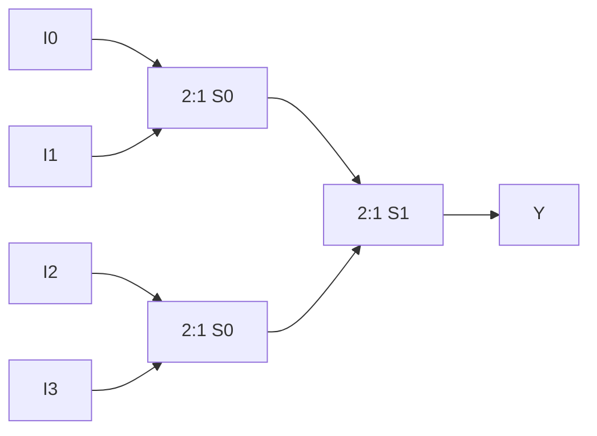

---
tags:
  - GATE/CS
  - GATE/DigitalLogic
  - CombinationalCircuits
aliases:
  - MUX
  - Data Selector
  - Multiplexer
date_created: 2026-10-13
difficulty: ⭐⭐⭐
last_revised: 2026-10-13
pyq_frequency: High
---

## Syllabus Position

Subject: [[Digital Logic]]
Parent Topic: [[Combinational Circuit]]
Sibling Topics: [[Decoder]], [[Encoder]], [[Demultiplexer]], [[Magnitude Comparator]]
Leads To: [[Shannon Expansion]], [[ALU Design]], [[FPGA Look-Up Tables]]

GATE Syllabus Line: "Combinational and sequential circuits" (Digital Logic).

Exam Weight Note: Frequent 1 or 2-mark MCQ. Typical forms are "implement function $F$ using a 4:1 MUX", "how many 2:1 MUXes make a 16:1 MUX", and "what does this MUX network compute".

## The Problem This Solves

Many data sources (registers, memory, I/O) often need to share one destination, such as a bus or an ALU input. Without a selector you would need a separate wire and gate for every source-destination pair. A multiplexer lets control bits decide which single source reaches the output.

Analogy: a railway switching yard, or a TV remote. Many channels arrive on many wires, but the selector picks one to show on one screen.

Core Idea (one sentence): a $2^n$-to-1 MUX uses $n$ select lines to copy exactly one of $2^n$ data inputs onto the single output.

## Formal Theory

A **multiplexer** (MUX) has $2^n$ **data inputs** $I_0,\dots,I_{2^n-1}$, $n$ **select lines** $S_{n-1}\dots S_0$, and one output $Y$. Some designs add an **enable** input. The output is

$$Y = \sum_{k=0}^{2^n-1} m_k(S)\cdot I_k$$

where $m_k(S)$ is the **minterm** of the select lines. Each term is "select value equals $k$, AND input $I_k$", and the OR picks the single active term.

### 2:1 MUX

$$Y = \overline{S}\,I_0 + S\,I_1$$

Gates: 1 NOT, 2 AND, 1 OR.

| S | Y |
|---|---|
| 0 | $I_0$ |
| 1 | $I_1$ |

### 4:1 MUX

$$Y = \overline{S_1}\,\overline{S_0}I_0 + \overline{S_1}S_0I_1 + S_1\overline{S_0}I_2 + S_1S_0I_3$$

Gates: 2 NOT, four 3-input AND, one 4-input OR.

### Building big MUXes from small ones (tree)

A $2^n{:}1$ MUX needs $2^n-1$ copies of 2:1 MUXes, because each 2:1 MUX removes one input from the pool.

$$\#\text{(2:1 MUXes)} = 2^{n}-1,\qquad \#(k{:}1\ \text{from } m{:}1)=\frac{k-1}{m-1}$$

For a 16:1 from 4:1: $(16-1)/(4-1)=5$. For an 8:1 from 2:1: 7.

The same select bit connects to every MUX in a given level, with the LSB on the first level.

### MUX as a universal logic element (function implementation)

Any $n$-variable function can be built on a $2^n{:}1$ MUX. Tie the variables to the select lines and wire each $I_k$ to the function's value 0 or 1 for that minterm.

The better trick uses a $2^{n-1}{:}1$ MUX through **Shannon expansion**. Use $n-1$ variables as select lines and the last variable $X$ for the data inputs. Each data input is one of $0$, $1$, $X$, $\overline{X}$:

$$F = \overline{A}\,F|_{A=0} + A\,F|_{A=1}$$

Procedure:
1. Choose $n-1$ variables as selects (the higher-order ones).
2. List pairs of minterms that share the same select value.
3. For each pair, write the input as $0$, $1$, $X$, or $\overline{X}$ based on which of the two minterms are in $F$.

A 2:1 MUX with $F=\overline{A}I_0+AI_1$ is functionally complete when constants and complements are free. With NOT available, a 2:1 MUX alone is universal ($Y=\overline{S}\cdot1+S\cdot0$ gives NOT, $I_1=0$ gives AND, $I_1=1$ gives OR).

### Demultiplexer (reverse)

A **DEMUX** routes one input to one of $2^n$ outputs by select lines. A decoder with enable acts as a DEMUX.

What GATE actually tests here: function implementation with a smaller MUX, the count of MUXes in a tree, reading the function from a MUX network, and the MUX as a universal element.

## Diagrams and Visuals

Drawing: a trapezoid with data inputs on the wide side, select lines entering from the bottom, and one output from the narrow side.

```
            4:1 MUX
   I0 --\
   I1 ---\   ____
   I2 ----->|MUX |----> Y
   I3 ---/  |4:1 |
            |____|
             | |
            S1 S0
```

Tree construction of a 4:1 from three 2:1 MUXes:



The first-level MUXes use $S_0$ and the last-level MUX uses $S_1$.

## Complexity Analysis

Circuits are measured by gate count and delay.

- Two-level SOP implementation of a $2^n{:}1$ MUX: $2^n$ AND gates (each with $n+1$ inputs), one $2^n$-input OR. Total about $O(n\,2^n)$ literals.
- Tree of 2:1 MUXes: $2^n-1$ muxes, and delay equals $n$ MUX delays, so $O(n)$ levels.
- Select lines: $n=\log_2(\text{inputs})$.

| Case | Delay | Hardware | Condition |
|---|---|---|---|
| Two-level | 3 gate levels | $2^n$ AND + 1 OR | wide OR available |
| Tree | $n$ MUX levels | $2^n-1$ 2:1 MUXes | only 2:1 MUXes |
| Function with Shannon trick | same | $2^{n-1}{:}1$ MUX + at most 1 NOT | $n$-variable function |

## Worked Example

Implement $F(A,B,C)=\sum m(1,2,6,7)$ using a 4:1 MUX with $A$ as $S_1$, $B$ as $S_0$, and $C$ for the data.

Step 1, group minterms by $AB$:

| AB | Minterms (C=0, C=1) | In F? | Input |
|----|---------------------|-------|-------|
| 00 | $m_0$, $m_1$ | $m_1$ only | $I_0=C$ |
| 01 | $m_2$, $m_3$ | $m_2$ only | $I_1=\overline{C}$ |
| 10 | $m_4$, $m_5$ | none | $I_2=0$ |
| 11 | $m_6$, $m_7$ | both | $I_3=1$ |

Step 2, verify: $A=0,B=1,C=0$ gives input $I_1=\overline{0}=1$, which matches $m_2\in F$. $A=0,B=1,C=1$ gives $I_1=0$, matching $m_3\notin F$.

Result: $I_0=C,\ I_1=\overline{C},\ I_2=0,\ I_3=1$. Cost: one 4:1 MUX and one NOT, instead of an 8:1 MUX.

What changes if you choose $B,C$ as selects instead? Group by $BC$ and use $A$ as data. The answer differs, but it implements the same $F$. A different choice of selects can need no inverter.

## Intuition Anchors

The Analogy (deepened): the railway yard has $2^n$ incoming tracks, and the select lines are the points that connect exactly one track to the outgoing line. A tree of 2:1 MUXes is a tournament bracket, where each round halves the contestants. A function implemented on a MUX is a lookup table: the selects are the address and the inputs are the stored answers.

The Mental Model: think "address then fetch". The select value is the index, and the output is the array element at that index. Shannon expansion is just "pick the select variables, and what is left is the data".

The One-Line Recall: $Y=\sum m_k(S)I_k$, so a $2^n{:}1$ MUX has $n$ selects and can implement any $(n+1)$-variable function with data inputs from $\{0,1,X,\overline{X}\}$.

The #1 Trap: students think an $n$-variable function needs a $2^n{:}1$ MUX. It seems right because each minterm needs a slot, but one variable can be moved to the data inputs, so $2^{n-1}{:}1$ suffices. Also, in tree problems, students count levels rather than the number of 2:1 MUXes ($2^n-1$).

## GATE Questions

**Question 1: GATE-style, 1-mark**

> How many 2:1 multiplexers are needed to build a 16:1 multiplexer?

- (A) 8
- (B) 15
- (C) 16
- (D) 31

<details>
<summary>Solution</summary>

**Answer: (B)**

**Reasoning:** Each 2:1 MUX merges two lines into one, reducing the count by 1. Going from 16 inputs to 1 needs 15 merges. The tree has $8+4+2+1=15$ MUXes.
- (A) 8 is only the first level.
- (C) mixes up inputs and MUXes.
- (D) is the node count of a tree including leaves.

**What this question is really testing:** the $2^n-1$ count.

**Trap to avoid:** counting levels or leaves.
</details>

---

**Question 2: Conceptual, 2-mark**

> Implement $F = A \oplus B$ using a single 2:1 MUX and at most one inverter.

<details>
<summary>Solution</summary>

Use $S=A$, $I_0=B$, $I_1=\overline{B}$. Check: $A=0$ gives $B$, and $A=1$ gives $\overline{B}$, which is $A\oplus B$. The inverter provides $\overline{B}$. The XNOR is obtained by swapping the inputs.
</details>

---

**Question 3: Hard, multi-concept, 2-mark**

> $F(A,B,C,D)=\sum m(1,3,4,6,9,11,14,15)$ is implemented with a 4:1 MUX using $A$ and $B$ as selects. Find $I_0,I_1,I_2,I_3$ in terms of $C,D$.

<details>
<summary>Solution</summary>

Group by $AB$; minterm index $=8A+4B+2C+D$.
- $AB=00$: minterms 0 to 3, in $F$: 1, 3. These are $\overline{C}D$ ($m_1$, $C=0$) and $CD$ ($m_3$), so $I_0 = D$.
- $AB=01$: minterms 4 to 7, in $F$: 4, 6. These have $D=0$ with $C=0,1$, so $I_1=\overline{D}$.
- $AB=10$: minterms 8 to 11, in $F$: 9, 11. $D=1$, so $I_2=D$.
- $AB=11$: minterms 12 to 15, in $F$: 14, 15. $m_{14}=CD'$, $m_{15}=CD$, so $I_3=C$.

Answer: $I_0=D,\ I_1=\overline{D},\ I_2=D,\ I_3=C$.
Uses [[K-Map Minimization]] ideas and the Shannon expansion.
</details>

**Pattern Recognition:**
- "Implement function using $k{:}1$ MUX" means group minterms by select value and read off $0$, $1$, $X$, $\overline{X}$.
- "How many 2:1 MUXes" means (inputs $-1$).
- A MUX network with fixed inputs means substitute and compute the output as a function.
- With a 2:1 MUX, the answer is Shannon expansion on one variable.

## Edge Cases and Failure Modes

- [ ] 1-input MUX is just a wire.
- [ ] Select line out of range (non-power-of-2 inputs): unused inputs are left unconnected, so the output is undefined for those codes.
- [ ] Select value changes while the data is changing: glitches (hazards) can appear in the output.
- [ ] Enable low: the output is 0 (or high impedance for tri-state designs).
- [ ] Select order mistake: $S_0$ vs $S_1$ swapped. The first-level MUXes in a tree must use $S_0$.
- [ ] Tying inputs: tying $I_k$ to 0 or 1 gives constants, and tying to variables gives literals.

## Comparisons

| Feature | [[Multiplexer]] | [[Decoder]] | [[Demultiplexer]] |
|---|---|---|---|
| Inputs / Outputs | $2^n$ data + $n$ select / 1 | $n$ / $2^n$ | 1 data + $n$ select / $2^n$ |
| Function | selects one input | generates minterms | routes one input |
| Implements functions | yes, directly (lookup) | needs external OR | needs external OR |
| GATE Trap | $2^{n-1}$ trick | decoder + OR | DEMUX = decoder with enable |

The most common GATE question comparing these asks which device implements a given function with the fewest components, and the answer hinges on whether the OR of minterms is internal (MUX) or external (decoder).

## Connections Web

**Must know before this topic:**
- [[Boolean Algebra]] — SOP expressions
- [[Canonical and Standard Forms]] — minterms
- [[Combinational Circuit]]
- [[K-Map Minimization]]
- [[Universal Gates]]

**Topics that build on this:**
- [[ALU Design]] — operand and operation selection
- [[FPGA Look-Up Tables]] — LUTs are MUX trees
- [[Barrel Shifter]]

**GATE subject cross-links:**
- [[Digital Logic]] > [[Combinational Circuit]]

**Cross-subject connections:**
- [[Datapath and Control]] — register file reads use MUXes
- [[Pipelining Hazards]] — forwarding MUXes
- [[Memory Addressing]]

**Standard references:**
- [[Morris Mano Digital Design Chapter 4]]

## Quick Revision Sheet

**Definition:** a MUX selects one of $2^n$ inputs via $n$ select lines.

**Core Idea:** select value = index, output = that input.

**Steps (function implementation):**
1. Pick $n-1$ variables as selects.
2. Group minterms by select value.
3. Set each input to $0$, $1$, $X$, or $\overline{X}$.
4. Verify two rows.

**Complexity:**
- $2^n{:}1$ from 2:1: $2^n-1$ MUXes, delay $n$ levels.
- 2:1: $Y=\overline{S}I_0+SI_1$.
- 4:1: $Y=\sum m_k I_k$.

**Key Properties:**
- Universal element.
- $n$-variable function needs a $2^{n-1}{:}1$ MUX plus at most 1 inverter.
- Decoder with enable = DEMUX.
- $k{:}1$ from $m{:}1$: $(k-1)/(m-1)$.

**The #1 Trap:** using a $2^n{:}1$ MUX for $n$ variables.

**When to use:** data routing and compact function implementation.

**Mnemonic:** "Select = address, Input = content."

## Revision Checklist

- [ ] I can state the formal definition without looking.
- [ ] I can explain the railway analogy.
- [ ] I can implement a 3-variable function on a 4:1 MUX in under 2 minutes.
- [ ] I can derive the $2^n-1$ count.
- [ ] I know the Quick Revision Sheet without reading it.
- [ ] I can solve all 3 GATE questions without peeking.
- [ ] I know the #1 trap.
- [ ] I have linked this note in my Obsidian vault.
- [ ] I have scheduled a spaced-repetition review in 3 days.
