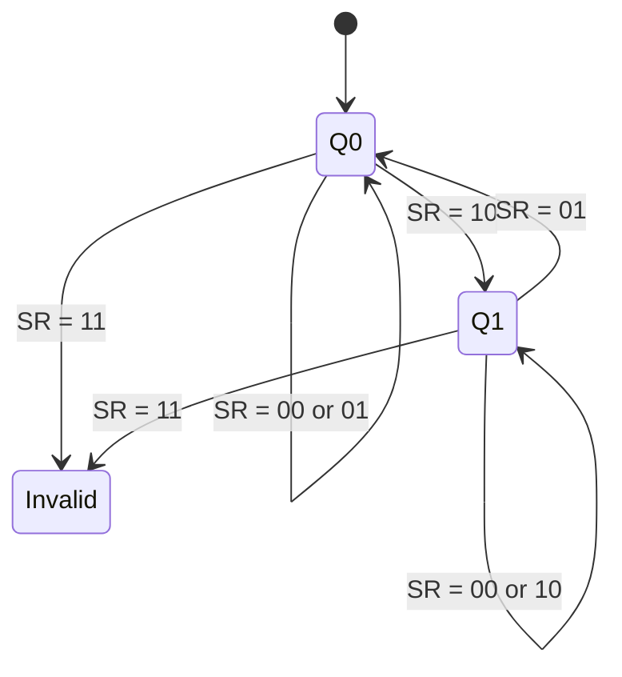

---
tags:
  - GATE/CS
  - GATE/DigitalLogic
  - SequentialCircuits
  - FlipFlops
aliases:
  - SR Latch
  - Set-Reset Flip Flop
  - SR FF
date_created: 2026-10-17
difficulty: ⭐⭐⭐
last_revised: 2026-10-17
pyq_frequency: Medium
---

## Syllabus Position

Subject: [[Digital Logic Index]]
Parent Topic: [[Flip Flops]]
Sibling Topics: [[JK Flip Flop]], [[D Flip Flop]], [[T Flip Flop]]
Leads To: [[Master Slave Flip Flop]], [[Counters]], [[Registers]], [[Sequential Circuit Design]]

GATE Syllabus Line: "Digital Logic: Boolean algebra. Combinational and sequential circuits. Minimization. Number representations and computer arithmetic (fixed and floating point)."

Exam Weight Note: Appears as 1-mark MCQ on the characteristic equation or invalid state, and as a 2-mark question on flip flop conversion (SR to D/T/JK) or analysing a sequence of inputs.

## The Problem This Solves

A combinational circuit forgets its inputs the moment they change. A computer needs memory: a way to remember one bit after the cause has gone away. We need a circuit that can be told "remember 1" or "remember 0", and otherwise keeps whatever it already holds.

Analogy: a light switch with two separate buttons. One button turns the light on (Set), the other turns it off (Reset). If you press neither, the light stays as it was. If you press both at once, the switch is confused and nobody knows what the light will do.

Core Idea (one sentence): The SR flip flop is two cross-coupled gates whose feedback loop stores one bit, with $S$ forcing the output to 1, $R$ forcing it to 0, and neither input leaving it unchanged.

## Formal Theory

An **SR flip flop** is a one-bit [[Sequential Circuit]] with inputs $S$ (set) and $R$ (reset) and complementary outputs $Q$ and $\overline{Q}$. Its next state $Q^+$ (or $Q_{n+1}$) depends on the inputs and the present state $Q$.

### Basic NOR Latch (active-high inputs)

Two [[NOR Gate]]s are cross-coupled: $Q = \overline{R + \overline{Q}}$ and $\overline{Q} = \overline{S + Q}$.

- $S=1, R=0$: $\overline{Q}$ goes to 0, so $Q = 1$. Set.
- $S=0, R=1$: $Q$ goes to 0, so $\overline{Q} = 1$. Reset.
- $S=0, R=0$: both gates act as inverters of the feedback, so the loop holds. Memory.
- $S=1, R=1$: both outputs are forced to 0, so $Q = \overline{Q} = 0$. This breaks complementarity: **invalid state**.

### Basic NAND Latch (active-low inputs)

Two [[NAND Gate]]s are cross-coupled: $Q = \overline{\overline{S}\cdot \overline{Q}}$ style, with inputs labelled $\overline{S}$ and $\overline{R}$.

- $\overline{S}=0, \overline{R}=1$: $Q = 1$. Set.
- $\overline{S}=1, \overline{R}=0$: $Q = 0$. Reset.
- $\overline{S}=\overline{R}=1$: hold.
- $\overline{S}=\overline{R}=0$: $Q=\overline{Q}=1$. Invalid.

The NAND latch is the mirror image of the NOR latch: it responds to 0, while NOR responds to 1. This follows from [[Duality and Complement of Boolean Functions]].

### Clocked SR Flip Flop

Adding two AND gates (NOR version) or two NAND gates (NAND version) in front of the latch gates $S$ and $R$ with a clock $CLK$. The latch only responds when $CLK = 1$ (level-triggered) or on the clock edge (edge-triggered). See [[Latches]] for the level/edge distinction.

### Truth Table (Characteristic Table)

| $S$ | $R$ | $Q$ | $Q^+$ | Operation |
|---|---|---|---|---|
| 0 | 0 | 0 | 0 | Hold |
| 0 | 0 | 1 | 1 | Hold |
| 0 | 1 | 0 | 0 | Reset |
| 0 | 1 | 1 | 0 | Reset |
| 1 | 0 | 0 | 1 | Set |
| 1 | 0 | 1 | 1 | Set |
| 1 | 1 | 0 | X | Invalid |
| 1 | 1 | 1 | X | Invalid |

### Characteristic Equation

Fill a [[K-Map Minimization]] over $S, R, Q$ with $SR=11$ as don't-cares:

| $Q \backslash SR$ | 00 | 01 | 11 | 10 |
|---|---|---|---|---|
| 0 | 0 | 0 | X | 1 |
| 1 | 1 | 0 | X | 1 |

Groups: the pair $\{SR=10\}$ (both $Q$ rows) plus the X at 11 gives $S$. The cell $Q=1, SR=00$ pairs with $Q=1, SR=10$ and the X at 11, giving $\overline{R}Q$. So:

$$Q^+ = S + \overline{R}\,Q \quad \text{with constraint } S\cdot R = 0$$

The constraint $SR=0$ is part of the answer: the equation is only valid when the invalid input is never applied.

### Excitation Table

Given a required transition $Q \to Q^+$, what inputs are needed? Read the characteristic table backwards.

| $Q$ | $Q^+$ | $S$ | $R$ |
|---|---|---|---|
| 0 | 0 | 0 | X |
| 0 | 1 | 1 | 0 |
| 1 | 0 | 0 | 1 |
| 1 | 1 | X | 0 |

Justification: for $0\to0$ either "hold" ($SR=00$) or "reset" ($SR=01$) works, so $R$ is a don't-care. For $1\to1$ either "hold" or "set" works, so $S$ is a don't-care.

### Conversions using SR

- SR to D: $S = D$, $R = \overline{D}$ (this removes the invalid state). See [[D Flip Flop]].
- SR to T: $S = T\overline{Q}$, $R = TQ$. See [[T Flip Flop]].
- SR to JK: $S = J\overline{Q}$, $R = KQ$. This is exactly how [[JK Flip Flop]] fixes the invalid state: when $J=K=1$ it toggles.

What GATE actually tests here: the characteristic equation $Q^+ = S + \overline{R}Q$, which input combination is forbidden, the excitation table don't-cares, the NAND latch being active-low, and conversion to other flip flops.

## Diagrams and Visuals

Drawing instructions: draw two NOR gates side by side. The output of the top gate ($Q$) feeds back into the input of the bottom gate; the output of the bottom gate ($\overline{Q}$) feeds back into the top gate. External $R$ enters the top gate, $S$ enters the bottom gate.

```
 R ---+--------\
      |  NOR    )o----+----- Q
      |  +-----/      |
      |  |            |   (cross-coupled feedback)
      |  +------------+---+
      |                   |
      |  +----------------+
      |  |
 S ---+--+-----\
         |NOR   )o----+---- Q'
         +----/
```

Labels: top gate produces $Q$, bottom gate produces $\overline{Q}$, each output is fed to the opposite gate's second input. This loop is the memory.

NAND version: replace NOR with NAND and rename inputs $\overline{S},\overline{R}$.

Clocked version (NAND):

```
 S ---[NAND]---\
        |       [NAND]--- Q
 CLK ---+       ^   |
        |       |   v
 R ---[NAND]---[NAND]--- Q'
```

State diagram:



Timing trace (NOR latch, starting $Q=0$):

```
S : __|‾|_______________
R : ________|‾|_________
Q : ______|‾‾‾‾‾|_______    (set at S pulse, held, reset at R pulse)
```

## Complexity Analysis

Not an algorithm, so we analyse hardware cost and delay.

- Gate count: basic latch = 2 gates; clocked = 4 gates (2 steering gates + 2 latch gates).
- Propagation delay: from input change to stable $Q$ takes about $2t_{pd}$, one delay per gate around the feedback loop (set path: input gate, then the other gate must settle).
- State complexity: 1 bit of memory means 2 valid states. A circuit with $n$ SR flip flops has $2^n$ states, so counting $N$ states needs $\lceil \log_2 N \rceil$ flip flops.

| Case | Delay | Gates | Trigger Condition |
|---|---|---|---|
| Set/Reset | $\approx 2\,t_{pd}$ | 2 (basic) / 4 (clocked) | One input active, other inactive |
| Hold | 0 (no change) | same | $SR = 00$ |
| Invalid | Unpredictable | same | $SR=11$ then both released together: race, output depends on which gate is faster |

Justification of the race: when $S=R=1$ is released simultaneously, both gates see inputs $(0, 0)$ with outputs $(0,0)$. Each tries to go to 1, then each sees the other at 1 and tries to go to 0. The result is oscillation or a random final state.

## Worked Example

Clocked SR flip flop (positive edge), initial $Q=0$. Apply the sequence below, one pair per clock edge. Use $Q^+ = S + \overline{R}Q$.

| Clock | $S$ | $R$ | $Q$ (before) | $S + \overline{R}Q$ | $Q^+$ |
|---|---|---|---|---|---|
| 1 | 1 | 0 | 0 | $1 + 1\cdot0 = 1$ | 1 |
| 2 | 0 | 0 | 1 | $0 + 1\cdot1 = 1$ | 1 |
| 3 | 0 | 1 | 1 | $0 + 0\cdot1 = 0$ | 0 |
| 4 | 0 | 0 | 0 | $0 + 1\cdot0 = 0$ | 0 |
| 5 | 1 | 0 | 0 | $1$ | 1 |
| 6 | 0 | 1 | 1 | $0$ | 0 |

Output sequence: $1,1,0,0,1,0$. Total operations: 6 clock edges, 6 evaluations of the equation. This confirms the $O(1)$ per-edge behaviour because each edge needs one fixed two-gate evaluation independent of history length.

What changes if the input is $SR=11$ on clock 7? The equation would give $Q^+ = 1$, but the physical circuit gives $Q=\overline{Q}$ (0 for NOR, 1 for NAND) and the state after release is unpredictable. A designer must guarantee $SR=11$ never occurs.

## Intuition Anchors

**The Analogy (restated and deepened):** The two-button light. Press Set: light on. Press Reset: light off. Press nothing: hold (this is the memory). Press both: the two buttons fight, which is the invalid state. The excitation table is asking "which button must I press to move the light from its present state to a wanted state?". For wanting "stay off", you can press nothing or Reset, so Reset is optional, hence X.

**The Mental Model:** Picture a see-saw with two inputs. $S$ pushes the $Q$ end up, $R$ pushes it down. With no push it stays where it is. Experts only track the pair $(Q,\overline{Q})$ and ask: does the new input force a change, or does the loop hold?

**The One-Line Recall:** $Q^+ = S + \overline{R}Q$ with $SR = 0$: Set wins when $S=1$, otherwise keep $Q$ unless $R=1$ clears it.

**The #1 Trap:** Students assume $S=R=1$ gives "set" or "toggle" (confusing it with JK). It seems right because both buttons are pressed. In truth, SR has no defined behaviour there; the NOR latch gives $Q=\overline{Q}=0$, and releasing together causes a race. Toggle exists only in [[JK Flip Flop]]. Also, the NAND latch is active-low, so $\overline{S}=\overline{R}=0$ is its invalid state, not 11.

## GATE Questions

---

**Question 1 — [GATE-style] — [1-mark]**

> The characteristic equation of an SR flip flop, assuming the input combination $S=R=1$ never occurs, is

- (A) $Q^+ = S + RQ$
- (B) $Q^+ = S + \overline{R}Q$
- (C) $Q^+ = \overline{S} + \overline{R}Q$
- (D) $Q^+ = S + R\overline{Q}$

<details>
<summary>Solution</summary>

**Answer: (B)**

**Reasoning:** Check each of the valid input rows. $SR=00$ needs $Q^+=Q$; $SR=01$ needs 0; $SR=10$ needs 1.
- (A): at $SR=01$, $Q=1$: $0 + 1 = 1$, but must be 0. Wrong.
- (B): $00 \to Q$, $01\to 0$, $10 \to 1$. Correct.
- (C): at $SR=10$, $Q=0$: $0 + 1\cdot0 = 0$, but must be 1. Wrong.
- (D): at $SR=01$, $Q=1$: $0 + 1\cdot0 = 0$ ok; but at $SR=00$, $Q=1$: $0 + 0 = 0$, but it must hold 1. Wrong.
Only (B) matches all valid rows.
**What this question is really testing:** Deriving the characteristic equation from the K-map with the invalid row as don't-care.

**Trap to avoid:** Writing $RQ$ instead of $\overline{R}Q$; the hold term needs $R=0$.

</details>

---

**Question 2 — [Numerical] — [2-mark]**

> A positive-edge-triggered SR flip flop starts with $Q=0$. The $(S,R)$ inputs at five successive clock edges are $(1,0),(0,0),(0,1),(0,0),(1,0)$. What is $Q$ after the fifth edge, and how many edges changed the output?

<details>
<summary>Solution</summary>

Apply $Q^+ = S + \overline{R}Q$:
1. $(1,0)$: $Q=1$ (changed 0 to 1)
2. $(0,0)$: $Q=1$ (hold)
3. $(0,1)$: $Q=0$ (changed)
4. $(0,0)$: $Q=0$ (hold)
5. $(1,0)$: $Q=1$ (changed)

**Answer:** $Q=1$ after the fifth edge; 3 edges changed the output.

</details>

---

**Question 3 — [Hard / Multi-concept] — [2-mark]**

> An SR flip flop is connected so that $S = T\overline{Q}$ and $R = TQ$, where $T$ is an external input. (i) Can the invalid input ever occur? (ii) What flip flop does the circuit behave as?

<details>
<summary>Solution</summary>

(i) $SR = T\overline{Q}\cdot TQ = T\,(\overline{Q}Q) = 0$ always, since $Q\overline{Q}=0$. So $S=R=1$ never occurs.

(ii) Substitute into the characteristic equation:
$$Q^+ = T\overline{Q} + \overline{TQ}\,Q = T\overline{Q} + (\overline{T}+\overline{Q})Q = T\overline{Q} + \overline{T}Q = T \oplus Q$$

Hold when $T=0$, toggle when $T=1$. It is a **T flip flop**.

**What this question is really testing:** Flip flop conversion using the characteristic equation and spotting that feedback removes the invalid state.

**Trap to avoid:** Forgetting $\overline{TQ} = \overline{T}+\overline{Q}$ (De Morgan) and getting the wrong simplification.

</details>

---

**Pattern Recognition:**
- "Which input is not allowed?" is always $S=R=1$ (NOR/clocked) or $\overline{S}=\overline{R}=0$ (NAND latch).
- Sequence-tracing questions: apply $Q^+ = S + \overline{R}Q$ row by row; do not guess.
- Conversion questions: use the excitation table of the target ($Q\to Q^+$ gives needed $S,R$) or substitute into the characteristic equation.
- Excitation table don't-cares: $0\to0$ gives $R=X$; $1\to1$ gives $S=X$.

## Edge Cases and Failure Modes

- [ ] $S=R=1$: wrong assumption is "it sets" or "it toggles". Actual: undefined state. Fix: gate inputs so $SR=0$, or use [[D Flip Flop]] / [[JK Flip Flop]].
- [ ] Power-up: wrong assumption is $Q=0$ at start. Actual: random, depends on gate mismatch. Fix: use asynchronous preset/clear.
- [ ] Simultaneous release from $SR=11$: race condition and possible metastability. Fix: release one input first.
- [ ] Level-triggered clocked SR: input changes while $CLK=1$ pass straight through, so glitches corrupt the state. Fix: edge-trigger or use [[Master Slave Flip Flop]].
- [ ] NAND latch active-low: wrong assumption is "11 is invalid". Actual: $\overline{S}\overline{R}=11$ is hold, 00 is invalid.
- [ ] Excitation table X entries: treating X as 0 when conversion needs minimisation loses simplification, treating it as a real value is wrong.
- [ ] Input of size 0 or 1 does not apply; the analogue is "no clock edge", where the state simply stays.

## Comparisons

| Feature | [[SR Flip Flop]] | [[JK Flip Flop]] | [[D Flip Flop]] | [[T Flip Flop]] |
|---|---|---|---|---|
| Characteristic equation | $S+\overline{R}Q$ | $J\overline{Q}+\overline{K}Q$ | $D$ | $T\oplus Q$ |
| Inputs | 2 | 2 | 1 | 1 |
| Invalid input | $S=R=1$ | None | None | None |
| Toggle | No | Yes ($J=K=1$) | No | Yes ($T=1$) |
| Key Property | Basic set/reset memory | Universal | Data storage | Counting |
| GATE Trap | Invalid state | Race-around (level-triggered) | Delay by one clock | Frequency division by 2 |

The most common GATE question comparing these asks which flip flop has a forbidden input or which can toggle, and the answer hinges on the feedback ($S=J\overline{Q}$, $R=KQ$) that JK adds to SR to make $11$ legal.

## Connections Web

**Must know before this topic:**
- [[NOR Gate]] and [[NAND Gate]] — the building blocks of the latch
- [[Universal Gates]] — why NAND/NOR alone can build it
- [[Boolean Algebra]] — to simplify the characteristic equation
- [[K-Map Minimization]] — deriving $Q^+$ with don't-cares

**Topics that build on this:**
- [[JK Flip Flop]], [[D Flip Flop]], [[T Flip Flop]]
- [[Master Slave Flip Flop]]
- [[Counters]], [[Registers]]

**GATE subject cross-links:**
- [[Digital Logic Index]] > [[Flip Flops]] > [[Latches]]

**Cross-subject connections:**
- [[Computer Organization Index]] — registers and memory cells are arrays of flip flops
- [[Sequential Circuit]] — state machines are built from these

**Standard references:**
- [[Morris Mano Chapter 5]] — Synchronous Sequential Logic

## Quick Revision Sheet

**Definition (1 sentence):** A 1-bit memory cell with set input $S$ and reset input $R$, built from cross-coupled NOR or NAND gates.

**Core Idea / Analogy (1 sentence):** Two buttons, On and Off; pressing neither keeps the state, pressing both is forbidden.

**Algorithm Steps:**
1. $SR=00$: hold $Q$.
2. $SR=01$: reset, $Q^+=0$.
3. $SR=10$: set, $Q^+=1$.
4. $SR=11$: invalid, never use.

**Complexity:**
- Time: delay $\approx 2t_{pd}$ per change; 2 gates basic, 4 gates clocked.
- Space: 1 bit.
- Recurrence: $Q^+ = S + \overline{R}Q$, with $SR=0$.

**Key Properties:**
- Excitation table: $0\to0$: $(0,X)$; $0\to1$: $(1,0)$; $1\to0$: $(0,1)$; $1\to1$: $(X,0)$.
- NOR latch is active-high; NAND latch is active-low.
- SR to D: $S=D, R=\overline{D}$. SR to T: $S=T\overline{Q}, R=TQ$.
- Invalid state forces $Q=\overline{Q}$.

**The #1 Trap:** $S=R=1$ is not toggle; that belongs to JK.

**When to use this over alternatives:** Only for basic control latches (e.g., debouncing); prefer D or JK in design.

**Mnemonic or one-liner:** "Set wins, Reset clears, zero zero holds, one one folds."

## Revision Checklist

- [ ] I can state the formal definition without looking.
- [ ] I can explain the analogy and map it to the algorithm or concept.
- [ ] I can trace a 6-element example by hand in under 2 minutes.
- [ ] I can derive the characteristic equation from the K-map from scratch.
- [ ] I know what the Quick Revision Sheet says without reading it.
- [ ] I can solve all 3 GATE questions in this note without peeking.
- [ ] I know the #1 trap and can articulate why students fall for it.
- [ ] I have linked this note correctly in my Obsidian vault.
- [ ] I have scheduled a spaced-repetition review in 3 days.
