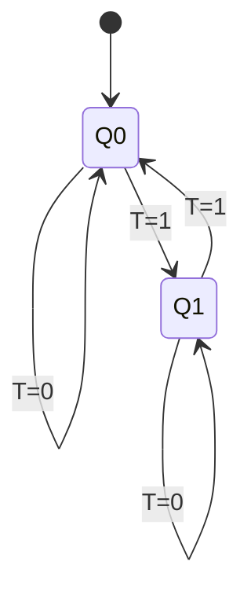
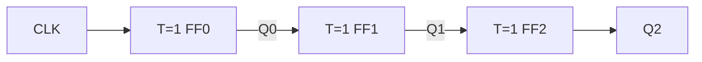

---
tags:
  - GATE/CS
  - GATE/DigitalLogic
  - SequentialCircuits
  - FlipFlops
aliases:
  - Toggle Flip Flop
  - T FF
  - Trigger Flip Flop
date_created: 2026-10-17
difficulty: ⭐⭐⭐
last_revised: 2026-10-17
pyq_frequency: Medium
---

## Syllabus Position

Subject: [[Digital Logic Index]]
Parent Topic: [[Flip Flops]]
Sibling Topics: [[SR Flip Flop]], [[JK Flip Flop]], [[D Flip Flop]], [[Latches]]
Leads To: [[Counters]], [[Ripple Counter]], [[Frequency Division]], [[Sequential Circuit Design]]

GATE Syllabus Line: "Combinational and sequential circuits" (Digital Logic: Boolean algebra, combinational and sequential circuits, minimization, number representations and computer arithmetic).

Exam Weight Note: Appears as 1- or 2-mark MCQ/NAT, usually as a counter/frequency-division question, a flip-flop conversion, or a characteristic-equation derivation.

## The Problem This Solves

Many circuits need a memory element that simply flips its stored bit on every event: counting pulses, dividing a clock, or producing alternating outputs. With an [[SR Flip Flop]] or [[D Flip Flop]], you must feed the right data in each time. It would be far easier to have a device where one input says "change" or "stay".

Analogy: a push-button light switch. Press (T = 1) and the light flips state; do not press (T = 0) and it stays as it is. Press it at every tick of a clock and the light blinks at exactly half the rate of the presses.

Core Idea (one sentence): A T flip flop keeps its state when $T=0$ and complements its state when $T=1$ at each active clock edge, so $Q^+ = T \oplus Q$.

## Formal Theory

A **T Flip Flop** is a single-input clocked [[Flip Flops|flip flop]] derived from a [[JK Flip Flop]] with $J=K=T$. It removes the forbidden/invalid input of the [[SR Flip Flop]] and removes the "set/reset" choice of the JK.

### Truth Table and Characteristic Table

| $T$ | $Q$ | $Q^+$ | Action |
|---|---|---|---|
| 0 | 0 | 0 | Hold |
| 0 | 1 | 1 | Hold |
| 1 | 0 | 1 | Toggle |
| 1 | 1 | 0 | Toggle |

Characteristic equation (read off the table: $Q^+=1$ when $T=1,Q=0$ or $T=0,Q=1$):

$$Q^+ = T\bar{Q} + \bar{T}Q = T \oplus Q$$

The [[XOR Gate]] is the key: XOR with 0 passes $Q$ through (hold), XOR with 1 inverts $Q$ (toggle).

### Excitation Table

Used for design: given the desired change $Q \to Q^+$, what must $T$ be?

| $Q$ | $Q^+$ | $T$ |
|---|---|---|
| 0 | 0 | 0 |
| 0 | 1 | 1 |
| 1 | 0 | 1 |
| 1 | 1 | 0 |

So $T = Q \oplus Q^+$: T is 1 exactly when the bit must change.

### Building a T Flip Flop

- From JK: tie $J$ and $K$ together to $T$.
- From D: $D = T \oplus Q$ (an XOR gate in the feedback path).
- Direct T flip flops are rare as ICs; they are made from the above.

Pseudocode:

```
Algorithm T_FF(T, clk_edge):
    if clk_edge is active:
        if T == 1:
            Q = NOT Q
        // else Q unchanged
    return Q
```

### Race-Around and Edge Triggering

If T=1 and a level-triggered clock stays high longer than the propagation delay, the output toggles repeatedly (race-around), as in an unclocked JK. The fix is edge triggering or a [[Master Slave Flip Flop]] arrangement. GATE assumes edge-triggered T flip flops.

### Conversions

Use the excitation-table method: write the target flip flop's behavior, then derive the inputs of the available flip flop.

**T to D:** need $Q^+ = D$. Since $T = Q \oplus Q^+$, we get $T = D \oplus Q$.

**T to JK:** need $Q^+ = J\bar{Q} + \bar{K}Q$. Then $T = Q \oplus Q^+ = J\bar{Q} + KQ$.

**T to SR:** $Q^+ = S + \bar{R}Q$ with $SR=0$, so $T = S\bar{Q} + RQ$.

**D to T:** $D = T \oplus Q$.

**JK to T:** $J = K = T$.

**SR to T:** $S = T\bar{Q}$, $R = TQ$.

### Frequency Division

With $T=1$, the flip flop toggles on each active clock edge, so a full output cycle needs two clock edges of one polarity:

$$f_{out} = \frac{f_{clk}}{2}$$

The output is a square wave with 50% duty cycle even if the clock is not. Cascading $n$ stages divides by $2^n$:

$$f_{out} = \frac{f_{clk}}{2^n}$$

### Counters (Ripple / Asynchronous)

Chain T flip flops (T=1) with each stage clocked by the previous stage's output. This is an asynchronous **ripple counter**. An $n$-bit one counts modulo $2^n$.

- Negative-edge triggered, clock from $Q$ of previous stage: up counter.
- Negative-edge triggered, clock from $\bar{Q}$ of previous stage: down counter.
- Positive-edge triggered flips these roles.

Synchronous counters instead share one clock and set $T_i = Q_{i-1}Q_{i-2}\cdots Q_0$ for an up counter. A mod-$N$ ripple counter (N not a power of 2) uses a NAND gate on the stage outputs to asynchronously clear at count $N$.

What GATE actually tests here: the characteristic equation, the excitation table for conversions or counter design, frequency or count sequences of cascaded stages, and ripple-delay limits on maximum clock frequency.

## Diagrams and Visuals

Drawing instructions: draw a rectangle labelled T FF with input T and clock triangle on the left, outputs $Q$ and $\bar{Q}$ on the right. For the D-based version draw an XOR gate whose inputs are T and Q, output feeding D.

```
        +-----+
 T -----|T   Q|---- Q
        |     |
 CLK ->|>  Q'|---- Q'
        +-----+
```

T flip flop from a D flip flop:

```
 T ---+
      |XOR|---> D [D FF] ---> Q ---+
 Q ---+                            |
  ^--------------------------------+
```

State diagram:



Timing for T=1 (negative edge triggered):

```
CLK : _|‾|_|‾|_|‾|_|‾|_
Q   : ‾‾‾|_____|‾‾‾‾‾|__
```

Q changes only at active edges and has half the clock frequency.

3-bit ripple counter:



Each stage divides the frequency by 2; $Q_0$ is $f/2$, $Q_1$ is $f/4$, $Q_2$ is $f/8$.

## Complexity Analysis

For sequential circuits, the relevant "complexity" is timing and state count.

- State complexity: 1 flip flop = 2 states; $n$ flip flops give up to $2^n$ states, which is why a mod-$N$ counter needs $\lceil \log_2 N \rceil$ T flip flops.
- Ripple counter delay: each stage adds a propagation delay $t_{pd}$, so the worst-case settling time is $n \cdot t_{pd}$. The clock period must satisfy $T_{clk} \ge n\,t_{pd}$ (plus decode time), so $f_{max} \le \dfrac{1}{n\,t_{pd}}$.
- Synchronous counter delay: $t_{pd,FF} + t_{AND}$ with AND of up to $n-1$ inputs, independent of the ripple chain, so it is faster.

| Case | Time | Space | Trigger Condition |
|---|---|---|---|
| Single FF toggle | $t_{pd}$ | 1 flip flop | $T=1$ at active edge |
| Ripple counter (worst) | $n\,t_{pd}$ | $n$ flip flops | All bits change, e.g. 0111 to 1000 |
| Ripple counter (best) | $t_{pd}$ | $n$ flip flops | Only LSB changes |
| Synchronous counter | $t_{pd}+t_{AND}$ | $n$ FFs + AND gates | Shared clock |

## Worked Example

Design: 3-bit ripple up counter, negative-edge T flip flops, $T=1$, count starting at 000. Count 8 clock pulses.

Stage rule: $Q_0$ toggles on every clock fall; $Q_1$ toggles when $Q_0$ falls (1 to 0); $Q_2$ toggles when $Q_1$ falls.

| Pulse | $Q_2Q_1Q_0$ | What toggled |
|---|---|---|
| start | 000 | |
| 1 | 001 | $Q_0$ |
| 2 | 010 | $Q_0$ falls, $Q_1$ toggles |
| 3 | 011 | $Q_0$ |
| 4 | 100 | $Q_0$ falls, $Q_1$ falls, $Q_2$ toggles |
| 5 | 101 | $Q_0$ |
| 6 | 110 | $Q_0$ falls, $Q_1$ toggles up |
| 7 | 111 | $Q_0$ |
| 8 | 000 | all fall, wraps |

Toggle events: $Q_0$ toggled 8 times, $Q_1$ 4 times, $Q_2$ 2 times. Total operations: 14 toggles. This confirms the divide-by-$2^i$ claim because stage $i$ toggles $8/2^i$ times in 8 clocks, so its output frequency is $f/2^{i+1}$.

Edge case: What changes if the flip flops are positive-edge triggered? The stage clock sees the 0 to 1 transition of the previous Q, so the same wiring counts down (000, 111, 110, ...). To count up, clock each stage from the previous $\bar{Q}$.

## Intuition Anchors

**The Analogy (restated and deepened):** The toggle switch flips only when pressed (T=1). A chain of switches, where each is pressed when the previous one goes from on to off, is an odometer: the last wheel moves only after the lower wheels roll over. Delay is the time for the carry to roll through wheels (ripple delay). Pressing with no effect (T=0) is the hold case.

**The Mental Model:** Experts see T as "XOR with my own output": new $Q$ = old $Q$ XOR T. For counters they picture each bit flipping exactly when all lower bits are 1 (synchronous) or when the lower bit falls (ripple).

**The One-Line Recall:** $Q^+ = T \oplus Q$; with $T=1$ the output is $f/2$, and $n$ stages count mod $2^n$.

**The #1 Trap:** Students assume a ripple counter with positive-edge FFs fed from $Q$ counts up, because "ripple counter" sounds like "up counter". In fact the next stage toggles on the 0 to 1 edge of the previous $Q$, which happens when the previous bit goes from 1 to 0 only on a down count. So positive edge with $Q$ gives a down counter; the correct up wiring is positive edge with $\bar{Q}$.

## GATE Questions

**Question 1 — GATE-style — 1-mark**

> A T flip flop has $T=1$ and is clocked by a 64 kHz square wave. Four such flip flops are cascaded as a ripple chain. The output frequency of the last stage is

- (A) 32 kHz
- (B) 16 kHz
- (C) 8 kHz
- (D) 4 kHz

<details>
<summary>Solution</summary>

**Answer: (D)**

**Reasoning:** Each stage halves the frequency, so $f = 64/2^4 = 4$ kHz. (A) is one stage only, (B) two stages, (C) three stages; each ignores a stage.

**What this question is really testing:** Frequency division by $2^n$.

**Trap to avoid:** Dividing by $n$ or counting only 3 stages.

</details>

---

**Question 2 — Numerical — 2-mark**

> A 4-bit ripple counter uses flip flops with propagation delay 20 ns each. Ignoring decode time, what is the maximum clock frequency for reliable operation?

<details>
<summary>Solution</summary>

Worst-case settling happens when the ripple travels through all 4 stages: $4 \times 20 = 80$ ns. So $f_{max} = 1/80\text{ ns} = 12.5$ MHz.

</details>

---

**Question 3 — Hard / Multi-concept — 2-mark**

> A D flip flop is used to build a T flip flop by feeding $D = X$. Which expression for $X$ is correct? Additionally, a T flip flop is to implement a JK; what is $T$?

<details>
<summary>Solution</summary>

D to T: $Q^+ = D$ must equal $T \oplus Q$, so $X = T \oplus Q$ (XOR of T and the present output).

T to JK: $T = Q \oplus Q^+$ with $Q^+ = J\bar{Q} + \bar{K}Q$. If $Q=0$: $Q^+=J$, so $T=J$. If $Q=1$: $Q^+=\bar{K}$, so $T=K$. Hence $T = J\bar{Q} + KQ$.

Check: J=K=1 gives $T = \bar Q + Q = 1$, toggle, as required for JK.

</details>

---

**Pattern Recognition:**
- Frequency question with n stages: divide by $2^n$; modulus of a ripple counter is $2^n$ unless reset logic is added.
- Conversion question: write the excitation table, then use $T = Q \oplus Q^+$.
- "Maximum frequency" question for ripple counter: multiply per-stage delay by number of stages.
- Check edge polarity and whether the clock comes from $Q$ or $\bar Q$ before deciding up or down.

## Edge Cases and Failure Modes

- [ ] Input of size 0 or 1: with $T=0$ the circuit never changes. Fix: tie T to 1 for a divider.
- [ ] Unknown start state: a counter powers up in a random state. Fix: use an asynchronous clear or preset.
- [ ] Level-triggered T FF with $T=1$: race-around toggling. Fix: use edge triggering or [[Master Slave Flip Flop]].
- [ ] Ripple glitches: intermediate states appear (0111 to 0110 to 0100 to 0000 to 1000), so decoding spikes. Fix: use a synchronous counter.
- [ ] Off-by-one in modulus: a mod-6 counter needs reset at count 6 (110), not 5, in the asynchronous clear scheme. Fix: decode the first invalid state.
- [ ] Odd mod counts are not 50% duty cycle. Fix: only pure power-of-2 division gives symmetry.
- [ ] Wrong polarity: swapping $Q$ and $\bar{Q}$ turns up into down. Fix: check edge type first.

## Comparisons

| Feature | [[T Flip Flop]] | [[JK Flip Flop]] | [[D Flip Flop]] |
|---|---|---|---|
| Time Complexity | One gate delay plus FF delay | Same | Same |
| Space Complexity | 1 FF | 1 FF, 2 inputs | 1 FF |
| Key Property | $Q^+ = T\oplus Q$ | $Q^+ = J\bar Q + \bar K Q$ | $Q^+ = D$ |
| When to Prefer | Counters, dividers | General purpose | Registers, storage |
| GATE Trap | Hold at T=0, not reset | J=K=1 toggles | Not a toggler by itself |

The most common GATE question comparing these is converting one flip flop into another, and the answer hinges on the excitation table of the target flip flop and the characteristic equation of the one you have.

## Connections Web

**Must know before this topic:**
- [[Flip Flops]] — basic memory element and clocking
- [[Latches]] — level-triggered ancestors
- [[SR Flip Flop]] — foundation of all other types
- [[JK Flip Flop]] — T is its J=K special case
- [[D Flip Flop]] — conversion partner
- [[XOR Gate]] — the toggle logic

**Topics that build on this:**
- [[Counters]]
- [[Ripple Counter]]
- [[Frequency Division]]
- [[Sequential Circuit Design]]

**GATE subject cross-links:**
- [[Digital Logic Index]] > [[Sequential Circuits]]

**Cross-subject connections:**
- [[Clock Frequency and CPU Cycle]] — clock dividers feed processor timing in COA
- [[Master Slave Flip Flop]] — prevents race-around in toggle mode

**Standard references:**
- [[Morris Mano Digital Design Chapter 5]]

## Quick Revision Sheet

**Definition (1 sentence):** T flip flop holds its state when $T=0$ and toggles when $T=1$.

**Core Idea / Analogy (1 sentence):** A push-button toggle switch pressed on each clock edge.

**Algorithm Steps:**
1. Wait for the active clock edge.
2. If $T=0$, keep $Q$.
3. If $T=1$, complement $Q$.
4. For counters, clock stage $i+1$ from stage $i$ output (or $\bar Q$).
5. For conversions, use $T=Q\oplus Q^+$.

**Complexity:**
- Time (best / average / worst): $t_{pd}$ / $\sim 2t_{pd}$ / $n\,t_{pd}$ (ripple)
- Space: 1 FF per bit
- Recurrence: $Q^+ = T \oplus Q$

**Key Properties:**
- $T = Q \oplus Q^+$ (excitation).
- $T=1$ gives divide-by-2, 50% duty cycle.
- $n$ stages give mod $2^n$.
- No invalid input state.
- T to D: $D = T\oplus Q$; JK to T: $J=K=T$.

**The #1 Trap:** Positive-edge FFs clocked from $Q$ make a down counter.

**When to use this over alternatives:** Counters and frequency dividers.

**Mnemonic or one-liner:** "T = 1, Toggle; T = 0, Tight (hold)."

## Revision Checklist

- [ ] I can state the formal definition without looking.
- [ ] I can explain the analogy and map it to the algorithm or concept.
- [ ] I can trace a 6-element example by hand in under 2 minutes.
- [ ] I can derive the worst-case complexity from scratch.
- [ ] I know what the Quick Revision Sheet says without reading it.
- [ ] I can solve all 3 GATE questions in this note without peeking.
- [ ] I know the #1 trap and can articulate why students fall for it.
- [ ] I have linked this note correctly in my Obsidian vault.
- [ ] I have scheduled a spaced-repetition review in 3 days.
