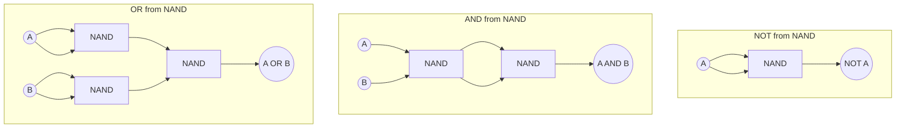

---
tags:
  - GATE/CS
  - GATE/DigitalLogic
  - LogicGates
aliases:
  - Universal Gate
  - Functionally Complete Gates
  - NAND-NOR Universality
date_created: 2026-09-15
difficulty: ⭐⭐⭐
last_revised: 2026-09-15
pyq_frequency: High
---

## Syllabus Position

Subject: [[Digital Logic Index]]
Parent Topic: [[Logic Gates]]
Sibling Topics: [[NAND Gate]], [[NOR Gate]], [[XOR Gate]], [[XNOR Gate]], [[AND Gate]], [[OR Gate]]
Leads To: [[Boolean Algebra]], [[Combinational Circuit Design]], [[Minimization Techniques]], [[VLSI Gate Libraries]]

GATE Syllabus Line: "Digital Logic: Boolean algebra, Combinational and sequential circuits, Minimization." Universality of gates is tested directly under Boolean algebra fundamentals and functional completeness.

Exam Weight Note: A near-guaranteed 1-mark conceptual MCQ almost every year, usually phrased as "which gate(s) are universal" or "using only NAND gates, implement function X" — occasionally escalated to a 2-mark gate-count/derivation question.

---

## The Problem This Solves

Imagine you're designing a chip and need to stock exactly one type of gate on your assembly line — fewer part types means cheaper fabrication, simpler testing, and uniform timing characteristics. But a chip needs AND, OR, NOT, and more to compute anything useful. Is there a *single* gate type flexible enough to build every other gate from scratch? That's exactly the question "universality" answers.

Think of a Swiss Army knife that can also function as a hammer, screwdriver, and saw if you hold it the right way — you don't need a separate toolbox, just one clever tool used in different configurations. A **universal gate** is that Swiss Army knife of digital logic: wire it one way and it behaves like a NOT gate, wire it another way and it behaves like AND, another way and it's OR.

Core Idea (one sentence): A **universal gate** is a single gate type — like NAND or NOR — from which every other logic gate, and therefore every possible Boolean function, can be constructed using only copies of that one gate.

---

## Formal Theory

A gate (or gate set) is called **universal** or **functionally complete** if any Boolean function of any number of variables can be realized using only that gate (or that set), with no other gate type required.

### The Functionally Complete Baseline: {AND, OR, NOT}

Every Boolean function can be written in **Sum of Products (SOP)** or **Product of Sums (POS)** canonical form using only AND, OR, and NOT gates — this is a foundational result of [[Boolean Algebra]] (every truth table can be expressed as an SOP expression by ORing together the minterms where $Y=1$). So $\{AND, OR, NOT\}$ is trivially functionally complete. The question of "is gate $G$ universal" reduces to: **can $G$ alone construct AND, OR, and NOT?**

### NAND is Universal

The **NAND gate** computes $Y = \overline{A \cdot B}$. Using only NAND gates:

**NOT from NAND** (tie inputs together):
$$\overline{A \cdot A} = \bar{A}$$

**AND from NAND** (NAND, then invert with a second NAND):
$$\overline{\overline{A \cdot B}} = A \cdot B$$

**OR from NAND** (invert both inputs first, then NAND — this is De Morgan's law in gate form):
$$\overline{\bar{A} \cdot \bar{B}} = A + B$$

```
Algorithm NOT_from_NAND(A):
    return NAND(A, A)

Algorithm AND_from_NAND(A, B):
    n1 = NAND(A, B)
    return NAND(n1, n1)

Algorithm OR_from_NAND(A, B):
    n1 = NAND(A, A)   # NOT A
    n2 = NAND(B, B)   # NOT B
    return NAND(n1, n2)
```

Since NAND alone builds all three primitives of $\{AND, OR, NOT\}$, NAND alone is functionally complete.

### NOR is Universal

The **NOR gate** computes $Y = \overline{A + B}$. By the symmetric (dual) argument using De Morgan's laws:

**NOT from NOR:**
$$\overline{A + A} = \bar{A}$$

**OR from NOR:**
$$\overline{\overline{A + B}} = A + B$$

**AND from NOR** (invert both inputs first, then NOR):
$$\overline{\bar{A} + \bar{B}} = A \cdot B$$

```
Algorithm NOT_from_NOR(A):
    return NOR(A, A)

Algorithm OR_from_NOR(A, B):
    n1 = NOR(A, B)
    return NOR(n1, n1)

Algorithm AND_from_NOR(A, B):
    n1 = NOR(A, A)   # NOT A
    n2 = NOR(B, B)   # NOT B
    return NOR(n1, n2)
```

### Why AND, OR, XOR, XNOR Are NOT Universal (Individually)

- **AND alone** cannot produce NOT — ANDing any number of variables (in normal or complemented literal form using only AND) can never invert a signal without an external NOT; AND is **monotonic** (increasing an input from 0 to 1 never decreases the output), but NOT is non-monotonic, so AND alone cannot express it.
- **OR alone** fails for the identical reason — OR is also monotonic.
- **XOR alone** (and **XNOR alone**) can only realize **affine (linear) functions over GF(2)** — expressions of the form $c_0 \oplus c_1 A_1 \oplus c_2 A_2 \oplus \dots$. Functions like AND ($A \cdot B$) are **not** affine over GF(2) (proof: $AND(0,0)\oplus AND(0,1)\oplus AND(1,0)\oplus AND(1,1) = 0\oplus0\oplus0\oplus1=1 \neq 0$, which violates the necessary condition for a 2-variable affine function), so XOR/XNOR gates alone cannot build AND, OR, or arbitrary functions — hence **not universal**. This is exactly the trap covered in [[XOR Gate]] and [[XNOR Gate]].

**What GATE actually tests here:** GATE rarely asks students to derive universality from scratch — it tests (a) direct recall of "NAND and NOR are the two universal gates," (b) the ability to actually draw/count gates for a NAND-only or NOR-only implementation of a given function, and (c) trap questions listing XOR, XNOR, AND, or OR as a distractor "universal gate" option.

---

## Diagrams and Visuals

**NAND building all three primitives:**


**Universality "family tree" — who can build whom:**
```
        {AND, OR, NOT}  <-- functionally complete baseline (3 gate types)
              ^
              | (each derivable individually from either)
      +-------+-------+
      |               |
   NAND-only      NOR-only     <-- universal (1 gate type each)
      |               |
   (cannot be built from)
      |               |
   XOR / XNOR alone   <-- NOT universal (only affine functions over GF(2))
```

**Truth-table "shape" intuition — why AND/OR fail:**
```
AND:  0 0 0 1   <- monotonic: never decreases as inputs go 0->1
OR:   0 1 1 1   <- monotonic: never decreases as inputs go 0->1
NOT inverts a bit -- impossible to build from purely monotonic gates
```
This monotonicity argument is a quick way to *see* why AND-only or OR-only circuits can never realize NOT, hence can never be universal.

---

## Complexity Analysis

Universality itself isn't an algorithm, so "complexity" here means **gate overhead** incurred by restricting a design to a single gate type, and how that scales for common circuit-design tasks.

- **NOT from NAND/NOR:** 1 extra gate (constant overhead) — tying both inputs together costs nothing extra in gate count, just 1 gate per inversion needed.
- **AND from NAND:** 2 NAND gates (1 NAND + 1 inverting NAND) vs. 1 native AND gate — a **2x gate overhead** for every AND operation when restricted to NAND-only fabrication.
- **OR from NAND:** 3 NAND gates (2 inverters + 1 final NAND) vs. 1 native OR gate — a **3x gate overhead**.
- **General combinational circuit conversion:** Converting an arbitrary SOP circuit with $p$ product terms (each with $k$ literals) into NAND-only form roughly **doubles** the total gate count in the worst case (SOP-to-NAND-NAND conversion is actually gate-count-neutral by De Morgan's law — this is the well-known "bubble pushing" trick where AND-OR two-level logic converts directly to NAND-NAND two-level logic with the *same* gate count, which is why NAND-only fabrication is practical, not wasteful, for two-level SOP designs).
- **Propagation delay:** Each NAND-based substitution for NOT/AND/OR typically adds 0–2 extra gate delays per substitution in naive derivations, but the two-level SOP→NAND-NAND conversion preserves the original 2-gate-delay depth exactly — a key reason NAND-only fabrication dominates real CMOS design.

### Complexity Summary Table

| Case                              | Gate Count Overhead      | Propagation Delay Overhead | Notes                                              |
|------------------------------------|---------------------------|------------------------------|------------------------------------------------------|
| NOT from NAND/NOR                  | +0 (1 gate, same as native NOT) | 1 gate delay (same as native) | No overhead — cheapest conversion                    |
| AND from NAND (naive)              | 2x gate count              | +1 gate delay                | Individually costly if not restructured               |
| OR from NAND (naive)               | 3x gate count              | +2 gate delays               | Individually costly if not restructured                |
| Two-level SOP → NAND-NAND (bubble push) | 0x overhead (same count) | 0 extra delay                | The practical, GATE-favorite conversion technique      |

---

## Worked Example

Let's convert the Boolean function $Y = AB + C\bar{D}$ (a 2-term SOP expression) into a **NAND-only** implementation using the standard "bubble-pushing" trick — a classic GATE-style task, not the trivial single-gate substitution.

**Step 1:** Write the function as a sum of two product terms: $Y = (AB) + (C\bar D)$.
State: 2 AND terms feeding 1 OR gate (native AND-OR realization).

**Step 2:** Apply double negation (adding two bubbles never changes a signal): $Y = \overline{\overline{(AB) + (C\bar D)}}$.
State: expression now has an outer inversion pair.

**Step 3:** Apply De Morgan's law to the *inner* NOT: $\overline{(AB)+(C\bar D)} = \overline{AB}\cdot\overline{C\bar D}$, so:
$$Y = \overline{\overline{AB}\cdot\overline{C\bar D}}$$
State: this is now literally a NAND of two NAND outputs — i.e., NAND-NAND-NAND structure.

**Step 4:** Realize each piece with NAND gates:
- $\overline{AB}$ = one NAND gate on inputs $A, B$.
- $\overline{C\bar D}$ = one NAND gate on inputs $C$ and $\bar D$ (where $\bar D$ itself = NAND($D,D$)).
- Final output = NAND of the two intermediate NAND outputs.

State: total gates = 1 (for $\bar D$) + 1 (for $\overline{AB}$) + 1 (for $\overline{C\bar D}$) + 1 (final NAND) = **4 NAND gates**.

**Result:** Compare to the native AND-OR-NOT realization: 2 AND + 1 OR + 1 NOT (for $\bar D$) = **4 gates total** as well. ✅ Verified — the NAND-only conversion costs exactly the same gate count as the native realization, confirming the "0x overhead" claim from the Complexity Analysis section.

**Total operations:** 4 gates in both the native and NAND-only realizations, at the same 2-level logic depth (ignoring the $\bar D$ inverter, which exists in both versions identically).

**Edge case follow-up:** What changes if the expression had 3 product terms instead of 2 (e.g., $Y = AB + C\bar D + EF$)? The bubble-pushing technique still applies term-by-term — each additional product term just adds 1 more NAND gate feeding into the final multi-input NAND, preserving the 0x overhead property for any number of SOP terms.

---

## Intuition Anchors

**The Analogy (restated and deepened):** The Swiss Army knife analogy now extends precisely: NAND isn't just "flexible" in the abstract — it's flexible because of **De Morgan's law**, which is the specific mechanical hinge that lets the knife-blade (AND) fold into a screwdriver (OR) simply by adding bubbles (inversions) at the right spots, at *zero extra cost* in a two-level design.

**The Mental Model:** Whenever you see a two-level AND-OR (SOP) circuit and someone asks you to "implement it using only NAND gates," don't rebuild the logic from scratch — just **replace every AND and OR gate with a NAND gate, one-for-one**, and the circuit works identically. This "bubble-pushing" trick is the single most useful mental shortcut for NAND-only conversions.

**The One-Line Recall:** "NAND and NOR are universal because {AND, OR, NOT} — the functionally complete baseline — can each be derived from NAND (or NOR) alone via De Morgan's laws, and a two-level SOP circuit converts to NAND-NAND with zero extra gate cost."

**The #1 Trap:** Students memorize "NAND and NOR are universal" but then, when asked "which gate is NOT universal," mistakenly pick NAND or NOR themselves (confusing "universal" with "uncommon") instead of correctly identifying AND, OR, XOR, or XNOR as the non-universal options. The fix: memorize the *short* list — only NAND and NOR are universal; everything else (AND, OR, NOT alone, XOR, XNOR) is not.

---

## GATE Questions

---

**Question 1 — [PYQ-style, based on recurring GATE pattern] — [1-mark]**

> Which of the following statements is correct regarding universal gates?
- (A) AND and OR are universal gates because every Boolean function can be written in SOP form.
- (B) NAND and NOR are universal gates; any Boolean function can be realized using only one of these gate types.
- (C) XOR is universal because it can realize both AND and OR through repeated application.
- (D) NOT is universal because every function can be expressed using complemented literals.

<details>
<summary>Solution</summary>

**Answer: (B)**

**Reasoning:**
NAND and NOR are each individually able to construct NOT, AND, and OR (shown via De Morgan's law substitutions), and since $\{AND, OR, NOT\}$ is functionally complete, so is each of NAND and NOR alone. Option (A) is wrong because SOP form requires **three** gate types (AND, OR, NOT) working together — no single one of AND or OR alone is universal. Option (C) is wrong because XOR can only realize affine (linear) functions over GF(2) and cannot produce AND or OR alone. Option (D) is wrong because NOT alone can only invert signals — it cannot combine two variables at all, so it trivially cannot realize AND or OR.

**What this question is really testing:** Whether the student distinguishes "part of a functionally complete *set*" (like AND, OR, NOT together) from "universal *by itself*" (like NAND or NOR alone).

**Trap to avoid:** Assuming that because AND and OR appear in the canonical SOP form, they must individually be universal — completeness requires the *combination*, not any single member alone.

</details>

---

**Question 2 — [Conceptual/Numerical] — [2-mark]**

> Implement the function $Y = \bar A$ (NOT gate) using the minimum number of NOR gates. State the count and the wiring.

<details>
<summary>Solution</summary>

**Reasoning:**
Tie both inputs of a single NOR gate to the same signal $A$: $NOR(A, A) = \overline{A+A} = \bar A$. This requires exactly **1 NOR gate** — the minimum possible, since you need at least one gate to invert a signal, and a single NOR gate with both inputs tied together achieves it directly.

**Trap to avoid:** Assuming you need 2 gates (one to "prepare" the signal and one to invert) — tying inputs together is a zero-cost trick that directly achieves inversion in exactly 1 gate.

</details>

---

**Question 3 — [Hard / Multi-concept] — [2-mark]**

> Using only 2-input NAND gates, implement the 3-variable function $Y = A + BC$. What is the minimum number of NAND gates required, and what is the propagation delay (in terms of gate delay $t_d$) from inputs to output? (See [[Boolean Algebra]] for SOP simplification.)

<details>
<summary>Solution</summary>

**Reasoning:**
First express in SOP form: $Y = A + BC$ (already minimal — 1 literal term $A$ plus 1 product term $BC$, ORed together). Apply the standard bubble-pushing conversion: $Y = \overline{\overline{A}\cdot\overline{BC}}$.

Gates needed:
1. NAND($B,C$) = $\overline{BC}$ — 1 gate.
2. To get $\bar A$ as a NAND output matching the "$\overline{A}$" role in the final NAND, note the final gate is $NAND(\overline{A}, \overline{BC})$ — but we actually want $NAND(A, \overline{BC})$ pattern adjusted: since $Y = A + BC = \overline{\bar A \cdot \overline{BC}}$, and we need $\bar A$, that's 1 more NAND gate: NAND($A,A$) = $\bar A$ — 1 gate.
3. Final gate: NAND($\bar A$, $\overline{BC}$) = $\overline{\bar A \cdot \overline{BC}} = A + BC$ — 1 gate.

Total: **3 NAND gates**. Propagation delay: gates 1 and 2 run in parallel (both only depend on primary inputs), so their delay is $t_d$ each but concurrent; the final gate adds one more delay: total delay $= t_d + t_d = 2t_d$.

**What this question is really testing:** Whether the student can combine the general bubble-pushing technique with careful literal-level bookkeeping (positive vs. complemented literals) rather than mechanically applying the two-level SOP→NAND-NAND rule without adjusting for the single-literal term $A$.

**Trap to avoid:** Forgetting that a lone single-variable term like $A$ (with no partner to AND with) still needs its own inverting NAND gate to correctly appear as $\bar A$ inside the final NAND expression — students often skip this and get the wrong polarity at the output.

</details>

---

**Pattern Recognition:**
- When asked "which gate(s) are universal," the guaranteed correct answer set is **{NAND, NOR}** — no other single gate qualifies.
- When asked to implement a function "using only NAND gates" (or only NOR gates) starting from a two-level SOP (or POS) expression, immediately reach for the **bubble-pushing / double-negation + De Morgan's law** trick rather than deriving from scratch — it preserves gate count exactly.
- When a question lists XOR, XNOR, AND, or OR as a candidate "universal gate," treat it as an automatic wrong answer — these can only realize a restricted (monotonic or affine) subset of Boolean functions.
- When counting gate delay in NAND/NOR-only circuits, check which intermediate gates can run in **parallel** (depend only on primary inputs) versus which must wait in **series** (depend on other intermediate outputs) — don't assume every substitution adds a serial delay.

---

## Edge Cases and Failure Modes

- [ ] **Single-variable functions (e.g., just $Y=A$ or $Y=\bar A$):** Even the simplest possible functions must still be checked against the universal gate — $Y=\bar A$ needs exactly 1 NAND/NOR (inputs tied together); $Y=A$ needs 2 (double inversion), which students sometimes think needs 0 (an "empty" wire), forgetting that a single NAND-only circuit cannot pass a signal through unchanged without at least a double inversion.
- [ ] **Confusing "part of a complete set" with "universal alone":** AND, OR, and NOT together are functionally complete, but *none of them individually* is universal — this distinction is the #1 conceptual trap in this entire topic.
- [ ] **Multi-level (non-SOP) circuit conversions:** The zero-overhead bubble-pushing guarantee applies cleanly to **two-level** SOP/POS circuits; for deeper multi-level logic, naive gate-by-gate NAND substitution can introduce extra inverters at internal signal boundaries that don't cancel out as neatly, and students often wrongly assume the same "0x overhead" rule applies universally regardless of circuit depth.
- [ ] **Fan-in limitations:** Real NAND/NOR gates are typically only available with a small number of inputs (e.g., 2-input or 3-input parts); implementing a function with many product terms or many literals per term may require cascading additional NAND/NOR gates purely due to fan-in restrictions, independent of the theoretical gate-count-neutral conversion.
- [ ] **XOR/XNOR "universal within a restricted class" confusion:** Students sometimes correctly note that XOR *can* build a full adder or a parity checker and mistakenly conclude it must therefore be universal — but building specific circuits is not the same as functional completeness across *all* possible Boolean functions; XOR remains restricted to affine functions over GF(2).
- [ ] **NOT gate alone claimed universal:** A NOT gate alone cannot even combine two variables (it's strictly single-input), so despite being able to invert any signal, it fails completeness entirely — a common trap for students who conflate "essential" with "sufficient."

---

## Comparisons

| Feature              | [[NAND Gate]]              | [[NOR Gate]]              | [[XOR Gate]] / [[XNOR Gate]] |
|----------------------|----------------------------|------------------------------|----------------------------|
| Universal?           | Yes                        | Yes                           | No                          |
| Basis for Universality | De Morgan's law derives NOT, AND, OR | De Morgan's law derives NOT, OR, AND | Restricted to affine (linear) functions over GF(2) |
| Two-Level SOP/POS Conversion Overhead | 0x (bubble-pushing, direct substitution) | 0x for POS form | Not applicable — cannot realize arbitrary SOP/POS at all |
| GATE Trap            | Assuming AND/OR alone are also universal | Confusing NOR's universality with NAND's (they use dual, not identical, derivations) | Assuming "used in adders/parity" implies universal |

The most common GATE question comparing these asks students to identify the odd-one-out in a list of gates by universality — the correct grouping is always {NAND, NOR} = universal vs. {AND, OR, NOT alone, XOR, XNOR} = not universal. The trap almost always hinges on whether the student recalls that functional completeness requires deriving **all three** of NOT, AND, and OR from the single gate type — not just one or two of them.

---

## Connections Web

**Must know before this topic:**
- [[Boolean Algebra]] — SOP/POS canonical forms and De Morgan's laws are the foundation of every universality proof here
- [[AND Gate]] — one of the three primitives that must be derivable for any gate to be called universal
- [[OR Gate]] — the second of the three required primitives
- [[NOT Gate]] — the third required primitive; inversion is the "hardest" one to fake with monotonic gates alone

**Topics that build on this:**
- [[NAND Gate]]
- [[NOR Gate]]
- [[Combinational Circuit Design]]
- [[Minimization Techniques]]
- [[VLSI Gate Libraries]]

**GATE subject cross-links:**
- [[Digital Logic Index]] > [[Combinational Circuits]]

**Cross-subject connections:**
- [[Circuit Fabrication]] (COA/VLSI) — real-world ICs favor single-gate-type (NAND-only) fabrication for cost and uniformity reasons rooted directly in this universality property
- [[Boolean Satisfiability]] (Theory/Complexity) — functional completeness underlies why arbitrary Boolean circuits (built from a universal basis) can encode any SAT instance

**Standard references:**
- [[Morris Mano Digital Logic Chapter 4]]
- [[CLRS]] (not directly relevant, but see [[Boolean Algebra]] cross-reference for canonical form derivations)

**Additional links used above:** [[XOR Gate]], [[XNOR Gate]]

---

## Quick Revision Sheet

**Definition (1 sentence):** A universal gate is a single gate type from which every other gate — and therefore any Boolean function — can be built using only copies of that one gate.

**Core Idea / Analogy (1 sentence):** Like a Swiss Army knife that folds into a hammer, screwdriver, or saw depending on how you hold it — NAND (or NOR) alone reconfigures into NOT, AND, or OR.

**Algorithm Steps (numbered, maximum 6 steps):**
1. Confirm the gate can produce NOT (tie inputs together).
2. Confirm the gate can produce AND (via double inversion, for NAND) or OR (via De Morgan, for NOR).
3. Confirm the gate can produce OR (via De Morgan, for NAND) or AND (via double inversion, for NOR).
4. Since {NOT, AND, OR} is functionally complete, conclude the gate alone is universal.
5. For circuit conversion: express the target function in two-level SOP or POS form.
6. Apply "bubble-pushing" (double negation + De Morgan) to substitute every AND/OR with NAND/NOR at zero extra gate cost.

**Complexity:**
- Time (best/average/worst): N/A (structural property, not an algorithm) — but two-level SOP→NAND-NAND conversion adds 0 extra propagation delay.
- Space: 0x gate-count overhead for two-level SOP/POS conversions; higher overhead possible for deep multi-level circuits or fan-in-limited gates.
- Recurrence (if applicable): Not applicable.

**Key Properties (3 to 5 bullet points):**
- Only **NAND** and **NOR** are universal among the standard 2-input gates.
- Universality = ability to derive NOT, AND, and OR individually from repeated use of one gate.
- Two-level SOP↔NAND-NAND (and POS↔NOR-NOR) conversions cost zero extra gates via De Morgan's law.
- XOR/XNOR are restricted to affine (linear) functions over GF(2) and are **not** universal.
- AND, OR, and NOT are each individually **not** universal — completeness requires all three together.

**The #1 Trap:** Confusing "part of the functionally complete baseline set {AND, OR, NOT}" with "universal by itself" — only NAND and NOR pass the by-itself test.

**When to use this over alternatives:** Use NAND-only (or NOR-only) design when fabrication uniformity, cost, or a single-gate-library constraint matters; use native AND/OR/NOT/XOR when circuit clarity or a specific well-known building block (adder, comparator, parity circuit) is more important than gate-type uniformity.

**Mnemonic or one-liner:** "NAND and NOR — 'N' for 'Never needs another gate type.'"

---

## Revision Checklist

- [ ] I can state the formal definition of a universal gate without looking.
- [ ] I can explain the Swiss Army knife analogy and map it to De Morgan's law substitutions.
- [ ] I can derive NOT, AND, and OR from NAND (and separately from NOR) by hand in under 2 minutes.
- [ ] I can convert a 2-term SOP expression into a NAND-only circuit and count the gates correctly.
- [ ] I know what the Quick Revision Sheet says without reading it.
- [ ] I can solve all 3 GATE questions in this note without peeking.
- [ ] I know the #1 trap (complete set vs. universal alone) and can articulate why students fall for it.
- [ ] I have linked this note correctly in my Obsidian vault.
- [ ] I have scheduled a spaced-repetition review in 3 days.
