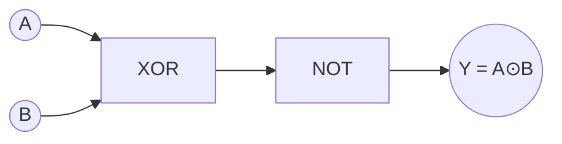
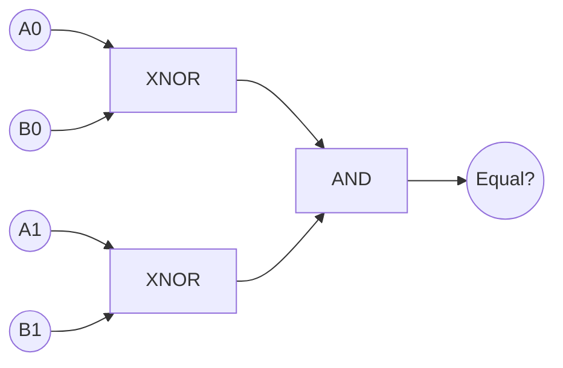

---
tags:
  - GATE/CS
  - GATE/DigitalLogic
  - LogicGates
aliases:
  - Exclusive NOR Gate
  - XNOR
  - Equivalence Gate
  - Coincidence Gate
date_created: 2026-09-15
difficulty: ⭐⭐⭐
last_revised: 2026-09-15
pyq_frequency: High
---

## Syllabus Position

Subject: [[Digital Logic Index]]
Parent Topic: [[Logic Gates]]
Sibling Topics: [[XOR Gate]], [[AND Gate]], [[OR Gate]], [[NAND Gate]], [[NOR Gate]]
Leads To: [[Comparator Circuits]], [[Parity Generator and Checker]], [[Universal Gates]], [[Boolean Algebra]]

GATE Syllabus Line: "Digital Logic: Boolean algebra, Combinational and sequential circuits, Minimization." XNOR is tested as the complement partner of XOR under combinational circuits and Boolean simplification.

Exam Weight Note: Almost never asked as a standalone truth-table recall; nearly always appears paired against [[XOR Gate]] in K-map pattern-recognition questions, equality-comparator design, or as a trick option in "which gate is universal" style MCQs.

---

## The Problem This Solves

Sometimes you don't want to know if two signals *disagree* — you want to know if they **match**. Checking bit-by-bit equality (are these two register values identical?) using only AND/OR/NOT gates requires stitching together several terms every single time. The XNOR gate hard-wires "these two inputs are the same" into a single primitive, making equality checking a one-gate operation instead of a multi-gate derivation.

Think of two people voting on the same question by raising or lowering a hand: XNOR is the judge who claps only when both hands are in the same position — both up or both down — and stays silent the moment they disagree. That's the "coincidence detector" behavior XNOR is named for.

Core Idea (one sentence): The **XNOR gate** outputs `1` exactly when its inputs are equal, making it the fundamental "equality" or "coincidence" detector of digital logic, and the exact logical complement of [[XOR Gate]].

---

## Formal Theory

The **XNOR gate** (exclusive-NOR, also called the **equivalence gate**) is a 2-input (generalizable to n-input) logic gate whose output is `1` if and only if an even number of inputs are `1` (equivalently, the inputs "agree"). For two inputs $A$ and $B$:

$$Y = A \odot B = \overline{A \oplus B} = AB + \bar{A}\bar{B}$$

### Truth Table (2-input)

| $A$ | $B$ | $Y = A \odot B$ |
|-----|-----|-------------------|
| 0   | 0   | 1                  |
| 0   | 1   | 0                  |
| 1   | 0   | 0                  |
| 1   | 1   | 1                  |

Notice this is the exact bitwise complement of the [[XOR Gate]] truth table — a fact GATE exploits constantly.

### Algebraic Properties

- **Commutative:** $A \odot B = B \odot A$
- **Associative:** $(A \odot B) \odot C = A \odot (B \odot C)$
- **Identity:** $A \odot 1 = A$
- **Self-equivalence:** $A \odot A = 1$
- **Complement relation:** $A \odot 0 = \bar{A}$
- **Self with complement:** $A \odot \bar{A} = 0$
- **Relation to XOR:** $\overline{A \odot B} = A \oplus B$ (the [[XOR Gate]]) — they are strict logical inverses of each other.

### Gate-Level Construction

Like [[XOR Gate]], XNOR is **not** a universal gate, so it must itself be built from AND, OR, and NOT gates, or as XOR followed by a NOT:

```
Algorithm XNOR_from_AND_OR_NOT(A, B):
    term1 = A AND B
    term2 = (NOT A) AND (NOT B)
    Y = term1 OR term2
    return Y
```

The simplest practical construction is just an XOR gate with an inverter on the output:

```
Algorithm XNOR_from_XOR(A, B):
    x = XOR(A, B)
    Y = NOT(x)
    return Y
```

A 5-NAND-gate implementation also exists (4 NANDs to build XOR, plus 1 more NAND wired as an inverter):

```
Algorithm XNOR_from_NAND(A, B):
    n1 = NAND(A, B)
    n2 = NAND(A, n1)
    n3 = NAND(B, n1)
    x  = NAND(n2, n3)      # this is A XOR B
    Y  = NAND(x, x)        # inverter: NOT(x)
    return Y
```

### n-Input XNOR (Even-Equivalence Generalization)

For $n$ inputs, XNOR outputs `1` if an **even** number of inputs are `0` — equivalently, the standard convention is that n-input XNOR is built as the complement of n-input XOR:

$$Y = \overline{A_1 \oplus A_2 \oplus \dots \oplus A_n}$$

This is exactly how **even-parity checkers** work: after transmission, XOR all received bits together and invert — if the result is `1`, the received word has even parity intact (no single-bit error detected). See [[Parity Generator and Checker]].

**What GATE actually tests here:** GATE almost never asks for the bare truth table. It embeds XNOR inside (a) equality-comparator design (bit A equals bit B check), (b) K-map recognition tasks where a function shows the "anti-checkerboard" (corner-and-center) pattern of 1s, (c) parity-checking circuits at the receiver end (as opposed to XOR-based parity *generation* at the sender), and (d) trick MCQs testing whether students confuse XOR's "difference" role with XNOR's "equality" role under time pressure.

---

## Diagrams and Visuals

**Circuit Symbol:**
```
      ___
A ---|   \                                o
     |    )---curve---o--- Y = A XNOR B (bubble = NOT)
B ---|___/
        \\  <- extra curved line at input (shared with XOR)
```
The XNOR symbol is identical to the XOR symbol (extra curved input line) **plus a small bubble** at the output — exactly like how NAND relates to AND, or NOR relates to OR. This bubble is the #1 visual distinguishing feature GATE diagrams rely on to separate XOR from XNOR.

**Karnaugh Map (2-variable) — the "anti-checkerboard" signature:**
```
        B=0   B=1
A=0  |   1   |   0   |
A=1  |   0   |   1   |
```
This is the diagonal pattern with 1s in the (0,0) and (1,1) corners — the exact opposite diagonal of [[XOR Gate]]'s K-map. GATE frequently tests instant recognition of this specific diagonal to identify a function as XNOR without doing full grouping.

**Gate-level trace (XOR + inverter construction):**
```
A ----+
      |----[XOR Gate]----(A⊕B)----[NOT]----Y = A⊙B
B ----+
```



**Equality comparator use-case (bit-by-bit):**

Each bit pair feeds an XNOR; ANDing all the XNOR outputs together tells you whether *every* bit position matched — the core idea behind [[Comparator Circuits]].

---

## Complexity Analysis

Like [[XOR Gate]], XNOR is a combinational gate, so "complexity" means **gate/transistor cost** and **propagation delay**.

- **Gate count (XOR + NOT form):** 5 gates for XOR (2 NOT + 2 AND + 1 OR) + 1 NOT = 6 gates total. Justification: XNOR is literally XOR with an inverted output, so its cost is XOR's cost plus one inverter.
- **Gate count (AND-OR-NOT direct form):** 2 NOT + 2 AND + 1 OR = 5 gates, same structural cost as XOR's direct SOP form, since $AB + \bar A \bar B$ has the identical shape as $A\bar B + \bar A B$.
- **Gate count (NAND-only implementation):** 5 NAND gates (4 to realize XOR + 1 extra NAND wired as inverter), one more than XOR's 4-NAND form.
- **Propagation delay:** XOR-then-NOT form = $t_{XOR} + t_{NOT}$ = 3 gate delays (internal to XOR) + 1 more = 4 gate delays. The direct AND-OR-NOT form (like XOR) only needs 3 gate delays since $AB + \bar A \bar B$ has the same depth as XOR's SOP — so a smart implementation avoids the extra inverter stage.
- **Transistor count (CMOS):** A direct implementation needs roughly the same ~12–14 transistors as XOR (some designs share transistors between the XOR and NOT stage rather than cascading a full separate inverter) — GATE VLSI-flavored questions sometimes ask students to compare this against XOR's transistor count.

### Complexity Summary Table

| Case                        | Gate Count      | Propagation Delay | Notes                                          |
|------------------------------|-----------------|--------------------|--------------------------------------------------|
| Direct AND-OR-NOT (SOP) form  | 5 gates         | 3 gate delays      | Same depth as XOR's direct SOP form              |
| XOR + separate NOT form       | 6 gates         | 4 gate delays      | Simple to derive from XOR, but costs 1 extra stage |
| NAND-only form                | 5 NAND gates    | 4 gate delays      | One NAND more than XOR's 4-NAND form              |
| n-input XNOR (cascaded)       | $O(n)$ 2-input XOR gates + 1 NOT | $O(\log n)$ with tree, $O(n)$ with linear chain | Used for even-parity checking at receiver |

---

## Worked Example

Let's trace a 4-bit even-parity **checker** at a receiver using XNOR — the natural complement to the XOR-based generator example in [[XOR Gate]].

**Received word (data + parity bit):** $P\,B_2\,B_1\,B_0 = 1\,0\,1\,1$ (parity bit $P=1$ was appended earlier so total 1s should be even)

**Step 1:** Compute $Q_1 = P \oplus B_2 = 1 \oplus 0 = 1$
State: intermediate XOR chain = 1

**Step 2:** Compute $Q_2 = Q_1 \oplus B_1 = 1 \oplus 1 = 0$
State: intermediate XOR chain = 0

**Step 3:** Compute $Q_3 = Q_2 \oplus B_0 = 0 \oplus 1 = 1$
State: final XOR-chain result = 1

**Step 4 (the XNOR step):** Checker output $= \overline{Q_3} = \overline{1} = 0$

**Result:** Checker output is `0`, meaning "no error detected" is signaled by... wait — check the convention: by design, if the checker outputs `1` it means "even parity confirmed, no error"; here output $=0$ signals an anomaly. Let's verify by direct count: total 1s in $1,0,1,1$ = three (odd) — but even parity was supposed to hold, so the checker correctly flags an error (output `0` = mismatch detected). ✅ Verified against direct bit-count.

**Total operations:** 3 XOR operations + 1 final inversion for 4 input bits, confirming the $O(n)$ claim — each additional bit still requires one more XOR in the chain, plus a single constant-cost inversion at the end regardless of $n$.

**Edge case follow-up:** What changes if the received word is `0000` (all zeros, trivially even parity)? Then every XOR step outputs `0`, the XOR chain result is `0`, and the XNOR output is $\overline{0} = 1$ — correctly signaling "parity OK, no error," confirming the base case needs no special-casing.

---

## Intuition Anchors

**The Analogy (restated and deepened):** The two-hand-clap judge is still the best picture, but extend it: for $n$ hands, the judge claps ("no error") only if the total number of raised hands has stayed **even** relative to the agreed convention. Every additional input either preserves or flips this "evenness," and XNOR's final inversion is just the judge's rule of "clap when the difference-count came out even, not odd."

**The Mental Model:** Picture XNOR as an "agreement detector" or "even-count confirmer" — the mirror image of XOR's "disagreement detector." Whenever you see an XOR chain immediately followed by a NOT gate (or a bubble on the output), your brain should instantly relabel the whole thing as one XNOR operation, not two separate steps.

**The One-Line Recall:** "XNOR outputs 1 iff the inputs are equal (2-input) or iff an even number of inputs are 1 (n-input); it equals $AB + \bar A \bar B$, and it is the exact logical complement of XOR: $A \odot B = \overline{A \oplus B}$."

**The #1 Trap:** Students see the K-map's diagonal pattern and default to writing "XOR" without checking which diagonal it is. The XOR diagonal has 1s at $(0,1)$ and $(1,0)$; the XNOR diagonal has 1s at $(0,0)$ and $(1,1)$. GATE deliberately places the anti-checkerboard pattern (1s in the corners) to bait students into writing $A \oplus B$ when the correct answer is $A \odot B$ — always check the $(0,0)$ cell first: if it's `1`, it's XNOR, not XOR.

---

## GATE Questions

---

**Question 1 — [PYQ-style, based on recurring GATE pattern] — [1-mark]**

> A 2-input logic gate produces the following truth table: $Y=1$ when $A=B=0$ and when $A=B=1$; $Y=0$ otherwise. Identify the gate.
- (A) XOR
- (B) XNOR
- (C) NAND
- (D) NOR

<details>
<summary>Solution</summary>

**Answer: (B) XNOR**

**Reasoning:**
The truth table describes $Y=1$ exactly when $A$ and $B$ are **equal** (both 0 or both 1) — this is the defining behavior of XNOR ($A \odot B = AB + \bar A \bar B$). XOR would give the opposite table ($Y=1$ when inputs differ). NAND and NOR have entirely different truth tables ($Y=0$ only when both inputs are 1, and $Y=1$ only when both inputs are 0, respectively) and don't match the given equality pattern at all.

**What this question is really testing:** Whether the student can read a truth table directly into a gate identity without needing the formal name given up front — a core K-map/truth-table literacy skill.

**Trap to avoid:** Confusing this with XOR simply because both gates share the word "exclusive" and a similar circuit symbol; always verify against the $(0,0)$ row first.

</details>

---

**Question 2 — [Conceptual/Numerical] — [2-mark]**

> Simplify $Y = (A \odot B) \odot (A \odot B)$ using XNOR properties.

<details>
<summary>Solution</summary>

Let $X = A \odot B$. Then $Y = X \odot X$. Using the self-equivalence property $Z \odot Z = 1$ (a value is always "equal to itself"), $Y = 1$ regardless of $A$ and $B$'s values.

**Trap to avoid:** Applying the XOR self-inverse rule ($A \oplus A = 0$) by mistake instead of the XNOR self-equivalence rule ($A \odot A = 1$) — mixing up the two identities is one of the most common algebra slips under exam time pressure.

</details>

---

**Question 3 — [Hard / Multi-concept] — [2-mark]**

> A 2-bit magnitude comparator circuit is built to check whether $A_1A_0 = B_1B_0$ using only XNOR and AND gates. How many XNOR gates are needed, and what is the total propagation delay (in terms of gate delay $t_d$, assuming each XNOR takes $3t_d$ and the final AND takes $t_d$) from inputs to the "Equal" output? (See [[Comparator Circuits]].)

<details>
<summary>Solution</summary>

**Reasoning:**
Each bit position requires its own equality check: $A_1 \odot B_1$ and $A_0 \odot B_0$ — that's 2 XNOR gates for a 2-bit comparator. Both XNOR outputs must be `1` simultaneously for the numbers to be equal, so a final AND gate combines them: $Equal = (A_1 \odot B_1) \cdot (A_0 \odot B_0)$.

Since both XNOR gates operate in parallel (not in series), the delay through the XNOR stage is just $3t_d$ (not $6t_d$), and then one more AND gate delay is added: total delay $= 3t_d + t_d = 4t_d$.

**What this question is really testing:** Whether the student understands that per-bit XNOR comparisons run in **parallel**, not cascaded, and combines this with [[Comparator Circuits]] design and gate-delay analysis from [[XNOR Gate]].

**Trap to avoid:** Assuming the two XNOR gates are in series (like an XOR parity chain) and incorrectly summing their delays sequentially, giving a wrong total of $6t_d + t_d = 7t_d$.

</details>

---

**Pattern Recognition:**
- When a GATE question shows a K-map with 1s in the two diagonal **corner** cells $(0,0)$ and $(1,1)$, immediately write $A \odot B$ (XNOR) — don't confuse it with the opposite-diagonal XOR pattern.
- When a question asks to check "equality" or "match" between bits, think XNOR first; when it asks about "difference" or "parity generation," think XOR first.
- When XNOR appears twice on the same operand in an expression ($X \odot X$), immediately simplify to `1` using the self-equivalence identity before expanding anything.
- When counting gate delay in comparator circuits, check whether per-bit XNOR gates run in parallel (common case) rather than assuming a cascaded chain like parity circuits use.

---

## Edge Cases and Failure Modes

- [ ] **All inputs are 0:** $\overline{0 \oplus 0 \oplus \dots \oplus 0} = \overline{0} = 1$ — correctly signals "equal/no error" with no special-casing needed.
- [ ] **All inputs identical (all 1s):** For 2-input XNOR, $A \odot A = 1$ always — but for n-input XNOR chains, this doesn't generalize the same way; students often wrongly assume "all-1 inputs" always gives `1` for any n, when the actual n-input result depends on the underlying XOR chain's parity, not just "are all inputs equal."
- [ ] **Confusing XNOR with XOR when the output bubble is missed in a diagram:** Forgetting the small output-side bubble turns an XNOR into a plain XOR gate in circuit diagrams — a very common transcription trap, mirroring the NAND-vs-AND, NOR-vs-OR bubble convention.
- [ ] **Assuming XNOR is universal:** Like XOR, XNOR is **not** a universal/functionally-complete gate — it also realizes only affine functions over GF(2) (specifically, XNOR-only circuits can build any XOR-realizable function by inserting an extra inversion, but still cannot achieve full functional completeness like NAND/NOR).
- [ ] **Off-by-one in n-input equivalence chains:** For $n$ bits combined via nested XNOR operations, association order matters for readability but not for the final value (XNOR is associative) — however, if implemented as "XOR-chain-then-single-final-NOT" vs. "cascaded XNOR-of-XNORs," students sometimes miscount how many inversions actually occur, leading to sign errors.
- [ ] **Mixing up parity generation vs. parity checking:** [[XOR Gate]] is typically used to *generate* the parity bit at the sender; XNOR (XOR + final invert) is typically used to *check* parity at the receiver — swapping these roles in circuit design is a frequent conceptual slip.

---

## Comparisons

| Feature              | [[XNOR Gate]]              | [[XOR Gate]]              | [[NOR Gate]]              |
|----------------------|----------------------------|------------------------------|----------------------------|
| Time Complexity (delay) | 3 gate delays (direct SOP form) or 4 (XOR+NOT form) | 3 gate delays (AND-OR-NOT form) | 1 gate delay |
| Space Complexity (gate/transistor count) | 5–6 gates / ~12–14 transistors | 5 gates / 12 transistors | 1 gate / 4 transistors |
| Key Property         | Outputs 1 iff inputs are equal | Outputs 1 iff inputs differ | Outputs 1 only if all inputs are 0 |
| When to Prefer       | Equality checking, even-parity checking, comparators | Parity generation, difference detection, adders | General "none true" logic, universal-gate applications |
| GATE Trap            | Confusing K-map diagonal with XOR's | Assuming it's universal | Confusing "universal" NOR with "non-universal" XNOR |

The most common GATE question comparing these is a truth-table or K-map snippet asking the student to identify whether a function is XOR or XNOR. The answer hinges entirely on the $(0,0)$ and $(1,1)$ rows: if $Y=1$ there, it's XNOR (equality); if $Y=0$ there, it's XOR (difference). A secondary common comparison is against NOR, testing whether students remember that NOR (unlike XNOR) **is** a universal gate despite the superficially similar names.

---

## Connections Web

**Must know before this topic:**
- [[XOR Gate]] — XNOR is defined directly as XOR's logical complement; you cannot understand XNOR's identities without first knowing XOR's
- [[Boolean Algebra]] — XNOR's algebraic identities follow from standard Boolean laws plus its own self-equivalence property
- [[AND Gate]] — needed to construct XNOR's SOP form ($AB + \bar A \bar B$)
- [[NOT Gate]] — needed both for complement terms in XNOR's SOP form and for the "XOR + NOT" construction

**Topics that build on this:**
- [[Comparator Circuits]]
- [[Parity Generator and Checker]] (specifically the parity-*checking* side, as opposed to XOR's parity-*generation* side)
- [[Equality Checker Circuits]]
- [[Magnitude Comparator]]

**GATE subject cross-links:**
- [[Digital Logic Index]] > [[Combinational Circuits]]

**Cross-subject connections:**
- [[Error Detection and Correction]] (Networks/OS) — XNOR-based parity checkers form the receiver-side half of the same error-detection scheme whose sender-side generator uses [[XOR Gate]]
- [[Cyclic Redundancy Check]] (Networks) — CRC verification at the receiver compares computed and received remainders, conceptually an equality (XNOR-like) check over GF(2) polynomial division

**Standard references:**
- [[Morris Mano Digital Logic Chapter 4]]
- [[CLRS]] (not directly relevant, but see [[Boolean Algebra]] cross-reference for algorithmic Boolean simplification)

**Additional links used above:** [[Universal Gates]], [[NAND Gate]], [[NOR Gate]], [[XOR Gate]]

---

## Quick Revision Sheet

**Definition (1 sentence):** XNOR outputs `1` if and only if its inputs are equal (2-input case) or an even number of its inputs are `1` (n-input case); it is the logical complement of XOR.

**Core Idea / Analogy (1 sentence):** Like a judge who claps only when two raised/lowered hands match — silent the moment they disagree.

**Algorithm Steps (numbered, maximum 6 steps):**
1. Compute $AB$ (AND of A and B).
2. Compute $\bar A \bar B$ (AND of NOT A with NOT B).
3. OR the two terms: $Y = AB + \bar A \bar B$.
4. Equivalently: compute $X = A \oplus B$, then invert: $Y = \bar X$.
5. For n-input, XOR all inputs together then invert the final result once.
6. Simplify using $A \odot A = 1$ and $A \odot 1 = A$ where applicable.

**Complexity:**
- Time (best/average/worst): constant — always 3 gate delays (direct SOP form) or 4 gate delays (XOR+NOT form), regardless of input values.
- Space: 5–6 gates (direct SOP or XOR+NOT form); $O(n)$ gates + 1 final NOT for n-input equivalence chain.
- Recurrence (if applicable): Not recursive; n-input propagation delay in a linear XOR chain is $O(n) \cdot t_d$ plus one constant inversion, reducible to $O(\log n) \cdot t_d$ with a balanced XOR tree.

**Key Properties (3 to 5 bullet points):**
- $A \odot A = 1$ (self-equivalence)
- $A \odot 1 = A$, $A \odot 0 = \bar A$
- $A \odot B = \overline{A \oplus B}$ — exact complement of XOR
- Not a universal gate (same GF(2)-linearity limitation as XOR)
- Anti-checkerboard (corner) signature in K-maps; core of equality checking and parity checking

**The #1 Trap:** Reading the K-map diagonal and assuming it's XOR without checking whether the 1s sit at the corners $(0,0)/(1,1)$ (XNOR) versus the middle $(0,1)/(1,0)$ (XOR).

**When to use this over alternatives:** Use XNOR when you need to detect *equality/agreement* or check parity at a receiver; use XOR when you need to detect *difference* or generate parity at a sender; use NOR when you need general "none true" logic and require a truly universal gate.

**Mnemonic or one-liner:** "XNOR = XOR's mirror twin — bubble on the output flips 'different' into 'same,' just like NAND flips AND and NOR flips OR."

---

## Revision Checklist

- [ ] I can state the formal definition without looking.
- [ ] I can explain the hand-clap-judge analogy and map it to n-input equivalence chains.
- [ ] I can trace a 4-bit parity-checking example by hand in under 2 minutes.
- [ ] I can derive the gate delay and gate count from scratch (direct SOP, XOR+NOT, and NAND forms).
- [ ] I know what the Quick Revision Sheet says without reading it.
- [ ] I can solve all 3 GATE questions in this note without peeking.
- [ ] I know the #1 trap (corner vs. middle K-map diagonal) and can articulate why students fall for it.
- [ ] I have linked this note correctly in my Obsidian vault.
- [ ] I have scheduled a spaced-repetition review in 3 days.
