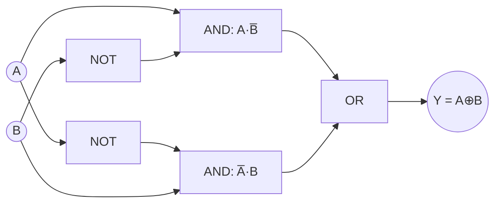

---
tags:
  - GATE/CS
  - GATE/DigitalLogic
  - LogicGates
aliases:
  - Exclusive OR Gate
  - XOR
  - EOR Gate
date_created: 2026-09-15
difficulty: ⭐⭐⭐
last_revised: 2026-09-15
pyq_frequency: High
---

## Syllabus Position

Subject: [[Digital Logic Index]]
Parent Topic: [[Logic Gates]]
Sibling Topics: [[AND Gate]], [[OR Gate]], [[XNOR Gate]], [[NAND Gate]], [[NOR Gate]]
Leads To: [[Half Adder]], [[Full Adder]], [[Parity Generator and Checker]], [[Universal Gates]], [[Boolean Algebra]]

GATE Syllabus Line: "Digital Logic: Boolean algebra, Combinational and sequential circuits, Minimization." XOR gate is a foundational building block tested implicitly under combinational circuits and Boolean algebra.

Exam Weight Note: Rarely tested as a standalone 1-mark recall question; almost always appears embedded inside adder circuits, parity checker design, or Boolean simplification problems as a 2-mark NAT/MCQ.

---

## The Problem This Solves

Imagine you need a circuit that says "yes" only when its two inputs *disagree* — not both true, not both false, but exactly one. Plain AND and OR gates can't express "exactly one of these is true" directly; you'd need to combine several gates to build that behavior from scratch every time. The XOR gate packages this "difference detector" logic into a single primitive so digital designers don't have to reconstruct it repeatedly.

Think of two light switches wired to the same bulb from opposite ends of a hallway (a common household wiring trick): flipping *either* switch alone turns the bulb on, but flipping both leaves it off again. That's exactly XOR behavior — the output is on precisely when the inputs differ.

Core Idea (one sentence): The **XOR gate** outputs `1` exactly when its inputs are unequal, making it the fundamental "difference" or "parity" detector of digital logic.

---

## Formal Theory

The **XOR gate** (exclusive-OR) is a 2-input (generalizable to n-input) logic gate whose output is `1` if and only if an odd number of inputs are `1`. For two inputs $A$ and $B$:

$$Y = A \oplus B = A\bar{B} + \bar{A}B$$

### Truth Table (2-input)

| $A$ | $B$ | $Y = A \oplus B$ |
|-----|-----|-------------------|
| 0   | 0   | 0                  |
| 0   | 1   | 1                  |
| 1   | 0   | 1                  |
| 1   | 1   | 0                  |

### Algebraic Properties

XOR obeys several identities that GATE loves to exploit in [[Boolean Algebra]] simplification:

- **Commutative:** $A \oplus B = B \oplus A$
- **Associative:** $(A \oplus B) \oplus C = A \oplus (B \oplus C)$
- **Identity:** $A \oplus 0 = A$
- **Self-inverse:** $A \oplus A = 0$
- **Complement relation:** $A \oplus 1 = \bar{A}$
- **Self with complement:** $A \oplus \bar{A} = 1$
- **Relation to XNOR:** $\overline{A \oplus B} = A \odot B$ (the [[XNOR Gate]])

### Gate-Level Construction

XOR is **not** a universal gate (unlike [[NAND Gate]] or [[NOR Gate]]), so it must itself be built from AND, OR, and NOT gates, or from NAND gates:

```
Algorithm XOR_from_AND_OR_NOT(A, B):
    term1 = A AND (NOT B)
    term2 = (NOT A) AND B
    Y = term1 OR term2
    return Y
```

An alternate 4-NAND-gate implementation exists (important because NAND is a [[Universal Gates|universal gate]]):

```
Algorithm XOR_from_NAND(A, B):
    n1 = NAND(A, B)
    n2 = NAND(A, n1)
    n3 = NAND(B, n1)
    Y  = NAND(n2, n3)
    return Y
```

### n-Input XOR (Parity Generalization)

For $n$ inputs, XOR outputs `1` if an **odd** number of inputs are `1`:

$$Y = A_1 \oplus A_2 \oplus \dots \oplus A_n$$

This generalization is exactly how [[Parity Generator and Checker]] circuits work — a direct GATE favorite.

**What GATE actually tests here:** GATE rarely asks "what is the truth table of XOR" directly. Instead it embeds XOR inside (a) minimal gate-count implementations of adders, (b) parity/error-detection circuit design, (c) Boolean expression simplification where recognizing an XOR pattern ($A\bar{B} + \bar{A}B$) collapses several terms instantly, and (d) counting minimum gates/transistors needed since XOR is not universal.

---

## Diagrams and Visuals

**Circuit Symbol:**
```
      ___
A ---|   \
     |    )---curve--- Y = A XOR B
B ---|___/
        \\  <- extra curved line at input (distinguishes XOR from OR)
```
The XOR symbol looks exactly like the OR gate symbol but with an **extra curved line** at the input side — this is the #1 visual distinguishing feature GATE diagrams rely on.

**Karnaugh Map (2-variable) — the "checkerboard" signature:**
```
        B=0   B=1
A=0  |   0   |   1   |
A=1  |   1   |   0   |
```
This checkerboard (diagonal) pattern of 1s is the unmistakable visual signature of XOR/XNOR in a K-map — GATE frequently tests recognition of this pattern to instantly identify a function as XOR-like without full simplification.

**Gate-level trace (AND-OR construction):**
```
A ----+--------[NOT]---(A̅)---+
      |                       |
      |                [AND](A̅·B)---+
      |         B-------+           |
      |                             [OR]---Y
      +----[AND](A·B̅)---+           |
      |                 |          /
      B---[NOT]---(B̅)---+---------+
```



---

## Complexity Analysis

XOR is a combinational gate, not an algorithm, so "complexity" here means **gate/transistor cost** and **propagation delay** — the GATE-relevant metrics.

- **Gate count (AND-OR-NOT implementation):** 2 NOT + 2 AND + 1 OR = 5 gates. Justification: each product term ($A\bar B$, $\bar A B$) needs one NOT and one AND; the OR combines them.
- **Gate count (NAND-only implementation):** 4 NAND gates, since NAND is functionally complete and each NAND reduces gate-type diversity, useful in IC fabrication (uniform gate libraries).
- **Propagation delay:** In the AND-OR-NOT form, delay = $t_{NOT} + t_{AND} + t_{OR}$ (3 gate delays in the critical path). In the 4-NAND form, delay = 3 NAND-gate-delays (since output depends on $n_1$ which feeds both $n_2, n_3$, then final NAND) — GATE sometimes asks to compare these delays.
- **Transistor count (CMOS):** A standard implementation needs 12 transistors for a 2-input XOR (vs. 6 for AND, 6 for OR) — this transistor cost is why XOR/XNOR are treated as "expensive" primitives and why minimizing their use in large circuits matters for VLSI-flavored GATE questions.

### Complexity Summary Table

| Case                     | Gate Count      | Propagation Delay | Notes                                   |
|--------------------------|-----------------|--------------------|------------------------------------------|
| AND-OR-NOT form          | 5 gates         | 3 gate delays      | Simple to derive, more gate types needed |
| NAND-only form           | 4 NAND gates    | 3 gate delays      | Preferred for uniform IC fabrication     |
| n-input XOR (cascaded)   | $O(n)$ 2-input XOR gates | $O(\log n)$ with tree structure, $O(n)$ with linear chain | Used for parity over $n$ bits |

---

## Worked Example

Let's trace a 4-bit even-parity generator using XOR — a classic GATE-style application, not the trivial 2-input case.

**Input bits:** $B_3 B_2 B_1 B_0 = 1\,0\,1\,1$

**Step 1:** Compute $P_1 = B_0 \oplus B_1 = 1 \oplus 1 = 0$
State: intermediate = 0

**Step 2:** Compute $P_2 = P_1 \oplus B_2 = 0 \oplus 0 = 0$
State: intermediate = 0

**Step 3:** Compute $P_3 = P_2 \oplus B_3 = 0 \oplus 1 = 1$
State: final parity bit = 1

**Result:** Parity bit $= 1$. Since the number of 1s in the input (1,0,1,1 → three 1s, odd) is odd, the even-parity generator sets parity bit to `1` to make the *total* count of 1s (including parity bit) even: $3 + 1 = 4$ (even). ✅ Verified.

**Total operations:** 3 XOR operations for 4 input bits, confirming the $O(n)$ claim — each additional bit requires exactly one more XOR in the chain.

**Edge case follow-up:** What changes if all 4 bits are `0000`? Then every XOR step outputs `0`, parity bit = `0`, and total 1s = 0 (already even) — correctly requiring no correction. This confirms the base case works without special-casing.

---

## Intuition Anchors

**The Analogy (restated and deepened):** The two-switch hallway light is still the best mental picture, but extend it now: with $n$ switches wired in the classic "staircase" wiring pattern, the bulb is on exactly when an **odd** number of switches have been toggled from their original position. That's precisely how n-input XOR parity generation works — each additional bit "toggles" the accumulated parity.

**The Mental Model:** Picture XOR as a "difference detector" or "odd-one-counter." For 2 inputs, ask "do these disagree?" For n inputs, ask "is the count of 1s odd?" Every XOR chain you see in a circuit diagram is silently counting parity.

**The One-Line Recall:** "XOR outputs 1 iff the inputs differ (2-input) or iff an odd number of inputs are 1 (n-input); it equals $A\bar B + \bar A B$ and is its own inverse under repetition: $A \oplus A = 0$."

**The #1 Trap:** Students assume XOR is a universal gate because it "feels" as fundamental as NAND/NOR. It is **not** — you cannot build every Boolean function using XOR gates alone (e.g., you cannot produce a constant function output that's independent input-invariant beyond what linear/affine functions allow over GF(2)). GATE traps students by asking "which of the following is NOT a universal gate" with XOR/XNOR as the correct (non-universal) answer choices, while students mistakenly pick AND/OR/NAND instead.

---

## GATE Questions

---

**Question 1 — [PYQ-style, based on recurring GATE pattern] — [1-mark]**

> Which of the following gates is NOT a universal gate?
- (A) NAND
- (B) NOR
- (C) XOR
- (D) Both NAND and NOR are universal, but XOR and XNOR are not

<details>
<summary>Solution</summary>

**Answer: (D)** (if only single-choice allowed, then (C) XOR is the direct non-universal answer)

**Reasoning:**
NAND and NOR are each individually functionally complete — any Boolean function can be constructed using only NAND gates or only NOR gates. XOR (and XNOR) cannot achieve this because XOR-based circuits can only realize **affine (linear)** Boolean functions over GF(2); they cannot produce arbitrary nonlinear functions like AND or OR from XOR gates alone without an additional constant/bias input trick, and even then coverage is limited compared to NAND/NOR completeness.

**What this question is really testing:** Whether the student understands "universal gate" is a strict property requiring functional completeness, not just "commonly used gate."

**Trap to avoid:** Assuming any gate that appears in every digital logic course (like XOR) must be universal. Familiarity ≠ completeness.

</details>

---

**Question 2 — [Conceptual/Numerical] — [2-mark]**

> A circuit computes $Y = (A \oplus B) \oplus (A \oplus B)$. Simplify $Y$ using XOR properties.

<details>
<summary>Solution</summary>

Let $X = A \oplus B$. Then $Y = X \oplus X = 0$ (self-inverse property: $A \oplus A = 0$).

So regardless of $A$ and $B$'s values, $Y = 0$ always.

**Trap to avoid:** Trying to expand the full 4-variable truth table instead of recognizing the self-XOR identity — wastes 5+ minutes on a question solvable in 10 seconds using $A \oplus A = 0$.

</details>

---

**Question 3 — [Hard / Multi-concept] — [2-mark]**

> In a Full Adder circuit built using two Half Adders and an OR gate, how many XOR gates are used in total, and what is the propagation delay (in terms of gate delay $t_d$) from input to the Sum output? (See [[Full Adder]] and [[Half Adder]].)

<details>
<summary>Solution</summary>

**Reasoning:**
Each [[Half Adder]] uses exactly 1 XOR gate (for Sum) and 1 AND gate (for Carry). A Full Adder = 2 Half Adders + 1 OR gate. So total XOR gates = 2 (one per half adder).

Sum path: $A \oplus B$ (1st XOR, delay $t_d$) $\oplus\, C_{in}$ (2nd XOR, delay $t_d$) → total Sum delay = $2t_d$.

**What this question is really testing:** Whether the student can trace gate-level delay through a cascaded XOR structure inside a composite circuit, combining [[XOR Gate]] knowledge with [[Full Adder]] design — a classic multi-concept GATE combination.

**Trap to avoid:** Forgetting that Sum passes through **two** XOR gates in series (not one), leading to an incorrect delay of $t_d$ instead of $2t_d$.

</details>

---

**Pattern Recognition:**
- When a GATE question shows a checkerboard pattern in a K-map, immediately suspect XOR/XNOR and skip full grouping — write the expression directly as $A \oplus B$ or its complement.
- When asked "is gate X universal," check if X is NAND/NOR (yes) or XOR/XNOR/AND/OR alone (no) — this is a near-guaranteed 1-mark question type.
- When XOR appears twice on the same two variables in an expression, immediately apply $X \oplus X = 0$ before expanding anything.
- When counting gate delay through adders or parity circuits, count each XOR in the *chain*, not just distinct gate types.

---

## Edge Cases and Failure Modes

- [ ] **All inputs are 0:** $0 \oplus 0 \oplus \dots \oplus 0 = 0$ — correctly signals even parity with no correction needed; no special-casing required.
- [ ] **All inputs identical (all 1s, even count):** Pairs cancel via $A \oplus A = 0$, so an even number of 1s XORed together always yields `0` — a subtle point students often miss when reasoning about n-input XOR by intuition alone.
- [ ] **Confusing XOR with OR when exactly one diagram curve is missing:** In circuit diagrams, forgetting the extra input-side curve turns an XOR into a plain OR gate — a common transcription trap on exam diagrams.
- [ ] **Assuming XOR is universal:** As covered above — it is not; XOR-only circuits can realize only linear/affine functions over GF(2), not arbitrary Boolean functions.
- [ ] **Off-by-one in n-input parity chains:** For $n$ bits, exactly $n-1$ XOR gates are needed in a linear chain (not $n$) — students often add one extra gate by miscounting.
- [ ] **XOR vs XNOR sign confusion:** $\overline{A \oplus B} = A \odot B$; mixing up which one represents "equality detection" ([[XNOR Gate]]) versus "difference detection" (XOR) is a frequent conceptual slip under exam time pressure.

---

## Comparisons

| Feature              | [[XOR Gate]]              | [[XNOR Gate]]              | [[OR Gate]]              |
|----------------------|----------------------------|------------------------------|----------------------------|
| Time Complexity (delay) | 3 gate delays (AND-OR-NOT form) | Same as XOR + 1 inverter | 1 gate delay |
| Space Complexity (gate/transistor count) | 5 gates / 12 transistors | 5 gates + 1 NOT / 14 transistors | 1 gate / 6 transistors |
| Key Property         | Outputs 1 iff inputs differ | Outputs 1 iff inputs are equal | Outputs 1 if any input is 1 |
| When to Prefer       | Parity generation, difference detection, adders | Equality checking, parity checking (even parity check) | General "any true" logic, not difference-sensitive |
| GATE Trap            | Assuming it's universal | Confusing with XOR polarity | Confusing with XOR in K-map checkerboard pattern |

The most common GATE question comparing these is a K-map or truth-table snippet showing a diagonal (checkerboard) pattern of 1s, asking the student to identify whether the function is XOR or XNOR. The answer hinges on whether $Y=1$ when inputs are **equal** (XNOR) or **unequal** (XOR) — check the $(0,0)$ and $(1,1)$ rows first, since those distinguish the two instantly.

---

## Connections Web

**Must know before this topic:**
- [[Boolean Algebra]] — XOR's algebraic identities rely on standard Boolean laws plus its own special self-inverse property
- [[AND Gate]] — needed to construct XOR from basic gates
- [[OR Gate]] — needed to construct XOR from basic gates
- [[NOT Gate]] — needed for complement terms in XOR's SOP form

**Topics that build on this:**
- [[Half Adder]]
- [[Full Adder]]
- [[Parity Generator and Checker]]
- [[Ripple Carry Adder]]
- [[Comparator Circuits]]

**GATE subject cross-links:**
- [[Digital Logic Index]] > [[Combinational Circuits]]

**Cross-subject connections:**
- [[Error Detection and Correction]] (Networks/OS) — parity bits generated via XOR are the basis of simple error-detection schemes
- [[Cyclic Redundancy Check]] (Networks) — CRC computation is fundamentally repeated XOR (polynomial division over GF(2))

**Standard references:**
- [[Morris Mano Digital Logic Chapter 4]]
- [[CLRS]] (not directly relevant, but see [[Boolean Algebra]] cross-reference for algorithmic Boolean simplification)

**Additional links used above:** [[Universal Gates]], [[NAND Gate]], [[NOR Gate]], [[XNOR Gate]]

---

## Quick Revision Sheet

**Definition (1 sentence):** XOR outputs `1` if and only if its inputs differ (2-input case) or an odd number of its inputs are `1` (n-input case).

**Core Idea / Analogy (1 sentence):** Like a two-switch hallway light — the bulb is on exactly when the switches disagree.

**Algorithm Steps (numbered, maximum 6 steps):**
1. Compute $A\bar B$ (AND of A with NOT B).
2. Compute $\bar A B$ (AND of NOT A with B).
3. OR the two terms: $Y = A\bar B + \bar A B$.
4. For n-input, chain 2-input XORs: $Y = A_1 \oplus A_2 \oplus \dots \oplus A_n$.
5. Simplify using $A \oplus A = 0$ and $A \oplus 0 = A$ where applicable.

**Complexity:**
- Time (best/average/worst): constant — always 3 gate delays (AND-OR-NOT) or 3 NAND delays regardless of input values (no data-dependent branching in combinational logic).
- Space: 5 gates (AND-OR-NOT) or 4 NAND gates; $O(n)$ gates for n-input parity chain.
- Recurrence (if applicable): Not recursive; n-input propagation delay in a linear chain is $O(n) \cdot t_d$, reducible to $O(\log n) \cdot t_d$ with a balanced XOR tree.

**Key Properties (3 to 5 bullet points):**
- $A \oplus A = 0$ (self-inverse)
- $A \oplus 0 = A$, $A \oplus 1 = \bar A$
- Not a universal gate (realizes only linear/affine functions over GF(2))
- Diagonal/checkerboard signature in K-maps
- Core of parity generation and error detection

**The #1 Trap:** Assuming XOR is universal like NAND/NOR — it is not.

**When to use this over alternatives:** Use XOR when you need to detect *difference* or compute *parity*; use XNOR when you need to detect *equality*; use OR when you just need "any true," not exclusivity.

**Mnemonic or one-liner:** "XOR = 'eXclusive OR' = exactly one, not both" — and remember **X**OR **X**ors out to zero when **X**ORed with itself.

---

## Revision Checklist

- [ ] I can state the formal definition without looking.
- [ ] I can explain the hallway-switch analogy and map it to n-input parity.
- [ ] I can trace a 4-bit parity example by hand in under 2 minutes.
- [ ] I can derive the gate delay and gate count from scratch (AND-OR-NOT and NAND forms).
- [ ] I know what the Quick Revision Sheet says without reading it.
- [ ] I can solve all 3 GATE questions in this note without peeking.
- [ ] I know the #1 trap (non-universality) and can articulate why students fall for it.
- [ ] I have linked this note correctly in my Obsidian vault.
- [ ] I have scheduled a spaced-repetition review in 3 days.
