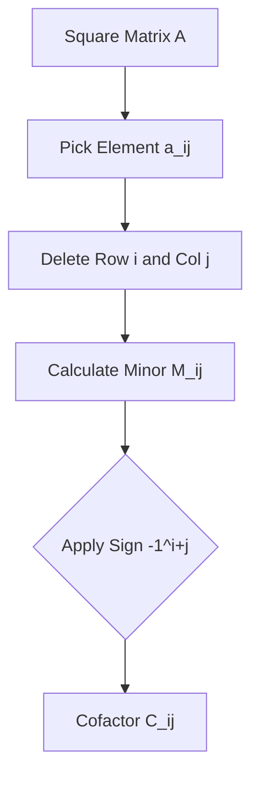

## 🗺️ Context
**Subject:** [[Engineering Mathematics]]
**Parent Topic:** [[Linear Algebra]]
**Sibling Topics:** [[Determinants]]
**Leads To:** [[Adjoint of a Matrix]], [[Inverse of a Matrix]]

> 📍 **GATE Syllabus Mapping:** Matrices and determinants.

## 💡 Motivation & Intuition
If the [[Determinants|Determinant]] is the "soul" of a matrix, **Minors** and **Cofactors** are the internal components that build it. They allow us to break down a large matrix problem into smaller, manageable $2 \times 2$ problems.

**Core Idea:** A cofactor is a "signed" minor. It tells you the contribution of a specific element $a_{ij}$ to the overall determinant.

## 📖 Theory

### 1. The Minor ($M_{ij}$)
The Minor $M_{ij}$ of an element $a_{ij}$ is the determinant of the sub-matrix formed by deleting the $i$-th row and $j$-th column of matrix $A$.

### 2. The Cofactor ($C_{ij}$)
The Cofactor $C_{ij}$ is the Minor with a positional sign applied:
$$C_{ij} = (-1)^{i+j} M_{ij}$$

### 3. The Sign Pattern
For any square matrix, the signs $(-1)^{i+j}$ follow a checkerboard pattern:
$$\begin{bmatrix} + & - & + \\ - & + & - \\ + & - & + \end{bmatrix}$$

### 4. Expansion of Determinant
The determinant of $A$ is the sum of elements of any row/column multiplied by their corresponding cofactors:
$$\det(A) = a_{i1}C_{i1} + a_{i2}C_{i2} + \dots + a_{in}C_{in}$$

## 🖼️ Visual Workflow

## ⏱️ Complexity Analysis
Calculating all cofactors for an $n \times n$ matrix requires calculating $n^2$ determinants of size $(n-1) \times (n-1)$.
- Total complexity: $O(n^4)$ if done naively.

## 🔢 Worked Example
Matrix $A = \begin{bmatrix} 1 & 0 & 2 \\ 3 & -1 & 0 \\ 0 & 4 & 2 \end{bmatrix}$. Find cofactor $C_{12}$.

1. **Locate $a_{12}$:** It is $0$.
2. **Find Minor $M_{12}$:** Delete Row 1, Col 2.
   $$M_{12} = \begin{vmatrix} 3 & 0 \\ 0 & 2 \end{vmatrix} = (3 \times 2) - (0 \times 0) = 6$$
3. **Apply Sign:** $i=1, j=2 \implies i+j=3$ (odd).
   $$C_{12} = (-1)^3 \times 6 = -6$$

## 🎯 GATE Questions
**Question:** If the sum of products of elements of any row with the cofactors of **another** row is calculated, the result is:
- (A) $\det(A)$
- (B) $0$
- (C) $1$
- (D) $- \det(A)$

💡 Solution

**Answer: (B)**
This is a standard property. 
$\sum a_{ij} C_{kj} = 0$ if $i \neq k$. 
**Intuition:** It's like trying to find the volume of a shape using the wrong height.

## ⚠️ Edge Cases & Traps
- [ ] **Sign Errors:** The most common mistake is forgetting $(-1)^{i+j}$. Always draw the checkerboard first.
- [ ] **$2 \times 2$ Matrix:** The minor of $a_{11}$ is simply $a_{22}$.

## ⚖️ Comparisons
| Feature | Minor | Cofactor |
| :--- | :--- | :--- |
| **Sign** | Always positive (magnitude) | Depends on position |
| **Use** | Intermediate step | Building Adjoint/Inverse |

## 🧠 Memory Hooks
- **"Checkerboard Rule"**: Start with $+$ at (1,1) and alternate.
- **"Minor is Mini"**: It's the determinant of the "mini" matrix.

## 🕸️ Connections Web
- [[Determinants]] — Built using cofactors.
- [[Adjoint of a Matrix]] — The transpose of the matrix of cofactors.
- [[Inverse of a Matrix]] — Uses cofactors via the Adjoint.

## ✅ Revision Checklist
- [ ] I can calculate the sign for any $(i, j)$ instantly.
- [ ] I understand why $\sum a_{ij} C_{kj} = 0$ for $i \neq k$.
