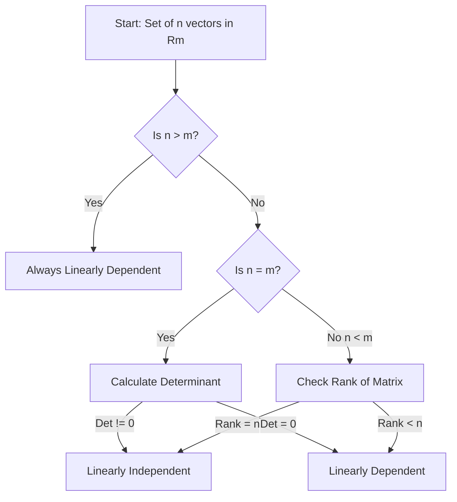

## 🗺️ Context
**Subject:** [[Engineering Mathematics]]
**Parent Topic:** [[Linear Algebra]]
**Sibling Topics:** [[Vector Spaces]], [[Basis and Dimension]], [[Rank of a Matrix]]
**Leads To:** [[Eigenvalues and Eigenvectors]], [[Systems of Linear Equations]], [[Diagonalization]]

> 📍 **GATE Syllabus Mapping:** Linear Algebra: Matrix Algebra, Systems of linear equations, Eigenvalues and eigenvectors. (Note: Linear dependency is the foundational test for all these topics).

---

## 💡 Motivation & Intuition
Imagine you are giving directions to a friend. 
- "Go 5km North, then 3km East." (Both directions are unique; you can't reach the same spot by only going North).
- "Go 5km North, then 2km South." (This is redundant! South is just negative North).

In Linear Algebra, **Linear Independence** is about **uniqueness of information**. If a vector in a set can be "built" using the others (like South from North), it adds no new information to the system. It is **Linearly Dependent**. If every vector provides a unique "direction" that cannot be replicated by others, they are **Linearly Independent**.

**Core Idea:** A set of vectors is Linearly Independent if the only way to get the zero vector using a weighted sum is to set all weights to zero.

---

## 📖 Theory

### 1. Formal Definition
A set of vectors $\{v_1, v_2, \dots, v_n\}$ in a [[Vector Space]] $V$ is said to be **Linearly Dependent (LD)** if there exist scalars $c_1, c_2, \dots, c_n$, **not all zero**, such that:
$$c_1v_1 + c_2v_2 + \dots + c_nv_n = \mathbf{0}$$

If the only solution to the above equation is $c_1 = c_2 = \dots = c_n = 0$ (the trivial solution), then the set is **Linearly Independent (LI)**.

### 2. Geometric Interpretation
- **In 2D ($\mathbb{R}^2$):** Two vectors are LD if they lie on the same line passing through the origin (collinear).
- **In 3D ($\mathbb{R}^3$):** Three vectors are LD if they lie on the same plane passing through the origin (coplanar).

### 3. Critical Theorems & Properties
- **The Zero Vector Rule:** Any set containing the **Zero Vector** $\mathbf{0}$ is always **Linearly Dependent**. (Proof: $1 \cdot \mathbf{0} + 0 \cdot v_1 = \mathbf{0}$, here $c_1=1 \neq 0$).
- **The Subset Rule:** If a set is LI, every subset of it is also LI. If a set is LD, any superset containing it is also LD.
- **The Dimension Constraint:** In an $n$-dimensional space $\mathbb{R}^n$, any set of $m$ vectors where $m > n$ is **always Linearly Dependent**.
- **The Determinant Test:** For $n$ vectors in $\mathbb{R}^n$, they are LI if and only if the determinant of the matrix formed by them is **non-zero**.

---

## 🖼️ Diagrams & Visuals

### 2D Visualization (Collinearity)
```text
      ^ v2 (Dependent - same line)
      |
      |   / v3 (Independent)
      |  /
      | /
______|/______> v1
      |
      |
```
- $v_1$ and $v_2$ are **LD** (one is a multiple of another).
- $v_1$ and $v_3$ are **LI** (different directions).

### Mermaid Logic Flow: Checking LI/LD


---

## ⏱️ Complexity Analysis

Checking dependency usually involves solving $Ax = 0$ or finding the [[Rank of a Matrix]].

| Method | Best Case | Worst Case | Notes |
| :--- | :--- | :--- | :--- |
| **Determinant** | $O(n^3)$ | $O(n^3)$ | Only for $n \times n$ systems. |
| **Gaussian Elimination** | $O(n \cdot m^2)$ | $O(n \cdot m^2)$ | Works for any $m$ vectors in $\mathbb{R}^n$. |

**Derivation:** Row reduction to [[Row Echelon Form (REF)]] involves roughly $n^3$ operations for a square matrix. If we find $r$ non-zero rows, the [[Rank of a Matrix]] is $r$. If $r < \text{number of vectors}$, it's LD.

---

## 🔢 Worked Example

**Task:** Determine if $S = \{(1, 2, 1), (2, 1, 0), (1, -1, -1)\}$ is LI or LD.

**Step 1: Form the Matrix**
$$A = \begin{bmatrix} 1 & 2 & 1 \\ 2 & 1 & -1 \\ 1 & 0 & -1 \end{bmatrix}$$
*(Note: You can place vectors as rows or columns; the rank remains the same).*

**Step 2: Row Reduction (RREF)**
$R_2 \leftarrow R_2 - 2R_1$:
$$\begin{bmatrix} 1 & 2 & 1 \\ 0 & -3 & -3 \\ 1 & 0 & -1 \end{bmatrix}$$
$R_3 \leftarrow R_3 - R_1$:
$$\begin{bmatrix} 1 & 2 & 1 \\ 0 & -3 & -3 \\ 0 & -2 & -2 \end{bmatrix}$$
$R_3 \leftarrow R_3 - \frac{2}{3}R_2$:
$$\begin{bmatrix} 1 & 2 & 1 \\ 0 & -3 & -3 \\ 0 & 0 & 0 \end{bmatrix}$$

**Step 3: Analyze Rank**
- Number of non-zero rows = 2.
- Rank $\rho(A) = 2$.
- Number of vectors $n = 3$.
- Since $\rho(A) < n$, the vectors are **Linearly Dependent**.

---

## 🎯 GATE Questions

**Question 1 (GATE CS 2015):**
Consider the following set of vectors: $v_1 = [1, 1, 0, 1]^T$, $v_2 = [0, 1, 1, 0]^T$, $v_3 = [1, 0, 1, 1]^T$. Are these vectors linearly independent?

<details>
<summary>💡 Solution (click to reveal)</summary>

**Answer: No, they are Linearly Dependent.**

**Step-by-step reasoning:**
Check if $c_1v_1 + c_2v_2 + c_3v_3 = 0$:
$c_1(1) + c_2(0) + c_3(1) = 0 \implies c_1 = -c_3$
$c_1(1) + c_2(1) + c_3(0) = 0 \implies c_2 = -c_1 = c_3$
$c_1(0) + c_2(1) + c_3(1) = 0 \implies c_2 = -c_3$

Wait, from the first two we get $c_2 = c_3$, but the third says $c_2 = -c_3$. This only happens if $c_2 = c_3 = 0$, which implies $c_1=0$.
**Correction:** Let's re-verify: $v_1 - v_2 = [1, 0, -1, 1]^T$. This is NOT $v_3$.
Actually, let's look at $v_1 + v_2 = [1, 2, 1, 1]^T$. Not $v_3$.
Let's check $v_3 - v_1 = [0, -1, 1, 0]^T$. This is $-v_2$!
So, $v_3 - v_1 = -v_2 \implies v_1 - v_2 - v_3 = 0$.
Since we found non-zero constants $(1, -1, -1)$, they are **Linearly Dependent**.

**Trap to avoid:** Don't just look for $v_1 + v_2 = v_3$. It could be any combination like $2v_1 - 3v_2 + v_3 = 0$.

</details>

---

## ⚠️ Edge Cases & Traps
- [ ] **The "More Vectors than Dimensions" Trap:** If you see 4 vectors in $\mathbb{R}^3$, don't calculate anything. It's **LD**.
- [ ] **The Zero Vector:** If the set is $\{\mathbf{0}, v_1, v_2\}$, it is **LD**.
- [ ] **Row vs Column:** Rank is the same whether you put vectors in rows or columns.
- [ ] **Scalar Multiples:** If one vector is $(1, 2, 3)$ and another is $(2, 4, 6)$, the set is immediately **LD**.

---

## ⚖️ Comparisons

| Property | Linearly Independent (LI) | Linearly Dependent (LD) |
| :--- | :--- | :--- |
| **Relation** | $c_1v_1 + \dots + c_nv_n = 0 \implies \text{all } c_i=0$ | $\exists c_i \neq 0$ such that $\sum c_iv_i = 0$ |
| **Rank** | $\text{Rank} = \text{No. of vectors}$ | $\text{Rank} < \text{No. of vectors}$ |
| **Determinant** | $|A| \neq 0$ (for square matrix) | $|A| = 0$ (for square matrix) |
| **Redundancy** | No vector can be written as a combo of others | At least one vector is "useless" |

---

## 🧠 Memory Hooks
- **LI = Unique Info:** Like primary colors (Red, Blue, Yellow). You can't make Red using Blue and Yellow.
- **LD = Copycat:** One vector is just a "remix" of the others.
- **Master Formula:** 
  - $\rho(A) = n \implies \text{LI}$
  - $\rho(A) < n \implies \text{LD}$
  *(where $n$ is the number of vectors)*

---

## 🕸️ Connections Web
- [[Vector Spaces]] — Vectors must belong to a space.
- [[Basis and Dimension]] — A Basis is a **Maximal LI set**.
- [[Rank of a Matrix]] — Rank is the count of LI rows/columns.
- [[Null Space]] — If vectors are LD, the matrix has a non-trivial Null Space.
- [[Eigenvalues and Eigenvectors]] — Eigenvectors corresponding to distinct eigenvalues are always LI.

---

## ✅ Revision Checklist
- [ ] Can I define LD using the $c_1v_1 + \dots$ formula?
- [ ] Do I know why a set with $\mathbf{0}$ is always LD?
- [ ] Can I find the rank of a $3 \times 3$ matrix to check for independence?
- [ ] Do I remember that $m > n$ in $\mathbb{R}^n$ means LD?
