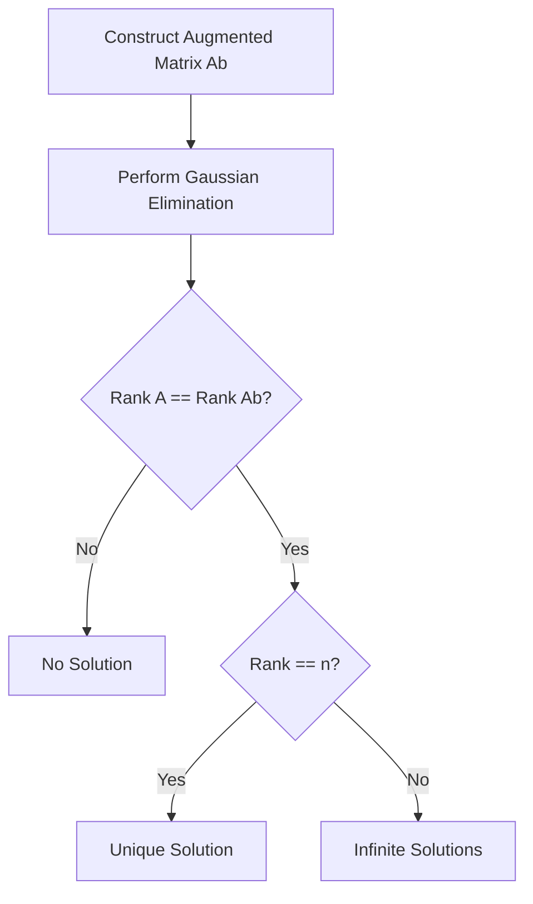

## 🗺️ Context
**Subject:** [[Linear Algebra]]
**Parent Topic:** [[Matrices]]
**Sibling Topics:** [[Matrix Rank]], [[Inverse of a Matrix]], [[Linear Independence]]
**Leads To:** [[Eigenvalues and Eigenvectors]], [[Vector Spaces]]

> 📍 **GATE Syllabus Mapping:** LU decomposition, Rank, Determinants, Systems of linear equations.

---

## 💡 Motivation & Intuition
In engineering and computer science, we often model problems as a system of linear equations: $Ax = b$. 
- **The Problem:** Given a transformation matrix $A$ and an output vector $b$, can we find the input $x$ that produced $b$?
- **The Analogy:** Think of $A$ as a machine. If $A$ "squashes" space (loses rank), some $b$'s might become impossible to reach (no solution), while others might be reachable by infinitely many inputs (infinite solutions).
- **Core Idea:** The **Rank** of a matrix tells us the "useful" dimensions of its output. If the target $b$ lies within the "span" of $A$'s columns, a solution exists.

---

## 📖 Theory

### 1. Augmented Matrix and Consistency
To solve $Ax = b$, where $A$ is an $m \times n$ matrix, we construct the **Augmented Matrix** $[A|b]$.
A system is **consistent** if it has at least one solution, and **inconsistent** if no solution exists.

### 2. The Rouché–Capelli Theorem
The fundamental condition for the existence of solutions is:
A system $Ax = b$ is consistent **if and only if** the rank of the coefficient matrix $A$ is equal to the rank of the augmented matrix $[A|b]$.
$$\rho(A) = \rho(A|b)$$

### 3. Classification of Solutions
Let $n$ be the number of variables (columns of $A$):

| Condition | Type of System | Number of Solutions |
| :--- | :--- | :--- |
| $\rho(A) < \rho(A\|b)$ | Inconsistent | **No Solution** |
| $\rho(A) = \rho(A\|b) = n$ | Consistent | **Unique Solution** |
| $\rho(A) = \rho(A\|b) < n$ | Consistent | **Infinite Solutions** |

- **Unique Solution Case:** If $A$ is a square matrix ($n \times n$), this happens when $|A| \neq 0$ (i.e., $A$ is [[Invertibility|Invertible]]).
- **Infinite Solutions Case:** The number of **independent variables** (or free variables) is given by $n - \rho(A)$.

### 4. Homogeneous Systems ($Ax = 0$)
For $Ax = 0$, the system is *always* consistent because $x = 0$ (the trivial solution) always works.
- If $\rho(A) = n$: Only the **Trivial Solution** ($x=0$) exists.
- If $\rho(A) < n$: **Non-Trivial Solutions** (infinite) exist.

---

## 🖼️ Diagrams & Visuals

### Geometric Interpretation (2D)
1. **Unique Solution:** Two lines intersecting at exactly one point.
2. **Infinite Solutions:** Two lines lying exactly on top of each other.
3. **No Solution:** Two parallel lines that never meet.

### Row Echelon Form (REF) Logic

---

## ⏱️ Complexity Analysis
**Do not just state the complexity — derive or justify it.**

To determine rank and solve the system, we typically use [[Gaussian Elimination]] to reach Reduced Row Echelon Form (RREF).

- **Time Complexity:** $O(n^3)$ for an $n \times n$ matrix. This involves $n$ stages of elimination, where each stage involves $O(n^2)$ operations to zero out elements.
- **Space Complexity:** $O(n^2)$ to store the matrix.
- **Derivation:** In step $k$, we update $(n-k)^2$ elements. Total operations $\approx \sum_{k=1}^n (n-k)^2 \approx \frac{n^3}{3}$.

---

## 🔢 Worked Example

**Problem:** Determine the nature of solutions for:
$x + y + z = 6$
$x + 2y + 3z = 10$
$x + 2y + \lambda z = \mu$

**Step 1: Augmented Matrix**
$$[A|b] = \begin{bmatrix} 1 & 1 & 1 & | & 6 \\ 1 & 2 & 3 & | & 10 \\ 1 & 2 & \lambda & | & \mu \end{bmatrix}$$

**Step 2: Row Operations**
$R_2 \to R_2 - R_1$
$R_3 \to R_3 - R_1$
$$\begin{bmatrix} 1 & 1 & 1 & | & 6 \\ 0 & 1 & 2 & | & 4 \\ 0 & 1 & \lambda-1 & | & \mu-6 \end{bmatrix}$$
$R_3 \to R_3 - R_2$
$$\begin{bmatrix} 1 & 1 & 1 & | & 6 \\ 0 & 1 & 2 & | & 4 \\ 0 & 0 & \lambda-3 & | & \mu-10 \end{bmatrix}$$

**Analysis:**
1. **No Solution:** If $\lambda = 3$ and $\mu \neq 10$, then $\rho(A) = 2$ and $\rho(A|b) = 3$.
2. **Infinite Solutions:** If $\lambda = 3$ and $\mu = 10$, then $\rho(A) = 2$ and $\rho(A|b) = 2$. (Since $2 < 3$ variables).
3. **Unique Solution:** If $\lambda \neq 3$, then $\rho(A) = 3$ and $\rho(A|b) = 3$. (Regardless of $\mu$).

---

## 🎯 GATE Questions

**Question 1 (GATE CS 2014):**
Consider a system of linear equations $Ax=b$, where $A$ is an $n \times n$ matrix and $b$ is a non-zero vector. If the system has more than one solution, then:
- (A) $|A| = 0$
- (B) $\rho(A) = n$
- (C) $b$ is in the null space of $A$
- (D) $A$ is non-singular

💡 Solution (click to reveal)

**Answer: (A)**

**Reasoning:**
- If a system has more than one solution, it must have **infinite solutions** (linear systems never have exactly 2, 3, etc. solutions).
- For infinite solutions, $\rho(A) < n$.
- If $\rho(A) < n$ for a square matrix, the matrix is **singular**, meaning its determinant $|A| = 0$.
- Option (B) implies unique solution. Option (D) is the same as (B). Option (C) is irrelevant to the existence of multiple solutions for $Ax=b$.

**Trap to avoid:** Confusing $Ax=b$ with $Ax=0$. For $Ax=b$, a solution only exists if $b$ is in the [[Column Space]] of $A$, not the [[Null Space]].

---

## ⚠️ Edge Cases & Traps
- [ ] **Square vs. Non-Square:** For $m < n$ (under-determined), you can **never** have a unique solution (only no solution or infinite).
- [ ] **Consistency Check:** Always check $\rho(A) = \rho(A|b)$ *before* looking at the number of variables.
- [ ] **Homogeneous Systems:** $Ax=0$ is *never* inconsistent.
- [ ] **Row Exchange:** Swapping rows changes the augmented matrix but does not change the rank or the solution set.

---

## ⚖️ Comparisons

| Feature | Homogeneous ($Ax=0$) | Non-Homogeneous ($Ax=b$) |
| :--- | :--- | :--- |
| **Always Consistent?** | Yes (Trivial $x=0$) | No (Depends on $b$) |
| **Unique Solution** | Only if $\rho(A) = n$ | If $\rho(A) = \rho(A\|b) = n$ |
| **Condition for Infinite** | $\rho(A) < n$ | $\rho(A) = \rho(A\|b) < n$ |
| **Geometric Meaning** | Passes through Origin | May not pass through Origin |

---

## 🧠 Memory Hooks
- **Mnemonic:** **R.U.I.** -> **R**ank == **U**nique (if full) or **I**nfinite (if low).
- **Visual Metaphor:** The matrix $A$ is a "shadow caster". $b$ is the "target". If the shadow (Column Space) doesn't cover the target, there is no solution.
- **Quick-Recall Formula:** $\text{Free Variables} = n - \text{rank}(A)$.

---

## 🕸️ Connections Web

**Prerequisite Knowledge:**
- [[Matrix Rank]] — The fundamental measure used here.
- [[Linear Independence]] — Rank is the number of LI rows/columns.
- [[Gaussian Elimination]] — The tool to find rank.

**Builds Upon This Topic:**
- [[Null Space]] — The solution set of $Ax=0$.
- [[Rank-Nullity Theorem]] — Relates dimensions of solution spaces.
- [[Column Space]] — $Ax=b$ is consistent if $b \in \text{Col}(A)$.

**GATE Subject Links:**
- [[Linear Algebra]] — Core Topic.
- [[Computer Graphics]] — Solving transform matrices.

---

## ✅ Revision Checklist
- [ ] I can explain the Rouché–Capelli theorem.
- [ ] I can calculate the number of free variables for a system with infinite solutions.
- [ ] I know the difference between consistency and uniqueness.
- [ ] I can solve for parameters ($\lambda, \mu$) to force specific solution types.
- [ ] I understand why $m < n$ implies no unique solution.
