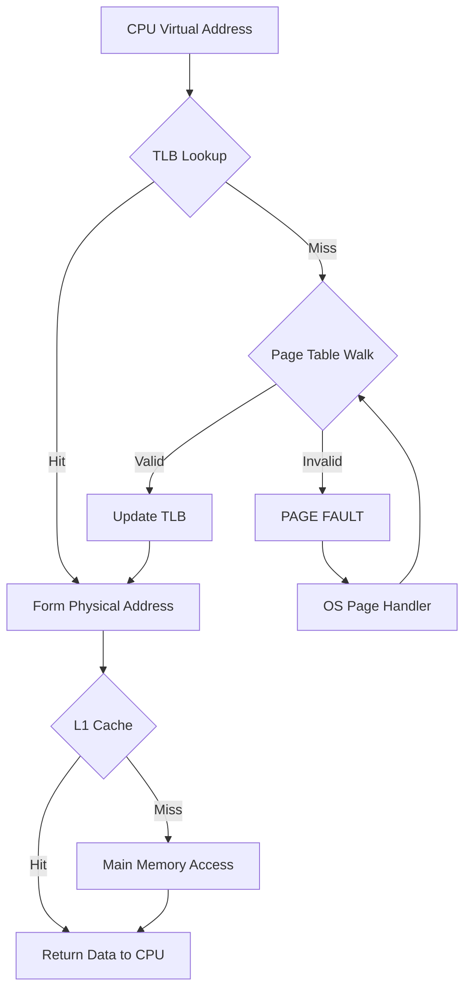

## Syllabus Position

Subject: [[Memory Management Overview]]
Parent Topic: [[Paging]]
Sibling Topics: [[TLB]], [[Cache Memory]], [[Cache Mapping Methods]], [[Page Replacement Algorithms]]

GATE Syllabus Line: "Memory management... Virtual memory... Address translation."

Exam Weight Note: Usually tested through "Integrated" questions that combine TLB, Paging, and Cache into one large numerical.

## The Problem This Solves

Understanding [[TLB]], [[Paging]], and [[Cache Memory]] in isolation is easy, but in a real CPU, they work together in a strict sequence. A student must know what happens first: Does the TLB lookup happen before or after the Cache lookup? What happens if the TLB hits but the Cache misses? This note provides the "Master Map".

Core Idea (one sentence): The Address Translation Pipeline is the sequence of hardware and software steps that convert a CPU-generated Virtual Address into actual data from the Memory Hierarchy.

## Formal Theory

The pipeline can be divided into the **Translation Phase** and the **Data Retrieval Phase**.

### Phase 1: Virtual to Physical (TLB & MMU)
1. CPU issues $VA = (VPN, Offset)$.
2. **TLB Search**:
   - **Hit**: Get $PFN$ immediately.
   - **Miss**:
     - Check **Page Table** in RAM (Page Walk).
     - If PTE valid: Load into TLB, get $PFN$.
     - If PTE invalid: **Page Fault** $\to$ Trap to OS $\to$ Load from Disk $\to$ Restart Instruction.

### Phase 2: Physical to Data (Cache & RAM)
1. Once $PA = (PFN, Offset)$ is formed.
2. **Cache Search** (usually using L1, then L2, then L3):
   - **Hit**: Return data to CPU (Fastest).
   - **Miss**:
     - Access **Main Memory (RAM)**.
     - Load block into Cache, return data to CPU.

### Interaction Models (GATE Favourite)
- **PIPT (Physically Indexed, Physically Tagged)**: Translation (TLB) happens *before* Cache lookup. Safe but slow.
- **VIVT (Virtually Indexed, Virtually Tagged)**: Cache lookup happens using $VA$. Fast, but suffers from aliasing.
- **VIPT (Virtually Indexed, Physically Tagged)**: Index into cache using bits from $VA$ offset while simultaneously searching TLB for $PFN$. Overlaps translation and cache lookup. Most modern CPUs use this.

## Diagrams and Visuals

**The End-to-End Flow:**



**Hierarchy of Speed (slowest to fastest):**
```
Disk > RAM (Page Table) > RAM (Data) > L3 Cache > L2 Cache > L1 Cache > Registers
```

## Complexity Analysis

Let:
- $h_t$ = TLB hit ratio, $c$ = TLB time.
- $h_c$ = Cache hit ratio, $t_c$ = Cache time.
- $m$ = Main memory access time.

**Total EMAT (Simplified Sequential)**:
$$\text{EMAT} = \underbrace{h_t(c) + (1-h_t)(c + m)}_{\text{Translation Time}} + \underbrace{h_c(t_c) + (1-h_c)(m)}_{\text{Data Access Time}}$$

*Note: In reality, some steps overlap (VIPT), but GATE usually specifies the model.*

## Worked Example

**Question**: A system has a TLB (1ns, 90% hit) and Cache (2ns, 80% hit). RAM access is 100ns. Calculate total access time.

**Step-by-Step**:
1. **Avg Translation Time**: $0.9(1) + 0.1(1 + 100) = 0.9 + 10.1 = 11\text{ ns}$.
2. **Avg Data Access Time**: $0.8(2) + 0.2(100) = 1.6 + 20 = 21.6\text{ ns}$.
3. **Total Time**: $11 + 21.6 = 32.6\text{ ns}$.

## Intuition Anchors

**The Mental Model**:
Imagine a high-security building.
1. **TLB**: The security guard's list of authorized visitors. (Fast check).
2. **Page Table**: The master ledger in the office. (Slow check).
3. **Cache**: The items you keep in your pockets. (Fast retrieval).
4. **RAM**: The items in your locker. (Slow retrieval).
5. **Disk**: The items at home. (Very slow retrieval).

**The #1 Trap**:
Forgetting that **Page Table access is itself a memory access**. If you miss the TLB, you *must* access RAM to read the Page Table — costing you one extra $m$ before you even reach the data.

## GATE Questions

**Question 1 — [GATE-style] — [2-mark]**
Consider a system where TLB access is 2ns, Cache access is 10ns, and RAM access is 100ns. TLB hit rate is 95%, Cache hit rate is 90%. What is the effective time to access a memory operand? Assume Cache is accessed only after address translation is complete.

<details>
<summary>Solution</summary>

**Answer: ~28 ns**

**Reasoning:**
1. Translation time: $E_{trans} = 0.95(2) + 0.05(2 + 100) = 1.9 + 5.1 = 7\text{ ns}$.
2. Data access: $E_{data} = 0.90(10) + 0.10(10 + 100) = 9 + 11 = 20\text{ ns}$ (Cache miss requires RAM; 10ns cache lookup still occurs before confirming miss).
3. Total = $7 + 20 = 27\text{ ns}$ (slight variation based on problem wording around whether cache time is included on miss).
</details>

## Edge Cases and Failure Modes

- [ ] **Multi-level Paging + TLB Miss**: A TLB miss might require 2, 3, or 4 memory accesses just to walk to the $PFN$. Each level of a page table is a separate RAM access.
- [ ] **Write-Through vs Write-Back**: Affects the pipeline if the instruction is a STORE. Write-through propagates writes immediately to RAM; write-back defers until eviction.
- [ ] **TLB miss + Page Fault**: The absolute worst case. Instruction stalls for milliseconds (disk I/O time). This is what triggers [[Thrashing]].

## Comparisons

| Event | Handler | Speed |
| :--- | :--- | :--- |
| Cache Hit | Hardware | ~1-10 ns |
| TLB Hit | Hardware (MMU) | ~1-5 ns |
| TLB Miss (PT in RAM) | Hardware page walk | ~50-200 ns |
| Page Fault | OS Kernel | ~1-10 ms |

## Connections Web

**Must know before this topic:**
- [[TLB]] — Translation phase.
- [[Cache Mapping Methods]] — Data retrieval phase.
- [[Paging]] — Source of the Page Table.

**Topics that build on this:**
- [[Thrashing]] — When this pipeline collapses under constant misses.
- [[Fragmentation and Allocation]] — Physical memory layout that the pipeline ultimately addresses.
- [[Memory Management Overview]] — The overarching system this pipeline operates within.

## Quick Revision Sheet

1. **VA $\to$ TLB**: Hit? PFN. Miss? Page Table.
2. **Page Table**: Valid? Update TLB. Invalid? Page Fault (OS).
3. **PA $\to$ Cache**: Hit? Data. Miss? RAM.
4. **EMAT**: Sum of (Prob $\times$ Time) for every path.
5. **Key Distinction**: TLB/Cache are hardware caches; Page Table/RAM are software/logical memory structures.
6. **VIPT**: Overlaps TLB and Cache lookup — used in modern CPUs for performance.

## Revision Checklist
- [ ] I can draw the full flowchart from memory (VA → data).
- [ ] I can calculate EMAT for a multi-level TLB/Cache hierarchy.
- [ ] I know where the OS steps in (Page Fault) vs hardware stays in control (TLB Miss, Cache Miss).
- [ ] I understand PIPT vs VIPT trade-offs.
- [ ] I can identify the "worst case" number of memory accesses for a given system.
