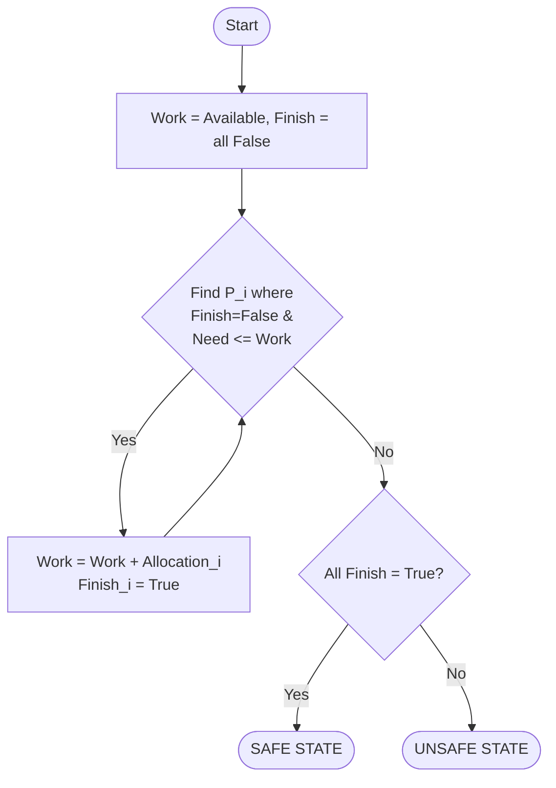

⚠️ **Warning:** You are not in `~/Documents/My Notes`. This file will be saved in the current directory instead. Move it manually if needed.

## Syllabus Position

Subject: [[Operating Systems]]
Parent Topic: [[Deadlock]]
Sibling Topics: [[Resource Allocation Graph]], [[Deadlock Prevention]], [[Deadlock Detection]]
Leads To: [[Safety State]], [[Deadlock Recovery]]

**GATE Syllabus Line:** "Deadlock avoidance: Banker’s algorithm"

**Exam Weight Note:** Extremely high. Appears almost every alternate year as a 2-mark NAT (Numerical Answer Type) requiring a full trace of the Safety Algorithm or a 1-mark MCQ on theoretical constraints.

---

## 💡 The Problem This Solves (Intuition First)

Imagine a **Bank** with multiple customers. Each customer has a **Credit Limit** (Maximum Demand), but they only use a portion of it at any time (Current Allocation). The bank has a finite amount of **Cash** (Available Resources).

The bank's goal is to never grant a loan that puts it in a position where it cannot satisfy at least one customer's full credit limit. If the bank lends too much and *all* customers suddenly demand their full credit limit, the bank might "freeze" (Deadlock).

**Mapping to OS:**
- **Banker:** The [[Operating System]] (OS).
- **Customers:** [[Process]] instances.
- **Cash:** System resources (CPU, RAM, Disk, I/O).
- **Credit Limit:** The declared maximum resource requirement of a process.
- **Decision:** Grant a resource request only if the resulting state allows every process to finish eventually.

**Core Idea:** Do not grant a request if it leads the system to an **Unsafe State**.

---

## 📖 Formal Theory

The Banker's Algorithm is a **Deadlock Avoidance** strategy. It requires that the OS knows in advance the **Maximum Resources** each process will ever request.

### 1. Prerequisites & Assumptions
1. The number of processes ($n$) and resource types ($m$) are fixed.
2. Every process must declare its maximum demand for each resource type upfront.
3. Resources are requested and released in a finite time.
4. When a process finishes, it returns all allocated resources.

### 2. Data Structures
Let $n$ be the number of processes and $m$ be the number of resource types.

- **Available**: A vector of size $m$. $Available[j] = k$ means there are $k$ instances of resource type $R_j$ available.
- **Max**: An $n \times m$ matrix. $Max[i][j] = k$ means process $P_i$ may request at most $k$ instances of resource type $R_j$.
- **Allocation**: An $n \times m$ matrix. $Allocation[i][j] = k$ means $P_i$ is currently allocated $k$ instances of $R_j$.
- **Need**: An $n \times m$ matrix. $Need[i][j] = k$ means $P_i$ may need $k$ more instances of $R_j$ to complete its task.
  $$Need[i][j] = Max[i][j] - Allocation[i][j]$$

### 3. Safety Algorithm
This algorithm determines if the system is in a **Safe State**. A state is safe if there exists a **Safe Sequence** $\langle P_1, P_2, \dots, P_n \rangle$ such that for each $P_i$, the resources that $P_i$ can still request can be satisfied by currently available resources plus resources held by all $P_j$ (where $j < i$).

```text
Algorithm Safety:
1. Initialize Work = Available (vector of size m)
   Initialize Finish = [false, false, ..., false] (vector of size n)

2. Find an index i such that:
   a) Finish[i] == false
   b) Need_i <= Work
   If no such i exists, go to step 4.

3. Work = Work + Allocation_i
   Finish[i] = true
   Go to step 2.

4. If Finish[i] == true for all i, then the system is in a SAFE STATE.
```

### 4. Resource-Request Algorithm
When process $P_i$ makes a request $Request_i$ for resources:

```text
Algorithm Request(P_i, Request_i):
1. If Request_i > Need_i:
       Raise Error (Process exceeded its maximum claim).
2. If Request_i > Available:
       P_i must wait (Resources not available).
3. Tentatively update state:
       Available = Available - Request_i
       Allocation_i = Allocation_i + Request_i
       Need_i = Need_i - Request_i
4. Run Safety Algorithm.
       If SAFE: Grant resources and commit state.
       If UNSAFE: Rollback (Restore old state) and P_i must wait.
```

### 5. Why Safe State $\implies$ No Deadlock?
A safe state means there is an ordering (the safe sequence) where everyone can finish. Even if every process requests its **Max** demand at the same time, the first process in the sequence can finish, release its resources, which helps the next one finish, and so on. **Deadlock is impossible in a Safe State.**

---

## 🖼️ Diagrams & Visuals

### ASCII Matrix Layout
```text
Process |  Allocation  |      Max      |     Need      |   Available   
        |  A   B   C   |   A   B   C   |   A   B   C   |   A   B   C   
-----------------------------------------------------------------------
   P0   |  0   1   0   |   7   5   3   |   7   4   3   |   3   3   2   
   P1   |  2   0   0   |   3   2   2   |   1   2   2   |               
   P2   |  3   0   2   |   9   0   2   |   6   0   0   |               
   ...  |  ...         |   ...         |   ...         |               
```

### Safety Algorithm Logic


---

## ⏱️ Complexity Analysis

**1. Time Complexity (Safety Algorithm):**
- Let $n$ be processes and $m$ be resource types.
- To find a process that can finish, we may check up to $n$ processes.
- Each check involves comparing vectors of size $m$ (takes $O(m)$).
- Once a process finishes, it is never checked again. In the worst case, we find the "right" process only after checking all remaining $n, n-1, \dots, 1$ processes.
- Total iterations: $n + (n-1) + \dots + 1 = O(n^2)$.
- Complexity per comparison: $O(m)$.
- **Total Time Complexity:** $O(n^2 \cdot m)$.

**2. Time Complexity (Resource Request):**
- Includes the Safety Algorithm call: $O(n^2 \cdot m)$.
- The overhead of vector subtraction/addition is $O(m)$, which is dominated by the Safety check.

**3. Space Complexity:**
- $Max$ matrix: $n \times m$
- $Allocation$ matrix: $n \times m$
- $Need$ matrix: $n \times m$
- $Available$ vector: $m$
- **Total Space Complexity:** $O(n \cdot m)$.

**4. Why is this impractical?**
In a real OS, $n$ (processes) and $m$ (resources) are dynamic and large. Running an $O(n^2 m)$ algorithm on every single `malloc()` or resource request would cripple system performance. Furthermore, processes rarely know their "Maximum Demand" in advance.

---

## 🔢 Worked Example

**Initial State:**
3 Resource types: A (10 instances), B (5), C (7).
Currently Available: **(3, 3, 2)**.

| Process | Allocation (A B C) | Max (A B C) |
| :--- | :--- | :--- |
| P0 | 0 1 0 | 7 5 3 |
| P1 | 2 0 0 | 3 2 2 |
| P2 | 3 0 2 | 9 0 2 |
| P3 | 2 1 1 | 2 2 2 |
| P4 | 0 0 2 | 4 3 3 |

### Step 1: Compute Need Matrix ($Need = Max - Allocation$)
- $P0: (7-0, 5-1, 3-0) = (7, 4, 3)$
- $P1: (3-2, 2-0, 2-0) = (1, 2, 2)$
- $P2: (9-3, 0-0, 2-2) = (6, 0, 0)$
- $P3: (2-2, 2-1, 2-1) = (0, 1, 1)$
- $P4: (4-0, 3-0, 3-2) = (4, 3, 1)$

### Step 2: Run Safety Algorithm
Work = (3, 3, 2).
1. **P1:** Need (1, 2, 2) $\le$ Work (3, 3, 2)? **Yes.**
   Work = (3, 3, 2) + (2, 0, 0) = **(5, 3, 2)**. $Finish[P1] = true$.
2. **P3:** Need (0, 1, 1) $\le$ Work (5, 3, 2)? **Yes.**
   Work = (5, 3, 2) + (2, 1, 1) = **(7, 4, 3)**. $Finish[P3] = true$.
3. **P4:** Need (4, 3, 1) $\le$ Work (7, 4, 3)? **Yes.**
   Work = (7, 4, 3) + (0, 0, 2) = **(7, 4, 5)**. $Finish[P4] = true$.
4. **P0:** Need (7, 4, 3) $\le$ Work (7, 4, 5)? **Yes.**
   Work = (7, 4, 5) + (0, 1, 0) = **(7, 5, 5)**. $Finish[P0] = true$.
5. **P2:** Need (6, 0, 0) $\le$ Work (7, 5, 5)? **Yes.**
   Work = (7, 5, 5) + (3, 0, 2) = **(10, 5, 7)**. $Finish[P2] = true$.

**Safe Sequence:** $\langle P1, P3, P4, P0, P2 \rangle$. (Others may exist).

### Step 3: Request Handling
**Case A (Valid):** $P1$ requests (1, 0, 2).
1. $Request (1, 0, 2) \le Need (1, 2, 2)$? Yes.
2. $Request (1, 0, 2) \le Available (3, 3, 2)$? Yes.
3. Tentative: Available = (2, 3, 0), $P1_{Alloc}$ = (3, 0, 2), $P1_{Need}$ = (0, 2, 0).
4. Safety Check: P3 can still finish, eventually releasing enough for P1, etc. **Grant.**

**Case B (Invalid):** $P0$ requests (0, 2, 0).
1. Tentative Available would be (3, 1, 2).
2. Check $Need \le Work$:
   - P0 Need (7, 4, 3) > (3, 1, 2)
   - P1 Need (1, 2, 2) > (3, 1, 2) [B-resource insufficient]
   - P2 Need (6, 0, 0) > (3, 1, 2) [A-resource insufficient]
   - P3 Need (0, 1, 1) $\le$ (3, 1, 2)? **Yes.** $P3$ finishes, Work becomes (3, 1, 2) + (2, 1, 1) = (5, 2, 3).
   - Now check again: No process's need can be satisfied. System is **Unsafe**.
3. **Deny request.**

---

## 🧠 Intuition Anchors

- **The Deep Analogy:** 
  - $Allocation$ = Loans already in customer's hands.
  - $Max$ = Total Credit Line of the customer.
  - $Need$ = Remaining money the customer *might* withdraw before paying everything back.
  - $Available$ = Bank's current vault cash.
- **The Mental Model:** "Always ask — if I give this away, is there *at least one* process that can finish using what's left? And if that one finishes, can the next one finish?"
- **One-Line Recall:** "Banker's Algorithm avoids deadlock by ensuring the system always stays in a safe state where processes can finish in some sequential order, derived in $O(n^2 m)$ time."
- **The #1 Trap:** 
  - **Trap:** Thinking "Unsafe State = Deadlock".
  - **Fact:** An unsafe state only means **deadlock is possible** if everyone requests their max. A safe state **guarantees** no deadlock.
  - **Trap:** Forgetting to check $Request \le Need$ before $Request \le Available$. A process cannot request more than it originally declared!

---

## 🎯 GATE Questions

### Question 1 (PYQ Style)
A system has 5 processes and 3 resources (A:10, B:5, C:7). Current state: Available=(3,3,2). P1 Allocation=(2,0,0), Max=(3,2,2). P1 requests (1,0,2). Is this state safe?
(A) Yes, safe sequence exists.
(B) No, leads to unsafe state.
(C) No, request exceeds Need.
(D) No, request exceeds Available.

<details>
<summary>💡 Solution</summary>
**Answer: (A)**
Follow the worked example above. The request (1,0,2) is $\le$ Need (1,2,2) and $\le$ Available (3,3,2). After tentative allocation, P3 can finish, then P1, then others.
</details>

---

### Question 2 (NAT Numerical)
In a system with 3 resource types (A, B, C) and 10, 12, 14 instances respectively. Process $P_0$ has Allocation (2, 3, 5) and Max (7, 7, 7). The $Need$ of $P_0$ for resource $B$ is _________.

<details>
<summary>💡 Solution</summary>
**Answer: 4**
Need[B] = Max[B] - Allocation[B] = 7 - 3 = 4.
</details>

---

### Question 3 (Hard)
Which of the [[Coffman Conditions]] does the Banker's Algorithm primarily target to avoid deadlock?
(A) Mutual Exclusion
(B) Hold and Wait
(C) No Preemption
(D) Circular Wait

<details>
<summary>💡 Solution</summary>
**Answer: (D)**
Banker's Algorithm ensures that resources are allocated in a way that no **Circular Wait** can occur. It avoids the circular wait by ensuring a "safe sequence" exists.
</details>

---

## ⚠️ Edge Cases & Traps

- [ ] **Need = 0:** If a process has $Max = Allocation$, its need is zero. It can finish immediately. GATE often gives one such process to "kickstart" the safety sequence.
- [ ] **Available = 0:** Even if available is (0,0,0), the state is safe if a process exists with $Need = (0,0,0)$.
- [ ] **Request = Need:** If $P_i$ requests its full remaining need and it's granted, $P_i$ *must* finish and release all resources immediately in your trace.
- [ ] **Multiple Safe Sequences:** In NAT questions, if asked "How many safe sequences?", trace carefully. If at any step two processes can finish, both branches must be explored.
- [ ] **Integer Overflow:** In code, `mid = (lo + hi)/2` is a trap; in Banker's, the trap is assuming $Total = Available + \sum Allocation$. This is only true if no resources are "lost".

---

## ⚖️ Comparisons

| Feature | [[Banker's Algorithm]] | [[Resource Allocation Graph]] | [[Deadlock Prevention]] |
| :--- | :--- | :--- | :--- |
| **Approach** | Avoidance | Avoidance (Single Instance) | Prevention |
| **Max Demand?** | Required upfront | Not required | Not required |
| **Multi-instance?** | Yes | No (requires Banker's) | Yes |
| **Time Complexity**| $O(n^2 m)$ | $O(V+E)$ (Cycle detection) | $O(1)$ usually |
| **Main Drawback** | High overhead, static | Only for single instance | Low resource utilization |

---

## 🕸️ Connections Web

**Prerequisites:**
- [[Deadlock]] — The condition we are trying to avoid.
- [[Operating System]] — The environment where this runs.
- [[Process]] — The entities requesting resources.
- [[Resource Allocation Graph]] — Visual representation for single-instance cases.

**Builds on this:**
- [[Safe State]] — The goal state of the algorithm.
- [[Deadlock Detection Algorithm]] — Similar matrix logic but runs after suspected deadlock.

**Cross-Subject Connections:**
- [[Dining Philosophers Problem]] — A classic deadlock scenario.
- [[Semaphores]] — Low-level tools that can cause deadlocks if used poorly.
- [[Mutual Exclusion]] — One of the 4 Coffman conditions.
- [[Critical Section]] — Where processes hold resources.

**References:**
- [[Silberschatz OS Concepts Chapter 8]]
- [[CLRS]] (Graph algorithms context)

---

## ✅ Quick Revision Sheet

- **Definition:** A deadlock avoidance algorithm that denies requests if they lead to an unsafe state.
- **Matrices:** 
  - $Need = Max - Allocation$
  - $Work$ (Available) increases as processes finish: $Work = Work + Allocation_i$.
- **Safety Step:** Find $P_i$ where $Need_i \le Work \implies$ Add $Alloc_i$ to $Work$.
- **Complexity:** $O(n^2 m)$ time, $O(nm)$ space.
- **Key Property:** Safe $\implies$ No Deadlock. Unsafe $\implies$ Potential Deadlock.
- **Trap:** $Request \le Need$ must be checked first!
- **Mnemonic:** **AMAN** (Allocation, Max, Available, Need).

---

## ✅ Revision Checklist

- [ ] I can state the formal definition without looking.
- [ ] I can explain the bank loan analogy and map it to OS components.
- [ ] I can trace a 5-process example by hand in under 3 minutes.
- [ ] I can derive the $O(n^2 m)$ complexity from scratch.
- [ ] I know that Unsafe $\neq$ Deadlock.
- [ ] I can solve GATE PYQs on safe sequences.
- [ ] I know the Resource Request Algorithm's 3-step check.
- [ ] I have linked this note to [[Deadlock]] and [[Operating Systems]].
- [ ] I can compute the $Need$ matrix instantly.

---
