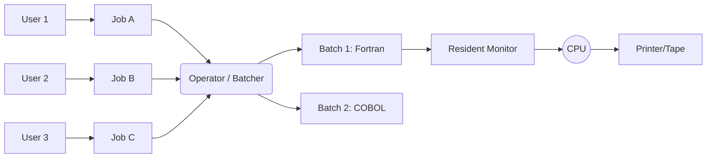

## Syllabus Position

Subject: [[Operating Systems]]
Parent Topic: [[Introduction to OS]]
Sibling Topics: [[RTOS]], [[Multi-programming]], [[Time-Sharing Systems]]
Leads To: [[CPU Utilization]], [[I/O Management]], [[Spooling]]

GATE Syllabus Line: Concepts of operating systems: processes, threads, inter-process communication... CPU scheduling.

Exam Weight Note: Usually appears in "Evolution of OS" questions or conceptual 1-mark MCQs about throughput and interactivity.

## The Problem This Solves

In the early days of computing (1950s-60s), computers were massive, expensive, and slow. Users had to manually load their programs (on punch cards), set up tapes, and wait. If a program took 5 minutes to run, the "setup time" might take 30 minutes. This was a massive waste of expensive CPU time.

**Batch OS** solved this by acting as a **Manager**. Instead of one user at a time, it grouped similar jobs into a "Batch" and processed them sequentially without manual intervention between jobs.

**Core Idea (one sentence):** Batch OS automates the transition between jobs to minimize setup time and maximize CPU usage for repetitive tasks.

## Formal Theory

### Definition
A **Batch Operating System** is a system where the user does not interact with the computer directly. Users prepare their jobs (offline) and submit them to an operator, who sorts them into batches with similar requirements.

### Key Phases of Evolution

#### 1. Simple Batch Systems
- **Resident Monitor:** A small piece of software that always stays in memory. It automatically loads the next job from the card reader when the current one finishes.
- **Sequential Execution:** Jobs are executed in the order they appear in the batch ([[FCFS]]).
- **Problem:** If a job performs I/O, the CPU sits idle. CPU utilization is very low.

#### 2. Spooling (Simultaneous Peripheral Operations On-Line)
- **Concept:** Uses a disk as a large buffer to store jobs waiting to be processed and outputs waiting to be printed.
- **How it works:** While the CPU is executing Job A, the I/O controller can be reading Job B from cards to the disk, or writing Job Z's output from disk to the printer.
- **Result:** Overlaps I/O of one job with computation of another. This is the precursor to **Multiprogramming**.

### Characteristics

- **Lack of Interactivity:** Once a job is submitted, the user cannot interact with it. No "Stop" or "Debug" during execution.
- **CPU Starvation:** A long-running job at the head of the batch can block all subsequent jobs (Convoy Effect).
- **Throughput:** High for similar, non-interactive tasks, but **Turnaround Time** is high (you might get your results the next day).

## Diagrams and Visuals

### Batch Processing Workflow


### Spooling vs. Buffering
- **Buffering:** Overlaps I/O of a *single* job with its own computation.
- **Spooling:** Overlaps I/O of *multiple* jobs with the computation of *one* job.

**ASCII Diagram of Spooling:**
```text
[Input Device] --(Slow)--> [Disk / Spool] --(Fast)--> [CPU]
[CPU] --(Fast)--> [Disk / Spool] --(Slow)--> [Output Device]
```

## Complexity Analysis

The metric for Batch OS is **Throughput** ($\eta$):
$$\eta = \frac{\text{Total Jobs Completed}}{\text{Total Time}}$$

**Wait Time Derivation:**
If a batch has $n$ jobs each taking time $t$, the average wait time is:
$$\text{Avg Wait} = \frac{0 + t + 2t + \dots + (n-1)t}{n} = \frac{t(n-1)}{2}$$
This shows that as the batch size increases, wait time grows linearly, leading to poor user experience.

## Worked Example

**Scenario:** 3 jobs arrive in a batch.
- Job 1: 10 mins (CPU)
- Job 2: 5 mins (CPU)
- Job 3: 20 mins (CPU)

**Execution Trace:**
1. **0 - 10 min:** Job 1 runs. Job 2 & 3 wait.
2. **10 - 15 min:** Job 2 runs. Job 3 waits.
3. **15 - 35 min:** Job 3 runs.

**Metrics:**
- **Turnaround Time (T1):** 10 min
- **Turnaround Time (T2):** 15 min
- **Turnaround Time (T3):** 35 min
- **Avg Turnaround:** $(10+15+35)/3 = 20 \text{ mins}$

**Edge Case:** If Job 1 enters an infinite loop, Job 2 and 3 will **starve** and never run. The operator must manually intervene.

## Intuition Anchors

**The Analogy:**
Batch OS is like a **Laundromat with a Wash-and-Fold service**. You drop off your clothes (Job), the attendant (Operator) puts all the "Whites" in one machine (Batch), and you come back the next day to pick them up. You cannot change the water temperature halfway through the cycle.

**The Mental Model:**
Picture a **Train**. Once it leaves the station, you can't get on, you can't get off, and you can't tell the driver to go faster. You just wait for it to reach the destination.

**The One-Line Recall:**
Batch OS groups similar jobs to reduce **Setup Time**, but sacrifices **Interactivity**.

**The #1 Trap:**
Students often confuse Batch OS with [[Multiprogramming]]. **Batch OS is usually uniprogramming** (one job in memory at a time). Spooling adds a layer of concurrency but doesn't necessarily mean multiple jobs are sharing the CPU.

## GATE Questions

---

**Question 1 — [Conceptual] — [1-mark]**
Which of the following was the primary motivation for the development of Batch Operating Systems?
- (A) To allow multiple users to use the computer simultaneously.
- (B) To reduce the time the CPU spent idle during job setup.
- (C) To provide a graphical user interface.
- (D) To support real-time constraints.

<details>
<summary>Solution</summary>

**Answer: (B)**

**Reasoning:**
In early systems, manual job setup by users was the bottleneck. Batch OS (via the Resident Monitor) automated this, keeping the CPU busy for longer periods. (A) describes Time-Sharing, (C) is modern OS, and (D) is RTOS.

</details>

---

**Question 2 — [GATE-style] — [1-mark]**
What is the main disadvantage of a simple Batch OS without Spooling?
- (A) High CPU Utilization
- (B) Lack of protection between jobs
- (C) CPU remains idle during I/O operations of a job
- (D) Frequent context switching overhead

<details>
<summary>Solution</summary>

**Answer: (C)**

**Reasoning:**
In a simple Batch system, execution is sequential and synchronous. When a job waits for I/O (e.g., reading a card), the CPU has nothing else to do because only one job is active. Spooling was invented specifically to fix this.

</details>

## Edge Cases and Failure Modes

- [ ] **Infinite Loops:** One bad job can hang the entire batch.
- [ ] **Job Protection:** Early Batch systems had no memory protection; Job A could overwrite the Resident Monitor or Job B's data.
- [ ] **Priority:** Simple batches don't support "Urgent" jobs; everything is FCFS.
- [ ] **I/O Bound Jobs:** A job that does mostly I/O will waste almost all CPU cycles in a non-spooled system.

## Comparisons

| Feature | Batch OS | Time-Sharing OS |
| :--- | :--- | :--- |
| **Interactivity** | None | High |
| **CPU Goal** | Maximize Throughput | Minimize Response Time |
| **User Access** | Offline (Submit & Leave) | Online (Terminal) |
| **Switching** | Only when Job finishes | Time Quantum based |
| **GATE Trap** | Starvation by long jobs | Overhead of switching |

## Connections Web

**Must know before this topic:**
- [[Operating Systems Overview]] — Basic history
- [[I/O Management]] — Understanding card readers and printers

**Topics that build on this:**
- [[Multi-programming]] — The next logical step (multiple jobs in RAM)
- [[Spooling]] — The technology that enabled the transition
- [[CPU Utilization]] — The primary metric for Batch systems

**GATE subject cross-links:**
- [[Operating Systems]] > [[CPU Scheduling]]

**Standard References:**
- [[Galvin Chapter 1.2]] / [[Tanenbaum Section 1.2]]

## Quick Revision Sheet

**Definition:** Jobs are grouped and processed without user interaction.

**Core Idea:** Reduce **Setup Time** (overhead).

**Key Components:**
- **Resident Monitor:** The "First OS".
- **Spooling:** Using Disk to overlap I/O and CPU.

**Pros:** High throughput for repetitive tasks.
**Cons:** High turnaround time, No interactivity, Starvation risk.

**The #1 Trap:** Batch $\neq$ Multiprogramming. Batch is about **automation**, Multiprogramming is about **simultaneous residency**.

## Revision Checklist

- [ ] I can explain the role of a Resident Monitor.
- [ ] I can differentiate between Buffering and Spooling.
- [ ] I understand why Batch OS has poor turnaround time.
- [ ] I can identify why Batch OS is not suitable for debugging.
- [ ] Scheduled review in 3 days.

---
✅ Note created: Batch OS.md
   Sections complete: 14 / 14
   Wiki Links found: 14
   GATE Questions included: 2
   Estimated revision time: 8 minutes
