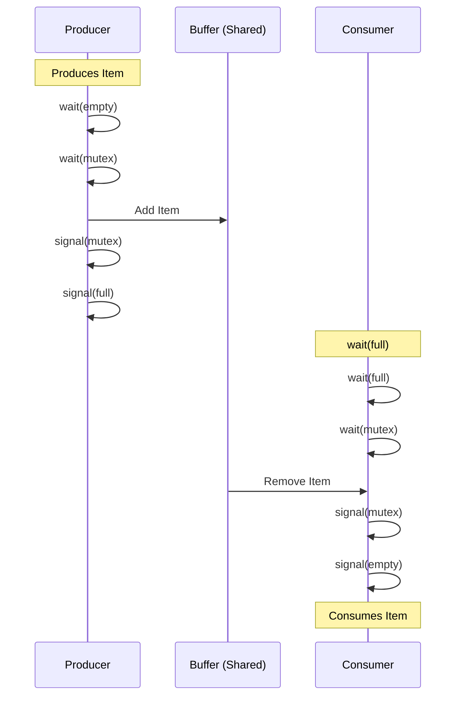

## Syllabus Position

Subject: [[Operating Systems]]
Parent Topic: [[Process Synchronization]]
Sibling Topics: [[Readers-Writers Problem]], [[Dining Philosophers Problem]], [[Critical Section Problem]]
Leads To: [[Monitors]], [[Deadlock]], [[Inter-Process Communication]]

GATE Syllabus Line: "Processes, Threads, Inter‐process communication, Concurrency and synchronization, Deadlock."

Exam Weight Note: Frequently appears as 2-mark NAT or MCQ. GATE often tests the **initial values of semaphores** or the **order of semaphore operations** to check for deadlock.

---

## The Problem This Solves

Imagine a bakery where one chef (the **Producer**) makes donuts and places them in a display case that can only hold 10 donuts. A customer (the **Consumer**) comes and buys donuts from that case. 

If the case is full, the chef must stop making donuts and wait. If the case is empty, the customer must wait for a fresh donut. Furthermore, only one person can touch the case at a time to prevent dropping donuts or miscounting.

**Analogy:** It's like a YouTube video buffer. The network (producer) downloads data into a small memory chunk. The player (consumer) reads from it. If the network is too fast, it stops (buffer full); if the network is too slow, the video pauses (buffer empty).

Core Idea (one sentence): The Bounded Buffer problem ensures that a producer cannot add to a full buffer and a consumer cannot remove from an empty buffer, while maintaining **Mutual Exclusion** during buffer access.

---

## Formal Theory

The Bounded Buffer problem involves two types of processes—**Producer** and **Consumer**—sharing a fixed-size buffer of size $n$.

### 1. The Constraints
1.  **Mutual Exclusion**: Only one process (either producer or consumer) can access the buffer at a time.
2.  **Synchronization (Full)**: The producer must wait if the buffer is full.
3.  **Synchronization (Empty)**: The consumer must wait if the buffer is empty.

### 2. Semaphore-Based Solution
To solve this, we use three [[Semaphores]]:
- `mutex`: A **Binary Semaphore** initialized to $1$ to ensure mutual exclusion.
- `empty`: A **Counting Semaphore** initialized to $n$ (total empty slots).
- `full`: A **Counting Semaphore** initialized to $0$ (total occupied slots).

### 3. Pseudocode Implementation

#### Producer Process:
```
while(true) {
    // Produce an item
    item = produce();

    wait(empty);  // Decrement empty slots (wait if 0)
    wait(mutex);  // Enter critical section

    // Add item to buffer
    buffer.add(item);

    signal(mutex); // Leave critical section
    signal(full);  // Increment full slots
}
```

#### Consumer Process:
```
while(true) {
    wait(full);   // Decrement full slots (wait if 0)
    wait(mutex);  // Enter critical section

    // Remove item from buffer
    item = buffer.remove();

    signal(mutex); // Leave critical section
    signal(empty); // Increment empty slots

    // Consume the item
    consume(item);
}
```

### What GATE actually tests here
GATE examiners love to swap the order of `wait(empty)` and `wait(mutex)`. If you lock the `mutex` first and then find the buffer is full/empty, you will sleep while holding the lock, causing a [[Deadlock]]. **Always acquire the resource semaphore before the mutex.**

---

## Diagrams and Visuals

### 1. Buffer State Diagram
The buffer is a circular array with `in` and `out` pointers.

```text
Buffer Size (n) = 5
[ Full ] [ Full ] [ Empty ] [ Empty ] [ Empty ]
    ^                 ^
   out               in
(Consumer reads)   (Producer writes)

Current Semaphores: mutex=1, empty=3, full=2
```

### 2. Process Interaction Flow


---

## Complexity Analysis

- **Time Complexity**: Each `wait()` and `signal()` operation is $O(1)$. The overhead comes from [[Context Switching]] if a process is blocked.
- **Space Complexity**: $O(n)$ where $n$ is the buffer size. The synchronization primitives (semaphores) take $O(1)$ space.
- **Overhead**: In a "Busy-waiting" solution (using `while` loops), CPU cycles are wasted. In a "Blocking" solution (standard semaphores), the overhead is the time taken by the OS to move a process to the **Wait Queue** and back to the **Ready Queue**.

| Case         | Time Complexity | Space Complexity | Trigger Condition                          |
|--------------|-----------------|------------------|--------------------------------------------|
| Best Case    | $O(1)$          | $O(n)$           | Buffer is neither full nor empty.          |
| Producer Block| $O(Context Swap)$| $O(n)$           | Buffer is full (`empty == 0`).             |
| Consumer Block| $O(Context Swap)$| $O(n)$           | Buffer is empty (`full == 0`).             |

---

## Worked Example

**Setup:** Buffer size $n = 3$. 
Initial Semaphores: `mutex = 1`, `empty = 3`, `full = 0`.

1.  **Producer P1** starts.
    - `wait(empty)`: `empty` becomes 2.
    - `wait(mutex)`: `mutex` becomes 0.
    - *Action*: Adds Item A to Buffer[0].
    - `signal(mutex)`: `mutex` becomes 1.
    - `signal(full)`: `full` becomes 1.
2.  **Producer P2** starts.
    - `wait(empty)`: `empty` becomes 1.
    - `wait(mutex)`: `mutex` becomes 0.
    - *Action*: Adds Item B to Buffer[1].
    - `signal(mutex)`: `mutex` becomes 1.
    - `signal(full)`: `full` becomes 2.
3.  **Consumer C1** starts.
    - `wait(full)`: `full` becomes 1.
    - `wait(mutex)`: `mutex` becomes 0.
    - *Action*: Removes Item A from Buffer[0].
    - `signal(mutex)`: `mutex` becomes 1.
    - `signal(empty)`: `empty` becomes 2.

**Final State:** Buffer has [Item B], `empty=2`, `full=1`, `mutex=1`.
**Total operations:** 15 semaphore calls for 3 successful interactions.

---

## Intuition Anchors

**The Analogy (restated):**
Think of a **Post Office Box**. The mailman (Producer) has a key to the building (`mutex`) and checks if there's a free slot (`empty`). The recipient (Consumer) has a key (`mutex`) and checks if there's mail (`full`). If the mailman gets inside the building but the slots are full, he can't do his job. But if he locks the building door and *then* checks for slots, and stays inside waiting for a slot to open... no one else can enter, and the system freezes.

**The Mental Model:**
Track three things: **Space**, **Items**, and **The Key**. 
- You need **Space** to produce. 
- You need **Items** to consume. 
- You need **The Key** to touch the buffer.

**The One-Line Recall:**
$P \to \text{wait(empty), wait(mutex)} \dots C \to \text{wait(full), wait(mutex)}$.

**The #1 Trap:**
Deadlock occurs if `wait(mutex)` is called **before** `wait(empty)` or `wait(full)`. 
*Example:* Buffer is full. Producer calls `wait(mutex)` (locks buffer), then `wait(empty)` (sleeps because buffer is full). Consumer tries to call `wait(full)` but is blocked by `mutex`. **Deadlock!**

---

## GATE Questions

**Question 1 — [PYQ: GATE 2014] — [2-mark]**

A shared variable `count` is used to keep track of the number of items in a buffer. The producer and consumer processes are:
Producer: `wait(empty); wait(mutex); buffer[in]=item; in=(in+1)%n; count++; signal(mutex); signal(full);`
Consumer: `wait(full); wait(mutex); item=buffer[out]; out=(out+1)%n; count--; signal(mutex); signal(empty);`
What is the problem if `mutex` is removed?

- (A) Deadlock
- (B) Race Condition on `count`
- (C) Buffer Overflow
- (D) Buffer Underflow

<details>
<summary>Solution</summary>

**Answer: (B)**

**Reasoning:**
The variable `count` is shared. `count++` and `count--` are not atomic at the machine level (they involve Load, Increment/Decrement, Store). Without `mutex`, two processes might interleave these operations, leading to an incorrect final value of `count`. This is a classic **Race Condition**. 

**What this question is really testing:**
The role of Mutual Exclusion in protecting non-atomic shared variables.

</details>

---

**Question 2 — [Conceptual] — [1-mark]**

In the Bounded Buffer problem with $n$ slots, what are the initial values of the semaphores `S1` (to track empty slots), `S2` (to track full slots), and `S3` (for mutual exclusion)?

- (A) $S1=0, S2=n, S3=1$
- (B) $S1=n, S2=0, S3=1$
- (C) $S1=1, S2=0, S3=n$
- (D) $S1=n, S2=1, S3=0$

<details>
<summary>Solution</summary>

**Answer: (B)**

**Reasoning:**
- `empty` (S1) starts at $n$ because all slots are empty initially.
- `full` (S2) starts at $0$ because no items are present.
- `mutex` (S3) starts at $1$ to allow the first process to enter.

</details>

---

**Question 3 — [Hard] — [2-mark]**

Consider a Bounded Buffer of size 5. If 3 Producers and 2 Consumers are running, and the current semaphore values are `empty = 1`, `full = 4`, and `mutex = 1`. How many items are currently in the buffer, and which process type is likely to block next?

- (A) 1 item, Consumer will block
- (B) 4 items, Consumer will block
- (C) 4 items, Producer will block
- (D) 1 item, Producer will block

<details>
<summary>Solution</summary>

**Answer: (C)**

**Reasoning:**
1. The value of the `full` semaphore indicates the number of items in the buffer. Here `full = 4`, so there are 4 items.
2. The value of `empty` is 1. If a producer attempts to produce, it will call `wait(empty)`, making `empty = 0`. The *next* producer after that will find `empty = 0` and block. Thus, the Producer is closer to blocking.

**Pattern Recognition:**
In any synchronization problem, the semaphore value tells you the "capacity" remaining for that specific action.

</details>

---

## Edge Cases and Failure Modes

- [ ] **Buffer Size $n=1$**: The problem reduces to a simple alternating sequence (Strict Alternation) but still requires `mutex` if multiple producers/consumers exist.
- [ ] **Wrong Semaphore Order**: As discussed, `wait(mutex)` must be the **innermost** wait to avoid deadlock.
- [ ] **Signal/Wait Mismatch**: If a programmer forgets `signal(full)`, consumers will starve. If they forget `signal(empty)`, producers will eventually block forever.
- [ ] **Interrupts during Signal**: Standard semaphores assume `wait()` and `signal()` are **Atomic**. If the OS can interrupt inside these functions, the semaphore itself becomes a source of Race Conditions.

---

## Comparisons

| Feature              | [[Bounded Buffer]]    | [[Readers-Writers]]   | [[Dining Philosophers]] |
|----------------------|-----------------------|-----------------------|-------------------------|
| Primary Goal         | Resource Coordination | Priority/Fairness     | Deadlock Avoidance      |
| Type of Semaphores   | Counting + Binary     | Binary + Integer      | Binary Array            |
| Key Constraint       | Buffer Limits         | No concurrent writes  | No adjacent eating      |
| Main GATE Trap       | Semaphore Ordering    | Starvation of Writers | Circular Wait           |

**Note:** The Bounded Buffer is a "Many-to-Many" communication model, whereas Readers-Writers is "Many-to-One" (for writing).

---

## Connections Web

**Must know before this topic:**
- [[Semaphores]] — The building blocks of the solution.
- [[Critical Section]] — The code that touches the buffer.
- [[Atomic Operations]] — Why `wait` and `signal` must be uninterruptible.

**Topics that build on this:**
- [[Monitors]] — A higher-level abstraction that avoids manual semaphore management.
- [[Message Passing]] — An alternative to shared memory using `send()` and `receive()`.
- [[Deadlock]] — What happens when synchronization goes wrong.

**GATE subject cross-links:**
- [[Operating Systems]] > [[Process Synchronization]]
- [[Computer Organization]] > [[I/O Interface]] (Buffers in hardware)

**Standard references:**
- [[Galvin Chapter 6]] (Silberschatz, Galvin, Gagne)
- [[Tanenbaum Modern OS]]

---

## Quick Revision Sheet

**Definition:** A classic synchronization problem where producers and consumers share a finite buffer.

**Core Idea:** Use `empty` and `full` counting semaphores to track slots, and a `mutex` for exclusive access.

**Algorithm Steps:**
1. Producer: `wait(empty) \to wait(mutex) \to \text{ADD} \to signal(mutex) \to signal(full)`.
2. Consumer: `wait(full) \to wait(mutex) \to \text{REMOVE} \to signal(mutex) \to signal(empty)`.

**Complexity:**
- Time: $O(1)$ per operation.
- Space: $O(n)$ buffer storage.

**Key Properties:**
- `empty + full = n` (Buffer Size).
- `wait(mutex)` must be the last `wait` before critical section.
- `signal` order is less critical but usually follows the inverse of `wait`.

**The #1 Trap:** Swapping `wait(mutex)` and `wait(empty/full)` leads to **Deadlock**.

---

## Revision Checklist

- [ ] I can state the formal definition without looking.
- [ ] I can explain the bakery analogy and why the door lock order matters.
- [ ] I can trace a 3-slot example by hand.
- [ ] I can derive why `mutex` is needed even if `empty` and `full` are used.
- [ ] I know that `empty` starts at $n$ and `full` starts at $0$.
- [ ] I can solve the 2014 GATE question on race conditions.
- [ ] I have linked this note to [[Process Synchronization]].
- [ ] I have scheduled a spaced-repetition review.

---
