## Syllabus Position

Subject: [[Operating Systems Index]]
Parent Topic: [[CPU Scheduling]]
Sibling Topics: [[FCFS]], [[SJF]], [[Round Robin]], [[Priority Scheduling]]
Leads To: [[Preemptive vs Non-Preemptive]], [[Scheduling Algorithm Comparisons]]

GATE Syllabus Line: CPU scheduling, CPU scheduling algorithms, Process synchronization.

Exam Weight Note: Appears almost every year as a 2-mark NAT or MCQ where a [[Gantt Chart]] must be drawn to calculate averages.

## The Problem This Solves

Imagine a hospital triage system. If we only measure how many patients leave healthy, we might ignore how long they sat in the waiting room. If we only measure how fast the doctor works, we ignore the patient's experience.

In OS, we need a standard vocabulary to judge if an algorithm is "fair" or "fast." Without these metrics, we couldn't mathematically prove that [[SJF]] is optimal for waiting time or why [[Round Robin]] is better for interactive systems.

Core Idea (one sentence): Scheduling metrics provide the quantitative basis to evaluate the efficiency of the [[CPU Scheduler]] and the quality of service provided to a [[Process]].

## Formal Theory

The performance of any [[CPU Scheduling]] algorithm is evaluated using specific time-based parameters.

### 1. Basic Timing Metrics
- **[[Arrival Time (AT)]]**: The exact time a process enters the **Ready Queue**.
- **[[Burst Time (BT)]]**: The time required by the process on the CPU (also called Execution Time or Service Time).
- **[[Completion Time (CT)]]**: The time at which a process finishes its execution and leaves the system.

### 2. Derived Efficiency Metrics
- **[[Turnaround Time (TAT)]]**: The total time a process spends in the system.
  $$TAT = CT - AT$$
- **[[Waiting Time (WT)]]**: The total time a process spends waiting in the ready queue.
  $$WT = TAT - BT$$
- **[[Response Time (RT)]]**: The time from arrival until the process gets the CPU for the **first time**.
  $$RT = \text{First CPU Allocation Time} - AT$$

### 3. System-Wide Metrics
- **[[Scheduling Length]] (Makespan)**: The total time required to complete a batch of processes.
  $$\text{Makespan} = \max(CT) - \min(AT)$$
- **[[Throughput]]**: Number of processes completed per unit time.
  $$\text{Throughput} = \frac{\text{Total Processes}}{\text{Makespan}}$$
- **[[CPU Utilization]]**: The fraction of time the CPU is busy.
  $$\text{Utilization} = \frac{\text{Busy Time}}{\text{Total Time}}$$

> [!IMPORTANT]
> **What GATE actually tests here:**
> GATE rarely asks for definitions. It gives a table of AT/BT, expects you to draw a [[Gantt Chart]], and calculate the **Average Waiting Time** or **Average Turnaround Time**. The "Trap" is usually handling CPU **Idle Time** correctly in the Makespan.

## Diagrams and Visuals

### The Metric Timeline
1. Draw a horizontal line (Time).
2. Mark AT.
3. Mark "First CPU Time".
4. Mark CT.
5. The distance $AT \to \text{First CPU}$ is **RT**.
6. The distance $AT \to CT$ is **TAT**.
7. The total time spent "on CPU" (sum of all segments) is **BT**.
8. Everything else inside TAT is **WT**.

```mermaid
gantt
    title CPU Scheduling Metric Anatomy
    dateFormat  X
    axisFormat %s
    section Ready Queue
    Arrival (AT) :milestone, m1, 0, 0
    Waiting (WT) :active, w1, 0, 5
    section CPU
    First Response (RT) :milestone, m2, 5, 0
    Execution (BT) :crit, b1, 5, 12
    Completion (CT) :milestone, m3, 12, 0
```

## Complexity Analysis

| Metric | Complexity | Note |
| :--- | :--- | :--- |
| Single Process Calculation | $O(1)$ | Simple subtraction |
| Average Calculation | $O(n)$ | Summing $n$ values |
| Gantt Chart Construction | $O(n \log n)$ or $O(n^2)$ | Depends on the scheduling algorithm (e.g., [[Priority Scheduling]] needs sorting/searching). |

## Worked Example (The "All-in-One" Trace)

Consider 4 processes with [[Non-Preemptive]] SJF:

| Process | AT | BT |
| :--- | :--- | :--- |
| P1 | 0 | 8 |
| P2 | 1 | 4 |
| P3 | 2 | 9 |
| P4 | 3 | 5 |

**Gantt Chart:**
Since it is Non-Preemptive, at $t=0$, only P1 is available. It runs to completion.
At $t=8$, P2, P3, and P4 have arrived. SJF picks P2 (shortest BT).
At $t=12$, P4 runs.
At $t=17$, P3 runs.

`[P1 (0-8)] [P2 (8-12)] [P4 (12-17)] [P3 (17-26)]`

**Calculations Table:**

| P | AT | BT | CT | TAT (CT-AT) | WT (TAT-BT) | RT (First-AT) |
| :--- | :--- | :--- | :--- | :--- | :--- | :--- |
| P1 | 0 | 8 | 8 | 8 | 0 | 0 |
| P2 | 1 | 4 | 12 | 11 | 7 | 7 |
| P3 | 2 | 9 | 26 | 24 | 15 | 15 |
| P4 | 3 | 5 | 17 | 14 | 9 | 9 |

- **Average WT**: $(0+7+15+9)/4 = 31/4 = 7.75$
- **Average TAT**: $(8+11+24+14)/4 = 57/4 = 14.25$
- **Makespan**: $26 - 0 = 26$
- **Throughput**: $4/26 \approx 0.153$ processes/unit time.

## Intuition Anchors

**The Analogy:**
Think of a **Coffee Shop**.
- **AT**: You enter the shop.
- **First CPU Time**: Barista says "May I take your order?"
- **RT**: How long you stood there before being acknowledged.
- **BT**: Time it takes to actually brew your latte.
- **CT**: You walk out with your drink.
- **TAT**: Total time you "lost" in the shop.
- **WT**: Time spent looking at your phone while waiting.

**The Mental Model:**
The CPU is a single resource. **TAT** measures the user's frustration (I've been here too long!), while **Throughput** measures the owner's profit (How many customers did I serve?).

**The One-Line Recall:**
$TAT = CT - AT$; $WT = TAT - BT$; for Non-Preemptive, $WT = RT$.

**The #1 Trap:**
**WT vs RT in Preemptive Algorithms**: In [[Round Robin]] or Preemptive SJF, a process might get the CPU, then be kicked off, then wait again.
- **RT** only cares about the **first** time it got the CPU.
- **WT** cares about **every** time it was not on the CPU while being in the ready queue.

## GATE Questions

---

**Question 1 — [PYQ: GATE 2012] — [2-mark]**

Three processes P1, P2 and P3 arrive at time $t=0$ with CPU burst times 10, 20 and 30 respectively. If they are scheduled using [[SJF]], what is the average waiting time?

- (A) 10
- (B) 13.33
- (C) 20
- (D) 40

Solution

**Answer: (B)**

**Reasoning:**
1. At $t=0$, all arrive. Order of execution for SJF: P1 (10), P2 (20), P3 (30).
2. Gantt: `[P1: 0-10] [P2: 10-30] [P3: 30-60]`
3. WT for P1 = $0 - 0 = 0$.
4. WT for P2 = $10 - 0 = 10$.
5. WT for P3 = $30 - 0 = 30$.
6. Average WT = $(0 + 10 + 30) / 3 = 40/3 = 13.33$.

**What this question is really testing:** Simple SJF calculation.

**Trap to avoid:** Using FCFS order if the question says SJF.

---

**Question 2 — [Conceptual] — [1-mark]**

In which of the following cases is **Waiting Time (WT)** always equal to **Response Time (RT)**?

- (A) All Preemptive Algorithms
- (B) All Non-Preemptive Algorithms
- (C) Only FCFS
- (D) Only Round Robin

Solution

**Answer: (B)**

**Reasoning:**
In a **Non-Preemptive** environment, once a process gets the CPU, it never leaves until completion. Therefore, the "Total time waiting" is exactly the same as "Time spent waiting for the first allocation."
In **Preemptive** (like RR), the process might wait multiple times, making $WT > RT$.

## Edge Cases and Failure Modes

- [ ] **Idle Time**: If no process is ready at $t=5$ but the next arrives at $t=8$, the CPU sits idle. This **must** be counted in CT but does **not** count towards any process's BT.
- [ ] **Simultaneous Arrival**: If two processes have the same AT, the tie-breaker (usually PID or smaller BT) determines the [[Gantt Chart]] order.
- [ ] **Zero BT**: Theoretically possible in "dummy" processes; $TAT = WT$.
- [ ] **Context Switch Overhead**: Usually ignored in basic GATE problems unless explicitly given. If given, add the overhead time to every CPU entry/exit in the Gantt chart.

## Comparisons

| Feature | Waiting Time (WT) | Response Time (RT) | Turnaround Time (TAT) |
| :--- | :--- | :--- | :--- |
| **Focus** | Efficiency (Queueing) | Interactivity (User Feel) | Overall Duration |
| **Calculation** | $TAT - BT$ | First CPU - AT | $CT - AT$ |
| **Sensitivity** | High for all algorithms | High for [[Round Robin]] | High for [[FCFS]] |
| **Preemption** | Includes all wait gaps | Only includes the first gap | Includes everything |

## Connections Web

**Must know before this topic:**
- [[Process]] — What is being scheduled.
- [[Process States]] — Ready vs Running vs Terminated.
- [[PCB]] — Where these times are stored.

**Topics that build on this:**
- [[FCFS]], [[SJF]], [[Round Robin]], [[SRTF]], [[LRTF]], [[Priority Scheduling]].
- [[Gantt Chart]] — The tool used to calculate these.

**GATE subject cross-links:**
- [[Operating Systems Index]] > [[CPU Scheduling]]

**Standard references:**
- [[Galvin Chapter 5]] / [[Stallings Chapter 9]]

## Quick Revision Sheet

**Definition:** Quantifiable metrics (AT, BT, CT, TAT, WT, RT) used to evaluate CPU scheduling performance.

**Core Formulae:**
- $TAT = CT - AT$
- $WT = TAT - BT$
- $RT = \text{First Time} - AT$
- $\text{Throughput} = N / \text{Makespan}$

**Algorithm Steps for Problems:**
1. Draw **Gantt Chart** based on AT and the algorithm's rule.
2. Fill **CT** for each process from the chart.
3. Calculate **TAT** and then **WT**.
4. Sum and divide by $N$ for averages.

**Key Properties:**
- For **Non-Preemptive**, $WT = RT$.
- **SJF** always gives the minimum **Average Waiting Time**.
- **Throughput** is maximized when CPU idle time is minimized.

## Revision Checklist

- [ ] I can state the formal definition of TAT and WT.
- [ ] I understand why WT = RT in non-preemptive but not preemptive.
- [ ] I can draw a Gantt chart for a 4-process scenario.
- [ ] I can calculate throughput correctly including CPU idle time.
- [ ] I have linked this note to my [[CPU Scheduling]] MOC.
- [ ] I can solve the average WT for a given SJF table in < 2 mins.

