## Syllabus Position
Subject: [[Operating Systems]]
Parent Topic: [[CPU Scheduling Algorithms MOC]]
Leads To: [[Convoy Effect]], [[SJF]]

GATE Syllabus Line: CPU Scheduling Algorithms.

## The Problem This Solves
When processes arrive at different times, the simplest way to be "fair" is to serve them in the order they arrived.

Analogy: A queue at a grocery store checkout. The person who gets there first is served first.

Core Idea: CPU is allocated to processes in the order they request it.

## Formal Theory
**FCFS** is a **non-preemptive** scheduling algorithm. Once a process gets the CPU, it holds it until it terminates or blocks for I/O.

### Implementation
- Uses a **FIFO Queue** for the [[Ready Queue]].
- When a process enters the ready queue, its PCB is linked to the tail of the queue.
- The scheduler picks the process from the head.

### Characteristics
- **Criteria**: [[Arrival Time]] ($AT$).
- **Mode**: Non-preemptive.
- **Fairness**: High (no process is skipped), but leads to poor performance for short processes.

## Complexity Analysis
- **Scheduling Overhead**: $O(1)$ (just pick from head).
- **Time Complexity**: $O(n)$ to calculate metrics for $n$ processes.
- **Space Complexity**: $O(n)$ for the queue.

## Diagrams and Visuals
### The [[Convoy Effect]]
A large process (CPU-bound) holds the CPU, while many small processes (I/O-bound) wait behind it.

```mermaid
gantt
    title Convoy Effect
    dateFormat  HH:mm
    axisFormat  %H:%M
    section CPU
    P1 (Huge BT) :00:00, 00:30
    P2 (Small BT):00:30, 00:32
    P3 (Small BT):00:32, 00:34
```

## Worked Example
Processes: 
- P1: AT=0, BT=20
- P2: AT=1, BT=2
- P3: AT=2, BT=2

**Gantt Chart:**
| P1 (0-20) | P2 (20-22) | P3 (22-24) |

**Calculations:**
- P1: TAT = 20-0=20, WT = 20-20=0
- P2: TAT = 22-1=21, WT = 21-2=19
- P3: TAT = 24-2=22, WT = 22-2=20
- **Avg WT** = (0+19+20)/3 = 13.0

*What if P2 and P3 arrived first?* Avg WT would be significantly lower.

## Intuition Anchors
- **The #1 Trap**: Thinking FCFS is efficient. It is only "fair" in order, not in performance.
- **One-Line Recall**: Non-preemptive, criteria is AT, suffers from [[Convoy Effect]].

## GATE Questions
**Question 1 (GATE-style)**: 
Three processes P1, P2, P3 have BTs 10, 3, 7 and ATs 0, 0, 0. If they are scheduled in order P1, P2, P3, what is the avg WT?
- (A) 10
- (B) 7.66
- (C) 13
- (D) 8.33

Solution

Answer: (B)
P1 starts 0, ends 10. WT=0.
P2 starts 10, ends 13. WT=10.
P3 starts 13, ends 20. WT=13.
Avg WT = (0+10+13)/3 = 23/3 = 7.66.

## Edge Cases and Failure Modes
- [ ] **Arrival Tie**: Usually resolved by Process ID (PID).
- [ ] **Convoy Effect**: Long process at the start ruins avg metrics.

## Quick Revision Sheet
- **Criteria**: [[Arrival Time]]
- **Mode**: Non-preemptive
- **Starvation**: No
- **Problem**: [[Convoy Effect]]
- **Best use**: Batch systems where response time isn't critical.
