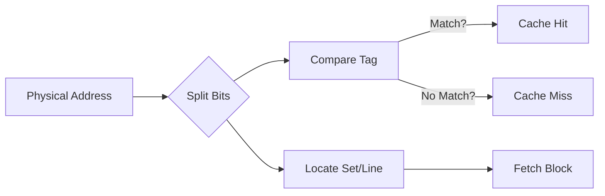

## Syllabus Position

Subject: [[Cache Memory]]
Parent Topic: [[Memory Management Overview]]
Sibling Topics: [[Paging]], [[TLB]]
Leads To: [[Cache Miss Types]], [[Memory Hierarchy]]

GATE Syllabus Line: "Computer Organization: Cache memory... mapping functions."

Exam Weight Note: High frequency. Usually appears as a 2-mark question asking for the number of bits in Tag/Index/Offset fields or calculating the size of the Tag Directory.

## The Problem This Solves

Main memory is huge (GBs), while Cache is tiny (MBs). We need a consistent, hardware-fast way to decide **where** a block of RAM should reside in the Cache. If we just put it anywhere, searching would be too slow. If we put it in only one spot, we might have constant collisions. Mapping methods define the "parking rules" for data in the cache.

Core Idea (one sentence): Mapping functions determine the placement of memory blocks in cache lines and the structure of the address interpretation.

## Formal Theory

A Physical Address is viewed by the cache in three parts: **Tag**, **Index (Line/Set)**, and **Word/Block Offset**.

### 1. Direct Mapping (Many-to-One)
Each memory block maps to exactly one cache line.
- **Formula**: $\text{Line Number} = (\text{Block Number}) \mod (\text{Number of Cache Lines})$
- **Address Split**: `[ Tag | Line Index | Block Offset ]`
- **Pros**: Simplest hardware, fast.
- **Cons**: High **Conflict Misses**. If two frequently used blocks map to the same line, they will constantly evict each other (**Thrashing**).

### 2. Fully Associative Mapping (Many-to-Many)
Any memory block can be placed in any cache line.
- **Address Split**: `[ Tag | Block Offset ]` (No Index bits!)
- **Pros**: Maximum flexibility, zero conflict misses.
- **Cons**: Requires parallel search of all tags (expensive CAM hardware). Slow for large caches.

### 3. k-way Set-Associative Mapping (Hybrid)
Cache is divided into $V$ sets, each containing $k$ lines.
- **Formula**: $\text{Set Number} = (\text{Block Number}) \mod (\text{Number of Sets})$
- **Address Split**: `[ Tag | Set Index | Block Offset ]`
- **Special Cases**:
  - $k=1$: Direct Mapped.
  - $k = \text{Total Lines}$: Fully Associative.

## Diagrams and Visuals

**Address Partitioning Comparison:**

```
Direct Mapped:
|      Tag      |   Line Index   | Block Offset |

Set-Associative:
|      Tag      |   Set Index    | Block Offset |

Fully Associative:
|            Tag                 | Block Offset |
```

**Mermaid Logic:**


## Complexity Analysis

- **Hardware Complexity**: Fully Associative > Set-Associative > Direct.
- **Miss Rate**: Direct > Set-Associative > Fully Associative.

| Method | Tag Directory Size Calculation |
| :--- | :--- |
| **Direct** | $N \times (\text{Tag Bits} + \text{Valid/Dirty})$ |
| **k-way** | $(Sets \times k) \times (\text{Tag Bits} + \dots)$ |

## Worked Example

**Scenario**:
- Physical Address: 32-bit.
- Cache Size: 32 KB.
- Block Size: 64 Bytes.
- Mapping: 4-way Set-Associative.

**Calculation**:
1. **Block Offset Bits**: $64 = 2^6 \implies \mathbf{6 \text{ bits}}$.
2. **Number of Lines**: $32 \text{ KB} / 64 \text{ B} = 2^{15} / 2^6 = 2^9 = 512 \text{ lines}$.
3. **Number of Sets**: $\text{Total Lines} / k = 512 / 4 = 128 = 2^7 \implies \mathbf{7 \text{ bits}}$.
4. **Tag Bits**: $32 - (7 + 6) = \mathbf{19 \text{ bits}}$.

**Check**: If it were Direct Mapped, Line bits would be 9, Tag bits would be 17.

## Intuition Anchors

**The Mnemonic**:
**"T-I-O"** (Tag, Index, Offset).
Think of an address like a Library:
- **Offset**: The specific page in a book.
- **Index**: The specific shelf (Set/Line).
- **Tag**: The ISBN number to verify it's the right book.

**The #1 Trap**:
Calculating "Number of Sets" correctly. Students often divide by block size but forget to divide by $k$ (the associativity). Always remember:
$$\text{Sets} = \frac{\text{Cache Size}}{\text{Block Size} \times k}$$

## GATE Questions

**Question 1 — [PYQ: GATE 2021] — [2-mark]**
A 128 KB direct-mapped cache has a block size of 64 bytes. For a 32-bit physical address, the number of bits in the Tag field is _____.

<details>
<summary>Solution</summary>

**Answer: 15**

**Steps:**
1. Block size = $64 = 2^6 \implies$ Offset = 6 bits.
2. Number of lines = $128 \text{ KB} / 64 \text{ B} = 2^{17} / 2^6 = 2^{11} \implies$ Index = 11 bits.
3. Tag bits = $32 - (11 + 6) = 32 - 17 = 15$.
</details>

---

**Question 2 — [Conceptual]**
Increasing the associativity ($k$) of a cache while keeping the cache size constant:
(A) Increases the number of sets.
(B) Decreases the number of tag bits.
(C) Increases the number of tag bits.
(D) Decreases the block offset bits.

<details>
<summary>Solution</summary>

**Answer: (C)**
Since $\text{Sets} = \text{Lines} / k$, increasing $k$ decreases the number of sets. Fewer set bits $\implies$ more bits leftover for the Tag.
</details>

## Edge Cases and Failure Modes

- [ ] **Power of 2**: Calculations only work cleanly if sizes are powers of 2. If not, round down or use the nearest power as per the problem constraints.
- [ ] **Byte vs Word Addressable**: If the system is word-addressable (e.g., 4 bytes per word), the offset bits change. **Pay attention to the "addressable" unit.**
- [ ] **Total Cache Size vs Data Size**: Usually, "Cache Size" refers to data capacity. Tag overhead is extra.

## Comparisons

| Feature | Direct | Set-Associative | Fully Associative |
| :--- | :--- | :--- | :--- |
| **Conflict Misses** | High | Medium | Zero |
| **Hardware Cost** | Low | Medium | High (CAM) |
| **Search Speed** | Fast | Medium | Slow (without CAM) |
| **Replacement Policy** | Not Needed | Needed (LRU/FIFO) | Needed |

## Connections Web

**Must know before this topic:**
- [[Cache Memory]] basics.
- Binary/Hexadecimal address conversions.

**Topics that build on this:**
- [[Address Translation Pipeline]] — Where cache lookup fits in the full pipeline.
- [[Page Replacement Algorithms]] — Conceptually similar replacement policies used in associative caches.
- [[TLB]] — TLB itself uses fully associative mapping (CAM).

**Standard references:**
- [[Hamacher COA Chapter 5]]
- [[Hennessy & Patterson Chapter 2]]

## Quick Revision Sheet

- **Direct**: $\text{Line} = \text{Block} \mod \text{Lines}$. Split: Tag | Line | Offset.
- **k-way**: $\text{Set} = \text{Block} \mod \text{Sets}$. Split: Tag | Set | Offset.
- **Associative**: No Index. Split: Tag | Offset.
- **Bits Identity**: $2^{\text{Offset}} = \text{Block Size}$; $2^{\text{Index}} = \text{Number of Sets}$.
- **Tag Directory Size**: $\text{Lines} \times (\text{Tag Bits} + \dots)$.
- **Increasing $k$**: Fewer index bits, more tag bits, fewer conflict misses.

## Revision Checklist
- [ ] I can split a 32-bit address into T-I-O for any mapping.
- [ ] I can calculate Tag Directory size including overhead bits.
- [ ] I understand how $k$ affects the tag length.
- [ ] I can identify which bits are used for the Index in a hex address.
