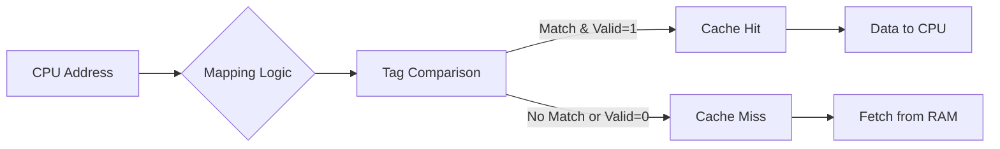

## Syllabus Position

Subject: [[Computer Organization and Architecture]]
Parent Topic: [[Memory Hierarchy]]
Sibling Topics: [[RAM]], [[Virtual Memory]], [[Secondary Storage]]
Leads To: [[Cache Coherence]], [[MESI Protocol]]

GATE Syllabus Line: "Cache memory: organization, mapping, replacement, and write policies."

Exam Weight Note: Heaviest topic in COA. Usually 2 marks on Mapping (Direct vs Set-Associative) and address bit partitioning.

## The Problem This Solves

Main memory (DRAM) is slow compared to the CPU. If the CPU waits for RAM every time, performance drops significantly. Cache (SRAM) is a small, fast memory that stores frequently used data to bridge this speed gap.

Analogy: If RAM is a huge warehouse (far away), Cache is the small toolbox on your belt. You keep the tools you're currently using in the toolbox so you don't have to walk to the warehouse for every screw.

Core Idea (one sentence): Exploit **Locality of Reference** (Temporal and Spatial) to provide the speed of SRAM with the capacity of DRAM.

## Formal Theory

### 1. Mapping Techniques
Where does a block from Main Memory (MM) go in Cache?
- **Direct Mapping**: Each MM block maps to exactly one Cache line. ($Line = Block\_No \pmod{Cache\_Lines}$)
- **Fully Associative Mapping**: A block can go to *any* Cache line.
- **Set-Associative Mapping**: A block maps to a specific *Set*, but can go to any line *within* that set. ($Set = Block\_No \pmod{Sets}$)

### 2. Address Bit Partitioning
A Physical Address is split based on mapping:

**Direct Map:**
| Tag | Line/Index | Offset |
| :--- | :--- | :--- |

**Set-Associative:**
| Tag | Set | Offset |
| :--- | :--- | :--- |

**Fully Associative:**
| Tag | Offset |
| :--- | :--- |

### 3. Write Policies
What happens when the CPU writes to a cached location?
- **Write-Through**: Write to both Cache and RAM simultaneously. (Slow, consistent).
- **Write-Back**: Write only to Cache. Use a **Dirty Bit**. Update RAM only when the line is evicted. (Fast, complex).
- **Write-Allocate**: On a write miss, bring the block into cache.
- **No-Write-Allocate**: On a write miss, update only RAM.

## Diagrams and Visuals

**Cache Structure:**

## Complexity Analysis

| Mapping | Search Hardware | Hit Ratio | Flexibility |
| :--- | :--- | :--- | :--- |
| Direct | 1 Comparator | Lowest | Low (Conflict Misses) |
| Fully Assoc | N Comparators | Highest | High |
| K-way Set Assoc | K Comparators | High | Medium |

**Average Access Time ($T_{avg}$):**
$$T_{avg} = H \times T_c + (1-H) \times (T_c + T_m)$$
(Where $H = Hit\_Ratio, T_c = Cache\_Time, T_m = Memory\_Time$)

## Worked Example

**Problem:**
A 16 KB Cache is 4-way Set-Associative with a block size of 32 bytes. The Main Memory is 1 MB. Find the bits for Tag, Set, and Offset.

**Step-by-step Solution:**
1. **Memory Bits:**
   - MM = 1 MB = $2^{20}$ bytes. Total Address = 20 bits.
2. **Offset Bits:**
   - Block Size = 32 bytes = $2^5$. Offset = 5 bits.
3. **Set Bits:**
   - Number of lines = $16 \text{ KB} / 32 \text{ bytes} = 2^{14} / 2^5 = 2^9 = 512$ lines.
   - 4-way Set Associative $\rightarrow$ 4 lines per set.
   - Number of Sets = $512 / 4 = 128 = 2^7$. Set bits = 7 bits.
4. **Tag Bits:**
   - Tag = Total - Set - Offset = $20 - 7 - 5 = 8$ bits.

**Resulting Address Partition:**
| Tag (8) | Set (7) | Offset (5) |

## Intuition Anchors

**The Mental Model:**
- **Direct Mapping** is like having a specific assigned seat in a classroom based on your ID number. If two students with IDs ending in 50 show up, they fight for the same seat (**Conflict Miss**).
- **Fully Associative** is like an open cafe — sit anywhere. No conflict misses, but hard to find someone (need to check every seat).
- **Set-Associative** is like a dinner party with reserved tables. You are assigned to Table 4, but can sit in any of the 4 chairs there.

**The #1 Trap:**
Confusing **Line Number** and **Set Number**. 
- In $K$-way, $Sets = Lines / K$.
- Use $Sets$ for the address bits, not $Lines$.

**The One-Line Recall:**
Address = [Tag] [Index/Set] [Offset].

## GATE Questions

**Question 1 — [GATE 2007] — [2-mark]**
A 4-way set-associative cache has a size of 16 KB and a block size of 64 bytes. If the physical address is 32 bits, the number of bits in the tag field is?
- (A) 21
- (B) 20
- (C) 15
- (D) 12

Solution

**Answer: (B) 20**
**Reasoning:**
- Offset = 64 bytes = $2^6$ bytes = 6 bits.
- Number of lines = $16 \text{ KB} / 64 = 2^{14} / 2^6 = 2^8 = 256$ lines.
- Sets = $256 / 4 = 64 = 2^6$ sets = 6 bits.
- Tag = $32 - 6 - 6 = 20$ bits.

---

**Question 2 — [Conceptual] — [1-mark]**
Which write policy is preferred for a system where I/O devices frequently read from Main Memory?
- (A) Write-back
- (B) Write-through
- (C) Write-miss
- (D) None

Solution

**Answer: (B) Write-through**
**Reasoning:** Write-through ensures that Main Memory is always up-to-date, which is critical if other devices (like DMA) access RAM directly.

## Edge Cases and Failure Modes

- [ ] **Conflict Misses**: High in Direct Mapping even if cache is mostly empty.
- [ ] **Capacity Misses**: Cache is simply too small for the working set.
- [ ] **Compulsory Misses**: First time data is accessed (Cold Start).
- [ ] **Write Stall**: In Write-through, CPU might have to wait for the slow RAM write to finish.

## Comparisons

| Feature | Direct | Set-Assoc | Fully Assoc |
| :--- | :--- | :--- | :--- |
| Hardware Cost | Low | Medium | High |
| Search Time | Fastest | Medium | Slowest |
| Flexibility | None | Good | Best |
| Conflict Miss | High | Low | Zero |

## Connections Web

**Must know before:**
- [[Memory Hierarchy]]
- [[Binary and Power of 2 Arithmetic]]

**Topics that build on this:**
- [[Cache Coherence]] — for multi-core systems.
- [[MESI Protocol]] — specific coherence logic.
- [[Virtual Memory]] — which often interacts with cache ([[Physically Indexed Physically Tagged]]).

## Quick Revision Sheet

1. **Direct**: $Block \to Line$. Index bits = $\log_2(\text{Lines})$.
2. **Set-Assoc**: $Block \to Set$. Index bits = $\log_2(\text{Sets})$.
3. **Fully Assoc**: No index. Tag = Total - Offset.
4. **Tag Comparison**: Performed in parallel for Set/Fully Assoc.
5. **Effective Access Time**: $H \times C + (1-H) \times (C+M)$.

## Revision Checklist
- [ ] I can partition a 32-bit address for any cache mapping.
- [ ] I understand the difference between Write-through and Write-back.
- [ ] I can derive the number of sets in a $K$-way cache.
