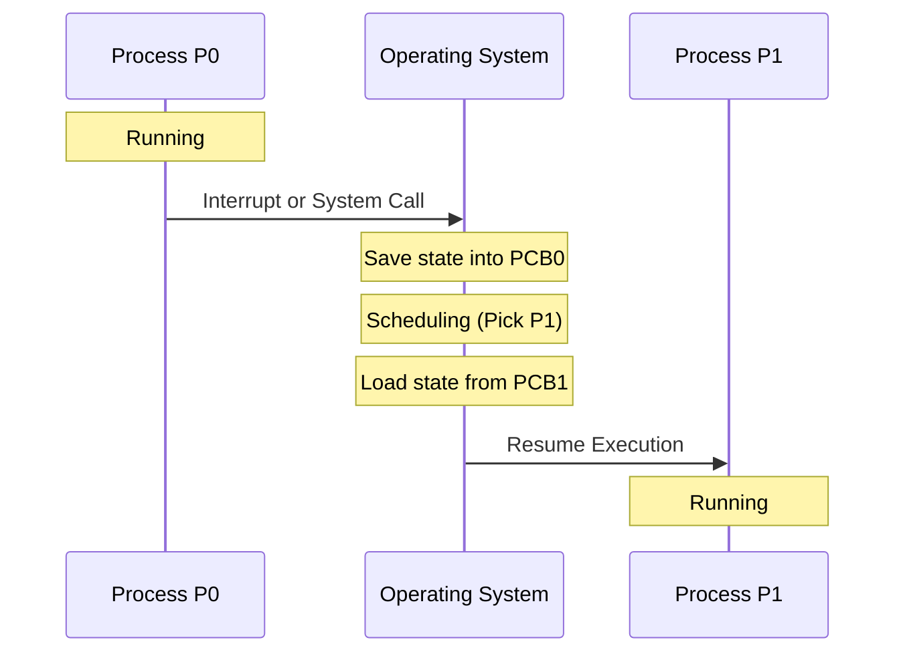

## Syllabus Position

Subject: [[Operating Systems]]
Parent Topic: [[Process]]
Sibling Topics: [[Process States]], [[Process Control Block]]
Leads To: [[CPU Scheduling]], [[Inter-Process Communication]]

GATE Syllabus Line: "Processes, Threads... Process Management."

Exam Weight Note: High. Often tested in numericals involving "Efficiency" or "CPU Utilization" calculation.

## The Problem This Solves

If we only have one CPU, how can we run Spotify, Chrome, and VS Code at the same time? We switch between them so fast that it *looks* like they are running simultaneously. But switching isn't free—it takes time to pack and unpack the "state".

Analogy: Imagine you are writing a math paper, and a friend asks you to help with a history essay. 
1. You mark where you were in the math book.
2. You put your math notes in a folder.
3. You take out the history book and find the right page.
4. Now you start history.
The time spent swapping folders is the **Context Switch**. You aren't doing "real work" during that time.

Core Idea: Context Switching is the mechanism to save the state of a running process and restore the state of the next process.

## Formal Theory

A context switch occurs when the CPU switches from one process to another.

### Steps in a Context Switch
1. **Save State**: The OS saves the current context of Process $P_0$ (Program Counter, Registers, etc.) into its [[Process Control Block]] ($PCB_0$).
2. **Select Next**: The [[Short-Term Scheduler]] selects a new process $P_1$ from the **Ready** queue.
3. **Restore State**: The OS loads the context of $P_1$ from $PCB_1$ into the CPU registers.
4. **Resume**: The CPU begins execution at the restored Program Counter of $P_1$.

### Overhead
Context switching is **Pure Overhead**. No useful work is done by the user process during this time.
- **Hardware Support**: Some CPUs have multiple register sets to speed this up.
- **Cache Effects**: Context switches often cause **TLB Flushes** and **Cache Misses**, slowing down the next process further.

## Diagrams and Visuals

### Context Switching Sequence

## Complexity Analysis
- **Time Complexity**: $O(1)$ with respect to number of processes, but the constant $C$ (switch time) can be high.
- **Efficiency Formula**: 
  $$\text{Efficiency} = \frac{\text{Total CPU Time for Process}}{\text{Total CPU Time for Process} + \text{Context Switch Time}}$$

## Worked Example
**Scenario**: A system has a time quantum of $10ms$. The context switch time is $1ms$. If a process needs $30ms$ of CPU time, what is the total time to finish and the percentage overhead?

1. **Execution 1**: Run $10ms$. Switch out ($1ms$).
2. **Execution 2**: Run $10ms$. Switch out ($1ms$).
3. **Execution 3**: Run $10ms$. (Last run, context switch back depends on system state, but usually counted as 3 runs).
- **Total Time**: $10+1 + 10+1 + 10 = 32ms$.
- **Overhead**: $2ms$ out of $32ms \approx 6.25\%$.

## Intuition Anchors

**The Mental Model:**
The CPU is a **Single Seat**. The Context Switch is the time it takes for one person to get up, pack their bag, and the next person to sit down and unpack.

**The One-Line Recall:**
Save current PCB $\to$ Scheduler $\to$ Load next PCB.

**The #1 Trap:**
**Mistaking Mode Switch for Context Switch.** 
- **Mode Switch**: Moving from User Mode to Kernel Mode (e.g., for a system call). Doesn't necessarily change the process.
- **Context Switch**: Changing the process itself. Much heavier overhead.

## GATE Questions

**Question 1 — [GATE 2006] — [2-mark]**
> Which of the following is most likely to cause a context switch?
- (A) Accessing a local variable
- (B) A floating point operation
- (C) An I/O request
- (D) Execution of an 'add' instruction

Solution

**Answer: (C)**

**Reasoning:**
- (A), (B), (D) are internal CPU/Memory operations that don't require the process to stop.
- (C) I/O request puts the process in the **Waiting** state. Since the CPU cannot sit idle, the OS will perform a **Context Switch** to run another process from the Ready queue.

---

**Question 2 — [Numerical] — [2-mark]**
> A system uses Round Robin scheduling with time quantum $q$. Context switch time is $s$. For a process that takes $T$ time to execute, what is the number of context switches?
- (A) $\lceil T/q \rceil$
- (B) $\lceil T/q \rceil - 1$
- (C) $T/q$
- (D) $T/(q+s)$

Solution

**Answer: (B)**

**Reasoning:**
If $T=25, q=10$:
- Run 1: 0-10ms (Switch 1)
- Run 2: 10-20ms (Switch 2)
- Run 3: 20-25ms (Finish)
Total switches = 2. Formula: $\lceil 25/10 \rceil - 1 = 3 - 1 = 2$.

## Edge Cases and Failure Modes
- [ ] **Thrashing**: If the time quantum is too small (approaching the context switch time), the system spends all its time switching and no time executing code.
- [ ] **TLB Flush**: Switching to a different address space requires clearing the Translation Lookaside Buffer, which causes a performance hit until it's refilled.

## Comparisons

| Feature | Context Switch | Mode Switch |
|---------|----------------|-------------|
| Purpose | Switch Process | Switch Privilege |
| Overhead | High | Low |
| PCB Change | Yes | No |
| User/Kernel | Always Kernel | User $\to$ Kernel |

## Connections Web
**Must know before:**
- [[Process Control Block]]
- [[Process States]]

**Topics that build on this:**
- [[CPU Scheduling]] — specifically Round Robin.
- [[Multiprogramming]]
- [[Virtual Memory]] — TLB effects.

**Standard references:**
- [[Silberschatz Chapter 3.2.3]]

## Quick Revision Sheet
- **Definition**: Saving/Restoring state via PCB.
- **Overhead**: Pure waste; hardware can mitigate.
- **Triggers**: I/O, Interrupts, Time Slices.
- **Formula**: $\lceil T/q \rceil - 1$ context switches for Round Robin.
- **Key distinction**: Different from Mode Switch.

## Revision Checklist
- [ ] I can describe the step-by-step process of a context switch.
- [ ] I understand why context switching is considered "overhead".
- [ ] I can solve numericals on CPU efficiency involving switch time.
- [ ] I know the difference between Context Switch and Mode Switch.
助けが必要ですか？
