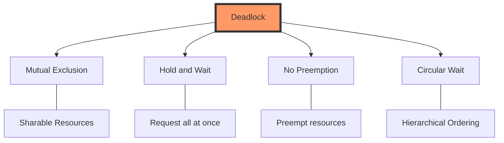

## Syllabus Position

Subject: [[Subject Index]]
Parent Topic: [[Process Synchronization]] / [[Resource Management]]
Sibling Topics: [[Critical Section Problem]], [[Classical Problems of Synchronization]]
Leads To: [[CPU Scheduling]], [[Memory Management]]

> 📍 **GATE Syllabus Line:** Operating Systems: System calls, processes, threads, scheduling, concurrency and synchronization. **Deadlock**.

**Exam Weight Note:** Deadlock is a consistent high-yield topic. Expect a 2-mark NAT on [[Banker's Algorithm]] or a 1-mark MCQ/MSQ on [[Coffman Conditions]] or [[Resource Allocation Graph]] properties.

---

## 💡 The Problem This Solves

Imagine a four-way traffic intersection where four cars arrive simultaneously from four different directions. Each car occupies its lane and needs the lane in front of it to move. Car A holds lane 1 and waits for lane 2. Car B holds lane 2 and waits for lane 3. Car C holds lane 3 and waits for lane 4. Car D holds lane 4 and waits for lane 1. No car can move; they are all "waiting for a wait."

**Analogy:** It’s a "Circular Wait." If everyone holds one resource and waits for another that is held by someone else in the circle, the system grinds to a halt.

**Core Idea:** Deadlock is a state where a set of processes are blocked because each process is holding a resource and waiting for another resource acquired by some other process in that same set.

---

## 📖 Formal Theory

### 1. Formal Definition
A **Deadlock** occurs when a set of processes $P = \{P_1, P_2, \dots, P_n\}$ exists such that every process in the set is waiting for an event that can only be caused by another process in the same set. In OS, that "event" is usually the release of a [[Resource]].

### 2. The 4 Coffman Conditions
For a deadlock to occur, these four conditions **must hold simultaneously**. If you break even one, you prevent deadlock.

1.  **[[Mutual Exclusion]]**: At least one resource must be held in a non-sharable mode (only one process at a time).
    *   *Example:* A printer cannot be used by two processes simultaneously.
2.  **[[Hold and Wait]]**: A process must be holding at least one resource and waiting to acquire additional resources held by other processes.
    *   *Example:* $P_1$ holds Disk Drive and requests Tape Drive.
3.  **[[No Preemption]]**: Resources cannot be forcibly taken from a process; they must be released voluntarily.
    *   *Example:* OS cannot kill $P_1$ to take its scanner and give it to $P_2$.
4.  **[[Circular Wait]]**: A set $\{P_0, P_1, \dots, P_n\}$ of processes must exist such that $P_0$ is waiting for $P_1$, $P_1$ for $P_2$, ..., and $P_n$ for $P_0$.
    *   *Note:* This is a necessary consequence of the first three.

### 3. [[Resource Allocation Graph]] (RAG)
A directed graph used to detect deadlocks.
-   **Vertices ($V$):** Partitioned into $P$ (Processes, represented as circles) and $R$ (Resources, represented as rectangles).
-   **Edges ($E$):**
    -   **Request Edge:** $P_i \to R_j$ (Process $P_i$ wants Resource $R_j$).
    -   **Assignment Edge:** $R_j \to P_i$ (Resource $R_j$ is allocated to $P_i$).

**The RAG Rule of Thumb:**
-   If RAG has **no cycle** $\implies$ **No Deadlock**.
-   If RAG has a **cycle**:
    -   **Single Instance** per resource type $\implies$ **Deadlock**.
    -   **Multi-Instance** per resource type $\implies$ **Maybe Deadlock** (Cycle is a necessary but not sufficient condition).

### 4. Deadlock Handling Strategies
-   **Deadlock Prevention:** Design the system such that at least one Coffman condition can never hold.
-   **Deadlock Avoidance:** Use dynamic information about resource requests to ensure the system stays in a **Safe State** (e.g., [[Banker's Algorithm]]).
-   **Deadlock Detection & Recovery:** Let deadlocks happen, detect them using algorithms, and recover (kill processes or preempt resources).
-   **Deadlock Ignorance:** The **Ostrich Algorithm**. Assume deadlocks never happen. Used in Linux and Windows because the cost of prevention is too high.

---

## 🖼️ Diagrams and Visuals

### Mermaid: Deadlock Conditions Flow


### ASCII Resource Allocation Graph (Single Instance Cycle)
```text
      [R1] 
     /    ^
    |      \
    v       |
   (P1)---->(R2)
    ^       /
     \     |
      \---(P2)

P1 holds R1, wants R2.
P2 holds R2, wants R1.
Cycle: P1 -> R2 -> P2 -> R1 -> P1.
RESULT: DEADLOCK.
```

---

## ⏱️ Complexity Analysis

### 1. [[Banker's Algorithm]]
Used for **Deadlock Avoidance**.
-   Let $n = \text{number of processes}$ and $m = \text{number of resource types}$.
-   **Safety Algorithm:** In each step, we look for a process whose $Need \le Available$. This takes $O(m)$ work. We might check $n$ processes in the first pass, $n-1$ in the second, etc.
-   **Worst Case Time Complexity:** $O(n^2 \cdot m)$.
-   **Space Complexity:** $O(n \cdot m)$ for matrices like $Allocation$, $Max$, and $Need$.

### 2. RAG Cycle Detection
-   Uses Depth First Search ([[DFS]]).
-   **Time Complexity:** $O(V + E)$ where $V = n+m$.

### 3. Detection Algorithm (Multi-instance)
Similar to Banker's Safety Algorithm: $O(n^2 \cdot m)$.

---

## 🔢 Worked Example: Banker's Algorithm

Consider 5 processes $P_0$ through $P_4$ and 3 resource types $A(10), B(5), C(7)$.

**Current State at $T_0$:**

| Process | Allocation (A B C) | Max (A B C) | Need (Max - Alloc) |
| :--- | :---: | :---: | :---: |
| $P_0$ | 0 1 0 | 7 5 3 | **7 4 3** |
| $P_1$ | 2 0 0 | 3 2 2 | **1 2 2** |
| $P_2$ | 3 0 2 | 9 0 2 | **6 0 0** |
| $P_3$ | 2 1 1 | 2 2 2 | **0 1 1** |
| $P_4$ | 0 0 2 | 4 3 3 | **4 3 1** |

**Total Allocated:** $A=7, B=2, C=5$.
**Available:** $Available = (Total - Allocated) = (10,5,7) - (7,2,5) = (3, 3, 2)$.

### Step-by-Step Safety Trace:
1.  **Initial:** $Work = (3, 3, 2)$, $Finish = [F, F, F, F, F]$.
2.  **Check $P_0$:** $Need(7,4,3) \not\le Work(3,3,2)$. Skip.
3.  **Check $P_1$:** $Need(1,2,2) \le Work(3,3,2)$. **True**.
    -   $Work = Work + Alloc(P_1) = (3,3,2) + (2,0,0) = (5,3,2)$. $P_1$ finishes.
4.  **Check $P_2$:** $Need(6,0,0) \not\le Work(5,3,2)$. Skip.
5.  **Check $P_3$:** $Need(0,1,1) \le Work(5,3,2)$. **True**.
    -   $Work = Work + Alloc(P_3) = (5,3,2) + (2,1,1) = (7,4,3)$. $P_3$ finishes.
6.  **Check $P_4$:** $Need(4,3,1) \le Work(7,4,3)$. **True**.
    -   $Work = Work + Alloc(P_4) = (7,4,3) + (0,0,2) = (7,4,5)$. $P_4$ finishes.
7.  **Check $P_0$:** $Need(7,4,3) \le Work(7,4,5)$. **True**.
    -   $Work = (7,4,5) + (0,1,0) = (7,5,5)$. $P_0$ finishes.
8.  **Check $P_2$:** $Need(6,0,0) \le Work(7,5,5)$. **True**.
    -   $Work = (7,5,5) + (3,0,2) = (10,5,7)$. All finish!

**Safe Sequence:** $\langle P_1, P_3, P_4, P_0, P_2 \rangle$.
**Result:** System is in a **Safe State**.

---

## 🧠 Intuition Anchors

-   **The Analogy:** Deadlock is "The Ultimate Standoff." Two people in a narrow hallway, neither moving aside, both waiting for the other to move.
-   **The Mental Model:** Picture a dependency graph. If you can follow the arrows and end up back where you started, and nobody can "preempt" or "share," you are stuck.
-   **One-Line Recall:** Deadlock requires 4 conditions: **M**utual exclusion, **H**old & Wait, **N**o preemption, **C**ircular wait (**MHNC**).
-   **The #1 Trap:** **"A cycle always means deadlock."** WRONG. In multi-instance RAG, a cycle is just a hint. Only in single-instance RAG is a cycle sufficient for deadlock.

---

## 🎯 GATE Questions

**Question 1 — [PYQ: GATE 2014] — [Difficulty: 1-mark]**
Which of the following is NOT a necessary condition for deadlock?
- (A) Mutual Exclusion
- (B) Circular Wait
- (C) Preemption
- (D) Hold and Wait

<details>
<summary>💡 Solution</summary>

**Answer: (C)**

**Reasoning:**
Deadlock requires **No Preemption**. If preemption is allowed (the OS can take resources back), deadlock can be broken or prevented. (A), (B), and (D) are part of the four Coffman conditions.

**Trap to avoid:** Confusing "Preemption" with "No Preemption." Preemption is the *cure*, No Preemption is the *cause*.
</details>

---

**Question 2 — [Conceptual] — [Difficulty: 2-mark]**
A system has 3 processes each needing 3 units of resource $R$. What is the minimum number of units of $R$ required to ensure the system is **deadlock-free**?

<details>
<summary>💡 Solution</summary>

**Answer: 7**

**Step-by-step reasoning:**
- Each process $P_i$ needs $N_i = 3$.
- To ensure deadlock, let each process hold $N_i - 1$ resources and wait for one more.
- Total resources held in "worst-case wait": $\sum (N_i - 1) = (3-1) + (3-1) + (3-1) = 6$.
- If we have 6 resources, they could all be held such that $P_1, P_2, P_3$ each have 2 and need 1.
- **Formula:** $R \ge \sum (N_i - 1) + 1$.
- $R \ge 3(3-1) + 1 = 7$.
- With 7 units, at least one process will eventually get its 3rd unit and finish.

**Pattern Recognition:** For $n$ processes needing $k$ resources each, min resources for no deadlock = $n(k-1) + 1$.
</details>

---

## ⚠️ Edge Cases & Traps

- [ ] **Safe State vs. Deadlock-free:** A safe state is deadlock-free, but an **unsafe state** is NOT necessarily deadlocked. An unsafe state just means we *might* deadlock if processes request their maximums.
- [ ] **Livelock:** Similar to deadlock, but the processes keep changing states (busy-waiting) without making progress. (Like two people trying to pass in a hallway and both stepping to the same side repeatedly).
- [ ] **Starvation:** A process waits indefinitely because others are prioritized. Unlike deadlock, the system as a whole is making progress, but one process is "starving."
- [ ] **Single Instance Cycle:** In a RAG with single-instance resources, a cycle is **Necessary and Sufficient**. In multi-instance, it's only **Necessary**.

---

## ⚖️ Comparisons

| Feature | [[Deadlock Prevention]] | [[Deadlock Avoidance]] | [[Deadlock Detection]] |
| :--- | :--- | :--- | :--- |
| **Strategy** | Negate 1 of 4 conditions | Stay in a Safe State | Let it happen, then fix |
| **Overhead** | High (lowers utilization) | Low/Medium | Low until detection runs |
| **Resource Utilization** | Low | Medium | High |
| **Information Need** | Static Rules | Max Needs of processes | Current Allocation |

---

## 🕸️ Connections Web

**Prerequisite Knowledge:**
- [[Process Synchronization]] — Deadlock is a failure of synchronization.
- [[Resource]] — The items processes compete for.

**Builds Upon This Topic:**
- [[Banker's Algorithm]] — The primary avoidance tool.
- [[Resource Allocation Graph]] — The primary modeling tool.

**GATE Subject Links:**
- [[Operating Systems]] — [[Concurrency]]

**Cross-Subject Connections:**
- [[Database Management Systems]] — Deadlock in [[Transaction Management]] (Two-Phase Locking).
- [[Distributed Systems]] — Distributed deadlock detection.

**Standard References:**
- [[Galvin Chapter 7]] — Deadlocks
- [[Stallings Chapter 6]] — Concurrency: Deadlock and Starvation

---

## ✅ Quick Revision Sheet

- **MHNC Mnemonic:** **M**utual Exclusion, **H**old & Wait, **N**o Preemption, **C**ircular Wait.
- **Prevention:**
    - Break H&W: Request all resources at start.
    - Break Circular Wait: Impose linear ordering on resources.
- **Avoidance:** **Banker's Algorithm**. Check if a process can finish, release its resources to $Work$, repeat.
- **Safety Formula:** $Need = Max - Allocation$.
- **No Deadlock Formula:** $\text{Resources} \ge \sum (\text{Max}_i - 1) + 1$.
- **RAG:** Circle = Cycle. Single instance $\to$ Cycle == Deadlock.

---

## ✅ Revision Checklist

- [ ] I can list the 4 Coffman conditions from memory.
- [ ] I can trace the Banker's Safety Algorithm in under 3 minutes.
- [ ] I can calculate the minimum resources needed to prevent deadlock for $N$ processes.
- [ ] I understand that "Unsafe state $\neq$ Deadlock."
- [ ] I have linked this note to [[Process Synchronization]].
- [ ] I can draw a RAG showing a cycle but no deadlock (using multi-instance nodes).

---
