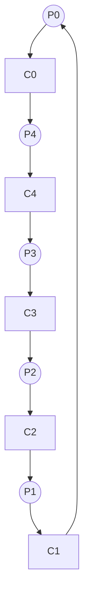

## Syllabus Position

**Subject:** [[Operating Systems]]
**Parent Topic:** [[Process Synchronization]]
**Sibling Topics:** [[Producer-Consumer Problem]], [[Readers-Writers Problem]], [[Sleeping Barber Problem]]
**Leads To:** [[Deadlocks]], [[Resource Allocation Graph]], [[Monitors]]

> 📍 **GATE Syllabus Mapping:** "Processes, Threads, Inter‐process communication, Concurrency and Synchronization, Deadlocks."

**Exam Weight Note:** This is a cornerstone of synchronization. GATE frequently tests the **conditions for deadlock avoidance** and the **minimum number of resources** required to prevent deadlock in this specific scenario. Typically appears as 2-mark NAT or MCQ.

---

## The Problem This Solves

Imagine five philosophers sitting around a circular table. They spend their lives doing only two things: **Thinking** and **Eating**. To eat, a philosopher needs two chopsticks (or forks)—one from their left and one from their right. However, there are only five chopsticks in total, placed between each pair of philosophers.

The problem arises when everyone gets hungry at the same time and picks up their left chopstick. Now, everyone is waiting for their right chopstick, which is held by their neighbor. No one can eat, and no one will put down their chopstick until they've eaten.

**Core Idea:** It represents the challenge of **allocating multiple shared resources** among multiple processes without causing [[Deadlock]] or [[Starvation]].

---

## Formal Theory

The Dining Philosophers Problem was originally proposed by [[Edsger Dijkstra]] in 1965. It illustrates the synchronization issues that occur when processes require multiple resources simultaneously.

### 1. The Naive Solution (Deadlock-Prone)
Each philosopher $P_i$ follows this logic:
1. Wait for `chopstick[i]` (Left)
2. Wait for `chopstick[(i+1) % 5]` (Right)
3. Eat
4. Release both chopsticks.

**Why it fails:** If all philosophers pick up their left chopstick simultaneously, the system enters a **Circular Wait** state—a necessary condition for [[Deadlock]].

### 2. Necessary Conditions for Deadlock
For deadlock to occur here, four conditions must hold:
- **Mutual Exclusion:** A chopstick can be used by only one philosopher at a time.
- **Hold and Wait:** A philosopher holds one chopstick while waiting for another.
- **No Preemption:** A chopstick cannot be forcibly taken from a philosopher.
- **Circular Wait:** $P_0$ waits for $P_1$, $P_1$ waits for $P_2$, ..., $P_4$ waits for $P_0$.

### 3. Standard Solutions for GATE

#### A. Resource Hierarchy (Dijkstra's Solution)
Assign an ordering to resources (chopsticks 0 to 4). Philosophers must always pick up the **lower-numbered** chopstick first.
- **Effect:** The philosopher sitting between chopstick 4 and 0 will try to pick 0 first, then 4. This breaks the circular wait.

#### B. The Arbitrator (Waiter Solution)
A philosopher must ask a "waiter" for permission to pick up chopsticks. The waiter only allows a philosopher to pick up chopsticks if both are available.
- **Effect:** Centralized control prevents deadlock but reduces concurrency.

#### C. Limiting Occupancy ($N-1$ Rule)
Allow only $N-1$ philosophers to sit at the table simultaneously (e.g., 4 philosophers for 5 chopsticks).
- **Effect:** At least one philosopher will always have access to two chopsticks.

#### D. Asymmetric Solution
Odd-numbered philosophers pick Left then Right; even-numbered philosophers pick Right then Left.
- **Effect:** Prevents the circular wait by changing the direction of acquisition for half the processes.

### Semaphore Implementation (N-1 Limit)
```
Semaphore chopstick[5] = {1, 1, 1, 1, 1};
Semaphore room = {4}; // Limit to 4 philosophers

Philosopher(i):
    while(true):
        THINK();
        wait(room);
        wait(chopstick[i]);
        wait(chopstick[(i+1)%5]);
        EAT();
        signal(chopstick[i]);
        signal(chopstick[(i+1)%5]);
        signal(room);
```

---

## Diagrams and Visuals

### Circular Table Layout
```text
          [P0]
     (C0)      (C1)
  [P4]            [P1]
     (C4)      (C2)
      [P3]----[P2]
          (C3)
```
*Legend: [Pi] = Philosopher i, (Ci) = Chopstick i.*

### Deadlock State (Resource Allocation Graph)

*Note: Edges from P to C mean 'Requesting'. Edges from C to P mean 'Held by'. The cycle indicates deadlock.*

---

## Complexity Analysis

### State Space Analysis
For $N$ philosophers, each can be in 3 states: `THINKING`, `HUNGRY` (Waiting), or `EATING`.
- **Total states:** $3^N$.
- **Deadlock Condition:** In the naive case, there is exactly **1** deadlocked state (all $N$ are HUNGRY and holding one chopstick).
- **Probability of Deadlock:** If transitions are random, the probability is $1/3^N$, but in reality, timing dependencies (Race Conditions) make it much higher in synchronized systems.

### Resource Calculation (GATE Formula)
To ensure **Deadlock Freedom** for $N$ processes where each process requires $K$ resources:
$$\text{Total Resources} \geq N(K-1) + 1$$
For Dining Philosophers:
- Each $P_i$ needs $K=2$ resources.
- For $N=5$, Total $\geq 5(2-1) + 1 = 6$.
- Since we only have 5 chopsticks, the system **can** deadlock unless we modify the protocol.

---

## Worked Example

**Input:** $N=5$ Philosophers, 5 Chopsticks. Initial state: All `THINKING`.

| Step | Action | P0 | P1 | P2 | P3 | P4 | System State |
| :--- | :--- | :--- | :--- | :--- | :--- | :--- | :--- |
| 1 | P0 grabs C0 | Hold C0 | - | - | - | - | Safe |
| 2 | P1 grabs C1 | Hold C0 | Hold C1 | - | - | - | Safe |
| 3 | P2 grabs C2 | Hold C0 | Hold C1 | Hold C2 | - | - | Safe |
| 4 | P3 grabs C3 | Hold C0 | Hold C1 | Hold C2 | Hold C3 | - | Safe |
| 5 | P4 grabs C4 | Hold C0 | Hold C1 | Hold C2 | Hold C3 | Hold C4 | **DEADLOCK** |

**Verification:** $P_0$ waits for $C_1$ (held by $P_1$), $P_1$ waits for $C_2$ (held by $P_2$), ..., $P_4$ waits for $C_0$ (held by $P_0$).
**Total Operations:** 5 successful `wait()` calls followed by 5 blocking calls.
**Resolution:** Using the **Asymmetric** rule: $P_4$ (even) picks $C_0$ then $C_4$. But $P_3$ (odd) picks $C_3$ then $C_4$. If $P_3$ holds $C_3$, and $P_4$ wants $C_0$ (available), $P_4$ gets $C_0$. Now $P_4$ wants $C_4$. If $P_3$ gets $C_4$ first, $P_4$ blocks. When $P_3$ finishes, $P_4$ can eat. The cycle is broken.

---

## Intuition Anchors

**The Analogy:**
It's a "Greedy Circular Buffer". If everyone takes their "fair share" (one item), no one gets a "functional share" (two items). It's like a narrow bridge where cars from both sides meet in the middle.

**The Mental Model:**
Picture the chopsticks as **Locks**. If you lock resource A and then try to lock B, while someone else locks B and tries to lock A, you are in the Dining Philosophers trap.

**The One-Line Recall:**
"Five philosophers, five forks, two needed to eat: All-left acquisition = Circular Wait = Deadlock."

**The #1 Trap:**
Assuming that preventing deadlock automatically prevents **Starvation**. Even if the system doesn't deadlock (e.g., using a Waiter), two philosophers can conspire to eat alternately such that the philosopher between them never gets both chopsticks. This is [[Starvation]].

---

## GATE Questions

**Question 1 — [PYQ: GATE-style] — [Difficulty: 2-mark]**
In a Dining Philosophers problem with $n$ philosophers, each needing 2 chopsticks to eat. What is the maximum number of philosophers that can be hungry and waiting for a chopstick without the system being in a deadlock?
- (A) $n-1$
- (B) $n$
- (C) $1$
- (D) $n/2$

<details>
<summary>Solution</summary>

**Answer: (A)**

**Reasoning:**
If $n-1$ philosophers are waiting, it means at most $n-1$ chopsticks are held. There is still 1 chopstick free on the table. The $n$-th philosopher (or one of the waiting ones) can eventually pick up that last chopstick and eat. Deadlock only occurs when **all** $n$ philosophers hold exactly one chopstick and wait for another.

**Trap to avoid:** Thinking that $n/2$ is the answer because only $n/2$ can eat. The question asks about *waiting without deadlock*, not *simultaneous eating*.
</details>

---

**Question 2 — [Conceptual] — [Difficulty: 1-mark]**
Which of the following solutions to the Dining Philosophers problem does NOT require a central entity?
- (A) Waiter/Arbitrator Solution
- (B) Resource Hierarchy (Ordering)
- (C) Message Passing to a Controller
- (D) Global Mutex Lock for the whole table

<details>
<summary>Solution</summary>

**Answer: (B)**

**Reasoning:**
Resource hierarchy is a **distributed strategy**. Each philosopher follows a local rule (pick lower ID first) based on the globally known IDs of the chopsticks. No central "decision maker" is required during execution.

**What this is testing:** Distributed vs. Centralized synchronization.
</details>

---

**Question 3 — [Numerical] — [Difficulty: 2-mark]**
Consider 6 philosophers and 6 chopsticks. If each philosopher picks up their left chopstick and waits for the right one, how many more chopsticks are needed to **guarantee** that deadlock will never occur, regardless of the acquisition order?

<details>
<summary>Solution</summary>

**Answer: 1**

**Reasoning:**
Using the formula $R \geq N(K-1) + 1$:
$N = 6$ (Philosophers)
$K = 2$ (Chopsticks needed per philosopher)
$R \geq 6(2-1) + 1 = 7$.
Currently, we have 6. We need $7-6 = 1$ more chopstick.

**Pattern Recognition:** GATE often asks for the "Minimum resources to avoid deadlock". The formula $R = \sum (need_i - 1) + 1$ is your best friend here.
</details>

---

## Edge Cases and Failure Modes

- [ ] **Single Philosopher:** If $N=1$, the philosopher needs 2 chopsticks but only 1 exists. Permanent starvation/deadlock.
- [ ] **Livelock:** If philosophers pick up a chopstick, see the other is busy, put it down, and repeat in perfect synchrony. They aren't "blocked" (waiting), but they make no progress.
- [ ] **Starvation:** A philosopher's neighbors eat so frequently that the philosopher never finds both chopsticks free simultaneously.
- [ ] **Fairness:** The asymmetric solution might favor certain philosophers over others depending on the scheduler.

---

## Comparisons

| Feature | [[Dining Philosophers]] | [[Producer-Consumer]] | [[Readers-Writers]] |
| :--- | :--- | :--- | :--- |
| **Primary Risk** | Deadlock (Circular Wait) | Buffer Overflow/Underflow | Starvation (usually Readers) |
| **Resource Type** | Multiple discrete units | Single shared buffer | Single shared database |
| **Concurrency** | Limited by neighbors | Limited by buffer size | Multiple readers allowed |
| **GATE Focus** | Deadlock prevention | Semaphore math | Priority logic |

---

## Connections Web

**Must know before this topic:**
- [[Semaphores]] — used for implementation
- [[Mutual Exclusion]] — the core requirement
- [[Critical Section]] — the "eating" phase

**Topics that build on this:**
- [[Deadlock Prevention]] — this problem is the classic example
- [[Chandy-Misra Algorithm]] — a distributed solution for this problem
- [[Monitors]] — high-level sync construct for the solution

**GATE subject cross-links:**
- [[Operating Systems]] > [[Process Synchronization]]
- [[Discrete Mathematics]] > [[Graph Theory]] (for Cycle detection)

**Standard references:**
- [[Silberschatz OS Concepts Chapter 6]]
- [[Tanenbaum Modern OS Chapter 2]]

---

## Quick Revision Sheet

- **Problem:** 5 philosophers, 5 chopsticks, need 2 to eat. Naive `wait(L); wait(R);` leads to deadlock.
- **Deadlock Condition:** All pick left (Circular Wait).
- **Solutions:**
  1. **Hierarchy:** Pick lower ID fork first (Breaks circular wait).
  2. **Occupancy:** Max $N-1$ philosophers allowed (Guarantees $\geq 1$ can eat).
  3. **Asymmetry:** Odd=L/R, Even=R/L.
  4. **Waiter:** Ask permission for both.
- **Formula:** $R \geq N(K-1) + 1$ to avoid deadlock.
- **Complexity:** $O(1)$ per request; $3^N$ states.
- **Key Trap:** Deadlock-free $\neq$ Starvation-free.

---

## Revision Checklist

- [ ] I can derive the $R \geq N(K-1) + 1$ formula.
- [ ] I can explain why the asymmetric solution breaks circular wait.
- [ ] I can draw the Resource Allocation Graph for the deadlocked state.
- [ ] I can write the semaphore pseudocode for the $N-1$ occupancy solution.
- [ ] I have solved the 3 GATE questions above without help.
- [ ] I understand the difference between Livelock and Deadlock in this context.
