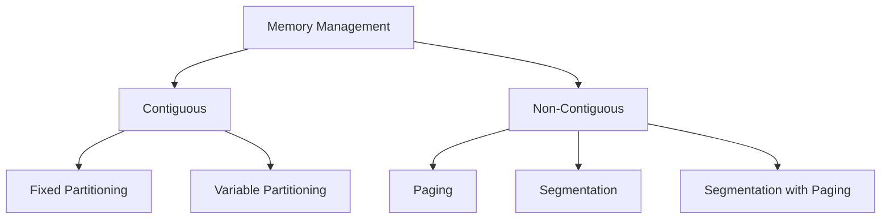

## Syllabus Position

Subject: [[Operating Systems]]
Parent Topic: [[OS Index]]
Sibling Topics: [[Process Management]], [[File Systems]], [[I/O Management]]
Leads To: [[Paging]], [[Segmentation]], [[Virtual Memory]]

GATE Syllabus Line: "Memory management: paging, segmentation, virtual memory, page replacement algorithms."

Exam Weight Note: This is the most consistent scoring area in OS. Usually 2-4 marks covering numericals on EMAT (Effective Memory Access Time) and Page Replacement.

## The Problem This Solves

CPU speeds have historically outpaced memory speeds (the "Memory Wall"). Additionally, programs are often larger than the physical RAM available. Memory management must ensure that:
1. Multiple processes can coexist without interfering with each other (Protection).
2. The programmer doesn't have to worry about physical memory limits (Abstraction).
3. Memory is used efficiently without wasting space (Optimization).

Analogy: Think of Memory Management as a Librarian. The library has limited shelf space (RAM) but thousands of books (Programs/Data). The librarian decides which books stay on the front shelves, which go to the basement (Disk), and how to find a book quickly using a catalog (Page Table).

Core Idea (one sentence): Efficiently mapping logical program addresses to physical hardware addresses while maximizing utilization and protection.

## Formal Theory

Memory management techniques evolved from simple to complex:

### 1. [[Contiguous Memory Allocation]]
Each process is contained in a single contiguous section of memory.
- **Fixed Partitioning**: Memory is divided into fixed-sized slots. Leads to **Internal Fragmentation**.
- **Variable Partitioning**: Partitions are created dynamically. Leads to **External Fragmentation**.

### 2. [[Non-Contiguous Allocation]]
A process's physical address space can be non-contiguous.
- **[[Paging]]**: Divide physical memory into fixed-sized blocks called **Frames** and logical memory into **Pages**.
- **[[Segmentation]]**: Divide memory into logical units (code, data, stack) of varying sizes.

### 3. [[Virtual Memory]]
A technique that allows the execution of processes that are not completely in memory. It uses [[Demand Paging]] to bring pages into RAM only when needed.

## Diagrams and Visuals

**Memory Hierarchy Visualization:**
1. Registers (Smallest, Fastest)
2. Cache (L1, L2, L3)
3. Main Memory (RAM)
4. Solid State Drive / Hard Disk
5. Magnetic Tape (Largest, Slowest)

## Complexity Analysis

| Technique | Search Complexity | Fragmentation Type | Hardware Support |
| :--- | :--- | :--- | :--- |
| Fixed Partitioning | $O(1)$ | Internal | Minimal |
| Variable Partitioning | $O(N)$ (First/Best Fit) | External | Relocation Registers |
| Paging | $O(1)$ with TLB | Internal (Last Page) | Page Table, MMU |
| Segmentation | $O(1)$ | External | Segment Table |

## Intuition Anchors

**The Mental Model:**
Picture a puzzle. Contiguous allocation requires you to find a single large empty spot for the whole puzzle. Paging allows you to scatter the puzzle pieces wherever they fit, as long as you have a map (Page Table) to find them later.

**The #1 Trap:**
Students often confuse **Internal** and **External** fragmentation. 
- Internal: Space wasted *inside* an allocated block.
- External: Space wasted *between* blocks, where the total free space is enough for a process, but it's not contiguous.

**The One-Line Recall:**
Memory Management = Protection + Relocation + Efficiency.

## GATE Questions

**Question 1 — [GATE 2015] — [1-mark]**
A system uses FIFO page replacement policy. It has 4 page frames and no pages in memory initially. The page reference string is: 1, 2, 3, 4, 1, 2, 5, 1, 2, 3, 4, 5. The number of page faults is?
- (A) 8
- (B) 9
- (C) 10
- (D) 11

Solution

Answer: (C) 10
Trace:
1. [1] (F)
2. [1, 2] (F)
3. [1, 2, 3] (F)
4. [1, 2, 3, 4] (F)
5. [1, 2, 3, 4] (Hit)
6. [1, 2, 3, 4] (Hit)
7. [5, 2, 3, 4] (F) - Replace 1
8. [5, 1, 3, 4] (F) - Replace 2
9. [5, 1, 2, 4] (F) - Replace 3
10. [5, 1, 2, 3] (F) - Replace 4
11. [4, 1, 2, 3] (F) - Replace 5
12. [4, 5, 2, 3] (F) - Replace 1
Total Faults = 10.

## Quick Revision Sheet

- **Logical Address**: Generated by CPU.
- **Physical Address**: Seen by memory unit.
- **MMU**: Hardware device that maps logical to physical.
- **Fragmentation**: 
    - Internal: Fixed blocks, unused space inside.
    - External: Variable blocks, holes between processes. Fix: **Compaction**.
- **EMAT Formula**: $Hit\_Ratio \times (TLB\_Access + RAM\_Access) + Miss\_Ratio \times (TLB\_Access + 2 \times RAM\_Access)$.

## Revision Checklist
- [ ] I can distinguish between Internal and External fragmentation.
- [ ] I know the memory hierarchy from Registers to Disk.
- [ ] I have linked this to [[Paging]].
