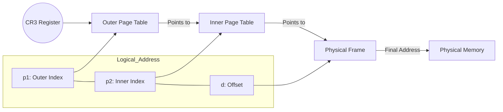

## Syllabus Position

Subject: [[Operating Systems]]
Parent Topic: [[Memory Management]]
Sibling Topics: [[Paging]], [[Segmentation]], [[Segmentation with Paging]]
Leads To: [[Virtual Memory]], [[Inverted Page Table]]

**GATE Syllabus Line:** "Memory management and virtual memory: Paging, Page tables, Multi-level paging."

**Exam Weight Note:** Extremely high frequency. Typically appears as 2-mark NAT questions involving address bit-splits or **Effective Memory Access Time (EMAT)** calculations.

---

## The Problem This Solves

Imagine you have a 32-bit logical address space and a **Page Size** of $4\text{ KB}$.
Total pages = $\frac{2^{32}}{2^{12}} = 2^{20} \approx 1\text{ million pages}$.
If each **Page Table Entry (PTE)** is $4\text{ bytes}$, the **Page Table** size is $2^{20} \times 4 = 4\text{ MB}$ per process.
In a system with 100 processes, we'd waste $400\text{ MB}$ of RAM just for page tables! Worse, this $4\text{ MB}$ must be stored **contiguously** in physical memory, which defeats the very purpose of paging (non-contiguous allocation).

**The Analogy:**
Single-level paging is like a book with a 1-million-line index on the first page. Multi-level paging is like a Library Catalog:
1. You go to the **Main Directory** (Level 1) to find which "Subject Room" to enter.
2. Inside the Room, you find the **Cabinet** (Level 2).
3. Inside the Cabinet, you find the **Drawer** (Level 3) which finally tells you the exact shelf (Physical Frame).
This allows us to keep only the "Subject Room" directories we actually need in memory.

**Core Idea (one sentence):** Multi-level paging treats the page table itself as a set of pages and pages them, allowing the page table to be stored non-contiguously and partially loaded.

---

## Formal Theory

### 1. Structure of Hierarchical Paging
In **Multi Level Paging**, the **Page Table** is broken into smaller pieces. A **Virtual Address** is no longer just a pair $(p, d)$, but a tuple $(p_1, p_2, \dots, p_k, d)$.

### 2. Address Bit Decomposition
For a $k$-level page table, the logical address is divided as:
$$| \text{Level } 1 \text{ Index } (p_1) | \text{Level } 2 \text{ Index } (p_2) | \dots | \text{Offset } (d) |$$

- **Offset ($d$):** Determined by the **Page Size**. If page size is $2^n$ bytes, offset is $n$ bits.
- **Outer Page Table ($p_1$):** Must always reside in memory. Its base address is stored in the **Page Table Base Register (PTBR)** (e.g., **CR3** in x86).

### 3. Calculating the number of levels ($k$)
To make the page table non-contiguous, every page table (except the last level) must fit exactly within **one page frame**.
Let:
- $S$ = Logical Address Space size (bits)
- $P$ = Page Size ($2^d$ bytes)
- $E$ = Page Table Entry size (bytes)

The number of entries per page is $N = \frac{P}{E}$.
The number of bits needed to index one page of the table is $\log_2(N)$.
Total bits for paging = $S - d$.
Number of levels $k \approx \lceil \frac{S - d}{\log_2(N)} \rceil$.

---

## Diagrams and Visuals

### 1. Address Translation (2-Level)
**Drawing Instructions:** Draw a 32-bit bar. Split it into $p_1, p_2,$ and $d$. Draw an arrow from $p_1$ into a "Top Level Page Table". That entry points to a "Second Level Page Table". $p_2$ indexes into that, pointing to the "Physical Frame". $d$ is added to the frame start.

### 2. Memory Layout
- **Level 1 (Root):** Stored contiguously (1 page).
- **Level 2:** Scattered across different frames.
- **Data:** Scattered across different frames.

---

## Complexity Analysis

### Time Complexity
Each memory access for data now requires $k$ additional memory accesses to fetch the frame address.
- **Total accesses per data request** = $k + 1$ (where $k$ is the number of levels).
- This is significantly slowed down unless a **[[TLB]] (Translation Lookaside Buffer)** is used.

### Space Complexity
- **Worst Case:** If the process uses the entire address space, multi-level paging actually uses **more** space than single-level (due to the overhead of the directory pages).
- **Best Case:** For a sparse process, we only store the root and the tables for valid regions. This is why we use it!

| Case | Time Complexity | Space Complexity | Trigger Condition |
| :--- | :--- | :--- | :--- |
| **No TLB** | $O(k)$ | $O(\text{Size of Hierarchy})$ | Every access traverses all $k$ levels |
| **With TLB** | $O(1) \text{ avg}$ | $O(\text{Size of Hierarchy})$ | High TLB Hit Ratio ($H \approx 0.99$) |

---

## Worked Example (Full Trace)

**Scenario:**
- 32-bit Logical Address.
- Page Size = $4\text{ KB}$ ($2^{12}$).
- PTE size = $4\text{ bytes}$ ($2^2$).
- **Calculate the levels and bit split.**

**Step 1: Offset Bits**
$d = \log_2(4\text{ KB}) = 12\text{ bits}$.

**Step 2: Entries per Page**
Each page can hold $\frac{4\text{ KB}}{4\text{ B}} = 1024$ entries.
Bits to index a page table = $\log_2(1024) = 10\text{ bits}$.

**Step 3: Bit Split**
Total bits for pages = $32 - 12 = 20\text{ bits}$.
Level 2 index ($p_2$) = $10\text{ bits}$.
Level 1 index ($p_1$) = $20 - 10 = 10\text{ bits}$.
**Final Split:** $10 | 10 | 12$.

**Trace for Address `0x00403005`:**
1. Binary: `0000 0000 01 | 00 0000 0011 | 0000 0000 0101`
2. $p_1 = 1$, $p_2 = 3$, $d = 5$.
3. CPU looks at **CR3**, finds Outer Table.
4. Accesses `OuterTable[1]`. This gives frame number of the Inner Table. (1st memory access)
5. Accesses `InnerTable[3]`. This gives frame number of the actual Data. (2nd memory access)
6. Accesses `Data[5]`. (3rd memory access)
**Total memory accesses: 3.**

---

## Intuition Anchors

**1. The Book of Books:**
If the Page Table is a list of all house addresses in a city, Multi-level paging is like a "Directory of Neighborhoods" which points to "Street Lists". You don't carry the whole city directory; you only look up the neighborhood you are currently in.

**2. The Mental Model:**
Picture a **K-ary Tree**. The leaves are the actual physical frames. The internal nodes are the page tables. Translating an address is simply walking from the root to a leaf.

**3. The One-Line Recall:**
$k$-level paging = $k$ accesses for the table + 1 access for data = $k+1$ total accesses.

**4. The #1 Trap:**
**The "Off-by-one" Error:** Students often forget the final access to the actual data. If a question asks for "Memory accesses to fetch an operand", the answer is $k+1$. If it asks "Accesses to find the physical address", it's just $k$.

---

## GATE Questions

---

**Question 1 — [PYQ: GATE 2017] — [2-mark]**

> A system uses 3-level paging. The TLB hit ratio is $90\%$. TLB access time is $10\text{ ns}$ and Memory access time is $100\text{ ns}$. What is the Effective Memory Access Time (EMAT)?

- (A) $120\text{ ns}$
- (B) $150\text{ ns}$
- (C) $140\text{ ns}$
- (D) $130\text{ ns}$

Solution

**Answer: (C)**

**Reasoning:**
- $k = 3$. Total memory accesses on TLB miss = $k+1 = 4$.
- $EMAT = \text{HitRatio} \times (\text{TLB} + \text{Mem}) + (1 - \text{HitRatio}) \times (\text{TLB} + (k+1) \times \text{Mem})$
- $EMAT = 0.9 \times (10 + 100) + 0.1 \times (10 + 4 \times 100)$
- $EMAT = 0.9 \times 110 + 0.1 \times 410$
- $EMAT = 99 + 41 = 140\text{ ns}$.

**What this is testing:** Calculation of EMAT with multi-level paging.
**Trap:** Forgetting that a 3-level table requires 4 total memory accesses on a miss.

---

**Question 2 — [Conceptual] — [1-mark]**

> In a 2-level paging system, if the page size is increased, what happens to the number of bits in the $p_1$ and $p_2$ fields, assuming the total address space and PTE size remain constant?

Solution

**Answer:** Both $p_1$ and $p_2$ typically decrease.

**Reasoning:**
- If Page Size ($P$) increases, Offset ($d$) increases.
- If $P$ increases, the number of entries per page ($\frac{P}{E}$) increases, so $p_2$ (bits to index a page) increases.
- However, the total bits for paging $(S - d)$ decreases significantly.
- Usually, $p_1$ shrinks the most because $p_1 = (S-d) - p_2$.

---

## Edge Cases and Failure Modes

- [ ] **Sparse Address Space:** Multi-level paging is efficient here. If an entire range of virtual addresses is unused, the corresponding outer PTE is marked "invalid," and we don't even allocate the lower-level tables.
- [ ] **Page Table doesn't fit in a page:** If the bit-split results in $p_2$ needing 12 bits but a page only holds $2^{10}$ entries, you **must** add another level ($k=3$).
- [ ] **TLB Consistency:** When switching processes, the **CR3** changes. The TLB must be flushed (unless Address Space Identifiers - ASIDs are used).
- [ ] **Internal Fragmentation:** Multi-level paging doesn't solve internal fragmentation within the data pages; it only reduces the memory overhead of the tables themselves.

---

## Comparisons

| Feature | Single-Level | Multi-Level | [[Inverted Page Table]] |
| :--- | :--- | :--- | :--- |
| **Memory Accesses** | 2 ($1 \text{ table} + 1 \text{ data}$) | $k+1$ | $1 + \text{hash collision search}$ |
| **Contiguity** | Requires contiguous PT | Non-contiguous | One table for entire system |
| **Space Overhead** | High (fixed) | Low (proportional to use) | Minimum (Fixed by Physical RAM) |
| **Search Speed** | Fastest | Slower | Varies (Hashing) |

**GATE Pattern:** GATE loves comparing Multi-level and Inverted. Remember: Multi-level space depends on **Virtual Address Space**, while Inverted space depends on **Physical RAM Size**.

---

## Connections Web

**Must know before this topic:**
- [[Paging]] — Basis of the entire structure.
- [[Physical vs Logical Address]] — Understanding why we translate.
- [[Page Table Entry]] — What is being stored.

**Topics that build on this:**
- [[Virtual Memory]] — Demand paging uses this structure.
- [[Translation Lookaside Buffer]] — Essential for performance.
- [[Protection Bits]] — Stored in the last level PTE.

**GATE subject cross-links:**
- [[Operating Systems]] > [[Memory Management]]
- [[Computer Architecture]] > [[Cache Hierarchy]] (TLB is a cache).

**Standard references:**
- [[Galvin - Chapter 8]]
- [[Stallings - Chapter 7]]

---

## Quick Revision Sheet

**Definition:** A hierarchical paging scheme where the page table itself is paged.

**Core Idea:** Only keep necessary parts of the page table in memory.

**Address Split ($k$-levels):**
$$| p_1 | p_2 | \dots | p_k | d |$$
- $d = \text{Offset}$ (from Page Size)
- $p_i = \text{Index for Level } i$ (usually $\log_2(\frac{\text{Page Size}}{\text{PTE Size}})$)

**Complexity:**
- **Time:** $k+1$ memory accesses.
- **EMAT:** $H(c+m) + (1-H)(c + (k+1)m)$.

**Key Properties:**
1. Reduces memory overhead for sparse processes.
2. The **Root Page Table** must always be in memory.
3. Every level of table (except maybe the root) should fit in one page frame.

**The #1 Trap:** Don't forget the **CR3** register stores the *physical* address of the Level 1 table.

---

## Revision Checklist

- [ ] I can derive the $10 | 10 | 12$ split for a standard 32-bit/4KB system.
- [ ] I can calculate EMAT for any $k$-level system.
- [ ] I know why we don't use single-level paging for 64-bit systems ($2^{52}$ entries is impossible).
- [ ] I can explain why Multi-level paging is better for "Sparse" address spaces.
- [ ] I can trace an address through a 3-level hierarchy.
- [ ] I have verified the path of the CR3 register to the final data.
