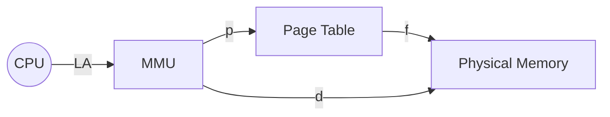

## Syllabus Position

Subject: [[Operating Systems]]
Parent Topic: [[Memory Management Overview]]
Sibling Topics: [[Segmentation]], [[Contiguous Memory Allocation]]
Leads To: [[Multi-level Paging]], [[Inverted Page Table]], [[TLB]]

GATE Syllabus Line: "Memory management: paging..."

Exam Weight Note: High frequency of 2-mark NAT questions involving Page Table Size, Number of Entries, and Effective Memory Access Time (EMAT).

## The Problem This Solves

[[Contiguous Memory Allocation]] suffers from **External Fragmentation**. If we have 10MB of total free space but it is split into 1MB holes, we cannot load a 5MB process. 

Paging solves this by breaking the process into fixed-sized pieces. We no longer need a single contiguous hole; we just need enough total frames.

Analogy: Think of a process as a collection of 1-page articles. Instead of needing a single 10-page folder, you can put each page in any empty slot in a 100-slot binder, as long as you keep an index (Page Table) saying "Article 1, Page 1 is in Slot 45".

Core Idea (one sentence): Map a contiguous logical address space to a non-contiguous physical address space using fixed-size blocks called **Pages** and **Frames**.

## Formal Theory

### 1. Basic Concepts
- **Logical Address (LA)**: Generated by CPU. Divided into **Page Number ($p$)** and **Page Offset ($d$)**.
- **Physical Address (PA)**: Actual location in RAM. Divided into **Frame Number ($f$)** and **Frame Offset ($d$)**.
- **Page Size = Frame Size**: Always a power of 2 ($2^k$).

### 2. Address Translation
The [[MMU]] (Memory Management Unit) uses a **Page Table** to translate $p$ to $f$.
$$PA = (f \times \text{Page Size}) + d$$

### 3. Page Table Structure
The Page Table is stored in Main Memory.
- **PTBR (Page Table Base Register)**: Points to the start of the page table.
- **PTLR (Page Table Length Register)**: Indicates the size of the table.

### 4. Mathematical Relations
- If Logical Address Space (LAS) = $2^L$ bytes, and Page Size (PS) = $2^P$ bytes:
  - Number of Pages = $2^{L-P}$
  - Bits for Page Number ($p$) = $L-P$
  - Bits for Offset ($d$) = $P$
- If Physical Address Space (PAS) = $2^M$ bytes:
  - Number of Frames = $2^{M-P}$
  - Bits for Frame Number ($f$) = $M-P$

**Page Table Size (PTS)**:
$$\text{PTS} = (\text{Number of Entries}) \times (\text{Page Table Entry Size})$$
$$\text{PTS} = 2^{p} \times \text{PTE Size}$$

## Diagrams and Visuals

**Address Translation Flow:**

**Memory Layout:**
- Logical View: Page 0, Page 1, Page 2 (Contiguous)
- Physical View: Frame 5 (P1), Frame 2 (P0), Frame 8 (P2) (Scattered)

## Complexity Analysis

| Action | Complexity | Explanation |
| :--- | :--- | :--- |
| Translation (Naive) | $O(1)$ | Direct index into Page Table array. |
| Access Time | $2 \times T_{RAM}$ | One for Page Table, one for actual Data. |
| Space | $O(\text{LAS}/\text{PS})$ | Page Table must exist for the entire LAS. |

**Effective Memory Access Time (EMAT)**:
Without TLB: $EMAT = 2 \times T_{mem}$
With TLB (Hit Ratio $h$):
$$EMAT = h(T_{tlb} + T_{mem}) + (1-h)(T_{tlb} + 2 \times T_{mem})$$

## Worked Example (Full Trace)

**Problem:**
A system has a 32-bit logical address, 4 KB page size, and 512 MB physical memory. The Page Table Entry (PTE) size is 4 bytes.
1. Calculate the number of pages.
2. Calculate the size of the Page Table.

**Step-by-step Solution:**
1. **Identify Bits:**
   - LAS = $2^{32}$ bytes.
   - Page Size = 4 KB = $2^{12}$ bytes.
   - Offset bits ($d$) = 12 bits.
   - Page bits ($p$) = $32 - 12 = 20$ bits.

2. **Number of Pages:**
   - Number of Pages = $2^p = 2^{20} \approx 1 \text{ Million}$.

3. **Page Table Size:**
   - Entries = $2^{20}$
   - Entry Size = 4 bytes ($2^2$ bytes).
   - PTS = $2^{20} \times 2^2 = 2^{22}$ bytes = 4 MB.

**Wait!** 4 MB for a single process's page table is huge. This is why we need [[Multi-level Paging]].

## Intuition Anchors

**The Mental Model:**
Paging is like a **GPS for Memory**. The CPU asks for "Street 5, House 2". The GPS (Page Table) says "Street 5 is actually at Latitude 40, Longitude 70". The offset (House 2) remains the same because the internal layout of the street hasn't changed.

**The #1 Trap:**
**Page Size vs. Page Table Size.** 
- Increasing Page Size *decreases* the number of entries in the Page Table, making the Page Table smaller.
- However, larger Page Size increases **Internal Fragmentation**.

**The One-Line Recall:**
$LA = (p, d) \xrightarrow{\text{Page Table}} (f, d) = PA$.

## GATE Questions

**Question 1 — [GATE 2001] — [2-mark]**
Consider a system with 32-bit logical address and 2 KB page size. The Page Table Entry is 4 bytes. What is the size of the page table?
- (A) 2 MB
- (B) 4 MB
- (C) 8 MB
- (D) 16 MB

Solution

**Answer: (C) 8 MB**
**Reasoning:**
- Page size = 2 KB = $2^{11}$ bytes.
- Offset bits = 11.
- Page bits $p = 32 - 11 = 21$.
- Number of entries = $2^{21}$.
- PTS = $2^{21} \times 4 \text{ bytes} = 2^{21} \times 2^2 = 2^{23}$ bytes.
- $2^{23} \text{ bytes} = 8 \times 2^{20} \text{ bytes} = 8 \text{ MB}$.

---

**Question 2 — [GATE 2014] — [2-mark]**
A virtual memory system uses 2-level paging. LAS is 32-bit, page size is 4 KB. Each PTE is 4 bytes. The inner page table fits in one page frame. How many bits for the outer page table?

Solution

**Reasoning:**
- Page size = 4 KB ($2^{12}$). Offset = 12 bits.
- Total page bits = $32 - 12 = 20$.
- Inner page table size = 4 KB. PTE = 4 bytes.
- Number of entries in inner table = $4 \text{ KB} / 4 \text{ bytes} = 1024 = 2^{10}$.
- Inner table bits ($p2$) = 10.
- Outer table bits ($p1$) = Total page bits - Inner bits = $20 - 10 = 10$.
**Answer: 10 bits.**

## Edge Cases and Failure Modes

- [ ] **Internal Fragmentation**: Occurs only in the **last page** of a process. Average loss is $PS/2$.
- [ ] **Page Table not in RAM**: If the Page Table is too large, it must be paged itself ([[Multi-level Paging]]).
- [ ] **TLB Miss**: Causes a double memory access.
- [ ] **Small Page Size**: Reduces internal fragmentation but increases Page Table size and TLB misses.

## Comparisons

| Feature | [[Paging]] | [[Segmentation]] |
| :--- | :--- | :--- |
| Block Size | Fixed | Variable |
| Fragmentation | Internal | External |
| User View | Invisible (System view) | Visible (Logical units) |
| Separation | No | Code/Data/Stack |

## Connections Web

**Must know before:**
- [[Memory Management Overview]]
- [[Binary and Power of 2 Arithmetic]]

**Topics that build on this:**
- [[TLB]] — to speed up access.
- [[Multi-level Paging]] — to handle large address spaces.
- [[Demand Paging]] — the basis of Virtual Memory.

**Standard references:**
- [[Silberschatz OS Chapter 8]]
- [[Stallings OS Section 7.2]]

## Quick Revision Sheet

1. **Pages (Logical)**, **Frames (Physical)**.
2. **Page Size = Frame Size**.
3. **PTE size** usually given in bytes.
4. **EMAT with TLB**: $h(c+m) + (1-h)(c+2m)$.
5. **Page Fault**: When page is not in RAM (handled by [[Virtual Memory]]).

## Revision Checklist
- [ ] I can derive Page Table Size from LAS and Page Size.
- [ ] I know why $p$ bits are used for indexing and $d$ bits are for offset.
- [ ] I can calculate EMAT with hit/miss ratios.
- [ ] I understand that Paging eliminates External Fragmentation.
