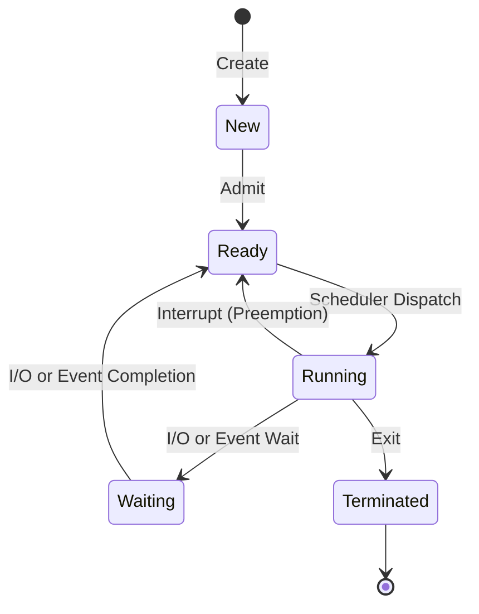
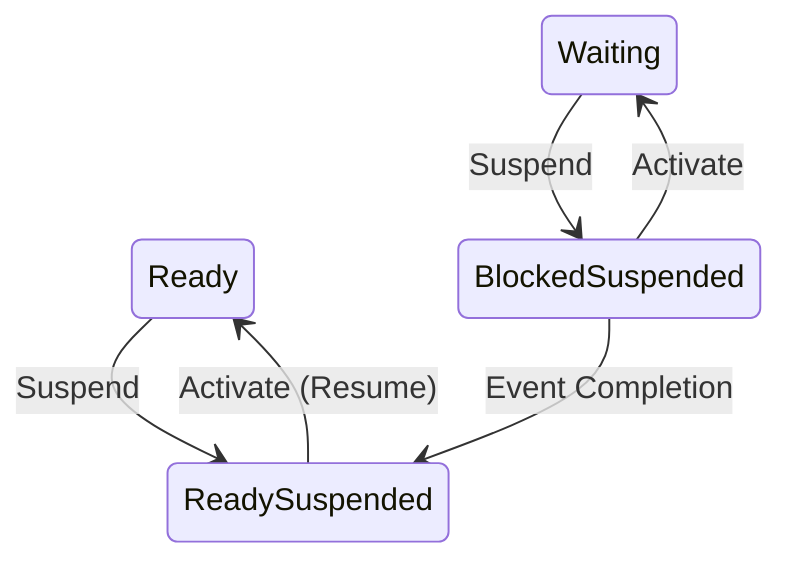

## Syllabus Position

Subject: [[Operating Systems]]
Parent Topic: [[Process]]
Sibling Topics: [[Process Control Block]], [[Context Switching]]
Leads To: [[CPU Scheduling]], [[Inter-Process Communication]]

GATE Syllabus Line: "Processes, Threads, Inter-process communication..."

Exam Weight Note: Frequently tested in MCQs regarding valid vs. invalid transitions.

## The Problem This Solves

A CPU is fast, but I/O is slow. If a process waits for a user to type, the CPU shouldn't sit idle. We need a formal "status" for every process so the OS knows which ones are ready to work and which ones are waiting.

Analogy: Think of a doctor's clinic. 
- **New**: Patient filling forms.
- **Ready**: Patient in the waiting room.
- **Running**: Patient inside the doctor's cabin.
- **Waiting**: Patient sent to the lab for a blood test.
- **Terminated**: Patient leaves the clinic.

Core Idea: A process moves through life cycles defined by its resource needs and CPU availability.

## Formal Theory

### The Five-State Model
1. **New**: The process is being created.
2. **Ready**: The process is in memory, waiting to be assigned to a processor.
3. **Running**: Instructions are being executed.
4. **Waiting (Blocked)**: The process is waiting for some event (like I/O completion).
5. **Terminated**: The process has finished execution.

### The Suspended States (Seven-State Model)
When RAM is full, the OS moves processes to the Disk (Virtual Memory).
- **Ready Suspended**: Process is in secondary memory but ready to run as soon as it's loaded to RAM.
- **Blocked Suspended**: Process is in secondary memory and waiting for an event.

### Key Transitions
- **Admit**: New $\to$ Ready.
- **Dispatch**: Ready $\to$ Running (Done by the [[Short-Term Scheduler]]).
- **Interrupt/Timeout**: Running $\to$ Ready (Preemption).
- **Event Wait**: Running $\to$ Waiting (Process requests I/O).
- **Event Completion**: Waiting $\to$ Ready.
- **Exit**: Running $\to$ Terminated.

## Diagrams and Visuals

### Five-State Transition Diagram

### Seven-State Diagram (with Suspend)

## Complexity Analysis
- **Transition Overhead**: Handled during [[Context Switching]]. It is $O(1)$ in terms of state change, but the saving/restoring of registers adds constant time overhead.

## Worked Example
**Scenario**: A process $P_1$ is calculating a sum and then needs to read from a file.
1. $P_1$ is **New**.
2. OS admits it; $P_1$ enters **Ready** queue.
3. CPU is free; Scheduler dispatches $P_1$ to **Running**.
4. $P_1$ executes `scanf`. It can't continue without user input.
5. $P_1$ moves to **Waiting**.
6. User types input. I/O controller signals completion.
7. $P_1$ moves to **Ready** (NOT directly to Running!).
8. Scheduler eventually dispatches $P_1$ to **Running** again.
9. $P_1$ finishes and moves to **Terminated**.

## Intuition Anchors

**The Mental Model:**
The **Ready Queue** is a line of people with all their tools, just waiting for the "Workstation" (CPU). The **Waiting Queue** is a break-room for people who are missing a tool and can't work even if the workstation was free.

**The One-Line Recall:**
Ready $\to$ Running (Dispatch), Running $\to$ Waiting (Blocked), Waiting $\to$ Ready (Unblocked).

**The #1 Trap:**
**Waiting $\to$ Running is NOT a direct transition.** A process must always go back to the **Ready** queue after an I/O event to let the scheduler decide who goes next.

## GATE Questions

**Question 1 — [GATE-style] — [1-mark]**
> Which of the following transitions is NOT possible in a standard five-state process model?
- (A) Ready $\to$ Running
- (B) Running $\to$ Ready
- (C) Waiting $\to$ Running
- (D) Waiting $\to$ Ready

Solution

**Answer: (C)**

**Reasoning:**
A process must go through the **Ready** state before being dispatched to the CPU. The scheduler only picks processes from the Ready queue.

---

**Question 2 — [Conceptual] — [2-mark]**
> In a system with $N$ processors, what is the maximum number of processes that can be in the **Running** state and **Ready** state simultaneously?
- (A) $N$, Unlimited
- (B) $1$, $N$
- (C) $N$, $N$
- (D) $1$, Unlimited

Solution

**Answer: (A)**

**Reasoning:**
- Each processor can run exactly one process. So, max **Running** = $N$.
- The **Ready** queue is only limited by the system's memory/PCB capacity, conceptually "unlimited" in basic theory questions.

## Edge Cases and Failure Modes
- [ ] **Starvation**: A process stays in **Ready** forever because higher priority processes keep running.
- [ ] **Deadlock**: Two processes in **Waiting** are waiting for events that only the other can trigger.
- [ ] **Preemption**: Forcing a process from **Running** to **Ready** even if it hasn't finished (e.g., Round Robin).

## Comparisons

| From State | To State | Trigger | Type |
|------------|----------|---------|------|
| Running | Ready | Time Slice Expired | Preemptive |
| Running | Waiting | I/O Request | Non-Preemptive |
| Ready | Running | Dispatcher | - |

## Connections Web
**Must know before:**
- [[Process]]

**Topics that build on this:**
- [[CPU Scheduling]] — defines the Ready $\to$ Running logic.
- [[Context Switching]] — happens during every transition involving the Running state.
- [[Short-Term Scheduler]] vs [[Medium-Term Scheduler]]

**Standard references:**
- [[Silberschatz Chapter 3.1]]

## Quick Revision Sheet
- **5 States**: New, Ready, Running, Waiting, Terminated.
- **Preemption**: Running $\to$ Ready.
- **Blocking**: Running $\to$ Waiting.
- **Wake-up**: Waiting $\to$ Ready.
- **Max Running**: Equal to number of CPUs.
- **Trap**: Never go from Waiting directly to Running.

## Revision Checklist
- [ ] I can draw the 5-state diagram from memory.
- [ ] I can explain why Waiting $\to$ Running is impossible.
- [ ] I understand the role of the Ready queue.
- [ ] I can identify where preemption occurs in the diagram.
