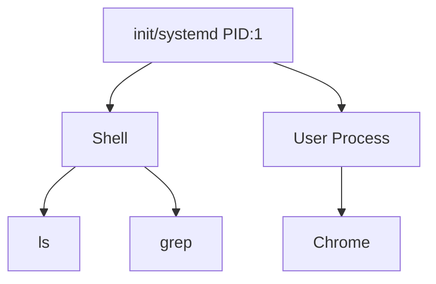

## Syllabus Position

Subject: [[Operating Systems]]
Parent Topic: [[Process Management]]
Sibling Topics: [[Threads]], [[CPU Scheduling]]
Leads To: [[Inter-Process Communication]], [[Process Synchronization]]

GATE Syllabus Line: "Processes, Threads, Inter-process communication, Concurrency and Synchronization."

Exam Weight Note: Fundamental concept. Usually tested via 1-mark MCQs on attributes or as a prerequisite for [[CPU Scheduling]] numericals.

## The Problem This Solves

Imagine a computer that could only run one fixed task forever (like an old-school calculator). To run different tasks or multiple tasks at once, we need a way to wrap a "static" piece of code (the program) into a "dynamic" entity that can be paused, resumed, and managed by the OS.

Analogy: A **Program** is a recipe in a cookbook (static text on a shelf). A **Process** is the actual act of cooking that recipe (dynamic, uses ingredients/CPU, takes time, has a current state like "boiling").

Core Idea (one sentence): A process is an instance of a computer program that is being executed by one or many threads.

## Formal Theory

A **Process** is defined as a [[Program in Execution]]. It is the unit of work in a modern time-sharing system.

### Process vs Program
| Feature | [[Program]] | [[Process]] |
|---------|-------------|-------------|
| Nature | Passive Entity | Active Entity |
| Storage | Secondary Memory (Disk) | Primary Memory (RAM) |
| Lifetime | Persistent until deleted | Temporary (start to finish) |
| Resources | No resources allocated | CPU, Memory, I/O assigned |

### Process Memory Layout
When a process is loaded into memory, it consists of four main sections:
1. **Text Section**: The executable code.
2. **Data Section**: Global and static variables.
3. **Heap Section**: Dynamically allocated memory during runtime (e.g., `malloc` in C).
4. **Stack Section**: Temporary data (function parameters, return addresses, local variables).

### Process Creation & Termination
- **Creation**: Processes are created using the `fork()` system call (in Unix-like systems). The creator is the **Parent**, and the new process is the **Child**.
- **Termination**: A process ends its execution by calling `exit()`. The OS then reclaims its resources.

What GATE actually tests here: The distinction between the stack and heap, and the relationship between `fork()` and the process hierarchy.

## Diagrams and Visuals

### Process Memory Image
```text
+-----------------------+ <--- Max Address
|         Stack         | (Grows Downward)
+-----------|-----------+
|           v           |
|                       |
|           ^           |
+-----------|-----------+
|         Heap          | (Grows Upward)
+-----------------------+
|         Data          | (Global/Static Vars)
+-----------------------+
|         Text          | (Code)
+-----------------------+ <--- 0000 Address
```

### Process Tree (Hierarchy)


## Complexity Analysis
- **Creation Complexity**: $O(N)$ where $N$ is the size of the address space being copied (optimized to $O(1)$ with **Copy-on-Write**).
- **Termination Complexity**: $O(1)$ for resource deallocation metadata.

## Worked Example
Consider a C program:
```c
int global_var = 10; // Data Section
void func() {
    int local_var = 5; // Stack Section
}
int main() {
    int *ptr = malloc(sizeof(int)); // Heap Section
    func();
    return 0;
}
```
**Trace**:
1. `main` starts. Memory is allocated for `global_var` in Data.
2. `malloc` called: Block allocated in **Heap**.
3. `func` called: Activation record pushed to **Stack** containing `local_var`.
4. `func` returns: **Stack** pointer decremented (record popped).
5. `main` returns: OS reclaims all sections.

## Intuition Anchors

**The Analogy (restated):**
The Program is the "Script". The Process is the "Performance". You can have many performances (processes) of the same script (program) happening at the same time in different theaters (memory locations).

**The Mental Model:**
Picture a process as a "Container". It contains the code, but it also has "hands" (CPU registers) and "shelf space" (memory) to do work.

**The One-Line Recall:**
Process = Program + Current State (PC, Stack, Registers).

**The #1 Trap:**
Thinking that two processes running the same program share variables. **Correction**: They have separate address spaces; a change in Process A's `x` does not affect Process B's `x`.

## GATE Questions

**Question 1 — [PYQ: GATE 2014] — [1-mark]**
> A process executes the following code:
> `for (i = 0; i < n; i++) fork();`
> The total number of child processes created is:
- (A) $n$
- (B) $2^n - 1$
- (C) $2^n$
- (D) $2^{n+1} - 1$

<details>
<summary>Solution</summary>

**Answer: (B)**

**Reasoning:**
- Each `fork()` doubles the number of existing processes.
- After $n$ iterations, there are $2^n$ total processes.
- The question asks for **child** processes. Total - Original = $2^n - 1$.

**What this question is really testing:** Recursive process creation via `fork()`.

</details>

---

**Question 2 — [Conceptual] — [1-mark]**
> Which section of a process's memory contains dynamically allocated memory?
- (A) Stack
- (B) Text
- (C) Data
- (D) Heap

<details>
<summary>Solution</summary>

**Answer: (D)**

**Reasoning:**
- Stack: Function calls/local vars.
- Text: Code.
- Data: Global/Static.
- Heap: Runtime dynamic allocation (`malloc`/`new`).

</details>

## Edge Cases and Failure Modes
- [ ] **Fork Failure**: If the OS hits the process limit, `fork()` returns -1.
- [ ] **Stack Overflow**: Infinite recursion exhausts the Stack section.
- [ ] **Memory Leak**: Allocating in Heap without deallocating.
- [ ] **Copy-on-Write**: Optimization where parent and child share physical memory until one modifies it.

## Comparisons

| Feature | [[Process]] | [[Thread]] |
|---------|-------------|-------------|
| Weight | Heavyweight | Lightweight |
| Address Space | Separate | Shared |
| Context Switch | High Overhead | Low Overhead |
| Communication | [[IPC]] (Complex) | Shared Memory (Simple) |

## Connections Web
**Must know before:**
- [[Operating Systems Overview]]
- [[Main Memory]]

**Topics that build on this:**
- [[Process States]]
- [[Process Control Block]]
- [[Context Switching]]
- [[Zombie and Orphan Processes]]
- [[CPU Scheduling]]

**Standard references:**
- [[Silberschatz Chapter 3]]

## Quick Revision Sheet
- **Definition**: Active entity, program in execution.
- **Sections**: Text (Code), Data (Globals), Heap (Dynamic), Stack (Local).
- **Creation**: `fork()` returns 0 to child, PID of child to parent.
- **Key Fact**: Processes are independent; they do not share memory by default.
- **Mnemonic**: **T**ext **D**rives **H**igh **S**peed (**T**ext, **D**ata, **H**eap, **S**tack).

## Revision Checklist
- [ ] I can distinguish between a program and a process.
- [ ] I know the 4 memory sections of a process.
- [ ] I can calculate the number of processes created by $N$ forks.
- [ ] I have linked this note to [[Process States]].
