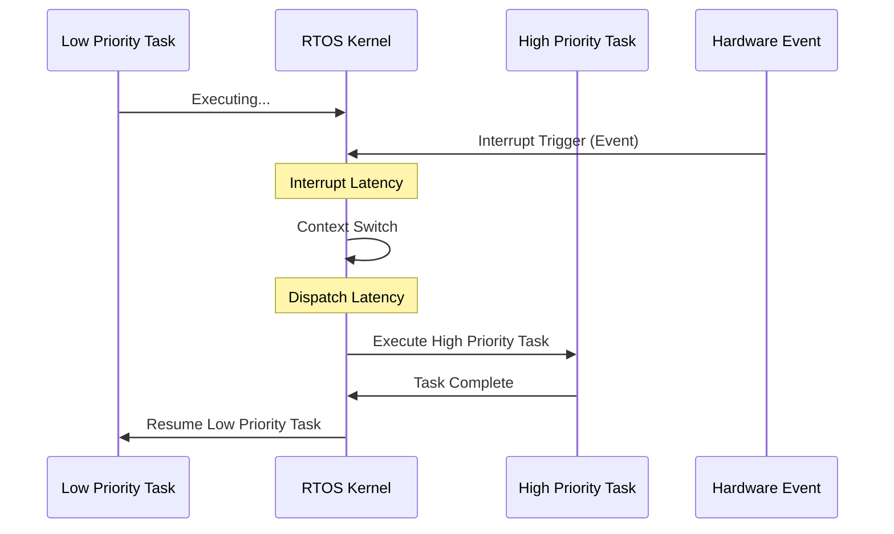

## Syllabus Position

Subject: [[Operating Systems]]
Parent Topic: [[Introduction to OS]]
Sibling Topics: [[Batch OS]], [[Multi-programming]], [[Time-Sharing Systems]]
Leads To: [[Process Scheduling]], [[CPU Scheduling Algorithms]]

GATE Syllabus Line: Concepts of operating systems: processes, threads, inter-process communication, concurrency, synchronization, deadlocks, CPU scheduling, memory management and virtual memory, file systems.

Exam Weight Note: Frequently appears in 1-mark theoretical questions or as constraints in 2-mark scheduling problems (e.g., Deadline-based scheduling).

## The Problem This Solves

Imagine a life-support system or an airbag deployment module. In these scenarios, a "correct" result produced too late is effectively a "wrong" result—and potentially a fatal one. Traditional General-Purpose OS (GPOS) like Windows or Linux prioritize **throughput** (doing as much work as possible) and **fairness** (giving everyone a turn). 

**RTOS** solves the problem of **temporal correctness**. It guarantees that critical tasks will complete within a strictly defined time window, regardless of the system load.

**Core Idea (one sentence):** RTOS is an operating system where the correctness of the system depends not only on the logical result of computation but also on the time at which the result is delivered.

## Formal Theory

### Definition
A **Real-Time Operating System (RTOS)** is designed to process data as it comes in, typically without buffer delays. The primary metric of success is **Predictability** and **Determinism**, not average throughput.

### Classification by Deadline Severity

#### 1. Hard RTOS
- **Definition:** Missing even a single deadline results in total system failure.
- **Example:** Airbag triggers, Satellite control, Pacemakers.
- **Guarantee:** Strict upper bound on response time is guaranteed.

#### 2. Soft RTOS
- **Definition:** Deadlines are important, but missing them occasionally is tolerable. Performance degrades but the system doesn't crash.
- **Example:** Video streaming, Digital cameras.
- **Guarantee:** Statistical guarantee of meeting deadlines.

#### 3. Firm RTOS
- **Definition:** Missing a deadline makes the result useless, but doesn't destroy the system.
- **Example:** Industrial manufacturing inspection.

### Key Technical Features

#### 1. Determinism
The OS behavior is predictable. For a given input state, the time taken to produce an output is constant or bounded.

#### 2. Preemptibility
The kernel must be highly [[Preemptive]]. A high-priority real-time task must be able to interrupt a lower-priority task (or even a system call) immediately.

#### 3. Bounded Latency
The maximum delay between an event (interrupt) and the start of the task handling that event must be known and minimized.
- **Interrupt Latency:** Time from interrupt arrival to start of ISR.
- **Dispatch Latency:** Time to stop one process and start another.

### Scheduling Constraints
In RTOS, a task $T_i$ is defined by:
- **Arrival Time ($A_i$):** When the task becomes ready.
- **Execution Time ($C_i$):** Worst-case execution time (WCET).
- **Deadline ($D_i$):** Time by which the task must complete.
- **Slack Time:** $D_i - (Current\_Time + Remaining\_Execution\_Time)$.

## Diagrams and Visuals

### RTOS Task Execution Flow

**Visualizing Latency:**
1. **Event Occurs**: $t_0$
2. **ISR Starts**: $t_1$ (Interval $t_1 - t_0$ is Interrupt Latency)
3. **Task Starts**: $t_2$ (Interval $t_2 - t_1$ is Dispatch Latency)
**Total Response Time:** $t_2 - t_0$.

## Complexity Analysis

RTOS analysis focuses on **Schedulability Analysis** rather than Big-O.

### Rate Monotonic Scheduling (RMS)
A static priority algorithm where Priority $\propto \frac{1}{Period}$.
**Condition for Schedulability:**
$$\sum_{i=1}^{n} \frac{C_i}{P_i} \leq n(2^{1/n} - 1)$$
- As $n \to \infty$, the utilization bound approaches $\ln 2 \approx 0.693$.

### Earliest Deadline First (EDF)
A dynamic priority algorithm.
**Condition for Schedulability:**
$$\sum_{i=1}^{n} \frac{C_i}{P_i} \leq 1$$
- EDF is optimal; if any algorithm can schedule a set of tasks, EDF can.

## Worked Example

**Scenario:** Schedule two tasks $T_1(C=1, P=4)$ and $T_2(C=2, P=6)$.

1. **Check Utilization:**
   $U = \frac{1}{4} + \frac{2}{6} = 0.25 + 0.33 = 0.583$
2. **RMS Bound ($n=2$):**
   $Bound = 2(2^{1/2} - 1) = 2(1.414 - 1) = 0.828$
3. **Result:** Since $0.583 \leq 0.828$, the tasks are guaranteed to be schedulable under RMS.

**Edge Case:** If $C_1$ increases to 3, $U = \frac{3}{4} + \frac{2}{6} = 1.083$. $U > 1$ means no algorithm (even EDF) can schedule this.

## Intuition Anchors

**The Analogy:**
RTOS is like a **Hospital Emergency Room**. A regular OS is like a **Post Office**. In a Post Office, the goal is to process the most mail per day (throughput). In an ER, it doesn't matter if you treat 100 people with scratches if one person with a heart attack dies waiting. The heart attack (High Priority Task) must preempt everything immediately.

**The Mental Model:**
Picture a "Countdown Timer" attached to every process. The OS isn't looking at who has been waiting longest ([[FCFS]]); it's looking at whose timer is closest to zero.

**The One-Line Recall:**
RTOS prioritizes **predictability** (meeting deadlines) over **throughput** (total work done).

**The #1 Trap:**
Students often think "Real-Time" means "Real-Fast." **False.** A slow system can be Real-Time as long as its slowness is **bounded and predictable**. A "Fast" system that occasionally stutters is not an RTOS.

## GATE Questions

---

**Question 1 — [PYQ: GATE 2011] — [1-mark]**
Which of the following is the most appropriate for a Hard Real-Time System?
- (A) Efficiency
- (B) Determinism
- (C) Throughput
- (D) Minimizing user response time

Solution

**Answer: (B)**

**Reasoning:**
Efficiency and Throughput are goals of General Purpose OS. User response time is a goal of Time-Sharing systems. Hard RTOS requires **Determinism** (predictable timing) to guarantee deadlines.

---

**Question 2 — [Conceptual] — [2-mark]**
In an RTOS, if the dispatch latency is $D$, interrupt latency is $I$, and the worst-case execution time of a critical task is $C$. If the deadline is $T$ from the arrival of the event, what is the required condition?
- (A) $I + D + C \leq T$
- (B) $C \leq T - I$
- (C) $D + C \leq T$
- (D) $I + C \leq T$

Solution

**Answer: (A)**

**Reasoning:**
The total time from the event occurring to the task finishing must be $\leq$ Deadline. This total time includes:
1. Time to notice the event ($I$)
2. Time to switch to the task ($D$)
3. Time to actually run the task ($C$)
Hence, $I + D + C \leq T$.

## Edge Cases and Failure Modes

- [ ] **Priority Inversion:** A low-priority task holds a resource needed by a high-priority task. **Fix:** [[Priority Inheritance Protocol]].
- [ ] **Interrupt Flooding:** Too many hardware interrupts prevent the CPU from running tasks. **Fix:** Interrupt masking or polling.
- [ ] **Context Switch Overhead:** If $C_i$ is very small, the time spent switching ($D$) might exceed the work done.
- [ ] **Clock Drift:** RTOS depends on accurate timers; hardware clock inaccuracies can lead to missed deadlines.

## Comparisons

| Feature | RTOS | General Purpose OS (GPOS) |
| :--- | :--- | :--- |
| **Primary Goal** | Predictability / Deadlines | Throughput / Fairness |
| **Scheduling** | Priority-based (Preemptive) | Round Robin / Multi-level Queue |
| **Latency** | Bounded & Minimized | Unbounded / Best-effort |
| **Usage** | Embedded / Mission Critical | Desktop / Server |
| **GATE Trap** | "Fast" vs "Predictable" | "Throughput" vs "Responsiveness" |

## Connections Web

**Must know before this topic:**
- [[Operating Systems Overview]] — Basic definition
- [[Interrupts]] — How hardware signals the CPU

**Topics that build on this:**
- [[Process Scheduling]] — Advanced algorithms
- [[Priority Inheritance Protocol]] — Solving RTOS-specific resource issues
- [[Embedded Systems]] — Primary application area

**GATE subject cross-links:**
- [[Operating Systems]] > [[Types of OS]]
- [[Computer Organization]] > [[I/O Interface]]

**Standard references:**
- [[Galvin Chapter 1]]  /  [[Stallings Section 10.2]]

## Quick Revision Sheet

**Definition:** OS where timing is as critical as logic. Correctness = Logic + Time.

**Core Idea:** Guaranteeing the **Worst-Case Response Time**.

**Complexity:** Schedulability is checked via $U = \sum \frac{C}{P}$.
- RMS: Fixed Priority, $U \approx 0.693$
- EDF: Dynamic Priority, $U = 1.0$

**Key Properties:**
- **Deterministic:** Predictable timing.
- **Preemptive Kernel:** High priority can always interrupt.
- **Bounded Latency:** $I + D$ must be known.

**The #1 Trap:** Don't confuse "Fast" with "Real-Time".

## Revision Checklist

- [ ] I can explain why an Airbag system is Hard RTOS and Netflix is Soft RTOS.
- [ ] I can derive the schedulability of a task set using $U = \sum \frac{C}{P}$.
- [ ] I can define Interrupt Latency and Dispatch Latency.
- [ ] I know the difference between RMS and EDF.
- [ ] I have solved the Priority Inversion conceptual problem.
- [ ] Scheduled review in 3 days.

---
✅ Note created: RTOS.md
   Sections complete: 14 / 14
   Wiki Links found: 15
   GATE Questions included: 2
   Estimated revision time: 10 minutes
