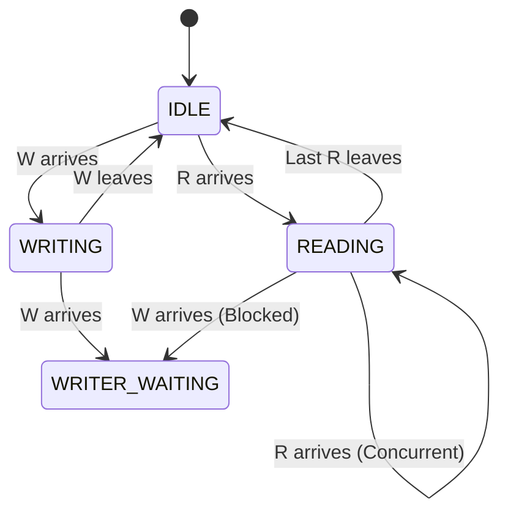

## Syllabus Position

**Subject:** [[Operating Systems]]
**Parent Topic:** [[Process Synchronization]]
**Sibling Topics:** [[Producer Consumer Problem]], [[Dining Philosophers Problem]], [[Critical Section]]
**Leads To:** [[Deadlock]], [[Concurrency Control in DBMS]]

> 📍 **GATE Syllabus Mapping:** "Process synchronization, semaphores, monitors."

**Exam Weight Note:** This is a classic synchronization problem. GATE frequently asks about starvation (which process gets stuck?), semaphore values after a sequence of operations (Numerical/NAT), and logic of the [[Semaphore]]-based implementation (MCQ/MSQ).

---

## 💡 Motivation & Intuition

### The Problem
Imagine a large **Shared Database** (or a file) that many processes want to access.
1. **Readers:** Only want to read data. They don't change anything.
2. **Writers:** Want to update data.

If two readers access the data at the same time, no problem occurs. However, if a writer and any other process (reader or writer) access the data simultaneously, we get a **Race Condition**, leading to data corruption or inconsistent reads.

### The Analogy: The Shared Library Table
Think of a single rare manuscript in a library.
- Multiple students can look at the manuscript together (**Concurrent Reading**).
- But if a restorer needs to paint/fix a page (**Writing**), they must be alone. No one can read while they work, and no two restorers can work on the same page at once.

**Core Idea:** Allow multiple concurrent [[Readers]], but ensure **Mutual Exclusion** for [[Writers]].

---

## 📖 Formal Theory

The Reader-Writer problem is a synchronization constraint where:
1. Any number of readers can reside in the [[Critical Section]] simultaneously.
2. Only one writer can be in the critical section at a time.
3. If a writer is in the critical section, no reader can enter.

### 1. First Readers-Writers Problem (Reader Preference)
**Constraint:** No reader should wait unless a writer has already obtained permission to use the shared object.
**Consequence:** Readers have higher priority. A continuous stream of readers can cause **Writer Starvation**.

#### Semaphore-based Solution (Pseudocode)
```cpp
// Global Variables
semaphore mutex = 1; // Protects read_count
semaphore wrt = 1;   // Protects shared data (Mutual Exclusion for Writer)
int read_count = 0;  // Number of readers currently reading

// READER
void Reader() {
    wait(mutex);
    read_count++;
    if (read_count == 1) 
        wait(wrt); // First reader locks the writer
    signal(mutex);

    // CRITICAL SECTION (Reading)

    wait(mutex);
    read_count--;
    if (read_count == 0) 
        signal(wrt); // Last reader unlocks the writer
    signal(mutex);
}

// WRITER
void Writer() {
    wait(wrt); 
    // CRITICAL SECTION (Writing)
    signal(wrt);
}
```

### 2. Second Readers-Writers Problem (Writer Preference)
**Constraint:** If a writer is waiting to access the object, no new readers may start reading.
**Consequence:** Once a writer requests access, it gets it as soon as possible. A continuous stream of writers can cause **Reader Starvation**.

### 3. Third Readers-Writers Problem (Fair Solution)
**Constraint:** No starvation for either readers or writers. This usually requires a **First-Come-First-Served (FCFS)** queueing mechanism using an additional semaphore (often called `serviceQueue`).

### 4. Monitor-based Solution
In a [[Monitors]]-based solution, the logic is encapsulated within a module. We use **Condition Variables** like `canRead` and `canWrite`.

```cpp
monitor ReadersWriters {
    int readers = 0;
    bool writing = false;
    condition canRead, canWrite;

    void startRead() {
        if (writing || !isEmpty(canWrite)) wait(canRead);
        readers++;
        signal(canRead); // Cascading signal to other waiting readers
    }

    void endRead() {
        readers--;
        if (readers == 0) signal(canWrite);
    }

    void startWrite() {
        if (writing || readers > 0) wait(canWrite);
        writing = true;
    }

    void endWrite() {
        writing = false;
        if (!isEmpty(canRead)) signal(canRead);
        else signal(canWrite);
    }
}
```

---

## 🖼️ Diagrams & Visuals

### State Transition Diagram


### Access Timeline (Reader Preference)
1. **$T_1$:** $R_1$ enters. `read_count = 1`, `wrt` is locked.
2. **$T_2$:** $R_2$ enters. `read_count = 2`, `wrt` remains locked.
3. **$T_3$:** $W_1$ arrives. Blocks on `wait(wrt)`.
4. **$T_4$:** $R_3$ arrives. `read_count = 3`. Enters even though $W_1$ is waiting! (Starvation risk).
5. **$T_5$:** $R_1, R_2, R_3$ leave. `read_count = 0`, `signal(wrt)` called.
6. **$T_6$:** $W_1$ finally enters.

---

## ⏱️ Complexity Analysis

### Time Complexity
- **Entry/Exit Code:** $O(1)$. All operations are simple semaphore increments/decrements.
- **Wait Time:** 
  - **Reader-Pref:** $O(W)$ for readers, potentially $\infty$ for writers.
  - **Writer-Pref:** $O(R)$ for writers, potentially $\infty$ for readers.

### Space Complexity
- $O(1)$ auxiliary space (just a few integers and semaphores).

### Throughput vs. Fairness
- **Reader Preference:** High throughput for readers but unfair to writers.
- **Writer Preference:** Minimizes update latency but unfair to readers.
- **Fair Solution:** Reduces total throughput due to increased switching/queueing overhead but guarantees progress.

| Case | Starvation | Best For... |
| :--- | :--- | :--- |
| **1st Variant** | Writers | High-read systems (e.g., DNS, Web Cache) |
| **2nd Variant** | Readers | Real-time update systems (e.g., Stock Ticker) |
| **3rd Variant** | None | General purpose databases |

---

## 🔢 Worked Example

**Scenario:** 1st Readers-Writers (Reader Preference).
**Initial State:** `mutex = 1`, `wrt = 1`, `read_count = 0`.

**Trace:**
1. **$R_1$ Arrives:**
   - `wait(mutex)` $\rightarrow$ `mutex = 0`
   - `read_count = 1`
   - `read_count == 1`? Yes $\rightarrow$ `wait(wrt)` $\rightarrow$ `wrt = 0`
   - `signal(mutex)` $\rightarrow$ `mutex = 1`
   - **Status:** $R_1$ is reading. `wrt = 0`.
2. **$W_1$ Arrives:**
   - `wait(wrt)` $\rightarrow$ Blocks (since `wrt = 0`).
   - **Status:** $W_1$ in wait-queue of `wrt`.
3. **$R_2$ Arrives:**
   - `wait(mutex)` $\rightarrow$ `mutex = 0`
   - `read_count = 2`
   - `read_count == 1`? No.
   - `signal(mutex)` $\rightarrow$ `mutex = 1`
   - **Status:** $R_1, R_2$ are reading. $W_1$ is still blocked. (Even though $W_1$ arrived before $R_2$!)
4. **$R_1$ Leaves:**
   - `wait(mutex)` $\rightarrow$ `mutex = 0`, `read_count = 1`.
   - `read_count == 0`? No.
   - `signal(mutex)` $\rightarrow$ `mutex = 1`.
5. **$R_2$ Leaves:**
   - `wait(mutex)` $\rightarrow$ `mutex = 0`, `read_count = 0`.
   - `read_count == 0`? Yes $\rightarrow$ `signal(wrt)` $\rightarrow$ `wrt = 1`.
   - `signal(mutex)` $\rightarrow$ `mutex = 1`.
6. **$W_1$ Wakes Up:**
   - $W_1$ completes `wait(wrt)` $\rightarrow$ `wrt = 0`.
   - **Status:** $W_1$ is writing.

---

## 🧠 Intuition Anchors

### 1. The "First One In, Last One Out" Model
The **First Reader** behaves like a pioneer—it's the only one that has to fight the writer to get into the room (`wait(wrt)`). Every reader after it just walks through the open door. The **Last Reader** is the cleaner—it's responsible for locking the door behind it and signaling the writer (`signal(wrt)`).

### 2. The Mental Model: The Shared Blackboard
If I'm reading a blackboard, I don't care if 10 other people are reading. But if someone starts erasing/writing, I can't read anymore. If I'm writing, I need everyone to stay away so I don't poke them with the chalk and so my work stays consistent.

### 3. One-Line Recall
> **Readers share, Writers exclude; First reader locks, Last reader frees.**

### 4. The #1 Trap
**The `mutex` Trap:** Students often confuse `mutex` and `wrt`. 
- `mutex` is **ONLY** for protecting the `read_count` variable. 
- `wrt` is the actual lock for the **Shared Data**. 
If you forget `mutex`, two readers could increment `read_count` simultaneously, both see `read_count == 1`, and both try to `wait(wrt)`, causing a [[Deadlock]].

---

## 🎯 GATE Questions

**Question 1 — [PYQ: GATE-style] — [1-mark]**
In the first readers-writers problem (reader preference), if there are 5 readers currently reading the shared object, what is the value of the `wrt` semaphore?
- (A) 5
- (B) 1
- (C) 0
- (D) -4

<details>
<summary>💡 Solution (click to reveal)</summary>

**Answer: (C)**

**Reasoning:**
The `wrt` semaphore is initialized to 1. When the first reader entered, it executed `wait(wrt)`, which decremented the value to 0. Subsequent readers do not call `wait(wrt)`. Until the last reader leaves and calls `signal(wrt)`, the value remains 0.

**What this question is really testing:**
Understanding of how the `wrt` semaphore represents the binary lock on the resource.

</details>

---

**Question 2 — [Numerical] — [2-mark]**
A system uses the Reader-Writer solution with reader preference. A stream of processes arrive: $R_1$ at 0ms, $W_1$ at 2ms, $R_2$ at 4ms. Each process takes 5ms to complete its task. At what time will $W_1$ finish its execution?

<details>
<summary>💡 Solution (click to reveal)</summary>

**Answer: 15ms**

**Reasoning:**
1. **0ms:** $R_1$ arrives and starts. (Finishes at 5ms).
2. **2ms:** $W_1$ arrives, but $R_1$ has locked `wrt`. $W_1$ waits.
3. **4ms:** $R_2$ arrives. Since it's **Reader Preference**, $R_2$ joins $R_1$ in the critical section immediately. (Finishes at 9ms).
4. **9ms:** $R_2$ (the last reader) finishes and signals `wrt`.
5. **9ms:** $W_1$ enters the critical section.
6. **9 + 5 = 14ms:** $W_1$ finishes.

**Trap to avoid:** Assuming $W_1$ starts at 5ms when $R_1$ finishes. In reader preference, $R_2$ "jumps the queue" even though $W_1$ arrived earlier.

</details>

---

**Question 3 — [Conceptual] — [2-mark]**
Consider a variation where multiple writers can write concurrently but no readers are allowed. Is this a valid synchronization problem?
- (A) Yes, it's a version of the Producer-Consumer problem.
- (B) No, it violates the mutual exclusion requirement for writers.
- (C) Yes, it's just multiple readers.
- (D) None of the above.

<details>
<summary>💡 Solution (click to reveal)</summary>

**Answer: (B)**

**Reasoning:**
By definition, "Writing" implies modification. If two processes modify the same data concurrently without synchronization, the final state depends on the order of execution ([[Race Condition]]). Thus, writers **must** have exclusive access.

</details>

---

## ⚠️ Edge Cases & Traps

- [ ] **Empty System:** If no one is using the resource, the first process (R or W) enters immediately.
- [ ] **Reader during Writer execution:** Reader MUST block. If it doesn't, data inconsistency occurs.
- [ ] **Writer during Reader execution:** In the 1st variant, the writer blocks. In the 2nd variant, the writer "blocks" the door so *future* readers can't enter.
- [ ] **Read_count overflow:** Theoretically possible in extreme systems, though practically handled by integer limits.
- [ ] **Signal/Wait order:** Reversing `wait(mutex)` and `wait(wrt)` in the reader code causes [[Deadlock]].

---

## ⚖️ Comparisons

| Feature | Reader-Writer | [[Producer Consumer]] | [[Dining Philosophers]] |
| :--- | :--- | :--- | :--- |
| **Data Flow** | One-way/Two-way | Producer $\rightarrow$ Buffer $\rightarrow$ Consumer | None (Resource Sharing) |
| **Concurrency** | Multiple Readers allowed | Usually 1 P / 1 C at a time | Multiple pairs of philosophers |
| **Main Concern** | Starvation / Fairness | Buffer Overflow / Underflow | Deadlock / Starvation |
| **Conflict** | R vs W, W vs W | P vs C, P vs P, C vs C | Neighbors competing for forks |

---

## 🕸️ Connections Web

**Must know before this topic:**
- [[Process Synchronization]] — The broad context.
- [[Critical Section]] — What we are protecting.
- [[Semaphores]] — The tools used to solve it.

**Topics that build on this:**
- [[Concurrency Control in DBMS]] — The Database version (Shared/Exclusive locks).
- [[Deadlock]] — What happens if locks are mismanaged.
- [[Monitors]] — High-level abstraction of this problem.

**GATE Subject Links:**
- [[Operating Systems]] — Process Management.
- [[Database Management Systems]] — Transaction Concurrency.

---

## Quick Revision Sheet

- **Definition:** Multiple readers can read; only one writer can write (exclusively).
- **Core Logic:** First reader locks the writer; last reader releases the writer.
- **Semaphores:** `mutex` (for read_count), `wrt` (for resource).
- **Complexity:** $O(1)$ entry/exit, but potential $\infty$ wait (starvation).
- **Variants:**
  - **1st:** Reader Preference (Writer Starves).
  - **2nd:** Writer Preference (Reader Starves).
  - **3rd:** FCFS (No Starvation).
- **Key Equation:** $T(n) \text{ is not applicable as it's not an algorithm, but } \text{Concurrency} = \text{Multiple Readers}$.
- **Mnemonic:** **"Pioneer Reader Locks, Cleaning Reader Unlocks."**

---

## ✅ Revision Checklist
- [ ] I can explain why `mutex` is needed in addition to `wrt`.
- [ ] I can trace the state of `read_count` and semaphores for a sequence of R/W arrivals.
- [ ] I know which variant causes writer starvation.
- [ ] I can identify the "First reader locks, Last reader frees" logic in code.
- [ ] I understand how Monitors solve this differently using condition variables.

---
✅ Note created: Reader Writer Problem.md
   Sections: 14/14 complete
   Wiki Links: 18 found
   Estimated read time: 8 minutes
