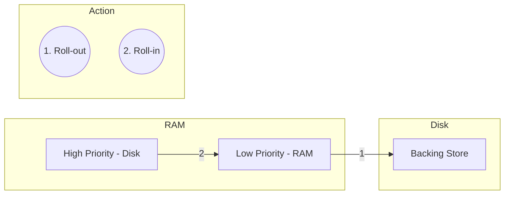

## Syllabus Position

Subject: [[Operating Systems]]
Parent Topic: [[Swapping]]
Sibling Topics: [[Process Scheduling]], [[Preemptive Scheduling]]
Leads To: [[Priority Scheduling]], [[Real-time Systems]]

GATE Syllabus Line: CPU Scheduling, Memory Management.

Exam Weight Note: Rarely appears as a primary topic, but often included as a terminology option in MSQs or theoretical questions about priority scheduling.

## The Problem This Solves

In a priority-based system, a high-priority "VVIP" process arrives, but the memory is full. We cannot afford to wait for a low-priority process to finish. We need a way to *force* the low-priority process out of memory immediately to accommodate the urgent task.

Analogy: **An Emergency Room**.
A patient with a minor cough (Low Priority) is in the only treatment room. A patient with a heart attack (High Priority) arrives. The hospital "rolls out" the cough patient to the hallway (Backing Store) to "roll in" the heart attack patient. Once the emergency is over, the cough patient is rolled back in.

Core Idea (one sentence): Rolling is a specific swapping strategy where lower-priority processes are swapped out ("Roll-out") to make room for higher-priority processes to be swapped in ("Roll-in").

## Formal Theory

### 1. Definition
**Rolling** is a variant of **[[Swapping]]** used primarily in priority-based scheduling algorithms. 

### 2. The Process
1. **Event:** A high-priority process becomes "Ready" but there is insufficient free memory.
2. **Roll-out:** The **[[Medium-term Scheduler]]** selects a lower-priority process currently in memory and moves its entire image to the **[[Backing Store]]**.
3. **Roll-in:** The high-priority process is then loaded into the newly vacated memory space.
4. **Resumption:** When the high-priority process finishes or blocks, the lower-priority process is "rolled back in" to continue execution.

### 3. Context Switch Impact
Because Rolling is triggered by priority preemption, the [[Context Switch]] time is significantly lengthened.
$$\text{CS Time} = \text{Time(Save State)} + \text{Time(Roll-out)} + \text{Time(Roll-in)} + \text{Time(Restore State)}$$

## Diagrams and Visuals

### Rolling Mechanism

**Drawing Instructions:**
1. Draw a High Priority (HP) process on the Disk.
2. Draw a Low Priority (LP) process in RAM.
3. Show Arrow 1: LP moving from RAM to Disk (Label: Roll-out).
4. Show Arrow 2: HP moving from Disk to the space LP vacated (Label: Roll-in).

## Complexity Analysis

The complexity is identical to **[[Swapping]]**, but the *frequency* is determined by the arrival rate of high-priority processes.

- **Worst Case:** Every high-priority arrival triggers a roll-out/roll-in. This leads to **[[Priority Inversion]]** or massive overhead.
- **Optimization:** System tries to find a lower-priority process that is already in a "Wait" state to roll out first.

## Worked Example

**System State:**
- Total RAM: 500 MB
- $P_{low}$ (Priority 10): 400 MB (In RAM)
- $P_{high}$ (Priority 1): 200 MB (In Disk)
- Free RAM: 50 MB

**Execution Steps:**
1. $P_{high}$ wants to run. Needs 200 MB. Only 50 MB free.
2. Scheduler identifies $P_{low}$ as a victim.
3. **Roll-out** $P_{low}$ to disk. Free RAM becomes $50 + 400 = 450 \text{ MB}$.
4. **Roll-in** $P_{high}$ to RAM. Free RAM becomes $450 - 200 = 250 \text{ MB}$.
5. $P_{high}$ executes.

## Intuition Anchors

**The Mental Model:**
"Priority Displacement". Memory isn't just a resource; it's a privilege that higher-priority processes can revoke from lower ones.

**The One-Line Recall:**
Roll-out = High priority kicks out low priority from RAM.

**The #1 Trap:**
Assuming Rolling is a different *mechanism* than Swapping. It is NOT. It is just a different *policy* for *when* and *who* to swap. 

## GATE Questions

---

**Question 1 — [GATE-style] — [1-mark]**

In a system using Rolling (Roll-in, Roll-out), which scheduler is primarily responsible for deciding which process to swap out?
- (A) Long-term Scheduler
- (B) Short-term Scheduler
- (C) Medium-term Scheduler
- (D) I/O Scheduler

Solution

**Answer: (C)**

**Reasoning:**
Any form of swapping, including Rolling, is the responsibility of the Medium-term Scheduler. It manages the degree of multiprogramming and the residency of processes in memory.

---

## Edge Cases and Failure Modes

- [ ] **Thrashing by Priority:** If high-priority processes arrive frequently and finish quickly, the system might spend all its time rolling processes in and out, performing no real work.
- [ ] **Memory Fragmentation:** If $P_{high}$ is smaller than $P_{low}$, rolling out $P_{low}$ might create a hole that is later hard to fill if $P_{low}$ cannot be relocated.

## Comparisons

| Feature | Standard [[Swapping]] | [[Rolling]] |
| :--- | :--- | :--- |
| **Trigger** | Memory Full | High Priority Arrival |
| **Victim Selection** | Least Recently Used / Blocked | Lowest Priority |
| **Goal** | Free Memory | Preempt for Priority |

## Connections Web

**Must know before this topic:**
- [[Swapping]] — The underlying mechanism.
- [[Priority Scheduling]] — The reason Rolling exists.

**Topics that build on this:**
- [[Real-time Systems]] — Where Rolling is often used to meet deadlines.
- [[Context Switching]] — Rolling is a major component of CS latency in these systems.

**Standard references:**
- [[Silberschatz OS Concepts Section 8.2]]

## Quick Revision Sheet

- **Definition:** Priority-based swapping.
- **Roll-out:** Move low-priority process to disk.
- **Roll-in:** Move high-priority process to RAM.
- **Key Use Case:** Ensuring high-priority tasks run immediately even if memory is full.
- **Main Drawback:** High context-switch latency.

## Revision Checklist

- [ ] I can define Rolling in the context of priority scheduling.
- [ ] I understand that Rolling and Swapping use the same physical mechanism.
- [ ] I can explain the impact of Rolling on context switch time.
- [ ] I have linked this note to [[Swapping]] and [[Priority Scheduling]].
