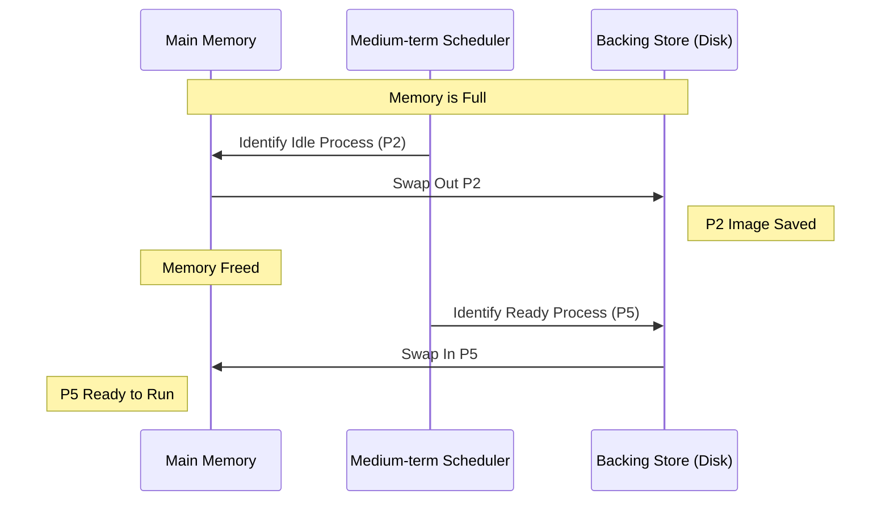

## Syllabus Position

Subject: [[Operating Systems]]
Parent Topic: [[Memory Management]]
Sibling Topics: [[Paging]], [[Segmentation]], [[Virtual Memory]]
Leads To: [[Demand Paging]], [[Thrashing]]

GATE Syllabus Line: Memory management, virtual memory.

Exam Weight Note: Usually conceptual MCQ/MSQ. Often linked with [[Medium-term Scheduler]] or [[Context Switching]] latency calculations.

## The Problem This Solves

We have 16GB of RAM, but the total size of all active processes is 32GB. How do we keep the system running without crashing? We need a way to temporarily "park" processes that aren't currently using the CPU onto the hard drive.

Analogy: **A Library Study Room**.
The room (Main Memory) has only 4 desks. 10 students (Processes) want to study. When a student goes for a 1-hour lunch break, the librarian (MTS) moves their books to a locker (Backing Store) so another student can use the desk. When the student returns, their books are moved back to a desk.

Core Idea (one sentence): Swapping is the process of moving a process from main memory to a **[[Backing Store]]** (disk) and back to memory for continued execution.

## Formal Theory

### 1. The Mechanism
Swapping is handled by the **[[Medium-term Scheduler]]**.
- **Swap-out:** A process is moved from memory to the backing store. Its memory is freed.
- **Swap-in:** A process is moved from the backing store back into memory.

### 2. [[Backing Store]]
A fast disk large enough to accommodate copies of all memory images for all users. It must provide direct access to these images.

### 3. Impact on [[Context Switch]]
The total time for a swap includes the time to transfer the entire process image.
$$ \text{Total Swap Time} = \frac{\text{Process Size}}{\text{Transfer Rate}} + \text{Disk Latency} $$
Because disk speeds are orders of magnitude slower than RAM, swapping significantly increases context switch time if the entire process is swapped.

### 4. Swapping and Relocation
- If the system uses **[[Static Linking]]** or **[[Absolute Loading]]**, the process must be swapped back into the *exact same* physical memory location.
- If the system uses **[[Dynamic Relocation]]** (via relocation registers), it can be swapped into any available physical address.

### 5. Interaction with [[Degree of Multiprogramming]]
Swapping allows the system to support a higher *total* number of processes than can fit in memory simultaneously, but it reduces the *effective* degree of multiprogramming at any single instant to free up resources.

## Diagrams and Visuals

### Swapping Process

**Drawing Instructions:**
1. Draw two boxes: "Main Memory" and "Backing Store".
2. Show an arrow labeled "Swap Out" moving from RAM to Disk.
3. Show an arrow labeled "Swap In" moving from Disk to RAM.
4. Label the component triggering these as the "Medium-term Scheduler".

## Complexity Analysis

**Time Complexity:**
The dominant factor is Disk I/O. 
Example:
- Process Size: 100 MB
- Transfer Rate: 50 MB/sec
- Swap out time: $100 / 50 = 2 \text{ sec}$.
- Swap in time: $100 / 50 = 2 \text{ sec}$.
- Total overhead: 4 seconds. 
*Compare this to a CPU context switch which is in microseconds.*

**Space Complexity:**
Requires $O(P)$ space on the backing store, where $P$ is the sum of the sizes of all swapped processes.

## Worked Example

**Scenario:** Calculate the context switch time including swapping.
- Memory: 1 GB
- Process Size: 10 MB
- Backing Store Transfer Rate: 100 MB/sec
- Average Latency: 8 ms

**Step 1: Calculate Transfer Time**
$$T_{transfer} = \frac{10 \text{ MB}}{100 \text{ MB/sec}} = 0.1 \text{ sec} = 100 \text{ ms}$$

**Step 2: Total Swap Time (Out + In)**
Assume we must swap out one process to make room for another.
$$T_{out} = 100 \text{ ms} + 8 \text{ ms} = 108 \text{ ms}$$
$$T_{in} = 100 \text{ ms} + 8 \text{ ms} = 108 \text{ ms}$$
$$\text{Total Context Switch Time} \approx 216 \text{ ms}$$

**Conclusion:** Without swapping, context switch is $\approx 10 \mu s$. With swapping, it is $216,000 \mu s$. Swapping is expensive!

## Intuition Anchors

**The Analogy (Extended):**
Swapping is like a **Kitchen**. You have only so much counter space (RAM). You keep the ingredients you are currently chopping on the counter. If you need space for the turkey, you put the bowl of salad back in the fridge (Backing Store). You "Roll-out" the salad to "Roll-in" the turkey.

**The Mental Model:**
Picture the RAM as a "Stage" and the Backing Store as the "Backstage". Only processes on the stage can perform.

**The One-Line Recall:**
Swapping = Entire process image moves between RAM and Disk to manage memory over-commitment.

**The #1 Trap:**
Confusing **Swapping** with **[[Paging]]**. 
- Swapping moves the *entire* process.
- Paging moves *fixed-size pieces* (pages).
Modern systems usually "swap pages" rather than "swap processes" (this is called **[[Demand Paging]]**).

## GATE Questions

---

**Question 1 — [GATE-style] — [1-mark]**

Which of the following conditions must be met to swap a process back into a different physical memory location than the one it was swapped out from?
- (A) The process must be I/O bound.
- (B) The system must use Static Linking.
- (C) The system must use Dynamic Relocation.
- (D) The process must be in the Running state.

Solution

**Answer: (C)**

**Reasoning:**
Dynamic Relocation allows the execution-time address binding. This means the hardware (MMU) uses a relocation register to map logical addresses to physical ones. If a process is moved, we just update the relocation register. In static binding, the addresses are hardcoded at load time.

**What this question is really testing:**
Binding times and their impact on memory management flexibility.

---

**Question 2 — [Conceptual] — [2-mark]**

A priority-based scheduling algorithm uses swapping to ensure higher priority processes can run. When a high-priority process arrives and memory is full, a lower-priority process is swapped out. This specific variant of swapping is known as:
- (A) Demand Paging
- (B) Roll-out, Roll-in
- (C) Fragmentation
- (D) Cycle Stealing

Solution

**Answer: (B)**

**Reasoning:**
"Roll-out, Roll-in" is the term used for swapping when it is specifically triggered by priority-based scheduling. The lower priority process is "rolled out" to make room for the higher priority one being "rolled in".

---

## Edge Cases and Failure Modes

- [ ] **Pending I/O:** A process cannot be swapped out if it is waiting for I/O and the I/O buffer is in the process's memory space. If we swap it out, the I/O controller might write data into a memory location now occupied by another process!
  - **Fix:** Either never swap processes with pending I/O or always do I/O into OS buffers (double buffering).
- [ ] **Thrashing:** If the system spends more time swapping than executing, performance collapses.
- [ ] **Flash Memory:** Standard swapping is avoided on mobile devices (iOS/Android) because flash memory has limited write cycles and poor throughput compared to desktop HDDs/SSDs.

## Comparisons

| Feature | [[Swapping]] | [[Paging]] | [[Demand Paging]] |
| :--- | :--- | :--- | :--- |
| **Granularity** | Entire Process | Page (Fixed size) | Page (On-demand) |
| **Disk I/O** | High (Heavy) | Moderate | Low (Minimal) |
| **Relocation Req.** | Dynamic preferred | Required | Required |
| **External Frag.** | Yes | No | No |

## Connections Web

**Must know before this topic:**
- [[Main Memory]] vs [[Backing Store]]
- [[Process States]] (Suspend states)

**Topics that build on this:**
- [[Rolling]] — Priority-based swapping.
- [[Virtual Memory]] — The logical evolution of swapping.
- [[Thrashing]] — When swapping goes wrong.

**GATE subject cross-links:**
- [[Operating Systems]] > [[Memory Management]]

**Standard references:**
- [[Silberschatz OS Concepts Chapter 8]]

## Quick Revision Sheet

**Definition:** Moving a process from RAM to Disk and back.

**Core Idea:** Handles memory overflow by using the disk as an extension of RAM.

**Algorithm Steps:**
1. Wait for memory pressure or priority event.
2. Select victim process.
3. Copy memory image to backing store.
4. Update [[PCB]] state to Suspend.
5. Allocate freed RAM to new process.

**Key Properties:**
- Heavily increases context switch time.
- Requires dynamic relocation for efficiency.
- Blocked processes are prime candidates for swap-out.

**The #1 Trap:** Swapping is for the *entire* process; Paging is for *parts*.

## Revision Checklist

- [ ] I can explain the "Pending I/O" problem in swapping.
- [ ] I can calculate swap latency given transfer rates.
- [ ] I know the difference between standard swapping and Roll-in/Roll-out.
- [ ] I understand how swapping relates to the [[Medium-term Scheduler]].
- [ ] I have linked this note correctly in my Obsidian vault.
