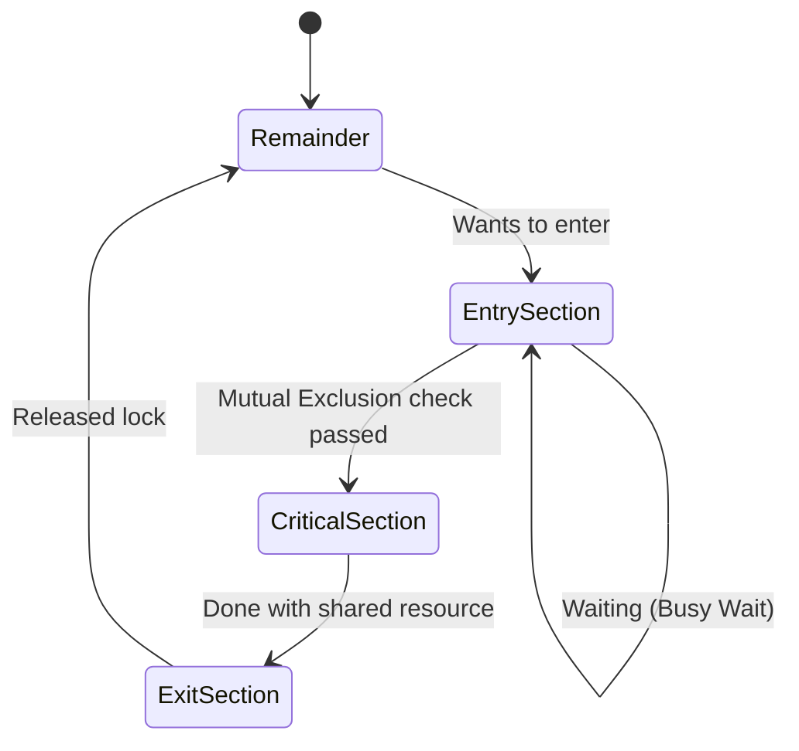

## Syllabus Position

Subject: [[Operating Systems]]
Parent Topic: [[Process Management]]
Sibling Topics: [[Process Scheduling]], [[Inter-Process Communication]]
Leads To: [[Peterson's Solution]], [[Semaphores]], [[Monitors]]

GATE Syllabus Line: "Process synchronization, critical section problem, semaphores, monitors, deadlocks."

Exam Weight Note: Appears frequently as 2-mark conceptual MCQ/MSQ regarding the three requirements (Mutual Exclusion, Progress, Bounded Waiting).

## The Problem This Solves

Imagine two people sharing a single bank account. Both try to withdraw $100 simultaneously. Person A checks the balance ($150), and Person B checks the balance ($150). Both see enough money, so both withdraw. The final balance should be -$50, but the bank might only record one withdrawal, leaving $50. This inconsistency happens because they accessed the "shared resource" at the same time.

In OS, when multiple [[Concurrent Processes]] access shared data, the result depends on the order of execution. This is a [[Race Condition]]. To prevent this, we must ensure that only one process at a time can modify the shared data.

**Core Idea (one sentence):** The Critical Section Problem is the challenge of designing a protocol that ensures multiple processes can cooperate and share data without causing inconsistency or data corruption.

## Formal Theory

The **Critical Section** is a segment of code where a process accesses and modifies shared resources (variables, files, tables).

### The Four Sections of a Synchronized Process
Every process $P_i$ follows this general structure:
1. **Entry Section**: The code that requests permission to enter the critical section.
2. **Critical Section (CS)**: The code where shared data is accessed.
3. **Exit Section**: The code that releases the lock or signals that it has left the CS.
4. **Remainder Section**: Non-critical code performed after leaving the CS.

### The Three Mandatory Requirements
For a solution to the Critical Section Problem to be considered "correct," it **must** satisfy the first two and **should** ideally satisfy the third:

#### 1. Mutual Exclusion (Primary Requirement)
If process $P_i$ is executing in its critical section, then no other processes can be executing in their critical sections. 
- *Mathematically:* $CS_i \cap CS_j = \emptyset$ for $i \neq j$.

#### 2. Progress (Primary Requirement)
If no process is in its CS and some processes wish to enter, only those processes NOT in their [[Remainder Section]] can participate in the decision of who enters next, and this selection cannot be postponed indefinitely.
- *In simpler terms:* A process outside the entry/exit sections should not block another process from entering the CS. No [[Deadlock]].

#### 3. Bounded Waiting (Secondary Requirement)
There exists a bound (limit) on the number of times other processes are allowed to enter their CS after a process has made a request to enter and before that request is granted.
- *In simpler terms:* No process should wait forever while others keep jumping the queue. No [[Starvation]].

> **What GATE actually tests here:** GATE often gives a snippet of code and asks which of these three requirements are violated. Progress is the trickiest to check—look for cases where one process is in its "remainder section" and its state prevents another from entering.

## Diagrams and Visuals

**Excalidraw/Paper Drawing Instructions:**
1. Draw a large circle representing the "Shared Resource".
2. Draw two boxes ($P_0$ and $P_1$) trying to enter the circle.
3. Place a "Gatekeeper" (Entry Section) before the circle.
4. Show that if $P_0$ is inside, the Gatekeeper blocks $P_1$.

**Mermaid State Diagram:**

## Complexity Analysis

The complexity of a solution is usually measured in terms of:
- **Time Complexity (Entry/Exit overhead):** Ideally $O(1)$ for each.
- **Space Complexity:** Number of shared variables (e.g., $N$ flags for $N$ processes).

| Requirement | Importance | Failure Mode |
|-------------|------------|--------------|
| **Mutual Exclusion** | Critical | Data Corruption / Race Condition |
| **Progress** | High | Deadlock (System freezes) |
| **Bounded Waiting**| Medium | Starvation (One process waits forever) |

## Worked Example

Consider two processes $P_0, P_1$ sharing a variable `count = 5`.
Both execute `count++` in the CS.

**Naive Execution (Race Condition):**
1. $P_0$ loads `count` (5) into register $R_0$.
2. $P_0$ increments $R_0$ (6).
3. **Context Switch** to $P_1$.
4. $P_1$ loads `count` (5) into register $R_1$.
5. $P_1$ increments $R_1$ (6).
6. $P_1$ stores $R_1$ (6) to `count`.
7. **Context Switch** back to $P_0$.
8. $P_0$ stores $R_0$ (6) to `count`.

**Final Result:** `count` is 6. **Correct Result:** should be 7.
**Conclusion:** Without Mutual Exclusion, the update is lost.

## Intuition Anchors

**The Analogy:**
Think of a single-occupancy bathroom. 
- **Mutual Exclusion:** Only one person inside at a time.
- **Progress:** If the bathroom is empty and someone wants to go, they should be able to, provided nobody who *doesn't* need to go is blocking the door.
- **Bounded Waiting:** You shouldn't have to wait for 100 people to go ahead of you if you were already in line.

**The Mental Model:**
Picture the CS as a "Baton" in a relay race. To run the "Shared Lap" (CS), you must hold the baton. The Critical Section Problem is just the set of rules for how to pass the baton fairly and safely.

**The One-Line Recall:**
The CS problem is about 3 goals: **No Two Inside** (Mutex), **No Blocking from Outside** (Progress), and **No Waiting Forever** (Bounded Waiting).

**The #1 Trap:**
Students often confuse **Progress** and **Bounded Waiting**.
- Progress $\approx$ "If someone wants to enter and it's empty, *someone* must enter." (Deadlock prevention)
- Bounded Waiting $\approx$ "If *I* want to enter, I will *eventually* enter." (Starvation prevention)

## GATE Questions

---

**Question 1 — [PYQ: GATE 2011] — [2-mark]**

A solution to the critical section problem must satisfy:
- (A) Mutual Exclusion only
- (B) Mutual Exclusion and Progress only
- (C) Mutual Exclusion, Progress, and Bounded Waiting
- (D) Progress and Bounded Waiting only

Solution

**Answer: (C)**

**Reasoning:**
While Bounded Waiting is sometimes described as "desirable," the standard academic definition (including Galvin/Silberschatz) lists all three as the requirements for a complete solution. In most GATE contexts, all three are expected.

**What this question is really testing:** Fundamental definitions of the requirements.

---

**Question 2 — [Conceptual] — [1-mark]**

If a synchronization solution allows a process in its remainder section to block another process from entering the critical section, which requirement is violated?
- (A) Mutual Exclusion
- (B) Progress
- (C) Bounded Waiting
- (D) Efficiency

Solution

**Answer: (B)**

**Reasoning:**
The definition of **Progress** explicitly states that only those processes NOT in their remainder section can participate in the decision of who enters the CS. If a process in the remainder section blocks another, it's a direct violation of Progress.

---

**Pattern Recognition:**
- Code snippets with a `while` loop that depends on another process's variable usually violate **Progress** if that other process can terminate or stay in its remainder section forever.

## Edge Cases and Failure Modes

- [ ] **Process Termination:** What if a process dies while holding a lock? (Mutual Exclusion persists, but Progress fails).
- [ ] **Interrupts:** In a single-processor system, disabling interrupts can achieve Mutex but is dangerous for the system clock and I/O.
- [ ] **Preemption:** If the OS doesn't preempt a process in the CS, it might solve Mutex but cause severe latency for higher-priority tasks.

## Comparisons

| Feature | [[Mutual Exclusion]] | [[Progress]] | [[Bounded Waiting]] |
| :--- | :--- | :--- | :--- |
| **Focus** | Safety | Liveness (No Deadlock) | Fairness (No Starvation) |
| **Violation** | Race Condition | System Hangs | Process Starves |
| **Strictness**| Mandatory | Mandatory | Highly Desirable |

## Connections Web

**Must know before this topic:**
- [[Concurrency]] — why multiple processes run at once.
- [[Shared Memory]] — how processes communicate.

**Topics that build on this:**
- [[Peterson's Solution]] — 2-process software solution.
- [[Semaphores]] — generalized sync tool.
- [[Monitors]] — high-level sync construct.

**GATE subject cross-links:**
- [[Operating Systems]] > [[Synchronization]]

**Standard references:**
- [[Galvin OS Chapter 6]]

## Quick Revision Sheet

**Definition (1 sentence):** A protocol to coordinate access to shared resources among concurrent processes.

**Core Idea:** Prevent race conditions by ensuring Mutex, Progress, and Bounded Waiting.

**The 3 Requirements:**
1. **Mutual Exclusion:** One at a time.
2. **Progress:** If free, someone must be able to enter; no blocking from outside.
3. **Bounded Waiting:** No indefinite waiting (No starvation).

**Complexity:**
- Goal: $O(1)$ entry/exit.

**The #1 Trap:** Confusing Progress (Deadlock) with Bounded Waiting (Starvation).

## Revision Checklist

- [ ] I can state the formal definition without looking.
- [ ] I can explain the analogy of the bathroom.
- [ ] I can derive the race condition from the `count++` example.
- [ ] I know the difference between Progress and Bounded Waiting.
- [ ] I have linked this note correctly in my Obsidian vault.
