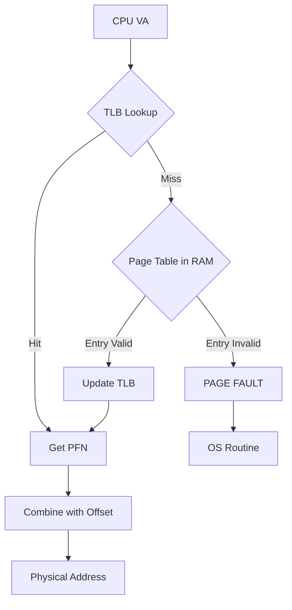

## Syllabus Position

Subject: [[Memory Management Overview]]
Parent Topic: [[Paging]]
Sibling Topics: [[Page Replacement Algorithms]], [[Segmentation]]
Leads To: [[EMAT Calculations]], [[Address Translation Pipeline]]

GATE Syllabus Line: "Memory management and virtual memory: Paging, Page tables, TLB."

Exam Weight Note: Appears almost every year, usually as a 2-mark NAT involving hit ratios and EMAT, or a 1-mark conceptual MCQ about context switching.

## The Problem This Solves

In a standard [[Paging]] system, every data access requires **two** memory references: one to fetch the Page Table Entry (PTE) and one to fetch the actual data. This effectively halves the system speed.

Imagine having to look up a word in a 1000-page dictionary (Page Table) every single time you read a word in a book. It's slow. To fix this, you keep a small sticky note (TLB) listing the definitions of the last 10 words you looked up. If the word is on the sticky note, you skip the dictionary entirely.

Core Idea (one sentence): The TLB is a high-speed associative cache that stores recently used [[Virtual-to-Physical Address]] mappings to accelerate address translation.

## Formal Theory

The **Translation Lookaside Buffer (TLB)** is a small, hardware-managed **Content Addressable Memory (CAM)** located inside the MMU.

### TLB Structure
Each entry in a TLB consists of:
- **Tag**: Usually the Virtual Page Number (VPN).
- **Value**: The corresponding Physical Frame Number (PFN).
- **Attributes**: Valid bit, Dirty bit, Protection bits (R/W/X), and optionally an **ASID** (Address Space Identifier).

### The Translation Flow
1. CPU generates a **Virtual Address** ($VA$).
2. The $VA$ is split into $VPN$ and $Offset$.
3. The $VPN$ is searched in the **TLB** (parallel search).
4. **TLB Hit**: The $PFN$ is retrieved directly. Physical Address ($PA$) = $PFN$ + $Offset$.
5. **TLB Miss**: The MMU must perform a **Page Table Walk** in main memory. Once found, the mapping is loaded into the TLB for future use.

### TLB Reach
The total amount of memory that can be mapped by the TLB at any given time.
$$\text{TLB Reach} = (\text{Number of TLB Entries}) \times (\text{Page Size})$$
*Note: Increasing page size (Huge Pages) increases TLB reach without increasing TLB size.*

### Context Switching & TLB
When a context switch occurs, the TLB entries of the old process are invalid for the new process. Two solutions exist:
1. **TLB Flushing**: Clear the entire TLB on every switch. (High overhead).
2. **ASID (Address Space Identifier)**: Tag each TLB entry with a process ID. Multiple processes can share the TLB simultaneously.

What GATE actually tests here: The distinction between a TLB miss and a [[Page Fault]]. A TLB miss is handled by hardware/MMU (fast), whereas a Page Fault is handled by the OS (extremely slow).

## Diagrams and Visuals

**Logic Flow:**

**TLB Entry (ASCII):**
| Valid | ASID | Tag (VPN) | PFN | Protection |
| :--- | :--- | :--- | :--- | :--- |
| 1 | 0x01 | 0x00ABC | 0x05 | R/W |

## Complexity Analysis

- **Time Complexity**: TLB search is $O(1)$ due to hardware parallelism (associative lookup).
- **Space Complexity**: Small (typically 64 to 1024 entries) due to expensive CAM hardware.

| Case | Access Time | Trigger |
| :--- | :--- | :--- |
| Best Case (Hit) | $C$ (TLB Access Time) | Mapping exists in TLB |
| Worst Case (Miss) | $C + M$ (or $C + 2M$ depending on model) | Page Table Walk required |

## Worked Example

**Input**:
- TLB Size: 64 entries.
- Page Size: 4 KB.
- System: 32-bit.
- VA generated: `0x00001005`.

**Step-by-Step Trace**:
1. Page Size = $2^{12}$, so Offset = 12 bits.
2. $VA$ in binary: `... 0001 0000 0000 0101`.
3. $VPN$ = `0x00001`, Offset = `0x005`.
4. Search TLB for Tag `0x00001`.
5. If Match found, retrieve $PFN$ (say `0x99`).
6. Result: $PA$ = `0x99005`.
7. **TLB Reach Check**: $64 \times 4 \text{ KB} = 256 \text{ KB}$. Any VA outside the first 256KB of unique pages will likely cause misses initially.

## Intuition Anchors

**The Analogy**:
TLB is the "Speed Dial" on your phone. The Page Table is the "Contacts App". The Disk is the "Physical Phone Book". You check Speed Dial first.

**The Mental Model**:
Visualize the TLB as a set of parallel wires. When a VPN enters, all wires check if they have the match simultaneously. It's a "Winner takes all" hardware race.

**The One-Line Recall**:
TLB is a hardware cache for Page Table Entries to avoid the penalty of two-step memory access.

**The #1 Trap**:
Assuming a TLB miss implies a Page Fault. **False.** A mapping can be missing in the TLB but still present in Main Memory (Page Table).

## GATE Questions

**Question 1 — [PYQ: GATE 2014] — [2-mark]**
A system uses a TLB with an access time of 10ns and main memory access time of 50ns. If the TLB hit ratio is 90%, and the page table is in main memory, what is the Effective Memory Access Time (EMAT)?
(Assume TLB and Memory are accessed serially).

Solution

**Answer: 65ns**

**Reasoning:**
- $h = 0.9, (1-h) = 0.1$
- $C = 10, M = 50$
- $EMAT = h(C + M) + (1-h)(C + 2M)$
- $EMAT = 0.9(10 + 50) + 0.1(10 + 100)$
- $EMAT = 0.9(60) + 0.1(110) = 54 + 11 = 65\text{ ns}$.

**What this question is really testing:** The "two-memory access" penalty on a TLB miss.

---

**Question 2 — [Conceptual] — [1-mark]**
Which of the following is true regarding TLB reach?
(A) It is independent of page size.
(B) It can be increased by using Multi-level paging.
(C) It can be increased by using larger page sizes.
(D) It is always equal to the total RAM size.

Solution

**Answer: (C)**
TLB Reach = TLB Size $\times$ Page Size. Using "Huge Pages" is a standard technique to reduce TLB misses in database applications.

## Edge Cases and Failure Modes

- [ ] **Context Switch**: If ASID is not used, TLB must be flushed. Forgetting to flush results in Process B accessing Process A's frames (Security breach).
- [ ] **TLB Size 0**: Effective access time becomes exactly $2 \times M$.
- [ ] **Superpages**: Mixing 4KB and 2MB pages in one TLB requires complex hardware to match tags of different lengths.

## Comparisons

| Feature | TLB | [[Cache Memory]] |
| :--- | :--- | :--- |
| **Stores** | Page Table Entries (Mappings) | Actual Data/Instructions |
| **Search** | Fully Associative (CAM) | Usually Set-Associative |
| **Miss Result** | Page Table Walk (RAM) | Memory Access (RAM) |
| **Managed by** | MMU (Hardware) | Cache Controller |

## Connections Web

**Must know before this topic:**
- [[Paging]] — Basis of the mappings stored.
- [[Memory Management Overview]] — Context of virtual memory.

**Topics that build on this:**
- [[Address Translation Pipeline]] — The macro view.
- [[Cache Mapping Methods]] — How data is found after address translation.

## Quick Revision Sheet

- **Definition**: A hardware cache for address translations.
- **EMAT Formula**: $EMAT = h(C+M) + (1-h)(C+2M)$.
- **TLB Reach**: $Entries \times PageSize$.
- **ASID**: Allows TLB entries to persist across context switches.
- **Miss Flow**: TLB Miss $\to$ PT Lookup $\to$ Valid? (Yes $\to$ Update TLB, No $\to$ Page Fault).

## Revision Checklist
- [ ] I can derive the EMAT formula for serial vs parallel access.
- [ ] I understand why a TLB miss does not mean a Page Fault.
- [ ] I can explain the role of ASID.
- [ ] I can solve a numerical with 90%+ accuracy.
