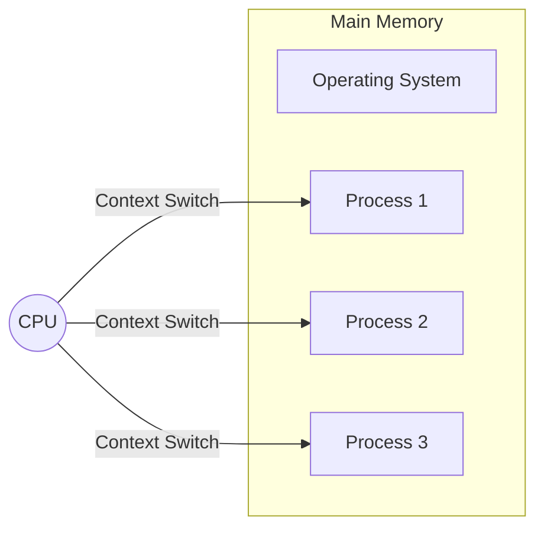

## Syllabus Position

Subject: [[Operating Systems]]
Parent Topic: [[Introduction to OS]]
Sibling Topics: [[System Calls]], [[OS Structures]]
Leads To: [[Process Management]], [[CPU Scheduling]], [[Memory Management]]

GATE Syllabus Line: Operating System basics: Batch, Multi-programming, multi-tasking, multi-processing, time-sharing, real-time systems.

Exam Weight Note: Typically appears as 1-mark theoretical MCQs or MSQs focusing on the differences in CPU utilization, response time, and scheduling requirements.

## The Problem This Solves

Early computers were massive, expensive, and slow to set up. If a human had to manually load every program, the CPU would sit idle for 99% of the time, wasting precious resources. Different computing needs (scientific, interactive, industrial control) required different ways of managing the CPU and memory.

Analogy: Think of a restaurant. 
- **Batch Processing** is like a pre-ordered banquet where all dishes are prepared together and served at once.
- **Multitasking** is like a busy diner where the waiter rotates between tables, giving everyone a "slice" of attention so no one feels ignored.

Core Idea (one sentence): Operating System types evolved to maximize [[CPU Utilization]] and minimize user [[Response Time]] based on the specific hardware constraints and user needs of the era.

## Formal Theory

### 1. Batch Processing Systems
In the earliest systems, users did not interact directly with the computer. Users prepared "jobs" (on punch cards) and submitted them to a computer operator. The operator would group jobs with similar requirements into **batches**.

- **Key Constraint:** The CPU often sat idle during [[I/O Operations]] because there was no way to switch to another job.
- **Starvation:** Smaller jobs could wait indefinitely if a massive job was at the front of the batch.
- **[[Spooling]] (Simultaneous Peripheral Operations On-Line):** A technique where data is stored in a buffer (disk) to be processed by a device later. It allowed the CPU to overlap I/O with computation.

### 2. Multiprogramming Systems
The core goal is to increase [[CPU Utilization]]. Several jobs are kept in [[Main Memory]] simultaneously. When the current job needs to wait for I/O, the OS switches the CPU to another job.

- **[[Degree of Multiprogramming]]:** The number of processes residing in [[Main Memory]]. Increasing this usually increases CPU utilization, but only up to a point (see [[Thrashing]]).
- **[[Context Switching]]:** The mechanism of saving the state of a process and loading the state of another.

### 3. Multitasking (Time-Sharing) Systems
An extension of multiprogramming where the CPU switches between jobs so frequently that users can interact with each program while it is running.

- **[[Response Time]]:** The primary metric here. It must be short (typically $< 1$ second).
- **Scheduling:** Often uses [[Round Robin Scheduling]] to ensure fairness.
- **[[Time Quantum]]:** Each process gets a tiny slice of time.

### 4. Real-Time Systems (RTS)
Systems with fixed time constraints. The "correctness" of the system depends not only on the logical result but also on the time at which it is delivered.

- **Hard Real-Time:** Missing a deadline is a total system failure (e.g., Airbag deployment). No [[Virtual Memory]] is typically used because it introduces non-deterministic delays.
- **Soft Real-Time:** Missing a deadline is undesirable but not catastrophic (e.g., Video streaming).
- **Determinism:** The ability to guarantee a maximum time for a task.

### 5. Distributed and Clustered Systems
- **[[Distributed Systems]]:** Loosely coupled systems where processors do not share memory or a clock. Communication happens via a network.
- **[[Clustered Systems]]:** Similar to distributed systems but usually share storage and are closely linked via a LAN. Used for High Availability (HA).

## Diagrams and Visuals

### Trace: Multiprogramming vs. Batch
Assume Job A (CPU: 5ms, I/O: 10ms, CPU: 5ms) and Job B (CPU: 10ms).

**Batch (Uniprogramming):**
Job A: [CPU1][---I/O---][CPU2]
Job B:                         [----CPU----]
(CPU is idle during I/O)

**Multiprogramming:**
Job A: [CPU1][---I/O---][CPU2]
Job B:       [----CPU----]
(Job B runs while Job A waits for I/O)

## Complexity Analysis

While "Types of OS" is conceptual, the performance is analyzed via:
- **CPU Utilization ($\eta$):** If $p$ is the fraction of time a process spends waiting for I/O, and $n$ is the degree of multiprogramming:
  $$\text{CPU Utilization} = 1 - p^n$$
  *Derivation:* The probability that all $n$ processes are waiting for I/O is $p^n$. Thus, the probability that at least one is ready for CPU is $1 - p^n$.
- **Throughput:** Number of jobs completed per unit time.

| Case | CPU Utilization | Response Time | Fairness |
| :--- | :--- | :--- | :--- |
| **Batch** | Low (I/O Bottleneck) | Very High | Poor |
| **Multiprogramming** | High | Medium | Medium |
| **Multitasking** | Medium/High | Low (Best) | High (RR) |
| **Hard RTS** | Variable | Guaranteed | N/A (Priority) |

## Worked Example

**Scenario:** A system has 4 processes, each spending 80% of its time on I/O. Calculate the CPU utilization.

1. $n = 4$ (Degree of Multiprogramming)
2. $p = 0.8$ (I/O wait probability)
3. Formula: $1 - p^n$
4. Calculation: $1 - (0.8)^4 = 1 - 0.4096 = 0.5904$ or $59.04\%$

**Edge Case:** If we add a 5th process, utilization becomes $1 - (0.8)^5 = 1 - 0.32768 = 67.23\%$.
*Observation:* Adding processes increases utilization but at a diminishing rate.

## Intuition Anchors

**The Analogy (The Library):**
- **Batch:** You give a list of 10 books to a librarian. They find them all and call you back in 2 hours.
- **Multitasking:** You and 5 others stand at the counter. The librarian gives each of you 30 seconds of help in a circle until everyone is done.

**The Mental Model:**
Picture the CPU as a high-speed engine. In Batch, the engine stops every time a passenger (I/O) needs to board. In Multiprogramming, we have a waiting room (Memory) full of passengers; if one is boarding, we immediately put another in the driver's seat.

**The One-Line Recall:**
Multiprogramming maximizes **Utilization** (CPU focus), while Multitasking minimizes **Response Time** (User focus).

**The #1 Trap:**
Students often confuse **Multiprogramming** with **Multitasking**. 
*Trap:* Thinking Multiprogramming implies multiple users interacting simultaneously. 
*Fact:* Multiprogramming was invented to keep the CPU busy, NOT to support interactive users. Multitasking (Time-Sharing) added the timer/interrupt to support interactivity.

## GATE Questions

---

**Question 1 — [PYQ: GATE 2015] — [1-mark]**

Which of the following statements is/are TRUE?
I. In a multiprogramming system, more than one process can be executed by the CPU at any given time.
II. In a multitasking system, the CPU switches between processes so frequently that users can interact with each program while it is running.

- (A) I only
- (B) II only
- (C) Both I and II
- (D) Neither I nor II

Solution

**Answer: (B)**

**Reasoning:**
- Statement I is FALSE. Even in a multiprogramming system, if there is only one CPU, it can execute only **one** instruction from **one** process at a single instant. The "multi" refers to multiple processes residing in *memory*, not being executed *simultaneously* on a single core.
- Statement II is TRUE. This is the definition of time-sharing/multitasking.

**What this question is really testing:**
The distinction between "concurrent" (appearing to run at the same time) and "simultaneous" (actually running at the same time on multiple cores).

---

**Question 2 — [Conceptual] — [2-mark]**

In a hard real-time system, which of the following is typically AVOIDED?
- (A) Priority-based scheduling
- (B) Preemptive kernels
- (C) Virtual Memory with Paging
- (D) Fixed-time interrupts

Solution

**Answer: (C)**

**Reasoning:**
- **Virtual Memory** (specifically paging) involves "Page Faults." A page fault requires a disk access, which is highly unpredictable (non-deterministic). In a hard real-time system, you cannot have a 10ms deadline if a page fault might randomly add 20ms of delay.

**Trap to avoid:**
Thinking "Priority-based scheduling" is bad. Actually, RTS relies heavily on strictly enforced priorities (e.g., [[Rate Monotonic Scheduling]]).

---

## Edge Cases and Failure Modes

- [ ] **Degree of Multiprogramming = 1:** The system effectively becomes a batch system; if the process waits for I/O, the CPU stays idle.
- [ ] **Very Small Time Quantum in Multitasking:** If the quantum is too small, the overhead of **[[Context Switching]]** dominates, and CPU utilization drops to near zero.
- [ ] **Soft RTS in Hard Deadlines:** Using a Soft RTS (like standard Linux) for a missile guidance system (failure = explosion). 
- [ ] **Spooling vs Buffering:** Spooling overlaps I/O of one job with computation of another; Buffering overlaps I/O and computation of the *same* job.

## Comparisons

| Feature | Multiprogramming | Multitasking (Time-Sharing) | Real-Time (Hard) |
| :--- | :--- | :--- | :--- |
| **Primary Goal** | Maximize CPU Utilization | Minimize Response Time | Meet Strict Deadlines |
| **Scheduling** | Non-preemptive / I/O-based | Preemptive (Round Robin) | Priority-based (Deterministic) |
| **User Interaction** | Low | High | Very Low / Automated |
| **Key Metric** | Throughput | Response Time | Jitter / Deadline miss |

## Connections Web

**Must know before this topic:**
- [[Process Concept]] — The basic unit of work.
- [[CPU vs I/O Bound]] — Explains why switching is needed.

**Topics that build on this:**
- [[CPU Scheduling Algorithms]] — How the OS chooses the next process.
- [[Memory Management]] — How multiple programs fit in RAM.
- [[Thrashing]] — When the degree of multiprogramming is too high.

**GATE subject cross-links:**
- [[Operating Systems]] > [[Types of OS]]

**Standard references:**
- [[Galvin Chapter 1]]
- [[Stallings Section 2.3]]

## Quick Revision Sheet

**Definition:** OS types are categorized by how they handle the CPU-Memory-I/O relationship.

**Algorithm Steps (Multiprogramming):**
1. Load multiple jobs into memory.
2. Pick one job and run.
3. If job needs I/O, save its state ([[Context Switch]]).
4. Pick another ready job from memory.

**Complexity:** CPU Utilization $\eta = 1 - p^n$.

**Key Properties:**
- **Batch:** High throughput for long jobs, no interaction.
- **Multitasking:** RR scheduling, low response time, fairness.
- **Real-Time:** Determinism is more important than speed.

**The #1 Trap:** Multiprogramming $\neq$ Parallel Processing. It is *concurrent* but serial at the CPU level.

## Revision Checklist

- [ ] I can derive the $1 - p^n$ formula.
- [ ] I can explain why Virtual Memory is avoided in Hard RTS.
- [ ] I can distinguish between Spooling and Buffering.
- [ ] I have solved the 2015 PYQ without error.
- [ ] I understand the trade-off between Time Quantum size and Context Switch overhead.

