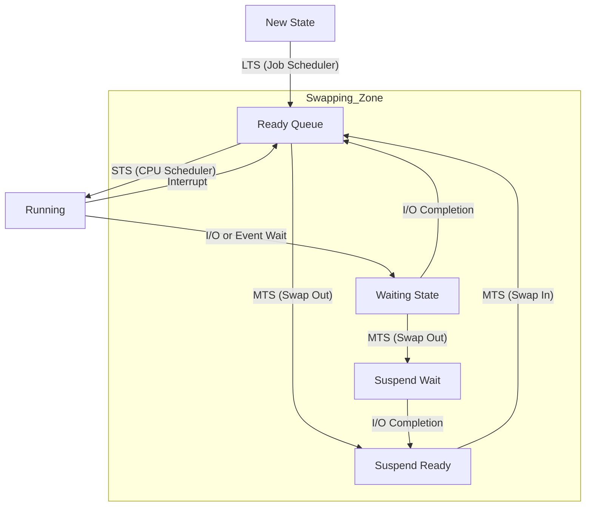

## Syllabus Position

Subject: [[Operating Systems]]
Parent Topic: [[Process Management]]
Sibling Topics: [[Process States]], [[Context Switching]]
Leads To: [[CPU Scheduling Algorithms]], [[Swapping]]

GATE Syllabus Line: Processes, Threads, CPU Scheduling.

Exam Weight Note: Frequently appears as 1-mark theoretical MCQ or as part of a larger 2-mark NAT on process state transitions.

## The Problem This Solves

An Operating System must manage hundreds of processes with limited CPU and RAM. If we load too many, the system thrashes; if we load too few, the CPU sits idle. If we pick the wrong process to run next, the system feels laggy.

Analogy: Think of a **Theme Park**. 
1. The **Long-term Scheduler** is the gatekeeper deciding who gets into the park (Job Pool $\rightarrow$ Park).
2. The **Short-term Scheduler** is the ride operator deciding who from the queue gets on the actual ride (Queue $\rightarrow$ Ride).
3. The **Medium-term Scheduler** is the security guard who asks people to wait in the parking lot if the park gets too crowded, bringing them back later (Park $\rightarrow$ Parking Lot $\rightarrow$ Park).

Core Idea (one sentence): Schedulers manage the flow of processes between different states to optimize system performance and the **[[Degree of Multiprogramming]]**.

## Formal Theory

### 1. [[Long-term Scheduler]] (Job Scheduler)
The LTS selects processes from a pool (usually on disk in a **[[Job Pool]]**) and loads them into memory for execution. 
- **Frequency:** Invoked infrequently (seconds or minutes).
- **Primary Goal:** Controls the **[[Degree of Multiprogramming]]** (total number of processes in memory).
- **Process Mix:** It strives for a good mix of **[[I/O-bound Processes]]** and **[[CPU-bound Processes]]**. If all are CPU-bound, the I/O waiting queue is empty; if all are I/O-bound, the CPU is idle.

### 2. [[Short-term Scheduler]] (CPU Scheduler)
The STS selects a process from the [[Ready Queue]] and allocates the CPU to it.
- **Frequency:** Invoked very frequently (milliseconds). It must be fast.
- **Primary Goal:** Maximize CPU utilization and minimize response time.
- **Dispatching:** The STS is often followed by the **[[Dispatcher]]**, which actually performs the [[Context Switch]].

### 3. [[Medium-term Scheduler]] (Swapper)
The MTS removes processes from memory (and from CPU contention) and later reintroduces them. This is known as **[[Swapping]]**.
- **Frequency:** Intermediate.
- **Primary Goal:** To reduce the [[Degree of Multiprogramming]] if the system is over-committed or to handle priority changes.
- **Action:** Moves processes from "Ready" or "Wait" states to **[[Suspend Ready]]** or **[[Suspend Wait]]** states on the backing store.

## Diagrams and Visuals

### Process State & Scheduler Interaction

**Drawing Instructions:**
1. Draw the standard 5-state process model.
2. Add "Suspend Ready" and "Suspend Wait" states at the bottom.
3. Label the arrows entering the system as LTS.
4. Label the arrow from Ready to Running as STS.
5. Label the arrows moving to/from Suspend states as MTS.

## Complexity Analysis

Schedulers themselves aren't usually analyzed via Big-O in GATE, but their *overhead* is critical:
- **LTS Overhead:** High per invocation, but low total because it's rare.
- **STS Overhead:** Must be extremely low (negligible). If STS takes 1ms to decide and the process runs for 10ms, 10% of CPU is wasted.
- **MTS Overhead:** High, as it involves Disk I/O (swapping).

## Worked Example

Imagine a system with:
- Job Pool: $\{P_1, P_2, P_3, P_4, P_5\}$
- Max Degree of Multiprogramming: 3

1. **LTS** picks $\{P_1, P_2, P_3\}$ and moves them to the [[Ready Queue]]. (Degree = 3).
2. **STS** picks $P_1$ to run.
3. $P_1$ requests I/O. **STS** picks $P_2$.
4. System detects memory pressure. **MTS** swaps out $P_3$ to disk. (Degree = 2).
5. **LTS** sees Degree < 3, picks $P_4$ from Job Pool. (Degree = 3).

## Intuition Anchors

**The Analogy (Deepened):**
The LTS is the **HR Department** (hiring people into the company), the STS is the **Project Manager** (assigning daily tasks), and the MTS is the **Sabbatical Policy** (sending employees home temporarily when there's no desk space).

**The Mental Model:**
Track the "Density of Memory". LTS is the faucet, MTS is the overflow valve, and STS is the internal stir-stick.

**The One-Line Recall:**
LTS = Job Pool to Ready; STS = Ready to CPU; MTS = Memory to Disk (Swapping).

**The #1 Trap:**
Thinking the STS controls the degree of multiprogramming. **No.** That is the job of the LTS (and partially MTS). STS only chooses *which* of the already-admitted processes runs.

## GATE Questions

---

**Question 1 — [GATE 2006] — [1-mark]**

Which of the following is responsible for controlling the degree of multiprogramming?
- (A) Short-term Scheduler
- (B) Long-term Scheduler
- (C) Mid-term Scheduler
- (D) Dispatcher

Solution

**Answer: (B)**

**Reasoning:**
The Long-term Scheduler (LTS) decides which jobs are admitted to the system. Since the number of processes in memory defines the degree of multiprogramming, the LTS is the primary controller.

**What this question is really testing:**
Definitions of scheduler roles.

**Trap to avoid:**
Choosing STS. STS only handles scheduling of processes already in memory.

---

**Question 2 — [Conceptual] — [2-mark]**

A system is experiencing heavy thrashing due to excessive page faults. Which scheduler should the OS invoke to alleviate this, and what action should it take?

Solution

**Answer: Medium-term Scheduler; Swap Out.**

**Reasoning:**
Thrashing occurs when the degree of multiprogramming is too high for the available physical memory. The Medium-term Scheduler (MTS) can reduce the degree of multiprogramming by swapping out processes to the backing store, freeing up frames for the remaining processes.

---

## Edge Cases and Failure Modes

- [ ] **LTS in Time-Sharing Systems:** In many modern OS (like Windows/Linux), the LTS is absent or minimal. Every user request starts a process immediately.
- [ ] **All CPU-bound Mix:** CPU utilization is 100%, but I/O devices are wasted.
- [ ] **All I/O-bound Mix:** CPU utilization drops significantly.
- [ ] **Overhead:** If STS is too complex, the system spends more time scheduling than executing (Scheduling Overhead).

## Comparisons

| Feature | [[Long-term Scheduler]] | [[Short-term Scheduler]] | [[Medium-term Scheduler]] |
| :--- | :--- | :--- | :--- |
| **Speed** | Slowest | Fastest | Intermediate |
| **Invoked on** | New Process Creation | Timer Interrupt / Block | Memory Pressure |
| **Target State** | Ready | Running | Suspend |
| **Controls DoM?** | Yes (Primary) | No | Yes (Secondary) |

## Connections Web

**Must know before this topic:**
- [[Process Control Block]] — Schedulers manipulate PCBs.
- [[Ready Queue]] — The primary data structure for STS.

**Topics that build on this:**
- [[CPU Scheduling Algorithms]] — The logic inside the STS.
- [[Swapping]] — The primary action of the MTS.
- [[Virtual Memory]] — More advanced memory management.

**GATE subject cross-links:**
- [[Operating Systems]] > [[Process Management]]

**Standard references:**
- [[Silberschatz OS Concepts Chapter 3]]

## Quick Revision Sheet

**Definition:** Schedulers are OS modules that handle process selection and state transitions.

**Algorithm Steps:**
1. LTS selects from Pool $\rightarrow$ Ready.
2. STS selects from Ready $\rightarrow$ CPU.
3. MTS selects from Ready/Wait $\rightarrow$ Disk (Swap out).

**Complexity:** STS must be $O(1)$ or very low $O(\log n)$.

**Key Properties:**
- LTS controls Degree of Multiprogramming.
- STS is invoked most frequently.
- MTS handles Swapping to handle memory over-commitment.

## Revision Checklist

- [ ] I can state the formal definition of all three schedulers.
- [ ] I can explain why modern OS might lack an LTS.
- [ ] I can draw the 7-state process model including suspend states.
- [ ] I know which scheduler controls the Degree of Multiprogramming.
- [ ] I have linked this note correctly in my Obsidian vault.
