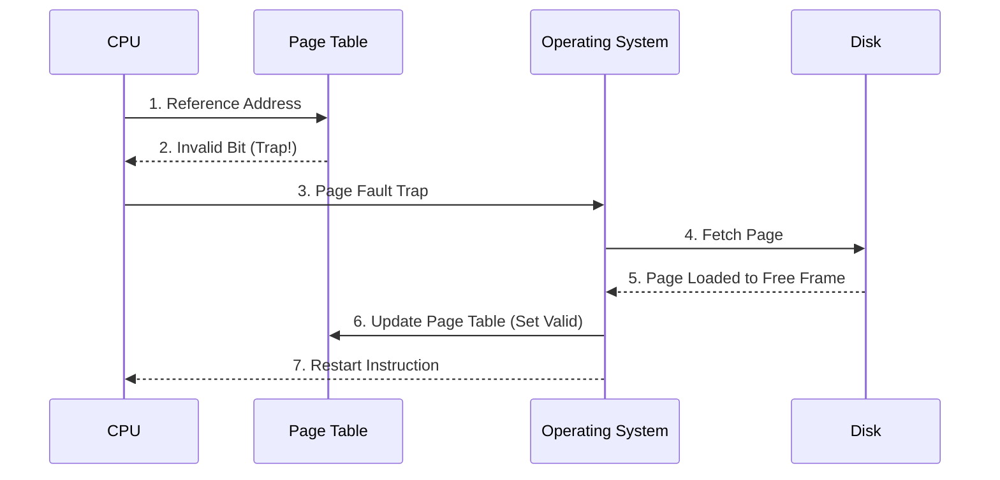

## Syllabus Position

**Subject:** [[Operating Systems]]
**Parent Topic:** [[Memory Management]]
**Sibling Topics:** [[Paging]], [[Segmentation]], [[Main Memory]]
**Leads To:** [[File Systems]], [[Security & Protection]]

> 📍 **GATE Syllabus Mapping:** "Virtual memory: Paging and segmentation. Page table and TLB. Page replacement algorithms. Thrashing."

**Exam Weight Note:** This is one of the most consistent topics in GATE OS. Expect at least one 2-mark numerical on **Effective Access Time (EAT)** or **Multi-level Page Tables**, and one conceptual question on **Belady's Anomaly** or **Thrashing**.

---

## 💡 Motivation & Intuition

### The Problem This Solves
In early computing, the size of a process was limited by the physical size of the RAM. If you had 4MB of RAM, you couldn't run a 5MB program. Furthermore, in multitasking, keeping entire processes in RAM leads to poor utilization because large parts of a program (error handling routines, rarely used features) are almost never executed.

### The Analogy
Imagine a **Chef's Workspace**. The **Countertop** is your [[Physical RAM]]. The **Pantry** is your [[Secondary Storage]] (Disk). 
- **Without Virtual Memory:** The chef must bring *every* ingredient for a 10-course meal onto the counter before starting. The counter gets cluttered, and you can only cook one meal at a time.
- **With Virtual Memory:** The chef keeps only the ingredients for the *current* course on the counter. If they need salt for the next course, they go to the pantry, grab it, and maybe put the finished appetizer back in the fridge to make space. This allows the chef to "cook" a meal much larger than the counter space.

**Core Idea (The Elevator Pitch):**
Virtual Memory is a technique that allows the execution of processes that are not completely in [[Main Memory]], creating an illusion of a much larger, contiguous address space for the user than what physically exists.

---

## 📖 Theory

### 1. [[Demand Paging]]
Instead of loading the whole process, we load pages only when they are demanded (requested).
- **Lazy Swapper:** Never swaps a page into memory unless it will be needed.
- **Valid-Invalid Bit:** A bit in the [[Page Table]] entry. 
    - `V`: Page is in memory.
    - `I`: Page is not in memory (results in a **Page Fault**).

### 2. The [[Page Fault]] Mechanism
When a process tries to access a page marked `I`:
1. Trap to the OS.
2. OS checks the Internal Table to see if the reference was valid.
3. If invalid, terminate. If valid, find a free frame.
4. Schedule a disk operation to read the page into the frame.
5. Update the Page Table (bit to `V`).
6. Restart the instruction that caused the trap.

### 3. [[Translation Lookaside Buffer (TLB)]]
A hardware cache of the [[Page Table]] used to speed up address translation. 
- **TLB Hit:** Address found in TLB (Fast).
- **TLB Miss:** Must look in the Page Table in RAM (Slow).

### 4. [[Dirty Bit]] (Modified Bit)
A bit set by hardware whenever a page is written to. 
- **Optimization:** During [[Page Replacement]], if the dirty bit is `0`, the page hasn't changed. We can simply discard it instead of writing it back to disk, saving a costly I/O operation.

### 5. [[Copy-on-Write (COW)]]
Used during `fork()`. Parent and child share the same pages initially. Pages are marked "Copy-on-write". Only when one process modifies a page is a physical copy created.

---

## 🖼️ Diagrams & Visuals

### Page Fault Handling Flow


### Logical to Physical Translation with TLB
```
Logical Address: [ Page # (p) | Offset (d) ]
                 |
        _________v_________
       |       TLB         |--- Hit ---> [ Frame # (f) ] ---+
       |___________________|                                |
                 |                                          |
                Miss                                        |
                 |                                          |
        _________v_________                                 |
       |    Page Table     |--- Valid --> [ Frame # (f) ] --+
       |___________________|                                |
                 |                                          |
              Invalid                                       |
                 |                                          v
            (Page Fault)                     Physical Address: [ f | d ]
```

---

## ⏱️ Complexity Analysis

### 1. Effective Access Time (EAT) with TLB
Let:
- $h = \text{TLB Hit Ratio}$
- $t = \text{TLB Access Time}$
- $m = \text{Main Memory Access Time}$

$$EAT = h(t + m) + (1-h)(t + 2m)$$
*Note: In $(1-h)$ case, we access TLB ($t$), find it's a miss, then access Page Table in RAM ($m$), then access the actual data in RAM ($m$). Total $t + 2m$.*

### 2. Effective Access Time (EAT) with Page Faults
Let:
- $p = \text{Page Fault Rate } (0 \le p \le 1)$
- $ma = \text{Memory Access Time}$
- $pfs = \text{Page Fault Service Time}$

$$EAT = (1-p) \times ma + p \times pfs$$
*Justification: If no fault $(1-p)$, we just access memory. If fault $(p)$, we incur the massive overhead of disk I/O.*

---

## 🔢 Worked Example

**Scenario:** We have **3 Frames** and the reference string: `7, 0, 1, 2, 0, 3, 0`.

### 1. FIFO (First-In-First-Out)
| Ref | F1 | F2 | F3 | Fault? |
|-----|----|----|----|--------|
| 7   | 7  |    |    | Yes    |
| 0   | 7  | 0  |    | Yes    |
| 1   | 7  | 0  | 1  | Yes    |
| 2   | 2  | 0  | 1  | Yes (7 out) |
| 0   | 2  | 0  | 1  | No     |
| 3   | 2  | 3  | 1  | Yes (0 out) |
| 0   | 2  | 3  | 0  | Yes (1 out) |
**Total Faults: 6**

### 2. LRU (Least Recently Used)
| Ref | F1 | F2 | F3 | Fault? |
|-----|----|----|----|--------|
| 7   | 7  |    |    | Yes    |
| 0   | 7  | 0  |    | Yes    |
| 1   | 7  | 0  | 1  | Yes    |
| 2   | 2  | 0  | 1  | Yes (7 is oldest used) |
| 0   | 2  | 0  | 1  | No     |
| 3   | 2  | 0  | 3  | Yes (1 is oldest used) |
| 0   | 2  | 0  | 3  | No     |
**Total Faults: 5**

---

## 🎯 GATE Questions

**Question 1 — (GATE 2014) — [Numerical]**
> A system uses 2-level paging. The logical address is 32 bits. Page size is 4KB. Page table entry (PTE) is 4 bytes. What is the size of the outer page table?
- (A) 4 KB
- (B) 1 MB
- (C) 4 MB
- (D) 2 KB

<details>
<summary>💡 Solution (click to reveal)</summary>

**Answer: (A)**

**Reasoning:**
1. Page size = $4KB = 2^{12}$ bytes. Offset (d) = 12 bits.
2. Remaining bits for Page Number (p) = $32 - 12 = 20$ bits.
3. In 2-level paging, p is split into $p_1$ and $p_2$.
4. Inner page table must fit in one page. Page size / PTE size = $4KB / 4B = 1024$ entries.
5. $1024 = 2^{10}$. So $p_2 = 10$ bits.
6. $p_1 = 20 - 10 = 10$ bits.
7. Outer page table has $2^{p1} = 2^{10} = 1024$ entries.
8. Size = $1024 \times 4B = 4KB$.

**Trap to avoid:** Thinking the outer table always fills a page. It often does in balanced systems, but you must calculate based on the bits.
</details>

---

**Question 2 — (GATE-style) — [Conceptual]**
> Which of the following statements is FALSE?
- (A) Optimal page replacement is used as a benchmark.
- (B) FIFO can exhibit Belady's Anomaly.
- (C) LRU always performs better than FIFO.
- (D) Thrashing increases CPU utilization.

<details>
<summary>💡 Solution (click to reveal)</summary>

**Answer: (D)**

**Reasoning:**
- (A) True: OPT is unimplementable because it requires future knowledge.
- (B) True: Standard property of FIFO.
- (C) True/General: LRU is a "stack algorithm" and never suffers from Belady's.
- (D) **FALSE**: Thrashing happens when the OS spends more time swapping than executing. CPU utilization drops sharply, leading the OS to mistakenly think it should increase multiprogramming, making the problem worse.

</details>

---

## ⚠️ Edge Cases & Traps

- [ ] **Belady's Anomaly:** Increasing the number of frames can *increase* page faults in FIFO. Does NOT happen in LRU or Optimal (Stack Algorithms).
- [ ] **Thrashing:** A state where $p \approx 1$. Fix: Reduce multiprogramming or use [[Working Set Model]].
- [ ] **Page Size Trade-off:**
    - Small Page: Less [[Internal Fragmentation]], but larger [[Page Table]] size.
    - Large Page: Better I/O efficiency, but more internal fragmentation.
- [ ] **Integer Overflow:** In EAT calculations, ensure units are consistent (ns vs ms). $1ms = 10^6 ns$.

---

## ⚖️ Comparisons

| Feature | [[FIFO]] | [[LRU]] | [[Optimal]] |
| :--- | :--- | :--- | :--- |
| **Strategy** | Oldest page brought in | Page not used for longest time | Page that won't be used for longest |
| **Belady's?** | **Yes** | No | No |
| **Implementation** | Easy (Queue) | Hard (Counters/Stack) | Impossible (Future) |
| **Performance** | Poor | Good | Perfect |

---

## 🧠 Memory Hooks

1. **Mnemonic for Belady's:** "FIFO is FOO (First Out, Often worse)".
2. **Visual Metaphor:** **The Lazy Swapper**. The OS is a lazy student who only reads the specific page of the textbook assigned *exactly* when the teacher asks a question.
3. **Quick-Recall Formula:** $EAT = (1-p)ma + p(pfs)$. Note that $pfs$ is usually $10^5 \times ma$. Even $p=0.001$ can double the EAT.

---

## 🕸️ Connections Web

**Must know before:**
- [[Paging]] — Basic mapping mechanism
- [[Main Memory]] — Physical constraints

**Builds on this:**
- [[Thrashing]] — Consequences of poor management
- [[Working Set Model]] — Handling thrashing
- [[Segmentation]] — Alternative logical mapping

**GATE Subject Links:**
- [[Computer Organization]] — Cache memory principles (TLB is a cache)
- [[Algorithms]] — LRU is implemented using Doubly Linked Lists and HashMaps.

**Standard References:**
- [[Galvin Chapter 9]]
- [[Tanenbaum Section 3.4]]

---

## ✅ Revision Checklist
- [ ] I can derive the EAT formula for both TLB and Page Faults.
- [ ] I can trace a string using LRU vs FIFO without mistakes.
- [ ] I understand why Belady's Anomaly happens (FIFO doesn't respect the "stack property").
- [ ] I can calculate 2-level page table sizes.
- [ ] I have linked this note to my [[Operating Systems]] index.

---
## Quick Revision Sheet

**Definition:** Memory management technique that allows execution of processes not entirely in RAM.
**Core Idea:** Demand Paging - Load pages only when accessed.
**EAT (Page Fault):** $EAT = (1-p)ma + p \cdot pfs$
**Page Replacement:**
- **FIFO:** Simple, suffers from Belady's Anomaly.
- **LRU:** Uses past to predict future. No Belady's.
- **Optimal:** Future-based. Minimum faults.
**Thrashing:** High page fault rate $\rightarrow$ CPU utilization drops $\rightarrow$ OS increases degree of multiprogramming $\rightarrow$ System collapses.
**Key Trap:** In 2-level paging, the outer page table entries point to *inner* page tables, not frames. Only inner PTEs point to frames.
