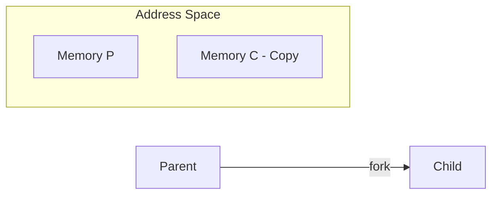
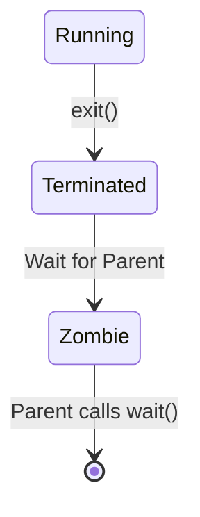

## Syllabus Position

Subject: [[Operating Systems]]
Parent Topic: [[Process]]
Sibling Topics: [[Process States]], [[Process Control Block]]
Leads To: [[Inter-Process Communication]]

GATE Syllabus Line: "Processes, Threads... Process Management."

Exam Weight Note: Frequently appears as conceptual MCQs about termination conditions or `fork()` behavior.

## The Problem This Solves

Processes don't just appear out of thin air. There is a hierarchy. If you kill a parent, what happens to the children? If a child finishes, who cleans up after it? We need a set of rules to manage these relationships to prevent "garbage" processes from clogging up the system.

Analogy: Think of a **Dynasty**. 
- The **Parent** creates the **Child** and gives them a copy of the family business.
- If the Child finishes their job, they report back to the Parent (**Zombie** stage).
- If the Parent dies first, the Child becomes an **Orphan** and is adopted by a "Grandparent" (the `init` process).

Core Idea: Processes exist in a parent-child relationship forming a tree structure.

## Formal Theory

### 1. Process Creation
Processes are created using the `fork()` system call.
- **Parent**: Receives the **PID of the child** from `fork()`.
- **Child**: Receives **0** from `fork()`.
- The child is a duplicate of the parent (same variables, same PC) but in a **different address space**.

### 2. Zombie Process
A process that has completed execution (called `exit()`) but still has an entry in the **Process Table**.
- **Reason**: The parent hasn't yet called `wait()` to read the child's exit status.
- **Problem**: It consumes a PID and a slot in the process table.

### 3. Orphan Process
A process whose parent has terminated or finished before the child.
- **Solution**: The OS re-parents orphan processes to the `init` process (PID 1). `init` periodically calls `wait()` to clean them up.

### 4. Degree of Multiprogramming
The total number of processes currently in memory. The OS tries to balance this to keep the CPU busy without causing [[Thrashing]].

## Diagrams and Visuals

### Fork Behavior


### Zombie State


## Complexity Analysis
- **Fork Overhead**: $O(V)$ where $V$ is memory size, but reduced to $O(1)$ via **Copy-on-Write (COW)**.
- **Wait Complexity**: $O(1)$ to check PCB status.

## Worked Example
**Code Segment:**
```c
if (fork() == 0) {
    printf("I am child");
    exit(0);
} else {
    sleep(100); // Parent sleeps, doesn't call wait()
    printf("I am parent");
}
```
**Trace:**
1. `fork()` called. Two processes now exist.
2. Child enters `if` (receives 0), prints, and exits.
3. Child becomes a **Zombie** because parent is sleeping and hasn't called `wait()`.
4. After 100s, parent wakes up, prints, and finishes.
5. OS cleans up both.

## Intuition Anchors

**The Mental Model:**
A **Zombie** is "Dead but still walking in the process table."
An **Orphan** is "Still walking but its parent is dead."

**The One-Line Recall:**
Zombie = Finished but not reaped. Orphan = Parent died before child.

**The #1 Trap:**
**Thinking Orphans are bad for the system.**
- **Correction**: Orphans are harmless because `init` adopts them and cleans them up. **Zombies** are the real problem because if the parent never calls `wait()`, that process table slot is gone forever until a reboot.

## GATE Questions

**Question 1 — [GATE 2004] — [2-mark]**
> A process terminates and becomes a zombie. The primary reason for this is:
- (A) To allow the child to finish its I/O
- (B) To allow the parent to read the child's exit status
- (C) To save the child's registers for later use
- (D) Because the CPU is too busy to clean it up

<details>
<summary>Solution</summary>

**Answer: (B)**

**Reasoning:**
The OS keeps the PCB of the finished child in the process table so that the parent can retrieve information like exit code and execution time. Only after the parent calls `wait()` is the entry removed.

</details>

---

**Question 2 — [Conceptual] — [1-mark]**
> What happens to a child process when its parent process terminates?
- (A) It is automatically terminated
- (B) it becomes a Zombie
- (C) It is adopted by the `init` process
- (D) It halts until a new parent is assigned

<details>
<summary>Solution</summary>

**Answer: (C)**

**Reasoning:**
This is the definition of an **Orphan** process. The OS prevents "parentless" processes by assigning them to the `init` process (PID 1).

</details>

## Edge Cases and Failure Modes
- [ ] **Fork Bomb**: A process that repeatedly forks itself to exhaust the process table, causing a denial of service.
- [ ] **Init Death**: If the `init` process crashes, the whole system usually panics and shuts down.

## Comparisons

| Feature | Zombie | Orphan |
|---------|--------|--------|
| Process Status | Terminated | Running |
| In Process Table? | Yes | Yes |
| CPU Usage | Zero | Active |
| Parent | Alive | Dead |
| Solution | Parent calls `wait()` | Adopted by `init` |

## Connections Web
**Must know before:**
- [[Process]]
- [[Process Control Block]]

**Topics that build on this:**
- [[Inter-Process Communication]]
- [[Process Management]]
- [[System Calls]]

**Standard references:**
- [[Silberschatz Chapter 3.3 & 3.4]]

## Quick Revision Sheet
- **Fork**: Parent gets PID, Child gets 0.
- **Zombie**: Child exits, parent hasn't `wait()`-ed.
- **Orphan**: Parent exits, child still running (Adopter: `init`).
- **Degree of Multiprogramming**: Max number of processes in memory.
- **Trap**: Zombies waste process table slots, Orphans do not.

## Revision Checklist
- [ ] I can define Zombie and Orphan processes.
- [ ] I know why `init` is important for orphans.
- [ ] I understand the return values of `fork()`.
- [ ] I can explain the purpose of the `wait()` system call.
助けが必要ですか？
