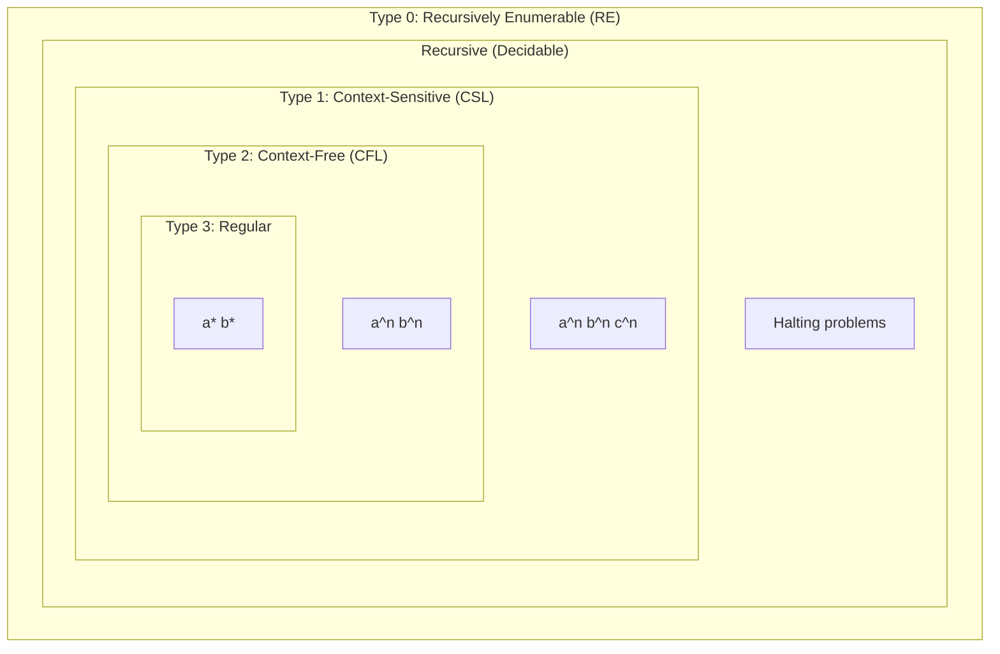

##  Context
**Subject:** [[Theory Of Computation Index]]
**Parent Topic:** [[Turing Machines]]
**Sibling Topics:** [[Regular Languages Definition]], [[Chomsky Normal Form]], [[Recursively Enumerable Languages]]
**Leads To:** [[Decidability Core Definition]], [[Undecidability In Toc]]

>  **GATE Syllabus Mapping:** Chomsky hierarchy of languages: regular, context-free, context-sensitive, and recursively enumerable languages.

---

##  Motivation & Intuition
If [[Theory Of Computation Index|Toc]] is a city, the **Chomsky Hierarchy** is its map. It organizes every type of language from simplest (the ones your TV remote uses) to the most complex (the ones that run modern physics simulations).

**Analogy:** A nested set of Russian Dolls.
The smallest doll (Regular) fits inside the next one (Context-Free), and so on. As the dolls get bigger, the "brain" (the machine) needed to understand them gets more complex.

**Core Idea:** Languages are classified into 4 types based on the **power of the machine** needed to recognize them.

---

##  Theory

### The Four Layers of the Hierarchy

| Type | Language | Machine | Grammar Rule ($\alpha \rightarrow \beta$) |
| :--- | :--- | :--- | :--- |
| **Type 3** | **[[Regular Languages Definition\|Regular]]** | [[DFA\|Dfa/Nfa]] | $A \rightarrow aB$ or $A \rightarrow a$ |
| **Type 2** | **Context-Free (CFL)** | [[Decision Properties Of Cfls\|Pda]] | $A \rightarrow \gamma$ ($A \in V$) |
| **Type 1** | **Context-Sensitive (CSL)**| LBA | $|\alpha| \leq |\beta|$ |
| **Type 0** | **[[Recursively Enumerable Languages\|Re]]** | [[Turing Machines\|Tm]] | No restrictions |

### Inclusion Property
The hierarchy is **strictly nested**:
$$\text{Regular} \subset \text{Context-Free} \subset \text{Context-Sensitive} \subset \text{Recursive} \subset \text{Recursively Enumerable}$$

---

##  Diagrams & Visuals

### Chomsky Hierarchy Diagram

**Description:**
- Every inner circle is **completely contained** within the outer circles.
- **Regular** is the most restricted, **RE** is the most general.

---

##  Complexity Analysis
As we go **up** the hierarchy:
- **Expressive Power** increases.
- **Decidability** decreases.
- **Machine complexity** (Memory) increases.
  - Type 3: Constant memory ([[DFA]]).
  - Type 2: One stack ([[Pda]]).
  - Type 1: Memory proportional to input (LBA).
  - Type 0: Infinite memory ([[Turing Machines]]).

---

##  Worked Example

**Question:** To which type(s) does the language $L = \{a^n b^n \mid n \geq 0\}$ belong?
1. **Is it Regular?** No, requires counting. Not Type 3.
2. **Is it Context-Free?** Yes, a simple CFG exists ($S \rightarrow aSb \mid \epsilon$). So it's **Type 2**.
3. **Is it Type 1, 0?** Since Type 2 is a subset of Type 1 and Type 0, it **also** belongs to Type 1 and Type 0.

**Answer:** It is Type 2, Type 1, and Type 0.

---

##  GATE Questions

**Question 1 (GATE-2005):**
Every context-free language is:
- (A) Regular.
- (B) Context-sensitive.
- (C) Deterministic context-free.
- (D) Recursive.

 Solution (click to reveal)

**Answer: (B) and (D)**

**Reasoning:**
- The hierarchy is $Regular \subset CFL \subset CSL \subset Recursive \subset RE$.
- Thus, every CFL is **Context-sensitive** (B) and **Recursive** (D).
- Note: (D) is the "strongest" correct answer, as all CFLs are decidable.

---

##  Edge Cases & Traps
- [ ] **Recursive vs RE:** Recursive languages (Decidable) sit between CSL and RE. They are NOT a "Type" in the original 4-type hierarchy but are crucial for GATE.
- [ ] **Empty Strings:** All types can handle $\epsilon$, except sometimes Type 1 depends on the formal definition.
- [ ] **Closure Properties:** Closure under complement fails for CFL and RE, but holds for Regular and Recursive.

---

##  Comparisons

| Language | Complement? | Intersection? | Decision (Member)? |
| :--- | :--- | :--- | :--- |
| **Regular** | Yes | Yes | $O(n)$ |
| **CFL** | **No** | **No** | $O(n^3)$ |
| **CSL** | Yes | Yes | PSPACE |
| **Recursive** | Yes | Yes | Decidable |
| **RE** | **No** | Yes | **Undecidable** |

---

##  Memory Hooks
- **"3-2-1-0"**: The Types get smaller as they get more powerful.
- **"Reg-CF-CS-RE"**: The standard mnemonic (Regular, Context-Free, Context-Sensitive, RE).
- **"The Memory Chain"**: Constant $\rightarrow$ Stack $\rightarrow$ Proportional $\rightarrow$ Infinite.

---

##  Connections Web
- [[Regular Languages Definition]] $\rightarrow$ Type 3.
- [[Chomsky Normal Form]] $\rightarrow$ Type 2.
- [[Turing Machines]] $\rightarrow$ Type 0.
- [[Decidability Core Definition]] $\rightarrow$ Type 0 vs Recursive.

---

##  Revision Checklist
- [ ] I can draw the inclusion diagram from memory.
- [ ] I know the machine associated with each type.
- [ ] I understand the constraints on production rules for each type.
- [ ] I have linked this to the [[Theory Of Computation Index]].

---
 Note created: Chomsky_Hierarchy.md
   Sections: 13/13 complete
   Wiki Links: 15 found
   Estimated read time: 6 minutes
