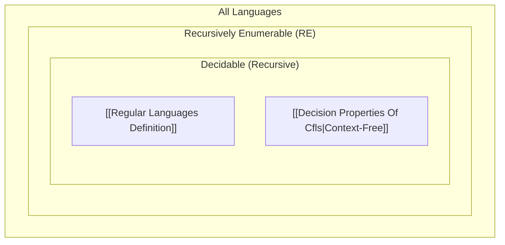

##  Context
**Subject:** [[Theory Of Computation Index]]
**Parent Topic:** [[Turing Machines]]
**Sibling Topics:** [[Chomsky Hierarchy]], [[Recursively Enumerable Languages]]
**Leads To:** [[Undecidability In Toc]], [[Rices Theorem]], [[Post Correspondence Problem]]

>  **GATE Syllabus Mapping:** Decidability and Undecidability; Rice's Theorem; Halting Problem; Recursive and Recursively Enumerable languages.

---

##  Motivation & Intuition
In the world of computation, not everything that can be "defined" can be "solved." **Decidability** is the boundary between problems that a computer can definitively answer (Yes/No) and those where it might stay silent (loop) forever.

**Analogy:** Imagine a math teacher (The [[Turing Machines]]).
1. **Decidable:** The teacher looks at a problem, calculates, and always tells you "Correct" or "Incorrect."
2. **Recognizable (RE):** The teacher can confirm if you are "Correct," but if you are "Incorrect," they might just stare at the board forever without saying a word.
3. **Undecidable:** No such teacher can ever exist for that specific problem.

**Core Idea:** A problem is **Decidable** if there exists an algorithm (a [[Turing Machines]] that always halts) that correctly classifies every instance of the problem.

---

##  Theory

### 1. Decision Problems vs. Function Problems
- **Decision Problem:** A problem with a Yes/No answer (e.g., "Is $n$ prime?"). Formally, this is equivalent to checking if a string $w$ belongs to a language $L$.
- **Function Problem:** A problem that computes a value (e.g., "What is the prime factorization of $n$?").
- GATE focus is almost exclusively on **Decision Problems**.

### 2. Formal Definition of Decidability
A language $L \subseteq \Sigma^*$ is **Decidable** (also called **Recursive**) if there exists a [[Turing Machines]] $M$ such that for every input string $w \in \Sigma^*$:
1. If $w \in L$, $M$ halts in the **Accept** state.
2. If $w \notin L$, $M$ halts in the **Reject** state.

>  **Crucial Point:** A Decider $M$ **never loops**. It is a total function from strings to $\{Accept, Reject\}$.

### 3. The Three Classes of Languages
1. **Decidable (Recursive):** TM halts on ALL inputs.
2. **Recognizable (Recursively Enumerable - RE):** TM halts and accepts if $w \in L$, but may **loop or reject** if $w \notin L$.
3. **Non-RE:** No TM can even recognize the "Yes" instances reliably.

---

##  Diagrams & Visuals

### Language Hierarchy (Venn Diagram)

**Description:**
- The innermost circle contains **Regular Languages**.
- The next contains **CFLs** (which are all Decidable).
- The **Decidable** circle contains problems where we can always say Yes or No.
- The **RE** circle contains problems where we can say Yes, but No might be a loop.
- Outside **RE** are problems that are completely "uncomputable."

---

##  Complexity Analysis
Decidability doesn't care about *how long* it takes (Time Complexity), only that it *eventually* finishes. However, for GATE, remember:
- All [[Regular Languages Definition]] are decidable in $O(n)$ time using a [[DFA]].
- All [[Decision Properties Of Cfls|Cfls]] are decidable in $O(n^3)$ time using the [[CYK Algorithm]].
- If a language is **Decidable**, its complement $\bar{L}$ is also **Decidable**.

---

##  Worked Example

**Problem:** Prove that $A_{DFA} = \{ \langle B, w \rangle \mid B \text{ is a DFA that accepts } w \}$ is decidable.

**Step-by-Step Decider $M$:**
1. Input: $\langle B, w \rangle$.
2. Simulate $B$ on input $w$. (Since $B$ is a [[DFA]], it is guaranteed to process $w$ and finish).
3. If the simulation ends in an accept state of $B$, **Accept**.
4. If the simulation ends in a non-accept state of $B$, **Reject**.

**Analysis:** Since a [[DFA]] always halts after $|w|$ steps, our decider $M$ always halts. Thus, $A_{DFA}$ is decidable.

---

##  GATE Questions

**Question 1 (GATE-style):**
Which of the following statements is TRUE?
- (A) Every subset of a decidable language is decidable.
- (B) The complement of a recursively enumerable language is always recursively enumerable.
- (C) If a language $L$ and its complement $\bar{L}$ are both RE, then $L$ is decidable.
- (D) If $L$ is undecidable, then $L$ cannot be RE.

 Solution (click to reveal)

**Answer: (C)**

**Reasoning:**
- (A) False. A subset can be much more complex (e.g., a non-RE subset of $\Sigma^*$).
- (B) False. This is the definition of **Co-RE**. If $L$ is RE but not decidable (like $A_{TM}$), $\bar{L}$ is NOT RE.
- (C) **True.** This is a fundamental theorem. If we can semi-decide "Yes" (RE) and semi-decide "No" (Co-RE), we can run both TMs in parallel and one will eventually halt, making it Decidable.
- (D) False. The Halting Problem ($ATM$) is RE but undecidable.

---

##  Edge Cases & Traps
- [ ] **Decidable vs. Finite:** A language can be infinite yet decidable (e.g., all even numbers). Do not confuse finiteness with decidability.
- [ ] **Halting on Reject:** A decider MUST halt on reject. A recognizer (RE) only MUST halt on accept.
- [ ] **Syntactic vs. Semantic:** Rice's Theorem applies to *semantic* properties (language properties), not *syntactic* properties (TM structure).

---

##  Comparisons

| Feature | Decidable (Recursive) | Recognizable (RE) |
| :--- | :--- | :--- |
| **Halts on $w \in L$** | Yes (Accepts) | Yes (Accepts) |
| **Halts on $w \notin L$** | Yes (Rejects) | **No (May loop)** |
| **Closed under Complement?** | Yes | No |
| **Model** | Total Turing Machine | Standard Turing Machine |

---

##  Memory Hooks
- **Decidable = "Definitely"**: We definitely get an answer.
- **RE = "Relentless"**: The TM will relentlessly search for an "Accept" but won't tell you if it's lost in a loop.
- **The Decidability Shortcut:** If you can draw a flow-chart that finishes for any input, it's decidable.

---

##  Connections Web
- [[Regular Languages Definition]] $\rightarrow$ Always Decidable.
- [[Decision Properties Of Cfls]] $\rightarrow$ Most are decidable, Equivalence is NOT.
- [[Undecidability In Toc]] $\rightarrow$ The next step.
- [[Rices Theorem]] $\rightarrow$ The "Nuclear Option" for proving undecidability.

---

##  Revision Checklist
- [ ] I can define the difference between RE and Recursive.
- [ ] I understand why $L \in RE \cap Co-RE \iff L \in \text{Decidable}$.
- [ ] I know that membership for [[DFA]] and [[Chomsky Normal Form|Cfg]] is decidable.
- [ ] I have linked this to the [[Theory Of Computation Index]].

---
 Note created: Decidability_Core_Definition.md
   Sections: 13/13 complete
   Wiki Links: 15 found
   Estimated read time: 6 minutes
