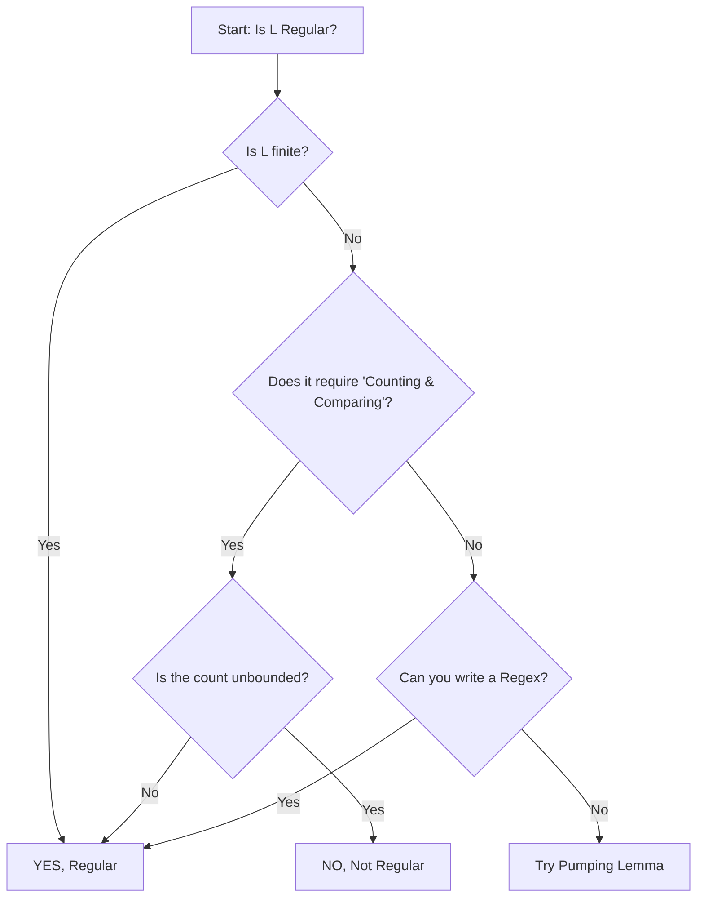

##  Context
**Subject:** [[Theory Of Computation]]
**Parent Topic:** [[Regular Languages Definition]]
**Sibling Topics:** [[Pumping Lemma]], [[Closure Properties Of Regular Languages]]
**Leads To:** [[Decision Properties Of Regular Languages]]

>  **GATE Syllabus Mapping:** Regular and context-free languages, pumping lemma.

##  Motivation & Intuition
In the GATE exam, the most common TOC question is: **"Is this language Regular?"** This note provides a systematic **flowchart** to answer that question without getting stuck in theoretical weeds.

**Core Idea:** Try to **prove** it's regular (FA, RE, RG) first. If you fail, try to **disprove** it (Pumping Lemma, Myhill-Nerode).

##  Theory
### A language $L$ is regular IF:
1. **Finite:** Every finite language is regular.
2. **Construction:** You can draw a [[Dfa Deterministic Finite Automata]] or [[Nfa Nondeterministic Finite Automata]] for it.
3. **Description:** You can write a [[Regular Expressions]] for it.
4. **Grammar:** You can write a [[Regular Grammar]] (Right or Left linear) for it.
5. **Closure:** $L$ is a result of a regular operation on other regular languages (Union, Intersection, etc. - see [[Closure Properties Of Regular Languages]]).

### A language $L$ is NOT regular IF:
1. **Memory Requirement:** It needs to "remember" an unbounded count and compare it later ($a^n b^n$).
2. **Infinite and Unbounded:** It involves non-linear relations like $n^2, 2^n, n!$.
3. **Pumping Lemma Fails:** You can't split a long string and pump the middle (see [[Pumping Lemma For Regular Languages]]).
4. **Infinite Index:** It has an infinite number of equivalence classes (see [[Myhill Nerode Theorem]]).

##  Diagrams & Visuals

##  Complexity Analysis
In the exam, your "complexity" is **time**. Use the **Shortcuts**!

### Identification Shortcuts
| Language Form | Status | Why? |
|---------------|--------|------|
| $\{a^n b^m \mid n, m < 100\}$ | **Regular** | Finite. |
| $\{a^n b^n \mid n \ge 0\}$ | **Not Regular** | Unbounded comparison. |
| $\{a^n b^m \mid n+m \text{ is even}\}$ | **Regular** | Needs only parity (finite state). |
| $\{a^p \mid p \text{ is prime}\}$ | **Not Regular** | No linear pattern. |
| $\{a^{2^n}\}$ | **Not Regular** | Gap between strings increases. |
| $\{w w^R \mid w \in \{a,b\}^*\}$ | **Not Regular** | Stack needed for palindrome. |

##  Worked Example
**Is $L = \{w \mid \text{number of 'a's is equal to number of 'b's in any order}\}$ regular?**
1. **Attempt DFA:** Can a DFA count $a$'s and $b$'s without limit? No.
2. **Attempt Regex:** No way to enforce equal counts.
3. **Pumping Lemma:**
   - Let $s = a^p b^p$.
   - Split $s = xyz$ where $|xy| \le p$.
   - $y = a^k$ ($k > 0$).
   - Pump $i=2 \implies a^{p+k} b^p$.
   - $a^{p+k} b^p \notin L$.
4. **Conclusion:** NOT Regular. (This is a [[Context Free Languages]]).

##  GATE Questions
**Question:** Which of the following is regular?
(A) $L = \{x y x^R \mid x, y \in \{a, b\}^+\}$
(B) $L = \{w x w^R \mid w, x \in \{a, b\}^+\}$
(C) $L = \{x \mid \text{count of 'a's} = \text{count of 'b's}\}$
(D) $L = \{a^n b^n \mid n \ge 10^{100}\}$

 Solution

**Answer: (A)**
- (C) is non-regular (unbounded counting).
- (D) is non-regular (unbounded $n$).
- (A) and (B) look similar. In (A), $x$ and $y$ are non-empty. For any string that starts and ends with the same symbol (like `aba`), we can say $x = a$, $y = b$, $x^R = a$. In fact, $(a+b)^+$ can be written as $x y x^R$ if the string has length $\ge 3$ and starts/ends the same.
- **Wait, why (A)?** Because we can pick $x$ to be very short (length 1). If we can find **any** way to make it regular, it is. If $y$ is $(a+b)^*$, then $a(a+b)^*a$ and $b(a+b)^*b$ are both regular.
- (B) is also regular if $x$ can absorb the complexity!
- **Trap:** GATE loves "tricky" regular expressions that look like context-free but can be simplified!

##  Edge Cases & Traps
- [ ] **Constant Bound:** $\{a^n b^n \mid n \le 10^6\}$ is **REGULAR** because it's finite.
- [ ] **Parity/Modulo:** $\{a^n \mid n \text{ is even}\}$ is **REGULAR**. Modulo arithmetic is finite-state.
- [ ] **Complement of Non-Regular:** Is often non-regular (e.g., complement of $a^n b^n$ is non-regular).

##  Comparisons
| Feature | Regular | Non-Regular |
|---------|---------|-------------|
| Memory | Finite | Infinite |
| FA | Exists | Does not exist |
| Pumping | Always works | Can fail |

##  Memory Hooks
- **"The Modulo Rule":** If the condition only cares about **remainders** (even, odd, multiple of 3), it is **REGULAR**.
- **"The Compare Rule":** If you have to compare two variables that can both go to infinity ($n, m$ where $n=m$), it is **NOT REGULAR**.

##  Connections Web
- [[Pumping Lemma For Regular Languages]]  Tool for "NO".
- [[Myhill Nerode Theorem]]  Advanced tool for "NO".
- [[Closure Properties Of Regular Languages]]  Tool for building from components.

##  Revision Checklist
- [ ] I can distinguish between $a^n b^m$ and $a^n b^n$.
- [ ] I know that every finite language is regular.
- [ ] I understand that modulo-based languages are always regular.
- [ ] I can apply the "Memory Test" to any language in under 30 seconds.
