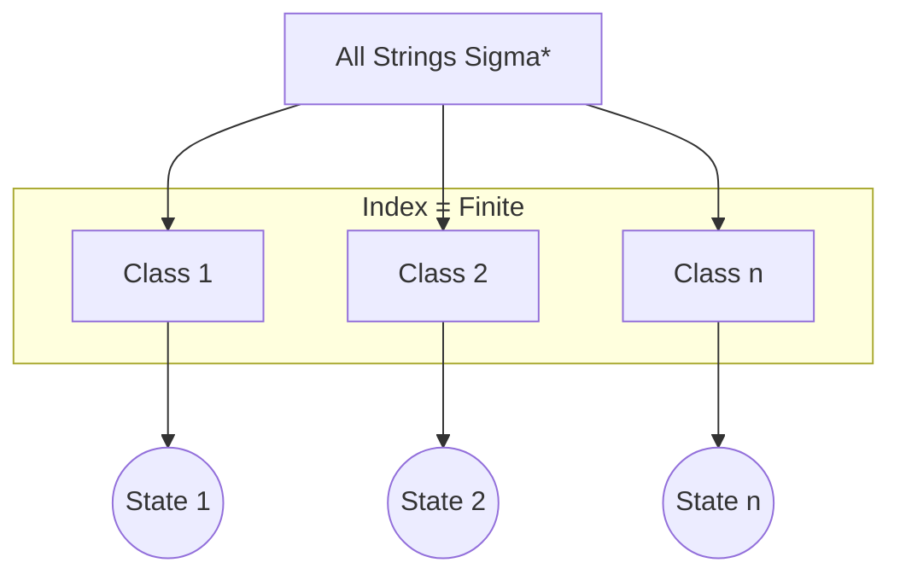

##  Context
**Subject:** [[Theory Of Computation]]
**Parent Topic:** [[Regular Languages Definition]]
**Sibling Topics:** [[Pumping Lemma]]
**Leads To:** [[DFA Minimization]]

>  **GATE Syllabus Mapping:** Regular expressions and finite automata. DFA minimization and equivalence.

##  Motivation & Intuition
The **Myhill-Nerode Theorem** is the ultimate mathematical foundation of regular languages. While the [[Pumping Lemma]] is a "necessary" condition, Myhill-Nerode is **"necessary and sufficient."** It doesn't just tell you IF a language is regularit also tells you EXACTLY how many states its **minimal DFA** will have.

**Core Idea:** Two strings $x$ and $y$ are "equivalent" if they can't be distinguished by any suffix $z$. If the number of such "equivalence classes" is finite, the language is regular.

##  Theory
A language $L$ over alphabet $\Sigma$ is regular **if and only if** the equivalence relation $R_L$ defined below has a **finite number of equivalence classes**.

### The Relation $R_L$ (Right-Invariant)
Two strings $x, y \in \Sigma^*$ are equivalent ($x \sim_L y$) if:
For all $z \in \Sigma^*, (xz \in L \iff yz \in L)$.

If $xz$ is in $L$ and $yz$ is not, then $x$ and $y$ are **distinguishable**.

### The Index
The **Index** of a language $L$ is the number of equivalence classes of $\sim_L$.
- **Theorem:** The index of $L$ is exactly the number of states in the **minimal DFA** recognizing $L$.

##  Diagrams & Visuals

*   **Intuition:** Each state in a DFA represents a "memory class." If you need infinite memory classes, you need infinite states (not regular).

##  Complexity Analysis
This is a powerful theoretical tool. In GATE, it's often used to find the **number of states in a minimal DFA**.

##  Worked Example
**Language:** $L = \{w \mid w \text{ ends with 'ab'}\}$
1. **Class 1 (Empty/Other):** $\epsilon, b, bb, ...$ (Strings not ending in 'a' or 'ab')
2. **Class 2 (Ends in 'a'):** $a, aa, ba, ...$ (Distinguishable because if we add $z='b'$, $ab \in L$ but $\epsilon b \notin L$)
3. **Class 3 (Ends in 'ab'):** $ab, aab, bab, ...$ (Distinguishable because if we add $z=\epsilon$, $ab \in L$ but $a \notin L$)
4. **Conclusion:** 3 classes = 3 states in the minimal DFA.

##  GATE Questions
**Question:** If $L = \{a^n b^n \mid n \ge 0\}$, how many equivalence classes does it have?
(A) 0
(B) 1
(C) $n$
(D) Infinite

 Solution

**Answer: (D)**
For strings $x = a^i$ and $y = a^j$ where $i \neq j$:
- Choose $z = b^i$.
- $xz = a^i b^i \in L$.
- $yz = a^j b^i \notin L$ (since $i \neq j$).
- Thus, every single string $a^i$ is in a **different** equivalence class.
- Since there are infinitely many $i$, there are **infinitely many equivalence classes**.
- This proves $L$ is **NOT regular**.

##  Edge Cases & Traps
- [ ] **Distinguishable Suffix:** To show two strings are in different classes, you only need to find **ONE** string $z$ that separates them.
- [ ] **Non-regularity Proof:** This is the most formal way to show a language like $\{a^{2^n}\}$ is not regular.

##  Comparisons
| Tool | Best Used For | Proves Regularity? |
|------|---------------|-------------------|
| [[Pumping Lemma]] | Disproving Regularity | No |
| [[Myhill Nerode Theorem]] | Proving OR Disproving | **Yes** |
| [[DFA Minimization]] | Building Minimal FA | Yes |

##  Memory Hooks
- **"The Suffix Test":** Can I find a $z$ that makes $x$ pass and $y$ fail?
- **"The State Rule":** Equivalence Class = Minimal DFA State.

##  Connections Web
- [[DFA Minimization]]  Direct application of index.
- [[Regular Languages Definition]]  The theorem defines regularity.
- [[Pumping Lemma]]  Often used as a shortcut for what MN proves.

##  Revision Checklist
- [ ] I can define the relation $R_L$.
- [ ] I understand that finite index $\iff$ regular.
- [ ] I know that Index = Minimal DFA State count.
