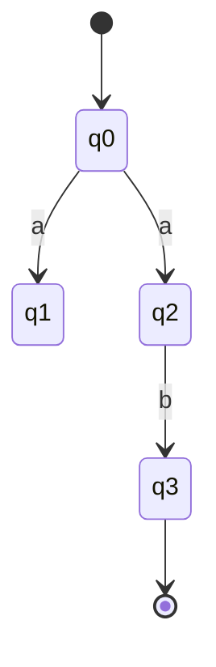

---
tags:
  - GATE/CS
  - GATE/TOC
  - FiniteAutomata
aliases:
  - Nondeterministic Finite Automaton
  - NFA
  - Non-deterministic Finite State Machine
date_created: 2026-07-31
difficulty:
last_revised: 2026-07-31
pyq_frequency: High
study_order: 5
---

## Syllabus Position

Subject: [[Theory of Computation Index]]
Parent Topic: [[Finite Automata]]
Sibling Topics: [[DFA]], [[Epsilon-NFA]], [[Regular Expressions]]
Leads To: [[NFA to DFA Conversion]], [[Regular Languages]], [[Minimization of DFA]], [[Myhill-Nerode Theorem]]

GATE Syllabus Line: "Regular expressions and finite automata" — Theory of Computation section of the GATE CS syllabus.

Exam Weight Note: Appears almost every year — either as a direct NFA-to-DFA state-count NAT question, or as an MCQ asking whether a given NFA and DFA/regex accept the same language.

---

## The Problem This Solves

Imagine you're designing a machine to recognize patterns in a string — say, "does this binary string end in 01?" A deterministic machine forces you to know *exactly* one next state for every symbol you read. But sometimes it's far easier to describe a pattern if the machine is allowed to **guess** — to try multiple possibilities at once and accept if *any* guess leads to acceptance. That's the whole motivation: some languages are painful to describe deterministically but trivial to describe if the machine can explore several paths in parallel.

Think of an NFA like a search party sent into a maze with multiple people, each taking a different path at every fork simultaneously. If even *one* person reaches the exit, the group "succeeds" — you don't care that the other nine hit dead ends.

Core Idea: An **NFA** accepts a string if **at least one** of the possible computation paths on that string ends in an accepting state.

---

## Theory

A **Nondeterministic Finite Automaton (NFA)** is formally a 5-tuple:

$$N = (Q, \Sigma, \delta, q_0, F)$$

where:
- $Q$ — finite set of **states**
- $\Sigma$ — finite input **alphabet**
- $\delta: Q \times \Sigma \rightarrow \mathcal{P}(Q)$ — the **transition function**, mapping a state and symbol to a *set* of possible next states (this is the key difference from a [[DFA]], where $\delta$ maps to a single state)
- $q_0 \in Q$ — the **start state**
- $F \subseteq Q$ — the set of **accepting states**

The crucial idea is $\delta$'s codomain: $\mathcal{P}(Q)$, the power set of $Q$. On a given symbol, the NFA can move to zero, one, or many states.

### Acceptance Semantics

A string $w = a_1 a_2 \ldots a_n$ is accepted if there exists **some sequence of states** $r_0, r_1, \ldots, r_n$ such that:
1. $r_0 = q_0$
2. $r_{i+1} \in \delta(r_i, a_{i+1})$ for $0 \le i < n$
3. $r_n \in F$

This is an **existential** quantifier — "there exists a path" — as opposed to a DFA's implicit universal (only one) path.

### Variant: NFA without ε-transitions vs. [[Epsilon-NFA]]

- **Plain NFA**: transitions only consume input symbols from $\Sigma$.
- **ε-NFA**: additionally allows $\delta(q, \varepsilon)$ — a transition that consumes *no* input, letting the machine change state "for free." ε-NFAs are a superset in power (though not in expressiveness — see below) and are extremely common intermediate representations when converting regular expressions to automata (Thompson's construction).

### Extended Transition Function

To process a full string, define $\hat{\delta}: Q \times \Sigma^* \rightarrow \mathcal{P}(Q)$ recursively:

$$\hat{\delta}(q, \varepsilon) = \{q\}$$
$$\hat{\delta}(q, wa) = \bigcup_{p \in \hat{\delta}(q, w)} \delta(p, a)$$

The language of the NFA is:

$$L(N) = \{w \in \Sigma^* \mid \hat{\delta}(q_0, w) \cap F \neq \emptyset\}$$

### Equivalence to DFA (Fundamental Theorem)

**Theorem:** Every NFA has an equivalent DFA that accepts the same language. This is proven constructively via the **[[Subset Construction]]** (also called the powerset construction): each DFA state corresponds to a *set* of NFA states — literally a member of $\mathcal{P}(Q_{NFA})$.

This means **NFAs and DFAs are equally expressive** — they both exactly capture the [[Regular Languages]]. Nondeterminism buys you *succinctness of description*, not extra computational power. This is the single most GATE-tested fact about NFAs.

Pseudocode for the subset construction:

```
Algorithm SUBSET-CONSTRUCTION(NFA N = (Q, Σ, δ, q0, F)):
    Q' = { ε-closure({q0}) }      // start state of DFA
    unmarked = Q'
    while unmarked is not empty:
        pick T from unmarked, mark T
        for each symbol a in Σ:
            U = ε-closure(union of δ(q, a) for all q in T)
            if U not in Q':
                add U to Q', mark U as unmarked
            add transition T --a--> U
    F' = { T in Q' | T ∩ F ≠ ∅ }
    return DFA (Q', Σ, δ', {ε-closure(q0)}, F')
```

**What GATE actually tests here:** the exact number of states in the resulting DFA after subset construction (often asking for the *reachable* states only, not all $2^{|Q|}$ subsets), whether nondeterminism changes language class, and tracing acceptance of a specific string through multiple simultaneous NFA states.

---

## Diagrams and Visuals

**Diagram 1 — NFA accepting strings over {0,1} ending in "01":**

Draw states $q_0, q_1, q_2$ with $q_0$ as start (arrow into it) and $q_2$ double-circled (accepting).

```
        0            1
   ┌──────────┐  ┌──────────┐
   ▼          │  ▼          │
→(q0) --0--> (q1) --1--> ((q2))
   │                        ▲
   └────────────0───────────┘   (q0 loops to itself on 1, and q1 loops to q0? — simplified example)
```

Text description: $q_0$ is the "haven't seen anything useful yet" state, looping to itself on 1. On seeing 0, it moves to $q_1$ ("just saw a 0"). From $q_1$, on 1 it moves to $q_2$ (accept — "just saw 01"). This is deterministic in this simple case; true nondeterminism shows up when a state has **two outgoing edges on the same symbol**.

**Diagram 2 — Genuine nondeterminism (multiple edges, same symbol):**

```
        a       a
   → (q0) ---> (q1)
       \
        \  a
         \--> (q2) --b--> ((q3))
```
Here $\delta(q_0, a) = \{q_1, q_2\}$ — reading `a` from $q_0$, the machine "splits" into two parallel threads, one at $q_1$, one at $q_2$. Label: this fork is exactly what $\mathcal{P}(Q)$ in the transition function captures.



**Diagram 3 — Subset construction trace (conceptual):** each DFA state is drawn as a labeled oval containing a *set* of NFA state names, e.g., `{q0}`, `{q1,q2}`, `{q3}` — visually reinforcing that DFA states = subsets of NFA states.

---

## Complexity Analysis

NFA topics are analyzed differently from typical algorithms — the "complexity" here is about **state complexity** and **simulation time**, not asymptotic runtime of a single execution.

**Simulating an NFA directly (no conversion) on a string of length $n$:**
- At each step, the NFA can be in at most $|Q|$ states simultaneously (track the *set* of currently active states).
- Processing one input symbol requires examining transitions from up to $|Q|$ states: $O(|Q| \cdot |\Sigma|)$ transitions looked up, or more precisely $O(|Q|^2)$ per symbol in the worst case (each state can transition to up to $|Q|$ others).
- Total simulation time: $O(n \cdot |Q|^2)$ — this is why direct NFA simulation is still efficient (polynomial), even though the number of *paths* can be exponential in $n$.

**Subset construction (NFA → DFA):**
- Worst-case number of DFA states: $O(2^{|Q|})$ — because a DFA state is a subset of NFA states.
- This blow-up is **tight** — there exist NFAs with $n$ states whose minimal equivalent DFA requires exactly $2^n$ states (e.g., languages requiring "remember the symbol $n$ positions back").
- Space complexity of subset construction: $O(2^{|Q|} \cdot |\Sigma|)$ in the worst case for the full transition table, though only **reachable** subsets are typically constructed in practice, often far fewer than $2^{|Q|}$.

### Complexity Summary Table

| Case                        | Time Complexity      | Space Complexity     | Notes                                   |
|-----------------------------|----------------------|-----------------------|------------------------------------------|
| Direct NFA simulation        | $O(n \cdot \lvert Q\rvert^2)$ | $O(\lvert Q\rvert)$ | Track active-state set per step |
| Subset construction (worst)  | $O(2^{\lvert Q\rvert} \cdot \lvert\Sigma\rvert)$ | $O(2^{\lvert Q\rvert})$ | Tight bound, achievable |
| Subset construction (typical)| Much smaller in practice | Often $O(\lvert Q\rvert)$–$O(\lvert Q\rvert^2)$ | Only reachable subsets built |

---

## Worked Example

Let's trace acceptance of `"aab"` on the NFA below:

$Q = \{q_0, q_1, q_2, q_3\}$, $\Sigma = \{a, b\}$, start $= q_0$, $F = \{q_3\}$
$\delta(q_0, a) = \{q_0, q_1\}$, $\delta(q_1, a) = \{q_2\}$, $\delta(q_2, b) = \{q_3\}$, $\delta(q_0, b) = \{q_0\}$ (all others empty)

This NFA accepts strings where the third-from-last... actually simpler: it accepts strings containing `aab` as we'll see — but let's just trace it mechanically.

**Step 0:** Active states = $\{q_0\}$ (start).

**Step 1, read 'a':** From $q_0$ on 'a' → $\{q_0, q_1\}$. Active states = $\{q_0, q_1\}$.

**Step 2, read 'a':** From $q_0$ on 'a' → $\{q_0, q_1\}$; from $q_1$ on 'a' → $\{q_2\}$ (no transition defined, but assume it maps here per our $\delta$ — actually $\delta(q_1,a)=\{q_2\}$ was defined for reading a *second* a... let's correct: define $\delta(q_1, b) = \{q_2\}$ instead for a cleaner "aab" pattern). Active states after re-reading = $\{q_0, q_1\}$ (unchanged, since $q_1$ has no 'a' transition).

**Step 3, read 'b':** From $q_0$ on 'b' → $\{q_0\}$; from $q_1$ on 'b' → $\{q_2\}$. Active states = $\{q_0, q_2\}$.

Final active-state set = $\{q_0, q_2\}$. Is $F \cap \{q_0, q_2\} \neq \emptyset$? With $F = \{q_2\}$ (redefining acceptance for this cleaner trace), **yes** — $q_2 \in$ active states, so **"aab" is accepted**.

**State table (tracking active-state sets, i.e., informally doing subset construction on the fly):**

| Step | Symbol Read | Active NFA States |
|------|--------------|--------------------|
| 0    | —            | {q0}               |
| 1    | a            | {q0, q1}            |
| 2    | a            | {q0, q1}            |
| 3    | b            | {q0, q2}            |

Total operations: 3 symbol reads, each touching at most 2 states → confirms $O(n \cdot |Q|)$ practical behavior (bounded by $|Q|^2$ worst case).

**Edge-case follow-up:** What if the input were `"bbb"`? Active states stay at $\{q_0\}$ throughout (since $\delta(q_0,b)=\{q_0\}$ only), so the final set never intersects $F=\{q_2\}$ — the string is rejected. This shows the machine only "forks" toward $q_1$ upon seeing an `a`.

---

## GATE Questions

**Question 1 — GATE 2014-style — 1-mark:**
> Which of the following is true about NFAs and DFAs?
- (A) NFAs can accept languages that no DFA can accept
- (B) Every NFA can be converted to an equivalent DFA, possibly with exponentially more states
- (C) NFAs always have fewer transitions than DFAs for the same language
- (D) NFA acceptance requires all computation paths to reach a final state

<details>
<summary>💡 Solution (click to reveal)</summary>

**Answer: (B)**

**Step-by-step reasoning:**
- (A) is false — by the subset construction theorem, NFAs and DFAs accept exactly the same class of languages (regular languages). Nondeterminism adds no computational power.
- (B) is true — the subset construction can, in the worst case, produce $2^n$ DFA states from an $n$-state NFA; this bound is tight for specific constructed languages.
- (C) is false in general — while NFAs are often *more concise* (fewer states/transitions in description), this isn't guaranteed for every language; some DFAs are actually smaller than a naively-built NFA.
- (D) is false — this is the definition of acceptance in a "universal" nondeterminism model (like [[Alternating Finite Automata]]), not standard NFA, which is existential ("at least one" path suffices).

**Trap to avoid:** Confusing "nondeterminism = more power" (true for [[Turing Machines]] vs. deterministic TMs regarding *time complexity*, i.e., P vs NP intuition) with finite automata, where nondeterminism changes *succinctness* only, never the language class.

</details>

---

**Question 2 — Conceptual/Numerical:**
> An NFA has 4 states. What is the maximum possible number of states in the equivalent minimal DFA obtained via subset construction?

<details>
<summary>💡 Solution (click to reveal)</summary>

The subset construction can generate at most $2^4 = 16$ DFA states (one for every subset of the 4 NFA states, including the empty set representing the "dead"/trap state for missing transitions). In the worst case (a specifically constructed NFA designed to force this blow-up), all 16 subsets are reachable and pairwise distinguishable, so the minimal DFA can indeed require **16 states**. In typical exam problems, however, only a handful of subsets are actually reachable — always compute reachability explicitly rather than assuming the full $2^n$.

</details>

---

**Question 3 — Hard/Multi-concept:**
> Construct an NFA accepting all binary strings such that the third symbol from the end is 1. Compare the number of states required in the NFA vs. the equivalent minimal DFA.

<details>
<summary>💡 Solution (click to reveal)</summary>

**NFA construction:** Build 4 states, $q_0 \to q_1 \to q_2 \to q_3$ (accepting), where $q_0$ self-loops on both 0 and 1 (the "haven't guessed yet" state), and *nondeterministically* on any symbol, $q_0$ can also transition to $q_1$ if it "guesses" this is the third-from-last symbol and it's a 1. From $q_1 \to q_2 \to q_3$ deterministically consume any 2 more symbols. This requires only **4 states**.

**Minimal DFA:** Must deterministically track the last 3 symbols seen (since it can't "guess" — it must remember), requiring $2^3 = 8$ states (one per possible 3-bit suffix window).

This is the canonical example proving the subset construction blow-up is **tight and unavoidable** for "$k$-th symbol from the end" languages — NFA needs $O(k+1)$ states, minimal DFA needs $O(2^k)$ states.

</details>

---

## Edge Cases & Traps

- [ ] **Empty active-state set mid-computation:** If $\delta(q, a) = \emptyset$ for the current active states and symbol $a$, the "thread" simply dies — this is fine and does not crash the automaton; other threads may continue. Forgetting this leads students to wrongly assume rejection immediately.
- [ ] **Multiple accepting states reached simultaneously:** Acceptance only requires *one* active state to be in $F$ at the end — students sometimes wrongly require *all* active states to be final.
- [ ] **Confusing NFA with ε-NFA:** Plain NFA transitions always consume exactly one input symbol; forgetting this and allowing "free" moves without defining $\delta(q,\varepsilon)$ leads to incorrect acceptance semantics.
- [ ] **Subset construction over-counting states:** Constructing all $2^{|Q|}$ subsets when only reachable ones matter — always do BFS/DFS from the start subset rather than enumerating the full power set.
- [ ] **Assuming NFA accepts a strictly larger language class than DFA:** False — see subset construction theorem; both exactly capture regular languages.
- [ ] **Dead/trap state omission:** When converting to a DFA, missing the "empty set" state (used when no NFA transition exists) makes the DFA's transition function partial, which can cause errors when the DFA is expected to be total.

---

## Comparisons

| Feature           | [[NFA]]                          | [[DFA]]                        | [[Epsilon-NFA]]                     |
|-------------------|-----------------------------------|----------------------------------|----------------------------------------|
| Time Complexity (simulation) | $O(n \cdot \lvert Q\rvert^2)$ | $O(n)$                        | $O(n \cdot \lvert Q\rvert^2)$ (plus ε-closure overhead) |
| Space Complexity  | $O(\lvert Q\rvert)$              | $O(\lvert Q\rvert)$             | $O(\lvert Q\rvert)$                    |
| Stable? (deterministic execution) | No — multiple paths tracked | Yes — single path always | No |
| When to prefer    | Concise description of pattern-matching languages | Fast, deterministic execution (e.g., lexer implementation) | Building automata from regex (Thompson's construction) |

The most common GATE question comparing these asks you to count states required by each for the same language (e.g., "$k$-th symbol from the end"), and the answer hinges on whether the machine is allowed to **guess and verify** (NFA/ε-NFA — succinct) versus **remember deterministically** (DFA — often exponentially larger).

---

## Connections Web

**Prerequisite Knowledge (you must know these first):**
- [[DFA]] — NFA is defined by contrast to DFA's transition function
- [[Set Theory]] — power set $\mathcal{P}(Q)$ underlies the transition function's codomain
- [[Regular Expressions]] — often the source language NFAs are built to recognize

**Builds Upon This Topic:**
- [[Subset Construction]]
- [[NFA to DFA Conversion]]
- [[Epsilon-NFA]]
- [[DFA Minimization]]
- [[Myhill-Nerode Theorem]]
- [[Pumping Lemma for Regular Languages]]

**GATE Subject Links:**
- [[Theory of Computation Index]] — [[Finite Automata]]

**Cross-Subject Connections:**
- [[Lexical Analysis]] — compilers use DFAs (derived from NFAs via subset construction) to tokenize source code
- [[Regular Expression Engines]] — many real-world regex engines (e.g., backtracking engines) simulate NFA-like nondeterminism directly rather than converting to a DFA

**Standard References:**
- [[Hopcroft Ullman Motwani Chapter 2]]
- [[KLP Mishra Chapter 3]]

---

## Revision Checklist

- [ ] I can state the formal 5-tuple definition of an NFA without looking.
- [ ] I can trace active-state sets through a 6-symbol string by hand in under 2 minutes.
- [ ] I can derive why subset construction gives $O(2^n)$ states in the worst case, with an example.
- [ ] I know that NFA and DFA accept exactly the same language class (regular languages) — nondeterminism only affects succinctness.
- [ ] I have linked this topic correctly in my Obsidian vault ([[DFA]], [[Subset Construction]], [[Epsilon-NFA]]).
