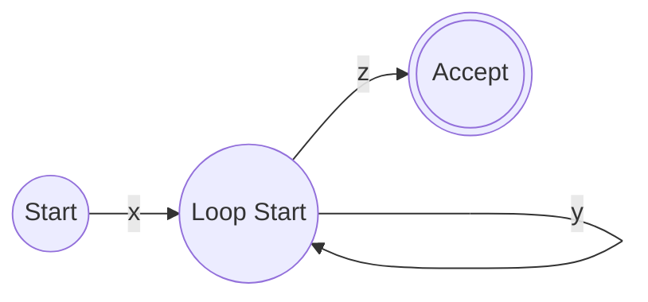

##  Context
**Subject:** [[Theory Of Computation]]
**Parent Topic:** [[Regular Languages Definition]]
**Sibling Topics:** [[Myhill Nerode Theorem]]
**Leads To:** [[Context Free Pumping Lemma]]

>  **GATE Syllabus Mapping:** Regular and context-free languages, pumping lemma.

##  Motivation & Intuition
The **Pumping Lemma** (PL) is like a "necessary condition" for regular languages. Think of it as a **property** that all regular languages have: if a string is long enough, it **must** have a middle section that can be repeated ("pumped") indefinitely while staying in the language.

**Core Idea:** You can use the PL to **disprove** a language is regular, but never to **prove** it. It's a "failing" testif a language fails the PL, it's definitely not regular.

##  Theory
If $L$ is a regular language, then there exists a constant $p$ (the **pumping length**) such that any string $s \in L$ with $|s| \ge p$ can be split into three parts, $s = xyz$, satisfying:
1. $y \neq \epsilon$ ($|y| > 0$)
2. $|xy| \le p$
3. For all $i \ge 0$, $xy^iz \in L$

### Proof Sketch
If $L$ is regular, it has a DFA with $p$ states. If $s$ has length $\ge p$, the path of $s$ in the DFA must visit at least $p+1$ states. By the **Pigeonhole Principle**, at least one state must be visited twice (a **loop**). Let $x$ be the string leading to the loop, $y$ be the string forming the loop, and $z$ be the rest. Since $y$ is a loop, we can traverse it any number of times.

##  Diagrams & Visuals

*   **x**: The "prefix" that gets to the loop.
    **y**: The "pumpable" loop part.
    **z**: The "suffix" that gets to the accept state.

##  Complexity Analysis
This is a mathematical property. In GATE, the complexity lies in **choosing the right string** and **showing a contradiction**.

##  Worked Example
**Prove $L = \{a^n b^n \mid n \ge 0\}$ is NOT regular.**
1. **Assume $L$ is regular.** Let $p$ be the pumping length.
2. **Choose string $s = a^p b^p$.** Clearly $s \in L$ and $|s| \ge p$.
3. **Analyze $s = xyz$ splits:**
   - Since $|xy| \le p$, $x$ and $y$ must consist only of $a$'s.
   - Let $y = a^k$ where $k > 0$ (since $|y| > 0$).
4. **Pump $i = 2$:** $xy^2z = a^p a^k b^p = a^{p+k} b^p$.
5. **Contradiction:** $a^{p+k} b^p \notin L$ because $p+k \neq p$. 
6. **Conclusion:** $L$ is NOT regular.

##  GATE Questions
**Question:** Which of the following can be pumped to show non-regularity for $L = \{a^{n^2} \mid n \ge 0\}$?
(A) $a^p$
(B) $a^{p^2}$
(C) $a^n$
(D) $a^{2p}$

 Solution

**Answer: (B)**
String $s = a^{p^2}$ is a perfect candidate because $|s| = p^2 \ge p$. 
Let $s = xyz$, where $|y| = k \le p$. 
If we pump $i=2$, $|xy^2z| = p^2 + k$.
Since $k \le p$, the next square is $(p+1)^2 = p^2 + 2p + 1$. 
The new length $p^2 + k$ is strictly less than $(p+1)^2$ (because $k \le p < 2p+1$).
Thus, $p^2 < p^2 + k < (p+1)^2$. The pumped length is **not a perfect square**. Contradiction!

##  Edge Cases & Traps
- [ ] **PL is NOT for proving:** If a language satisfies the PL, it might still be non-regular (e.g., $L = \{a^n b^n c^n\} \cup \{a, b, c\}^*$). Use [[Myhill Nerode Theorem]] for proof.
- [ ] **Wrong $s$ choice:** Don't pick a string shorter than $p$.
- [ ] **$|xy| \le p$ is key:** It restricts where $y$ can be in the string.

##  Comparisons
| Method | For Proving Regular | For Disproving Regular |
|--------|---------------------|------------------------|
| FA Construction |  YES |  NO |
| Pumping Lemma |  NO |  YES |
| Myhill-Nerode |  YES |  YES |

##  Memory Hooks
- **Acronym:** **XYZ** (eXtract, Yield, Zap/Pump).
- **Mnemonic:** "If it's Regular, it has a Loop (y)."
- **Trap:** Never say "L is regular because it satisfies Pumping Lemma."

##  Connections Web
- [[Regular Languages Definition]]  The property applies to these.
- [[Context Free Pumping Lemma]]  A more powerful version for CFLs.
- [[Dfa Deterministic Finite Automata]]  The proof basis.

##  Revision Checklist
- [ ] I can state the 3 conditions of PL.
- [ ] I can prove $a^n b^n$ is non-regular in under 1 minute.
- [ ] I understand that $|xy| \le p$ means $y$ is near the start.
