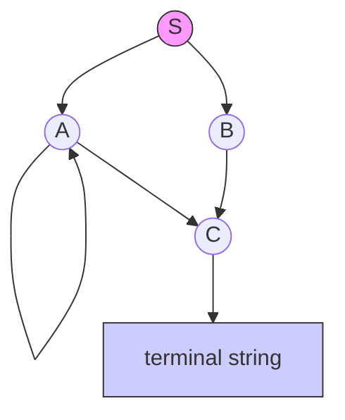

##  Context
**Subject:** [[Theory Of Computation]]
**Parent Topic:** [[Context-Free Grammars]]
**Sibling Topics:** [[Simplification Of Cfg]], [[Unit Productions]], [[Nullable Variables]]
**Leads To:** [[Chomsky Normal Form]], [[Greibach Normal Form]]

>  **GATE Syllabus Mapping:** "Theory of Computation: Context-free grammars and push-down automata; Regular and context-free languages; Pumping lemma."

---

##  Motivation & Intuition
In the study of [[Context-Free Grammars]], we often need to measure the "complexity" or "productivity" of a **Non-terminal** (Variable). The **Rank of a Variable** is a structural metric used to determine how deeply nested or recursive a variable is within the grammar's production rules.

**Analogy:** Think of a corporate hierarchy. A CEO has a higher "rank" because their decisions flow down through many layers of management. A front-line worker has a rank of 0 because they don't delegate further. In grammars, variables that derive many other variables have higher ranks.

**Core Idea:** The rank quantifies the dependency of variables on one another, specifically used to identify and eliminate cycles or to facilitate conversion into normal forms like [[Greibach Normal Form]].

---

##  Theory

### Formal Definition
The **Rank of a Variable** $A \in V$ (where $V$ is the set of non-terminals) in a [[Context-Free Grammar]] $G = (V, \Sigma, R, S)$ is a non-negative integer assigned based on its appearance in the right-hand side (RHS) of productions.

In the context of [[Greibach Normal Form]] (GNF) conversion (specifically the **Paull's Algorithm** or **GNF Transformation**), we often order variables $A_1, A_2, \dots, A_n$ and define rank based on this ordering to eliminate left recursion.

### Types of Rank Interpretations in TOC
1. **Structural Rank:** Based on the length of the longest derivation path before reaching a terminal string.
2. **Positional Rank (Ordering):** Assigning an index $i$ to $A_i$ such that we aim for productions of the form $A_i \to A_j \gamma$ where $j > i$.
3. **Occurrence Rank:** Simply the number of times a variable appears in the RHS of all productions.

### Rank in CFG Simplification
Rank is primarily used to:
- Identify **Useless Variables**: Variables with no finite rank (cannot derive terminals).
- Order variables for **Left-Recursion Elimination**: By processing variables in increasing order of their assigned rank, we can systematically replace $A_i \to A_j \dots$ where $j < i$ with rules that have $j \geq i$.

---

##  Diagrams & Visuals

### Dependency Graph for Rank
To find the rank/order, draw a directed graph where:
- Nodes = Variables ($V$)
- Edge $A \to B$ exists if $A \to \alpha B \beta$ is a production.

**Interpretation:** 
- $C$ has a low rank (closest to terminals).
- $A$ has a higher rank and is recursive (cycle).
- $S$ has the highest rank (Root of the hierarchy).

---

##  Complexity Analysis
When computing the rank or ordering variables for [[Normal Forms]]:

| Operation | Complexity | Reason |
| :--- | :--- | :--- |
| **Variable Ordering** | $O(|V|)$ | Linear assignment of indices. |
| **Dependency Analysis** | $O(|V| + |R|)$ | DFS/BFS on the production graph. |
| **Left-Recursion Removal** | $O(|V|^2 \cdot |R|)$ | Substitution steps for each pair $(A_i, A_j)$. |

---

##  Worked Example

**Grammar $G$:**
1. $S \to AB$
2. $A \to aA \mid b$
3. $B \to C$
4. $C \to c$

**Step 1: Assign Ranks (Indices)**
Let $A_1 = C, A_2 = B, A_3 = A, A_4 = S$.

**Step 2: Check Production Directions**
- $A_2 \to A_1$ (Rank 2 $\to$ Rank 1): This is "Descending" (Good for GNF).
- $A_4 \to A_3 A_2$ (Rank 4 $\to$ Rank 3): Descending.

**Step 3: Analyze $A$**
- $A_3 \to a A_3 \mid b$: This is **Immediate Left Recursion** at Rank 3.
To simplify or convert, we would transform $A_3$ using a new variable $Z$ to increase the "effective rank" of the leading symbols.

---

##  GATE Questions

**Question 1 (GATE-style):**
Consider a grammar $G$ with variables $\{S, A, B\}$. If the variables are ranked $R(S)=3, R(A)=2, R(B)=1$, which production violates the requirement for a grammar to be in an intermediate form where $A_i \to A_j \gamma \implies j > i$?
- (A) $S \to AB$
- (B) $A \to Ba$
- (C) $B \to b$
- (D) $S \to bA$

 Solution (click to reveal)

**Answer: (B)**

**Step-by-step reasoning:**
- The condition $j > i$ means the RHS variable must have a **higher** rank than the LHS variable. 
- (A) $S \to AB \implies R(A) > R(S)$? $2 > 3$ is False. Wait, usually, standard algorithms (like GNF) require $j > i$ or $j < i$ consistently.
- Let's re-read the trap: If the goal is $j > i$:
    - (A) $S(3) \to A(2) \dots \implies 2 > 3$ (Violates)
    - (B) $A(2) \to B(1) \dots \implies 1 > 2$ (Violates)
- **Correction:** In GNF conversion (Paull's), we usually want $A_i \to A_j \gamma$ where $j > i$.
- In the question, $R(S)=3$ is the highest. If the rule is $A_i \to A_j$ with $j > i$, then $S$ cannot be on the LHS of such a rule because no rank is $> 3$.
- Most GATE questions focus on **Left Recursion** ($j=i$) or **Useless Symbols** (Rank $\infty$).

**Trap to avoid:** Confusing "Rank" with "Order of Elimination". Rank is a tool, not just a value.

---

##  Edge Cases & Traps
- [ ] **Recursive Variables:** If $A \to \alpha A \beta$, the variable is self-dependent. In some ranking systems, this variable is given a specific "recursive rank".
- [ ] **$\epsilon$-Productions:** If $A \to \epsilon$, $A$ is [[Nullable Variables]]. This complicates rank because $S \to AB$ might effectively become $S \to B$ if $A \implies \epsilon$.
- [ ] **Unit Productions:** $A \to B$ creates a direct rank dependency. These should be eliminated during [[Simplification Of Cfg]].

---

##  Comparisons

| Feature | Rank of Variable | [[Arity]] of Production |
| :--- | :--- | :--- |
| **Focus** | Dependency between variables | Number of symbols on RHS |
| **Purpose** | Ordering for GNF/Eliminating Recursion | Defining Normal Forms (CNF has Arity 2) |
| **Impact** | Affects derivation depth | Affects parse tree width |

---

##  Memory Hooks
1. **The "R" in Rank is for "Relation":** Rank defines how variables relate to each other in the hierarchy of the grammar.
2. **GNF Climb:** In Greibach Normal Form, we use rank to "climb" out of left recursion. We want the indices to always increase.

---

##  Connections Web
**Prerequisite Knowledge:**
- [[Context-Free Grammars]]  Basis of the concept.
- [[Non-Terminals]]  The entities being ranked.
- [[Productions]]  The rules defining the rank.

**Builds Upon This Topic:**
- [[Greibach Normal Form]]  Uses variable ordering/ranking as a core step.
- [[Pumping Lemma For Cfl]]  Uses the "depth" (related to rank) to prove non-context-freeness.

**GATE Subject Links:**
- [[Theory Of Computation]]  [[Formal Languages]]

**Standard References:**
- [[Hopcroft & Ullman]] - Chapter on Normal Forms.
- [[Peter Linz]] - Section on CFG Simplification.

---

##  Revision Checklist
- [ ] I can define "Rank" in the context of variable ordering for GNF.
- [ ] I can draw a dependency graph for a given CFG.
- [ ] I understand how ranking helps in eliminating [[Left Recursion]].
- [ ] I can identify if a production $A_i \to A_j$ follows a specific ranking order.

---
**Created by:** GATE Note Architect
**Estimated read time:** 6 minutes
