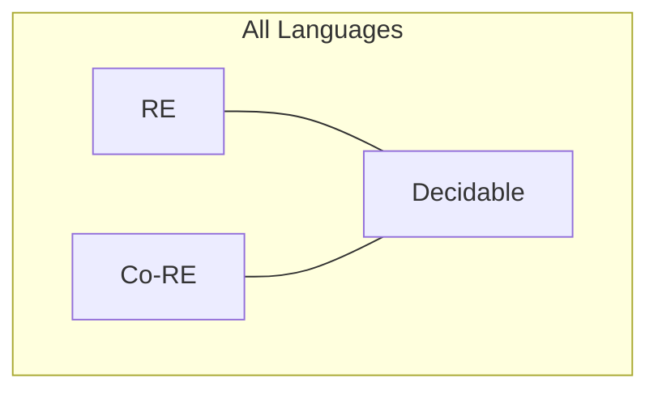

##  Context
**Subject:** [[Theory Of Computation Index]]
**Parent Topic:** [[Turing Machines]]
**Sibling Topics:** [[Decidability Core Definition]], [[Undecidability In Toc]], [[Chomsky Hierarchy]]
**Leads To:** [[Rices Theorem]], [[Post Correspondence Problem]]

>  **GATE Syllabus Mapping:** Recursive and Recursively Enumerable languages.

---

##  Motivation & Intuition
If a [[Decidability Core Definition|Decidable]] language is a computer that says "Yes" or "No," a **Recursively Enumerable (RE)** language is a computer that says "Yes" when it finds the answer, but if the answer is "No," it might search forever.

**Analogy:** Finding a lost key in a bottomless pit.
1. If the key is there (Input $\in L$), you will eventually find it and shout "Accept!"
2. If the key is not there (Input $\notin L$), you could spend an eternity searching without ever knowing if the key is just a few feet deeper.

**Core Idea:** A language is **RE** if there exists a [[Turing Machines]] that **halts and accepts** for all strings in the language.

---

##  Theory

### 1. Formal Definition
A language $L$ is **Recursively Enumerable** if there exists a TM $M$ such that for every input string $w$:
- If $w \in L$, then $M$ **halts and accepts**.
- If $w \notin L$, then $M$ either **halts and rejects** OR **loops forever**.

### 2. RE vs. Co-RE
- **RE (Recursively Enumerable):** "Yes" instances are semi-decidable.
- **Co-RE:** "No" instances are semi-decidable (complement $\bar{L}$ is RE).
- **Decidable (Recursive):** Both "Yes" and "No" instances are decidable ($L \in RE \cap Co-RE$).

### 3. Enumerators (The Name Source)
A language is RE if it can be **enumerated** by a machine. An **Enumerator** is a TM with a "printer" that starts with an empty tape and prints out every string in $L$, one by one (possibly with repetitions).

---

##  Diagrams & Visuals

### RE/Co-RE Venn Diagram

**Description:**
- The intersection of RE and Co-RE is exactly the set of **Decidable** (Recursive) languages.
- Outside the intersection but inside RE are languages like the Halting Problem ($A_{TM}$).
- Outside both are "Neither RE nor Co-RE" languages (like $EQ_{TM}$).

---

##  Complexity Analysis
- For RE languages, there is **no upper bound** on the time it takes to accept.
- If $L \in RE$ and $L \notin \text{Decidable}$, then $L$ is **Undecidable**.
- **Closure Properties:** RE languages are closed under **Union, Intersection, Concatenation, and Kleene Star**, but NOT under **Complement**.

---

##  Worked Example: Proving $A_{TM}$ is RE
$A_{TM} = \{ \langle M, w \rangle \mid M \text{ is a TM that accepts } w \}$

**The RE Machine $U$ (Universal TM):**
1. Input: $\langle M, w \rangle$.
2. Simulate $M$ on $w$.
3. If $M$ accepts $w$, **Accept**.
4. If $M$ rejects $w$, **Reject**.
5. If $M$ loops, $U$ will loop.

**Result:** Since $U$ accepts if $\langle M, w \rangle \in A_{TM}$, $A_{TM}$ is RE. It is undecidable because it may loop on non-members.

---

##  GATE Questions

**Question 1 (GATE-2008):**
Let $L_1$ be a recursive language and $L_2$ be a recursively enumerable language. Which of the following is NOT necessarily RE?
- (A) $L_1 \cup L_2$
- (B) $L_1 \cap L_2$
- (C) $L_2 - L_1$
- (D) $L_1 - L_2$

 Solution (click to reveal)

**Answer: (D)**

**Reasoning:**
- Recursive ($L_1$) is also RE.
- RE is closed under Union and Intersection (A, B).
- $L_2 - L_1 = L_2 \cap \bar{L_1}$. Since $L_1$ is recursive, $\bar{L_1}$ is recursive (and RE). RE $\cap$ RE is RE (C).
- $L_1 - L_2 = L_1 \cap \bar{L_2}$. Since $L_2$ is only RE, $\bar{L_2}$ is **Co-RE**, not necessarily RE. Thus, their intersection is not necessarily RE.

---

##  Edge Cases & Traps
- [ ] **Recursive is always RE**: Don't treat them as mutually exclusive.
- [ ] **Complement Rule**: If $L$ is RE, its complement $\bar{L}$ is RE **only if** $L$ is decidable.
- [ ] **Halting Problem**: The language of all TMs that halt on all inputs is **Not RE**.

---

##  Comparisons

| Property | Recursive (Decidable) | Recursively Enumerable (RE) |
| :--- | :--- | :--- |
| **Halts on $w \in L$** | Yes | Yes |
| **Halts on $w \notin L$** | Yes | **May loop** |
| **Closed under Complement** | Yes | **No** |
| **Machine type** | Decider (Total TM) | Standard TM |

---

##  Memory Hooks
- **"RE = Real Endless"**: It can search forever.
- **"RE = Recognizable"**: You recognize "Yes," but you might ignore "No."
- **The Shortcut:** If you can write a simulator for it, it's RE.

---

##  Connections Web
- [[Turing Machines]] $\rightarrow$ The recognizer for RE.
- [[Decidability Core Definition]] $\rightarrow$ The "better" subset of RE.
- [[Undecidability In Toc]] $\rightarrow$ RE languages that aren't Decidable.
- [[Theory Of Computation Index]] $\rightarrow$ Roadmap.

---

##  Revision Checklist
- [ ] I can define RE and Co-RE.
- [ ] I know why $L \in RE \text{ and } \bar{L} \in RE \implies L \in \text{Recursive}$.
- [ ] I understand why RE is not closed under complement.
- [ ] I have linked this to the [[Theory Of Computation Index]].

---
 Note created: Recursively_Enumerable_Languages.md
   Sections: 13/13 complete
   Wiki Links: 15 found
   Estimated read time: 6 minutes
